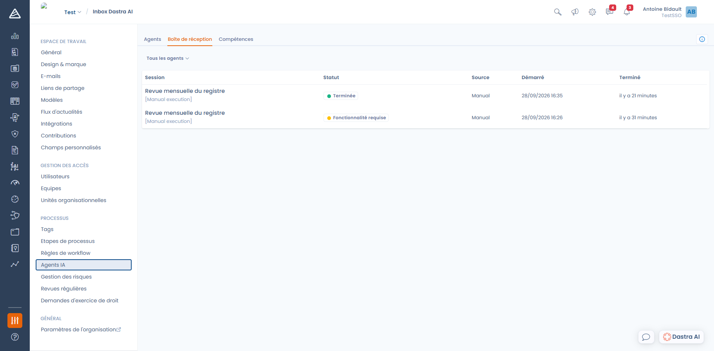
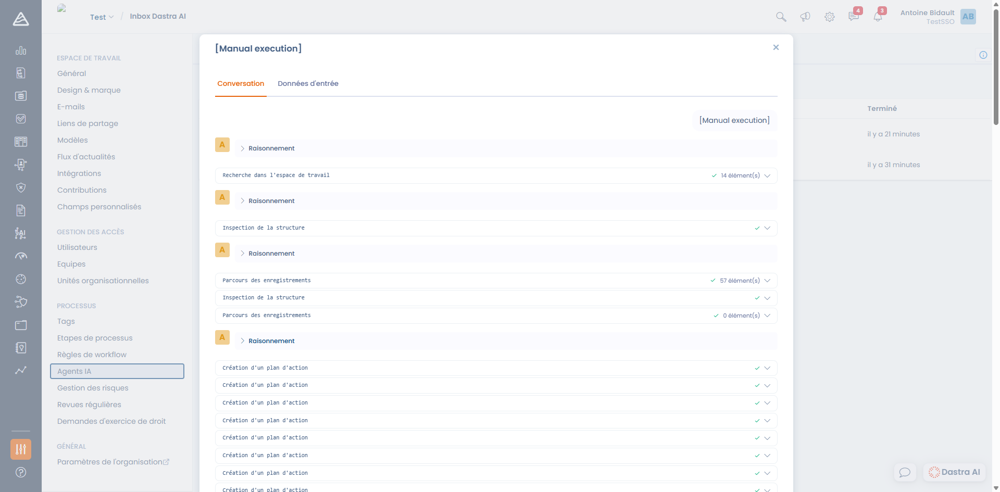

# Suivre les exécutions

La **boîte de réception** rassemble l'historique des exécutions de vos agents : ce qui a été lancé, par quoi, quand, et avec quel résultat.

Elle se trouve dans **Réglages espace de travail > Agents IA > Boîte de réception**.

<figure><figcaption>
La boîte de réception, avec le statut et la source de chaque exécution
</figcaption></figure>

Chaque ligne indique la **session**, son **statut**, sa **source** (Manuel, Planning ou Workflow), l'heure de **démarrage** et l'heure de **fin**. Le sélecteur en haut de la liste permet de n'afficher que les exécutions d'un agent donné.

Les exécutions en cours se mettent à jour en direct : inutile de rafraîchir la page.

***

### Le détail d'une exécution

Cliquez sur une ligne pour ouvrir le détail. Il comporte deux onglets :

* **Conversation** — le déroulé complet : le raisonnement de l'agent, les outils qu'il a appelés, et sa réponse finale.
* **Données d'entrée** — les valeurs des champs de saisie avec lesquelles l'exécution a été lancée.

<figure><figcaption>
Le détail d'une exécution
</figcaption></figure>

Le bouton **Continuer dans le chat** reprend le résultat de l'exécution dans une nouvelle conversation. C'est la façon la plus simple de creuser un résultat, de demander une reformulation ou de faire corriger quelque chose.

***

### Les statuts

Certains statuts sont techniques, d'autres sont **déclarés par l'agent lui-même** à la fin de son travail : ce sont des conclusions, pas des pannes.

| Statut | Signification |
| --- | --- |
| **En cours** | L'exécution est en train de se dérouler |
| **Terminée** | L'agent est allé au bout de sa mission |
| **Échouée** | Une erreur technique a interrompu l'exécution ; le message d'erreur est affiché dans le détail |
| **Revue humaine requise** | L'agent a fait son travail mais estime qu'une validation est nécessaire avant d'aller plus loin |
| **Permissions insuffisantes** | L'agent a manqué de droits pour accéder à une donnée ou effectuer une action |
| **Fonctionnalité requise** | Une fonctionnalité nécessaire n'est pas incluse dans l'offre de l'organisation |
| **Informations manquantes** | Les données disponibles ne permettaient pas de mener la mission à son terme |
| **Exécution incomplète** | L'agent a atteint la limite d'itérations d'outils avant de conclure |
| **Limite de contexte atteinte** | La conversation est devenue trop longue pour le modèle |


Un statut **Informations manquantes** ou **Revue humaine requise** revient souvent à revoir l'instruction de l'agent ou la liste de ses outils : il a fait ce qu'il pouvait avec ce qu'on lui a donné. Le détail de l'exécution explique généralement ce qui lui a manqué.


***

### Notifications

Si vous figurez parmi les **utilisateurs notifiés** d'un agent, vous recevez une notification Dastra à la fin de chaque exécution, réussie ou en échec. C'est la façon recommandée de surveiller un agent planifié sans avoir à consulter la boîte de réception.

### Journal technique

Pour un suivi au niveau de l'organisation — modèle utilisé, durée, utilisateur à l'origine de l'appel — consultez les **logs d'exécution de l'assistant IA** dans **Paramètres de l'organisation > Assistant IA**. Ils sont conservés 90 jours.
