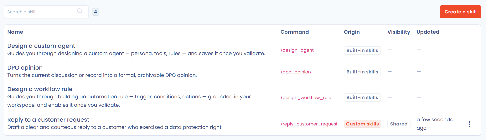

# Les compétences

Une **compétence** est une instruction que vous enregistrez une fois et que vous rappelez ensuite d'une commande, en tapant `/` dans la conversation. C'est l'équivalent d'un modèle de prompt partagé par toute l'organisation.

Les compétences se gèrent dans **Automatisation** > **Dastra AI** > **Compétences**.

<figure><figcaption>
L'onglet Compétences, avec les compétences intégrées de Dastra
</figcaption></figure>

***

### Les compétences intégrées

Dastra fournit trois compétences, disponibles dans tous les espaces de travail et non modifiables :

| Commande | Ce qu'elle fait |
| --- | --- |
| `/design_agent` | Vous accompagne dans la conception d'un agent personnalisé (persona, outils, règles) et l'enregistre une fois que vous l'avez validé. C'est ce que déclenche l'option **Générer avec Dastra AI** de l'écran de création d'un agent. |
| `/dpo_opinion` | Transforme la discussion en cours, ou la fiche consultée, en un avis DPO formel et archivable. |
| `/design_workflow_rule` | Vous accompagne dans la construction d'une règle de workflow (déclencheur, conditions, actions) à partir de votre espace de travail, et l'active une fois que vous l'avez validée. |

### Créer votre propre compétence

Cliquez sur **Créer une compétence**, puis renseignez :

* **Nom** : le libellé affiché dans la liste des commandes (120 caractères au plus).
* **Commande** : le texte tapé après le `/`. Lettres minuscules, chiffres et tirets bas, en commençant par une lettre, et **unique dans l'organisation** : par exemple `synthese_comite`.
* **Description** : une phrase expliquant quand l'utiliser, affichée à côté de la commande dans le chat (1000 caractères au plus).
* **Prompt** : l'instruction envoyée à l'assistant, jusqu'à 10 000 caractères.
* **Partager avec l'organisation** : lorsque cette option est activée, tous les membres de votre organisation voient la compétence, dans tous les espaces de travail. Sinon, vous seul pouvez l'utiliser. La liste indique chaque compétence comme **Partagée** ou **Privée**.

### Utiliser une compétence

Dans une conversation Dastra AI, tapez `/` ou cliquez sur **Compétences** : la liste des compétences disponibles s'affiche, avec les **Compétences intégrées** et vos **Compétences personnalisées**. Sélectionnez-en une, complétez votre message si nécessaire, puis envoyez. Un message applique au plus cinq compétences.


Une compétence s'applique à la conversation en cours, avec l'agent et le mode (Question ou Édition) actuellement sélectionnés. Une compétence qui doit modifier des fiches nécessite donc le mode Édition.


Créer, modifier ou supprimer une compétence demande le niveau modification de la permission **Agents IA personnalisés**, mais pas l'option d'offre « agents personnalisés ». Utiliser une compétence ne demande que l'accès à l'assistant. La liste **Compétences** du menu apparaît avec les autres entrées des agents personnalisés. Depuis le sous-menu **Compétences** de la zone de message, vous pouvez aussi créer une compétence (**Créer une compétence**), ou modifier et supprimer les vôtres, sans quitter le chat.

***

### Compétence ou agent ?

Les deux servent à capitaliser sur une instruction, mais pas au même moment :

* Une **compétence** est ponctuelle. Vous la déclenchez au milieu d'une conversation, sur le contexte du moment.
* Un **agent** est permanent. Il a sa propre identité, ses propres outils, et le cas échéant son propre planning.

Si vous retapez sans cesse la même demande, créez une compétence. Si vous voulez un interlocuteur spécialisé ou une tâche automatisée, créez un [agent](README.md).
