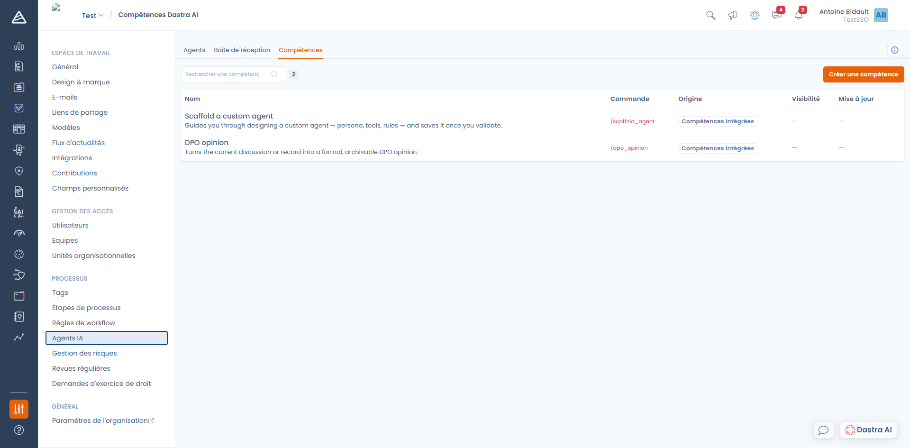

# Les compétences

Une **compétence** est une instruction que vous enregistrez une fois et que vous rappelez ensuite d'une commande, en tapant `/` dans la conversation. C'est l'équivalent d'un modèle de prompt partagé par toute l'organisation.

Les compétences se gèrent dans **Réglages espace de travail > Agents IA > Compétences**.

<figure><figcaption>
L'onglet Compétences, avec les compétences intégrées de Dastra
</figcaption></figure>

***

### Les compétences intégrées

Dastra fournit deux compétences, disponibles dans tous les espaces de travail et non modifiables :

| Commande | Ce qu'elle fait |
| --- | --- |
| `/scaffold_agent` | Vous accompagne dans la conception d'un agent personnalisé — persona, outils, règles — et l'enregistre une fois que vous l'avez validé. C'est ce que déclenche l'option **Générer avec Dastra AI** de l'écran de création d'un agent. |
| `/dpo_opinion` | Transforme la discussion en cours, ou la fiche consultée, en un avis DPO formel et archivable. |

### Créer votre propre compétence

Cliquez sur **Créer une compétence**, puis renseignez :

* **Nom** — le libellé affiché dans la liste des commandes.
* **Commande** — le texte tapé après le `/`. En minuscules, avec des tirets bas, et **unique dans l'organisation** : par exemple `synthese_comite`.
* **Description** — une phrase expliquant quand l'utiliser. Elle s'affiche à côté de la commande dans le chat.
* **Prompt** — l'instruction envoyée à l'assistant, jusqu'à 10 000 caractères.
* **Visibilité** — gardez la compétence pour vous, ou partagez-la avec les autres membres de l'espace de travail.

### Utiliser une compétence

Dans une conversation Dastra AI, tapez `/` : la liste des compétences disponibles s'affiche. Sélectionnez-en une, complétez votre message si nécessaire, puis envoyez.


Une compétence s'applique à la conversation en cours, avec l'agent et le mode (Question ou Édition) actuellement sélectionnés. Une compétence qui doit modifier des fiches nécessite donc le mode Édition.


***

### Compétence ou agent ?

Les deux servent à capitaliser sur une instruction, mais pas au même moment :

* Une **compétence** est ponctuelle. Vous la déclenchez au milieu d'une conversation, sur le contexte du moment.
* Un **agent** est permanent. Il a sa propre identité, ses propres outils, et le cas échéant son propre planning.

Si vous retapez sans cesse la même demande, créez une compétence. Si vous voulez un interlocuteur spécialisé ou une tâche automatisée, créez un [agent](README.md).
