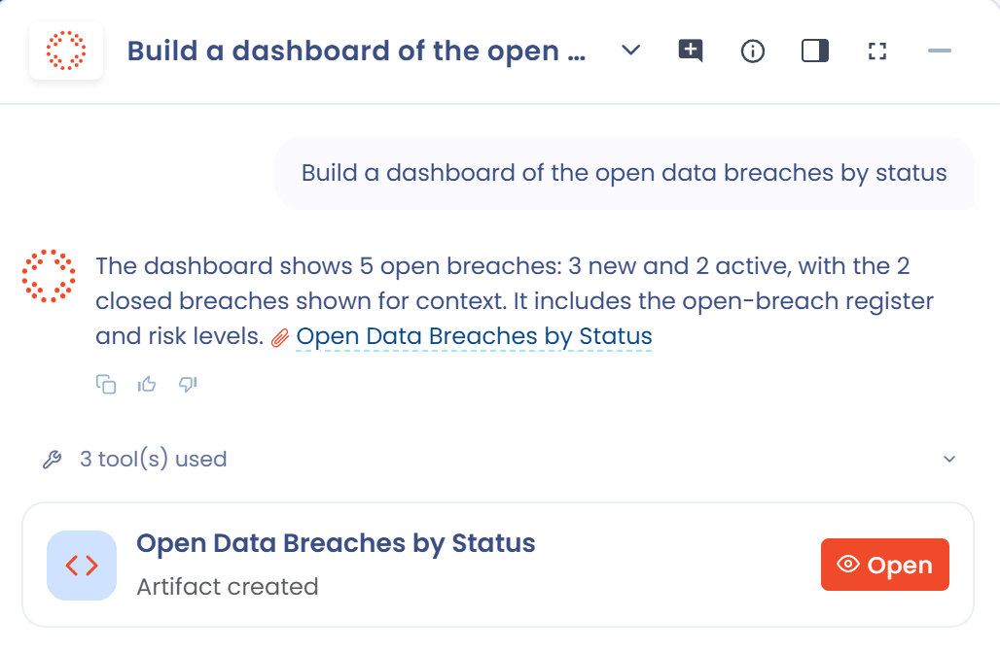
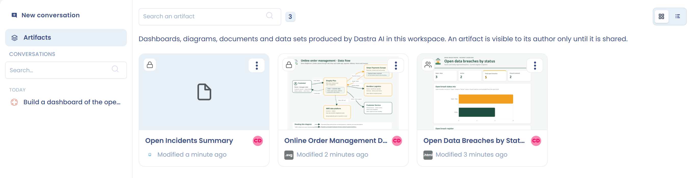
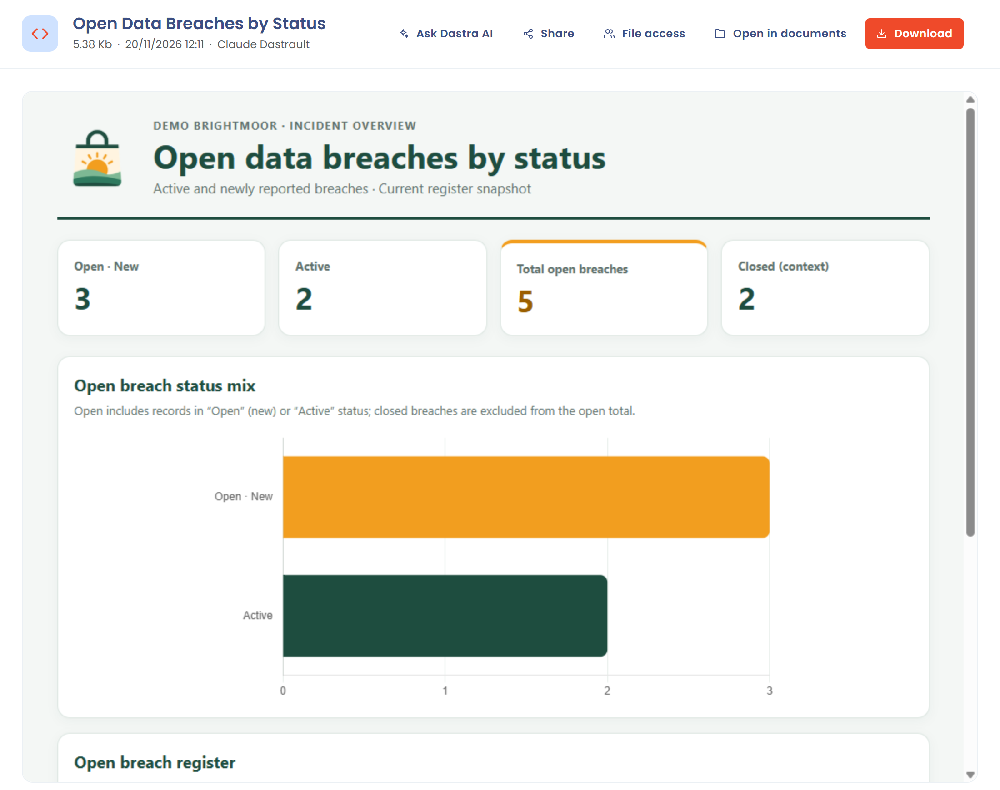

# Artefacts

Un artefact est un fichier que Dastra AI rédige à l'issue d'une conversation : un tableau de bord, un schéma, un document ou un export de données. Les artefacts s'adressent à toute personne qui utilise [Dastra AI](README.md) pour préparer un rapport ou un document de travail à partir des données d'un espace de travail.

## Ce qu'un artefact peut être

Dastra AI crée un artefact dans l'un de ces formats :

| Format | Usage courant |
| --- | --- |
| Page HTML | Un tableau de bord, un graphique ou une page interactive |
| SVG | Un schéma |
| Markdown ou texte | Un document, une note, une synthèse |
| JSON ou CSV | Un jeu de données |

Lorsque l'assistant construit un fichier avec l'exécution de code, ou exporte des fiches, le résultat est aussi enregistré comme artefact, dans un format tableur, Word, PowerPoint, PDF ou image. L'exécution de code n'est pas disponible sur toutes les instances.

## Créer un artefact

1. Ouvrez Dastra AI et décrivez ce que vous voulez : « Construis un tableau de bord des violations de données ouvertes par statut » ou « Dessine le flux de données de ce traitement sous forme de schéma ».
2. L'assistant rassemble les données dont il a besoin avec vos permissions, puis affiche une carte avec le titre de l'artefact et le bouton **Ouvrir**. La carte indique **Artefact créé**.

<figure><figcaption>
La carte d'un artefact, avec le bouton Ouvrir
</figcaption></figure>

3. Cliquez sur **Ouvrir** pour voir le résultat sur sa propre page.
4. Demandez des modifications dans la même conversation. L'assistant met à jour le même artefact au lieu d'en créer un second, et la carte indique **Artefact mis à jour**.

Un artefact est la réponse de l'assistant, pas une modification de vos fiches. Il ne nécessite ni le mode Édition ni autorisation. Un tableau de bord reprend le nom, le logo et les couleurs de votre espace de travail.


Un artefact HTML montre les données telles qu'elles étaient au moment où l'assistant l'a construit. Pour l'actualiser, demandez à l'assistant de mettre l'artefact à jour.


## Retrouver vos artefacts

Les artefacts sont listés dans la section **Dastra AI** du menu **Automatisation** :

1. Ouvrez **Automatisation** > **Dastra AI** > **Conversations**.
2. Cliquez sur **Artefacts**, sous **Nouvelle conversation**, dans la liste de gauche.

Depuis le panneau, l'entrée **Mes artefacts** du menu **+** ouvre la même liste.

La liste affiche chaque artefact sous forme de carte ou de ligne de tableau : choisissez **Vue exhaustive** ou **Vue simplifiée**. Utilisez **Rechercher un artefact** pour filtrer par nom. Le tableau indique le créateur, la date de dernière mise à jour, la taille et la visibilité.

<figure><figcaption>
Les artefacts de l'espace de travail, avec leur visibilité
</figcaption></figure>

La liste suit les permissions du module Documents : vous ne voyez que les artefacts que vous pouvez ouvrir. Lorsqu'elle est vide, le bouton **Demander à Dastra AI** démarre une conversation.

## Visibilité et partage

Un artefact n'est visible que par son auteur, et par les propriétaires de l'espace de travail, tant qu'il n'est pas partagé. L'icône de visibilité de la liste indique où il en est :

* **Son créateur uniquement (et les propriétaires du workspace)** ;
* **Partagé avec des utilisateurs ou des équipes** ;
* **Visible par tout le workspace**.

Pour ouvrir un artefact à d'autres personnes, utilisez les actions de sa page ou le menu de sa ligne :

* **Partager** ouvre la fenêtre de partage du module Documents. Elle nécessite la permission d'écriture avancée.
* **Droits d'accès à l'élément** définit qui peut ouvrir le fichier, par utilisateur ou par équipe. Elle nécessite la permission de gérer les pièces jointes.


Un artefact peut contenir des données que l'assistant a lues dans votre espace de travail, y compris des données personnelles. Vérifiez son contenu avant de le partager.


## Travailler avec un artefact

<figure><figcaption>
La page d'un artefact : aperçu et actions
</figcaption></figure>

Sur la page d'un artefact, vous pouvez :

* **Demander à Dastra AI** : démarre une nouvelle conversation avec l'artefact comme contexte, pour demander une réécriture ou une nouvelle version.
* **Ouvrir dans les documents** : affiche le fichier dans le module Documents.
* **Télécharger** : enregistre le fichier sur votre ordinateur.

Un artefact HTML s'exécute dans un cadre isolé. Un lien vers une fiche l'ouvre dans un nouvel onglet.

## Où sont stockés les artefacts

Les artefacts sont des fichiers du module Documents de l'espace de travail, dans le dossier **AI Artifacts**. Ils suivent les règles de tout fichier :

* **Déplacer dans la corbeille**, dans le menu de la ligne, envoie l'artefact dans la corbeille du module Documents.
* Supprimer une conversation supprime ses messages et les fichiers qui y sont joints, mais jamais les artefacts qu'elle a produits : un même artefact peut être modifié depuis plusieurs conversations. Placez un artefact dans la corbeille depuis sa page ou depuis le dossier **AI Artifacts** du module Documents.
* Dastra AI peut les retrouver : demandez-lui de lister les artefacts de l'espace de travail.

***


[assistant-ia.md](README.md)



[serveur-mcp.md](mcp.md)

