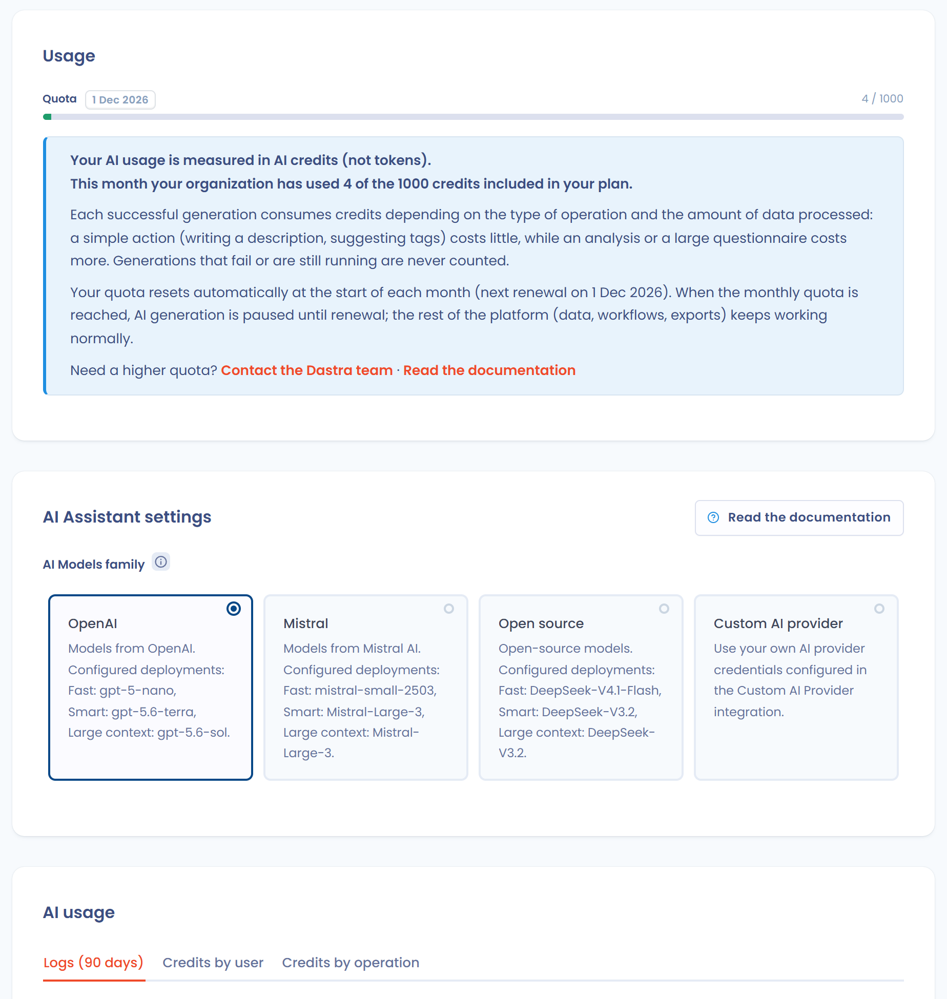
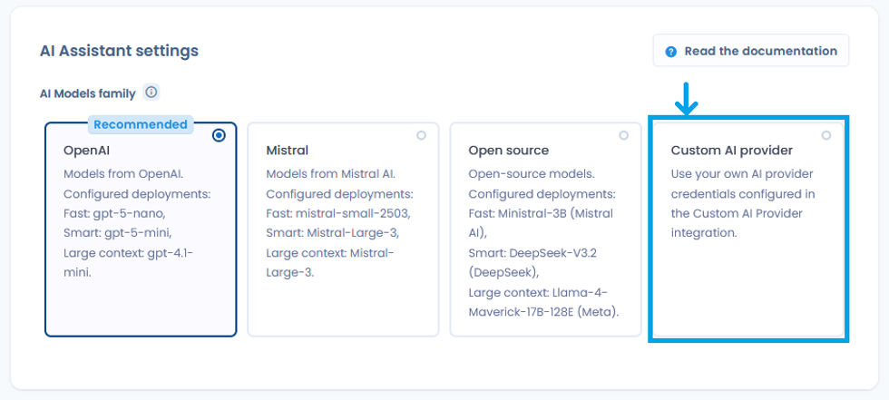
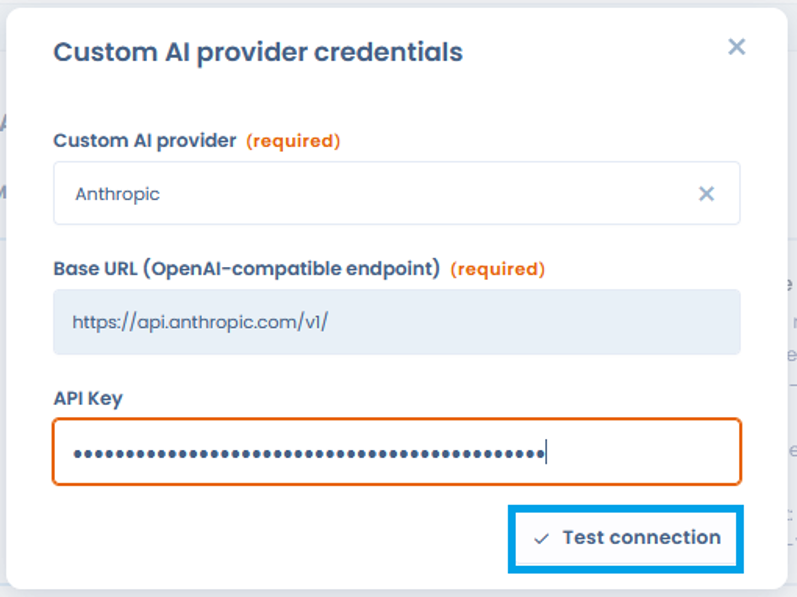
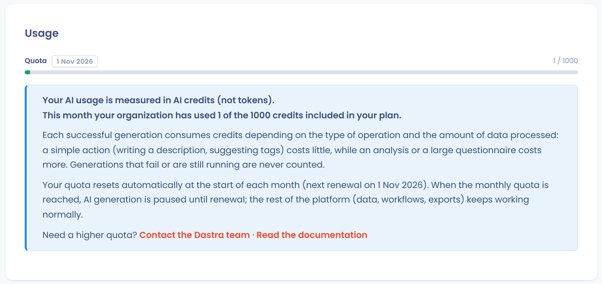

# Comment ça marche ?

## Modèles et hébergement

Dastra utilise des modèles d'IA générative pré-entraînés, disponibles en quatre familles au choix :

| Famille | Modèles configurés | Hébergement |
| --- | --- | --- |
| **OpenAI** _(recommandé par défaut)_ | Rapide : gpt-5-nano · Avancé : gpt-5.6-terra · Contexte étendu : gpt-5.6-sol | Azure, France / EEE |
| **Mistral** | Rapide : mistral-small-2503 · Avancé : Mistral-Large-3 · Contexte étendu : Mistral-Large-3 | Azure, France / EEE |
| **Open source** | Rapide : DeepSeek-V4.1-Flash · Avancé : DeepSeek-V3.2 · Contexte étendu : DeepSeek-V3.2 | Azure, France / EEE |
| **Modèles AI personnalisés** (fournisseur d'IA personnalisé) | Votre propre fournisseur via clé d'API _(voir ci-dessous)_ | Selon votre configuration |

Pour les trois premières familles, les modèles sont hébergés sur l'infrastructure Microsoft Azure en France. Ils ne sont pas opérés directement par OpenAI ou Mistral : Dastra utilise les services managés Azure, ce qui signifie que **vos données ne transitent pas vers les infrastructures propres d'OpenAI ou de Mistral**.


**Offre Bleu.** Sur [Bleu](../../../security/bleu.md), les fonctions d'IA ne passent pas par Azure : elles sont exécutées par Mistral AI, société française hors du périmètre Bleu. Le tableau ci-dessus ne s'applique pas. Seule la famille Mistral est utilisée, et toute préférence OpenAI ou Open source est remplacée par Mistral : Mistral Small pour le niveau Rapide, Mistral Large pour les niveaux Avancé et Contexte étendu. Dastra AI et les agents utilisent Mistral Medium, et la dictée vocale Mistral Voxtral.




Pour chaque famille, trois niveaux de modèle sont utilisés selon la complexité de la tâche :

* **Rapide** (actions simples) : génération de descriptions, proposition de tags
* **Avancé** (actions nécessitant plus de raisonnement) : génération d'éléments structurés dans Dastra
* **Contexte étendu** (actions traitant un volume important de données) : réponse à un questionnaire, analyse de conformité

Le propriétaire de l'organisation choisit la famille de modèles dans **Paramètres de l'organisation** > **Dastra AI**, carte **Paramètres de Dastra AI**, champ **Famille de modèles d'IA**. Le changement est enregistré dès que vous sélectionnez une famille.



<figure><figcaption>
Paramètres de l'organisation > Dastra AI : choix de la famille de modèles et suivi des crédits
</figcaption></figure>



***

## Fournisseur d'IA personnalisé

<figure><figcaption>
Le Fournisseur d'IA personnalisé (Custom AI provider) parmi les familles de modèles
</figcaption></figure>

Dastra vous permet de connecter votre propre fournisseur d'IA avec une clé d'API, à condition qu'il soit compatible avec le standard OpenAI API. Les fournisseurs proposés sont OpenAI, Google, Anthropic, Mistral et Azure AI Foundry. L'option **Autre** accepte tout autre point d'accès compatible, y compris un LLM auto-hébergé. Le fournisseur personnalisé s'applique aux fonctions de génération de l'assistant IA (les boutons des modules). Dastra AI (chat), les agents et le serveur MCP continuent d'utiliser les modèles de Dastra.

Pour configurer un fournisseur personnalisé, sélectionnez la famille **Modèles AI personnalisés** dans **Paramètres de l'organisation** > **Dastra AI**. Dans le bloc **Identifiants de fournisseur d'IA**, cliquez sur **Ajouter des identifiants**, renseignez le fournisseur et sa clé d'API, puis associez un modèle à chacun des trois niveaux (Rapide, Avancé, Contexte étendu).

Pour les fournisseurs reconnus, l'**URL de base** est pré-remplie : pour Anthropic, il s'agit de `https://api.anthropic.com/v1/`. Pour Azure AI Foundry et pour **Autre**, vous la saisissez.

* Le bouton **Tester la connexion** vérifie la validité des identifiants avant l'enregistrement.
* Vous désignez le modèle à utiliser pour chaque niveau, un modèle recommandé étant proposé par défaut.
* La clé d'API n'est jamais réaffichée en clair, et la gestion des identifiants est réservée aux propriétaires de l'organisation.

<figure><figcaption>
Configuration d'Anthropic : URL de base pré-remplie, clé d'API et bouton « Tester la connexion »
</figcaption></figure>


Lorsque vous utilisez un fournisseur d'IA personnalisé, les données transmises au modèle sont soumises à la politique de confidentialité de **votre fournisseur**, et non aux garanties Azure décrites sur cette page. Vérifiez les conditions de votre fournisseur avant d'activer cette option, notamment si vos prompts peuvent contenir des données à caractère personnel.


***

## Ce que Dastra envoie au modèle

Dastra transmet uniquement les informations nécessaires à la génération demandée : le texte saisi par l'utilisateur, et le cas échéant les champs structurés de l'objet concerné (traitement, système d'IA, demande d'exercice de droits, etc.).

Le détail exact des données transmises par fonctionnalité figure dans la section [Quelles données sont transmises au modèle](how-it-works.md#quelles-donnees-sont-transmises-au-modele).

Pour certaines fonctions de génération, Dastra applique avant l'envoi un filtre qui masque les adresses e-mail, les numéros de téléphone, les adresses postales et les codes postaux qu'il reconnaît dans le texte, ainsi que les noms précédés d'une civilité (M., Mme, Dr…). Le filtre suit les formats européens. Il laisse intacts les dates, les identifiants et les numéros de norme comme ISO 27001, afin que le modèle conserve les données métier dont il a besoin. Ce filtre n'est pas appliqué à toutes les fonctions : il ne l'est notamment pas à Dastra AI, aux agents, à l'Analyse IA ni au caviardage. Il ne garantit pas l'anonymisation d'un texte : évitez d'y saisir des données personnelles inutiles.

La **dictée vocale** de la zone de message de Dastra AI envoie votre enregistrement à un service de transcription, qui renvoie le texte. Dastra ne conserve pas l'enregistrement. Dastra utilise Azure Speech sur la plateforme standard et Mistral Voxtral sur [Bleu](../../../security/bleu.md).

***

## Ce que Dastra ne fait pas

Les points suivants sont garantis contractuellement par Microsoft Azure pour tous les modèles des familles OpenAI, Mistral et Open source :

* Vos prompts et résultats **ne sont pas disponibles** pour d'autres clients Azure
* Vos données **ne sont pas transmises** à OpenAI, Mistral ou tout autre tiers
* Vos données **ne sont pas utilisées** pour entraîner ou améliorer les modèles de base
* Les modèles sont **sans état (stateless)** : aucun prompt n'est stocké dans le modèle entre deux requêtes

***

## Surveillance des abus et revue humaine

Microsoft Azure maintient un mécanisme automatisé de détection des contenus potentiellement abusifs. Dans les cas exceptionnels où un contenu est signalé, un échantillon de prompts peut être conservé temporairement dans un espace de stockage isolé par client, aux fins de revue. Pour les ressources déployées dans l'EEE (ce qui est le cas de Dastra), les réviseurs humains éventuels sont également situés dans l'EEE.

Cette conservation reste exceptionnelle et ne concerne pas les usages normaux de la plateforme. Pour plus de détails, consultez la [documentation Microsoft sur la confidentialité des données Azure Direct Models](https://learn.microsoft.com/en-us/azure/ai-services/openai/concepts/data-privacy).


**Offre Bleu.** Cette section décrit Azure et ne s'applique pas à Bleu : les requêtes y sont traitées par Mistral AI, selon ses propres conditions. Pour les engagements applicables, référez-vous à votre contrat Dastra ou contactez notre équipe.


***

## Journaux d'utilisation de l'IA

Dastra conserve l'historique des appels à l'assistant IA. La carte **Utilisation de l'IA** de **Paramètres de l'organisation** > **Dastra AI** affiche les **90 derniers jours** dans l'onglet **Journaux (90 jours)**, réservé aux propriétaires de l'organisation. Pour chaque appel, les informations suivantes sont enregistrées :

| Champ | Description |
| --- | --- |
| **Date** | Horodatage de l'appel |
| **Statut** | Succès ou échec de la génération |
| **Opération** | Type de prompt utilisé |
| **Nom du modèle** | Nom du modèle sollicité |
| **Crédits** | Crédits consommés. Seules les générations réussies en consomment |
| **Durée** | Temps de traitement de la requête |
| **Utilisateur** | Membre de l'espace de travail ayant déclenché la génération |

Les onglets **Crédits par utilisateur** et **Crédits par opération** cumulent la consommation sur une période que vous choisissez avec le sélecteur de période. Elle commence le premier jour du mois en cours.

## Crédits et quotas IA

Dastra mesure la consommation de l'assistant IA en **crédits IA**. Le quota est mensuel et commun à tous les espaces de travail de l'organisation : il dépend de l'offre et de l'abonnement, et se renouvelle automatiquement le premier jour de chaque mois. Les échanges avec Dastra AI et les exécutions des agents consomment le même quota.

Une génération réussie consomme des crédits selon le type d'opération. Une génération en échec ou en cours n'est jamais décomptée.

| Opération | Crédits |
| --- | --- |
| Génération d'un traitement, d'un actif, d'un acteur, d'un jeu de données, d'une mesure de sécurité, d'un système d'IA ou d'un modèle d'IA ; notice d'information ; proposition de tags ; réponse à une demande d'exercice de droits ; extraction des métadonnées d'un contrat ; suggestion de contrôles et de tests ; génération d'un modèle de questionnaire ; justification de responsabilité d'un système d'IA ; suggestion de mapping ou d'action HTTP | 1 |
| Analyse de risque, analyse de la valeur métier, évaluation des critères d'AIPD, vérification d'une preuve de test, post-mortem de violation, rapport personnalisé | 2 |
| Réponse à un questionnaire et traduction d'un questionnaire | 1 par tranche de 25 questions |
| Caviardage automatique d'un document | 1 par segment de document envoyé |

La carte **Utilisation** de **Paramètres de l'organisation** > **Dastra AI** indique la consommation du mois en cours, le quota de l'offre et la date de renouvellement. La **barre de progression** change de couleur selon la part du quota consommée :

* **Vert** : moins de 80 % du quota
* **Orange** : de 80 % à 99 %
* **Rouge** : le quota est atteint

Lorsque le quota mensuel est atteint, un message vous en informe et propose de contacter l'équipe Dastra.

Dans le panneau Dastra AI, tous les utilisateurs voient l'état du quota : un compteur discret des crédits restants à partir de 50 % du quota, une bannière orange à partir de 80 %, puis une bannière rouge à 100 %, qui bloque l'envoi de nouveaux messages (l'historique reste consultable). Un message envoyé alors qu'il reste des crédits est traité en entier, même s'il fait dépasser le quota.

<figure><figcaption>
Suivi de la consommation de crédits IA du mois en cours
</figcaption></figure>

Lorsque le quota est atteint, les fonctionnalités IA sont désactivées jusqu'au prochain renouvellement. Le reste de la plateforme (données, workflows, exports) continue de fonctionner normalement.


**Fournisseur d'IA personnalisé : pas de décompte pour l'assistant IA.** Lorsque votre organisation utilise un fournisseur d'IA personnalisé, le système de crédits Dastra ne s'applique pas aux fonctions de génération de l'assistant IA. La consommation est gérée directement par votre fournisseur selon ses propres conditions de facturation. Dastra AI et les agents utilisent les modèles de Dastra : leurs messages consomment toujours le quota de crédits et sont bloqués lorsqu'il est atteint.


***

## Quelles données sont transmises au modèle ?

Dastra ne transmet **aucune donnée de votre espace de travail** au modèle IA sans que vous en soyez à l'origine. Seules les informations listées ci-dessous, selon la fonctionnalité utilisée, sont incluses dans la requête envoyée au modèle.

| Fonctionnalité                                             | Données transmises au modèle                                                                                                                                         | Données personnelles potentielles                                       |
| ---------------------------------------------------------- | -------------------------------------------------------------------------------------------------------------------------------------------------------------------- | ----------------------------------------------------------------------- |
| **Générer un traitement**                                  | Texte libre saisi par l'utilisateur                                                                                                                                  | Non, sauf si l'utilisateur mentionne des personnes dans sa description |
| **Générer un traitement avec l'option Utiliser des éléments existants** | Texte libre saisi par l'utilisateur + libellés des mesures de sécurité, actifs et champs de données existants de l'espace de travail | Non, sauf si des libellés existants contiennent des références nominatives |
| **Générer un actif**                                       | Texte libre + URL de la politique de confidentialité fournie                                                                                                         | Non                                                                     |
| **Générer un acteur**                                      | Texte libre + URL ou pièce jointe fournie                                                                                                                            | Non                                                                     |
| **Générer un jeu de données**                              | Texte libre saisi par l'utilisateur                                                                                                                                  | Non                                                                     |
| **Générer une mesure de sécurité**                         | Texte libre saisi par l'utilisateur                                                                                                                                  | Non                                                                     |
| **Générer une notice d'information**                       | Champs structurés du traitement (finalités, base légale, durées, destinataires, droits)                                                                              | Potentiellement, si les champs contiennent des références nominatives  |
| **Générer l'évaluation des critères d'AIPD** | Nom, description, finalités, catégories de personnes concernées (avec indication de vulnérabilité et volume maximal), jeux de données et leurs champs (dont les champs sensibles), actifs et destinataires du traitement | Potentiellement, selon le contenu du traitement |
| **Générer une description**                                | Texte libre saisi par l'utilisateur                                                                                                                                  | Non                                                                     |
| **Proposer des tags**                                      | Contenu textuel de l'objet (nom, description)                                                                                                                        | Non                                                                     |
| **Générer un modèle de questionnaire**                     | Texte libre saisi par l'utilisateur                                                                                                                                  | Non                                                                     |
| **Répondre à un questionnaire (PIA, analyse de risque…)**  | Champs structurés du traitement lié + instructions personnalisées éventuelles                                                                                        | Potentiellement, selon le contenu du traitement                        |
| **Générer une réponse à une demande d'exercice de droits** | Nom et prénom du demandeur, message de la demande, langue, nom de l'espace de travail, finalités, nom de l'opérateur, date et délai restant, état et identifiant de la demande | **Oui** : nom, prénom et contenu de la demande                          |
| **Générer un post-mortem de violation**                    | Champs structurés de la violation (description, données affectées, mesures prises)                                                                                   | Potentiellement, selon le contenu de la fiche violation                |
| **Extraire les métadonnées d'un contrat**                  | Contenu textuel du document transmis (pièce jointe ou URL)                                                                                                           | Potentiellement, selon le contenu du contrat                           |
| **Générer un rapport personnalisé**                        | Instructions saisies par l'utilisateur                                                                                                                               | Non, sauf si l'utilisateur inclut des données dans ses instructions    |
| **Analyse de risque (système d'IA)**                       | Champs structurés du système d'IA (description, finalités, données traitées, parties prenantes)                                                                      | Potentiellement, selon le contenu du système d'IA                      |
| **Générer une description de système d'IA**                | Texte libre + URL ou pièce jointe fournie                                                                                                                            | Non                                                                     |
| **Générer une notice système d'IA**                        | Champs structurés du système d'IA concerné                                                                                                                           | Potentiellement                                                         |
| **Suggestions de contrôles / exigences / tests**           | Contexte de l'objet concerné (nom, description, référentiel)                                                                                                         | Non                                                                     |
| **Analyse IA d'une preuve de test (Conformité)**           | Description de la procédure de test + contenu de la preuve (texte extrait, image ou URL récupérée)                                                                   | Potentiellement, selon le contenu de la preuve                         |
| **Générer la justification du rôle (système d'IA)** | Nom et description du système d'IA, libellés des modèles d'IA liés, type de responsabilité (fournisseur, déployeur…) | Non, sauf si le nom ou la description contiennent des références nominatives |
| **Générer l'évaluation de la valeur métier (système d'IA)** | Nom, description et modèles d'IA du système, rôles AI Act de l'organisation, libellés des traitements, actifs, catégories de personnes concernées et jeux de données liés (avec les libellés de leurs champs) | Peu probable, sauf si un libellé contient un nom |
| **Générer un modèle d'IA** | Texte libre saisi par l'utilisateur, texte extrait des fichiers joints ou de l'URL fournie | Potentiellement, selon le contenu des fichiers ou de la page |
| **Analyse IA d'une fiche (traitement, système d'IA, contrat, actif, acteur, synthèse de réponses d'audit)** | Contenu de la fiche et commentaires, ainsi que les fiches liées que l'analyse consulte avec vos permissions. Le contenu des pièces jointes n'est pas transmis | **Oui** : une fiche peut contenir des noms de responsables ou de contacts |
| **Traduire un modèle de questionnaire** | Tous les textes du modèle : titres, descriptions, sections, questions, options de réponse, tâches suggérées et blocs d'analyse. Les réponses saisies ne sont pas transmises | Non, sauf si le modèle cite des noms ou des coordonnées |
| **Caviarder automatiquement un document (demande d'exercice de droits)** | Texte intégral du document, extrait par reconnaissance de caractères (OCR) et envoyé par blocs, avec l'instruction libre éventuelle. Si vous excluez la personne concernée, ses nom, e-mail, téléphone et adresse sont aussi transmis. Les images des pages ne sont pas envoyées au modèle. Le filtre de masquage n'est pas appliqué, sinon les données à caviarder ne pourraient pas être détectées. Dastra ne journalise ni le texte ni les valeurs détectées | **Oui** : le texte du document contient par nature des données personnelles, y compris celles de tiers |
| **Générer un document depuis le gestionnaire de fichiers** | Instruction saisie par l'utilisateur | Non, sauf si l'instruction mentionne des personnes |
| **Description d'une règle de workflow** | Type d'objet, déclencheur, action et conditions de la règle, et texte déjà saisi | Non, sauf si une condition contient une valeur nominative |
| **Action HTTP d'une règle de workflow** | Type d'objet, instruction, extrait de documentation d'API collé, colonnes de l'objet (nom, libellé, type, valeurs possibles) et configuration en cours (URL dont les valeurs de paramètres sont masquées, méthode, noms des en-têtes sans leurs valeurs, corps de la requête). Jamais de données d'enregistrement ni d'identifiants | Peu probable, sauf si la documentation collée ou le corps de la requête en contient |
| **Mapping de champs d'une intégration** | Connecteur, champs source et colonnes cibles de Dastra (clé, libellé, type, valeurs possibles), règles de mapping existantes. Métadonnées uniquement, sans données d'exemple | Non |
| **Discuter avec Dastra AI ou un agent** | Votre message et l'historique de la conversation, les consignes de l'agent, les valeurs de ses champs de saisie, le résultat des outils (contenu des fiches auxquelles vous avez accès) et les pièces jointes. Les images et les PDF sont envoyés au modèle ; les autres formats ne sont ouverts que par l'exécution de code, lorsqu'elle est disponible. Le filtre de masquage n'est pas appliqué. Les conversations sont enregistrées dans Dastra, et vous pouvez les supprimer ; les pièces jointes sont conservées 180 jours | **Oui**, selon les fiches consultées et les pièces jointes |

Avec le [serveur MCP](mcp.md), les données lues sont transmises à l'outil d'IA que vous avez connecté, soumis à ses propres conditions, et non à un modèle de Dastra.


**Offre Bleu.** Les données du tableau sont transmises à Mistral AI, et non à Azure. Pour Dastra AI et les agents, les images jointes sont envoyées au modèle et les autres fichiers sont envoyés sous forme de texte extrait. Le caviardage automatique utilise la reconnaissance de caractères (OCR) de Mistral. L'exécution de code de Dastra AI n'est pas disponible.

**Bonne pratique** : évitez d'inclure des données à caractère personnel directement dans les champs de texte libre (descriptions, instructions personnalisées). Utilisez des identifiants ou des termes génériques lorsque c'est possible.


### Données qui ne sont jamais transmises

Les éléments suivants ne font **jamais** partie des requêtes envoyées au modèle IA :

* Les identifiants et mots de passe des utilisateurs Dastra
* Les données des autres enregistrements de votre espace de travail (seul l'objet sur lequel vous travaillez est concerné, sauf pour Dastra AI, les agents et l'Analyse IA, qui consultent les fiches nécessaires avec vos permissions), à l'exception des libellés des mesures de sécurité, actifs et champs de données existants lorsque vous activez l'option **Utiliser des éléments existants** à la génération d'un traitement
* Les métadonnées de session (nom de l'utilisateur connecté, adresse IP, etc.)
* Les pièces jointes non explicitement fournies dans la fonctionnalité concernée

### Durée de conservation des requêtes

Les modèles Azure utilisés par Dastra sont **sans état (stateless)** : les prompts et les résultats ne sont pas stockés dans le modèle et ne sont pas utilisés pour réentraîner ou améliorer les modèles de base.

**Exception : détection des abus** : Microsoft Azure maintient un mécanisme automatisé de surveillance des contenus potentiellement abusifs. Si un prompt est signalé, un échantillon peut être conservé temporairement dans un espace de stockage isolé par client, aux fins de revue. Pour les ressources déployées dans l'EEE (ce qui est le cas de Dastra), les éventuels réviseurs humains sont également situés dans l'EEE. Cette conservation reste exceptionnelle et ne concerne pas les usages normaux de la plateforme.

Pour plus d'informations, consultez la [documentation Microsoft sur la confidentialité des données Azure Direct Models](https://learn.microsoft.com/en-us/azure/ai-services/openai/concepts/data-privacy).
