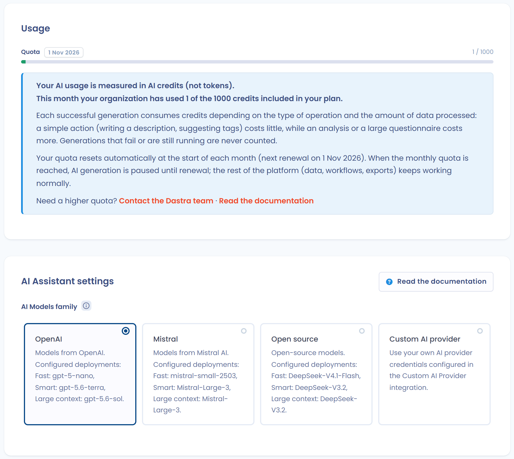

# Comment ça marche ?

## Modèles et hébergement

<figure><figcaption>
Paramètres de l'organisation > Assistant IA : choix de la famille de modèles et suivi des crédits
</figcaption></figure>

Dastra utilise des modèles d'IA générative pré-entraînés, disponibles en quatre familles au choix :

| Famille | Modèles configurés | Hébergement |
| --- | --- | --- |
| **OpenAI** _(recommandé par défaut)_ | Rapide : gpt-5-nano · Avancé : gpt-5.6-terra · Contexte étendu : gpt-5.6-sol | Azure, France / EEE |
| **Mistral** | Rapide : mistral-small-2503 · Avancé : Mistral-Large-3 · Contexte étendu : Mistral-Large-3 | Azure, France / EEE |
| **Open source** | Rapide : DeepSeek-V4.1-Flash · Avancé : DeepSeek-V3.2 · Contexte étendu : DeepSeek-V3.2 | Azure, France / EEE |
| **Modèles AI personnalisés** (fournisseur d'IA personnalisé) | Votre propre fournisseur via clé d'API _(voir ci-dessous)_ | Selon votre configuration |

Pour les trois premières familles, les modèles sont hébergés sur l'infrastructure Microsoft Azure en France. Ils ne sont pas opérés directement par OpenAI ou Mistral : Dastra utilise les services managés Azure, ce qui signifie que **vos données ne transitent pas vers les infrastructures propres d'OpenAI ou de Mistral**.

Pour chaque famille, trois niveaux de modèle sont utilisés selon la complexité de la tâche :

* **Rapide** (actions simples) : génération de descriptions, proposition de tags
* **Avancé** (actions nécessitant plus de raisonnement) : génération d'éléments structurés dans Dastra
* **Contexte étendu** (actions traitant un volume important de données) : réponse à un questionnaire, analyse de conformité

Le propriétaire de l'organisation choisit la famille de modèles dans **Paramètres de l'organisation** > **Assistant IA**, carte **Paramètres de l'Assistant IA**, champ **Famille de modèles d'IA**. Le changement est enregistré dès que vous sélectionnez une famille.

***

## Fournisseur d'IA personnalisé

<figure><figcaption>
Le Fournisseur d'IA personnalisé (Custom AI provider) parmi les familles de modèles
</figcaption></figure>

Dastra vous permet de connecter votre propre fournisseur d'IA avec une clé d'API, à condition qu'il soit compatible avec le standard OpenAI API. Les fournisseurs proposés sont OpenAI, Google, Anthropic, Mistral et Azure AI Foundry. L'option **Autre** accepte tout autre point d'accès compatible, y compris un LLM auto-hébergé.

Pour configurer un fournisseur personnalisé, sélectionnez la famille **Modèles AI personnalisés** dans **Paramètres de l'organisation** > **Assistant IA**. Dans le bloc **Identifiants de fournisseur d'IA**, cliquez sur **Ajouter des identifiants**, renseignez le fournisseur et sa clé d'API, puis associez un modèle à chacun des trois niveaux (Rapide, Avancé, Contexte étendu).

Pour les fournisseurs reconnus, l'**URL de base** est pré-remplie : pour Anthropic, il s'agit de `https://api.anthropic.com/v1/`. Pour Azure AI Foundry et pour **Autre**, vous la saisissez.

* Le bouton **Tester la connexion** vérifie la validité des identifiants avant l'enregistrement.
* Vous désignez le modèle à utiliser pour chaque niveau, un modèle recommandé étant proposé par défaut.
* La clé d'API n'est jamais réaffichée en clair, et la gestion des identifiants est réservée aux propriétaires de l'organisation.

<figure><figcaption>
Configuration d'Anthropic : URL de base pré-remplie, clé d'API et bouton « Tester la connexion »
</figcaption></figure>


Lorsque vous utilisez un fournisseur d'IA personnalisé, les données transmises au modèle sont soumises à la politique de confidentialité de **votre fournisseur**, et non aux garanties Azure décrites sur cette page. Vérifiez les conditions de votre fournisseur avant d'activer cette option, notamment si vos prompts peuvent contenir des données à caractère personnel.


***

## Ce que Dastra envoie au modèle

Dastra transmet uniquement les informations nécessaires à la génération demandée : le texte saisi par l'utilisateur, et le cas échéant les champs structurés de l'objet concerné (traitement, système d'IA, demande d'exercice de droits, etc.).

Le détail exact des données transmises par fonctionnalité figure dans la section [Quelles données sont transmises au modèle](how-it-works.md#quelles-donnees-sont-transmises-au-modele).

Avant l'envoi d'une demande de génération, Dastra applique un filtre qui masque les adresses e-mail, les numéros de téléphone, les adresses postales, les codes postaux et les noms complets qu'il reconnaît dans le texte. Le filtre suit les formats européens. Il laisse intacts les dates, les identifiants et les numéros de norme comme ISO 27001, afin que le modèle conserve les données métier dont il a besoin.

La **dictée vocale** de la zone de message de Dastra AI envoie votre enregistrement à un service de transcription, qui renvoie le texte. Dastra utilise Azure Speech sur la plateforme standard et Mistral Voxtral sur [Bleu](../../../security/bleu.md).

***

## Ce que Dastra ne fait pas

Les points suivants sont garantis contractuellement par Microsoft Azure pour tous les modèles des familles OpenAI, Mistral et Open source :

* Vos prompts et résultats **ne sont pas disponibles** pour d'autres clients Azure
* Vos données **ne sont pas transmises** à OpenAI, Mistral ou tout autre tiers
* Vos données **ne sont pas utilisées** pour entraîner ou améliorer les modèles de base
* Les modèles sont **sans état (stateless)** : aucun prompt n'est stocké dans le modèle entre deux requêtes

***

## Surveillance des abus et revue humaine

Microsoft Azure maintient un mécanisme automatisé de détection des contenus potentiellement abusifs. Dans les cas exceptionnels où un contenu est signalé, un échantillon de prompts peut être conservé temporairement dans un espace de stockage isolé par client, aux fins de revue. Pour les ressources déployées dans l'EEE (ce qui est le cas de Dastra), les réviseurs humains éventuels sont également situés dans l'EEE.

Cette conservation reste exceptionnelle et ne concerne pas les usages normaux de la plateforme. Pour plus de détails, consultez la [documentation Microsoft sur la confidentialité des données Azure Direct Models](https://learn.microsoft.com/en-us/azure/ai-services/openai/concepts/data-privacy).

***

## Journaux d'utilisation de l'IA

Dastra conserve l'historique des appels à l'assistant IA. La carte **Utilisation de l'IA** de **Paramètres de l'organisation** > **Assistant IA** affiche les **90 derniers jours** dans l'onglet **Logs (90 jours)**, réservé aux propriétaires de l'organisation. Pour chaque appel, les informations suivantes sont enregistrées :

| Champ | Description |
| --- | --- |
| **Date** | Horodatage de l'appel |
| **Statut** | Succès ou échec de la génération |
| **Opération** | Type de prompt utilisé |
| **Nom du modèle** | Nom du modèle sollicité |
| **Crédits** | Crédits consommés. Seules les générations réussies en consomment |
| **Durée** | Temps de traitement de la requête |
| **Utilisateur** | Membre de l'espace de travail ayant déclenché la génération |

Les onglets **Crédits par utilisateur** et **Crédits par opération** cumulent la consommation du mois en cours.

## Crédits et quotas IA

Dastra mesure la consommation de l'assistant IA en **crédits IA** (et non en tokens). Le quota est mensuel et commun à tous les espaces de travail de l'organisation : il dépend de l'offre et de l'abonnement, et se renouvelle automatiquement le premier jour de chaque mois. Les échanges avec Dastra AI et les exécutions des agents consomment le même quota.

Une génération réussie consomme des crédits selon le type d'opération. Une génération en échec ou en cours n'est jamais décomptée.

| Opération | Crédits |
| --- | --- |
| Génération d'un traitement, d'un actif, d'un acteur, d'un jeu de données, d'une mesure de sécurité, d'un système d'IA ou d'un modèle d'IA ; notice d'information ; proposition de tags ; réponse à une demande d'exercice de droits ; extraction des métadonnées d'un contrat ; suggestion de contrôles et de tests | 1 |
| Analyse de risque, évaluation des critères d'AIPD, vérification d'une preuve de test, post-mortem de violation, rapport personnalisé | 2 |
| Réponse à un questionnaire et traduction d'un questionnaire | 1 par tranche de 25 questions |

La carte **Utilisation** de **Paramètres de l'organisation** > **Assistant IA** indique la consommation du mois en cours, le quota de l'offre et la date de renouvellement. La **barre de progression** change de couleur selon la part du quota consommée :

* **Vert** : moins de 80 % du quota
* **Orange** : de 80 % à 99 %
* **Rouge** : le quota est atteint

Lorsque le quota mensuel est atteint, un message vous en informe et propose de contacter l'équipe Dastra.

<figure><figcaption>
Suivi de la consommation de crédits IA du mois en cours
</figcaption></figure>


Lorsque le quota est atteint, les fonctionnalités IA sont désactivées jusqu'au prochain renouvellement. Le reste de la plateforme (données, workflows, exports) continue de fonctionner normalement.



**Fournisseur d'IA personnalisé : pas de décompte.** Lorsque votre organisation utilise un fournisseur d'IA personnalisé, le système de crédits Dastra ne s'applique pas. La consommation est gérée directement par votre fournisseur selon ses propres conditions de facturation.


***

## Quelles données sont transmises au modèle ?


Dastra ne transmet **aucune donnée de votre espace de travail** au modèle IA sans que vous en soyez à l'origine. Seules les informations listées ci-dessous, selon la fonctionnalité utilisée, sont incluses dans la requête envoyée au modèle.


| Fonctionnalité                                             | Données transmises au modèle                                                                                                                                         | Données personnelles potentielles                                       |
| ---------------------------------------------------------- | -------------------------------------------------------------------------------------------------------------------------------------------------------------------- | ----------------------------------------------------------------------- |
| **Générer un traitement**                                  | Texte libre saisi par l'utilisateur                                                                                                                                  | Non, sauf si l'utilisateur mentionne des personnes dans sa description |
| **Générer un traitement avec l'option Utiliser des éléments existants** | Texte libre saisi par l'utilisateur + libellés des mesures de sécurité, actifs et champs de données existants de l'espace de travail | Non, sauf si des libellés existants contiennent des références nominatives |
| **Générer un actif**                                       | Texte libre + URL de la politique de confidentialité fournie                                                                                                         | Non                                                                     |
| **Générer un acteur**                                      | Texte libre + URL ou pièce jointe fournie                                                                                                                            | Non                                                                     |
| **Générer un jeu de données**                              | Texte libre saisi par l'utilisateur                                                                                                                                  | Non                                                                     |
| **Générer une mesure de sécurité**                         | Texte libre saisi par l'utilisateur                                                                                                                                  | Non                                                                     |
| **Générer une notice d'information**                       | Champs structurés du traitement (finalités, base légale, durées, destinataires, droits)                                                                              | Potentiellement, si les champs contiennent des références nominatives  |
| **Générer l'évaluation des critères d'AIPD** | Nom, description, finalités, catégories de personnes concernées (avec indication de vulnérabilité et volume maximal), jeux de données et leurs champs (dont les champs sensibles), actifs et destinataires du traitement | Potentiellement, selon le contenu du traitement |
| **Générer une description**                                | Texte libre saisi par l'utilisateur                                                                                                                                  | Non                                                                     |
| **Proposer des tags**                                      | Contenu textuel de l'objet (nom, description)                                                                                                                        | Non                                                                     |
| **Générer un modèle de questionnaire**                     | Texte libre saisi par l'utilisateur                                                                                                                                  | Non                                                                     |
| **Répondre à un questionnaire (PIA, analyse de risque…)**  | Champs structurés du traitement lié + instructions personnalisées éventuelles                                                                                        | Potentiellement, selon le contenu du traitement                        |
| **Générer une réponse à une demande d'exercice de droits** | Nom et prénom du demandeur, message de la demande, langue, nom de l'espace de travail, finalités, nom de l'opérateur, date et délai restant, état et identifiant de la demande | **Oui** : nom, prénom et contenu de la demande                          |
| **Générer un post-mortem de violation**                    | Champs structurés de la violation (description, données affectées, mesures prises)                                                                                   | Potentiellement, selon le contenu de la fiche violation                |
| **Extraire les métadonnées d'un contrat**                  | Contenu textuel du document transmis (pièce jointe ou URL)                                                                                                           | Potentiellement, selon le contenu du contrat                           |
| **Générer un document personnalisé**                       | Instructions saisies par l'utilisateur + contenu source éventuel                                                                                                     | Potentiellement, selon les instructions fournies                       |
| **Générer un rapport personnalisé**                        | Instructions saisies par l'utilisateur                                                                                                                               | Non, sauf si l'utilisateur inclut des données dans ses instructions    |
| **Analyse de risque (système d'IA)**                       | Champs structurés du système d'IA (description, finalités, données traitées, parties prenantes)                                                                      | Potentiellement, selon le contenu du système d'IA                      |
| **Générer une description de système d'IA**                | Texte libre + URL ou pièce jointe fournie                                                                                                                            | Non                                                                     |
| **Générer une notice système d'IA**                        | Champs structurés du système d'IA concerné                                                                                                                           | Potentiellement                                                         |
| **Suggestions de contrôles / exigences / tests**           | Contexte de l'objet concerné (nom, description, référentiel)                                                                                                         | Non                                                                     |
| **Analyse IA d'une preuve de test (Conformité)**           | Description de la procédure de test + contenu de la preuve (texte extrait, image ou URL récupérée)                                                                   | Potentiellement, selon le contenu de la preuve                         |


**Bonne pratique** : évitez d'inclure des données à caractère personnel directement dans les champs de texte libre (descriptions, instructions personnalisées). Utilisez des identifiants ou des termes génériques lorsque c'est possible.


### Données qui ne sont jamais transmises

Les éléments suivants ne font **jamais** partie des requêtes envoyées au modèle IA :

* Les identifiants et mots de passe des utilisateurs Dastra
* Les données des autres enregistrements de votre espace de travail (seul l'objet sur lequel vous travaillez est concerné), à l'exception des libellés des mesures de sécurité, actifs et champs de données existants lorsque vous activez l'option **Utiliser des éléments existants** à la génération d'un traitement
* Les métadonnées de session (nom de l'utilisateur connecté, adresse IP, etc.)
* Les pièces jointes non explicitement fournies dans la fonctionnalité concernée

### Durée de conservation des requêtes

Les modèles Azure utilisés par Dastra sont **sans état (stateless)** : les prompts et les résultats ne sont pas stockés dans le modèle et ne sont pas utilisés pour réentraîner ou améliorer les modèles de base.


**Exception : détection des abus** : Microsoft Azure maintient un mécanisme automatisé de surveillance des contenus potentiellement abusifs. Si un prompt est signalé, un échantillon peut être conservé temporairement dans un espace de stockage isolé par client, aux fins de revue. Pour les ressources déployées dans l'EEE (ce qui est le cas de Dastra), les éventuels réviseurs humains sont également situés dans l'EEE. Cette conservation reste exceptionnelle et ne concerne pas les usages normaux de la plateforme.


Pour plus d'informations, consultez la [documentation Microsoft sur la confidentialité des données Azure Direct Models](https://learn.microsoft.com/en-us/azure/ai-services/openai/concepts/data-privacy).
