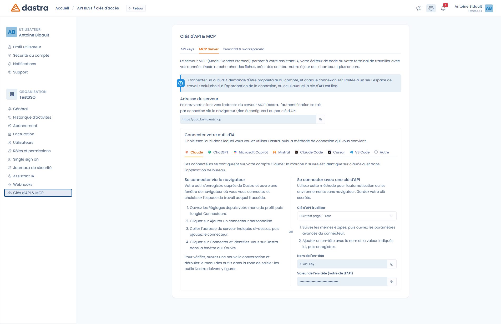
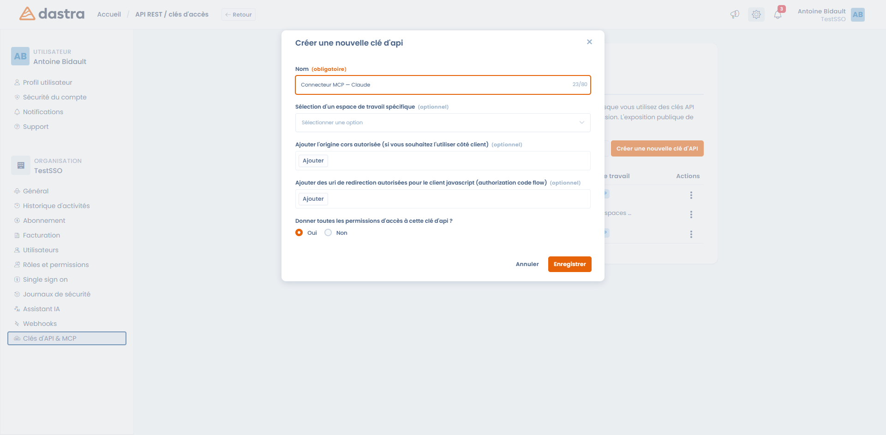

# Le serveur MCP

Le serveur MCP (**Model Context Protocol**) permet à votre assistant IA, votre éditeur de code ou votre terminal de travailler avec vos données Dastra : rechercher des fiches, créer des entités, mettre à jour des champs, et plus encore.

Autrement dit, au lieu de venir dans Dastra, vous demandez à l'outil que vous utilisez déjà — Claude, ChatGPT, Microsoft Copilot, Le Chat, Cursor… — de le faire pour vous.

Tout se configure dans **Paramètres de l'organisation > Clés d'API & MCP > MCP Server** ([accès direct](https://app.dastra.eu/general-settings/api)).

<figure><figcaption><p>Paramètres de l'organisation &#x3E; Clés d'API &#x26; MCP &#x3E; MCP Server</p></figcaption></figure>

***

### Avant de commencer


**Trois conditions doivent être réunies :**

* Le serveur MCP fait partie de l'offre **Dastra AI Pro**. S'il n'est pas inclus dans votre abonnement, l'onglet reste visible mais la connexion est refusée.
* Seul un **propriétaire du compte** peut connecter un outil d'IA.
* **Chaque connexion est limitée à un seul espace de travail** : celui choisi au moment d'approuver la connexion, ou celui auquel la clé d'API est liée. Pour travailler sur deux espaces de travail, créez deux connexions.


### Adresse du serveur

Pointez votre client vers l'adresse affichée dans le panneau :

```
https://api.dastra.eu/mcp
```

Le transport est du **HTTP** (streamable). Il n'y a rien à installer localement : ce n'est pas un serveur `stdio`.


Si votre organisation est hébergée sur l'infrastructure souveraine, l'adresse est `https://api-bleu.dastra.eu/mcp`. Reprenez toujours l'adresse affichée dans votre propre panneau plutôt que de la recopier depuis cette page.


***

## Choisir sa méthode de connexion

Deux méthodes fonctionnent, et le panneau vous présente les deux côte à côte pour chaque outil.

### Connexion via le navigateur (recommandée)

Votre outil s'enregistre tout seul auprès de Dastra et ouvre une fenêtre de navigateur où vous vous connectez et **choisissez l'espace de travail** auquel il aura accès.

C'est la méthode à privilégier : il n'y a aucune clé à créer, à copier ni à stocker, et vous pouvez révoquer l'accès à tout moment.

### Connexion avec une clé d'API

Réservée à l'automatisation et aux environnements sans navigateur. Vous ajoutez un en-tête HTTP à la configuration du connecteur :

| Nom de l'en-tête | Valeur |
| --- | --- |
| `X-API-Key` | La clé privée de votre clé d'API |


**La clé d'API doit être liée à un espace de travail**, sinon la connexion MCP est refusée. Au moment de créer la clé dans l'onglet **API keys**, renseignez le champ **Sélection d'un espace de travail spécifique**. Les clés éligibles portent un badge `MCP` dans la liste.


<figure><figcaption><p>C'est le champ « Sélection d'un espace de travail spécifique » qui rend une clé utilisable pour MCP</p></figcaption></figure>

La procédure générale de création d'une clé est décrite dans [Gestion des clés d'API](../../settings/api-keys.md).

***

## Connecter votre outil

Le panneau **Connecter votre outil d'IA** contient un onglet par outil, avec les étapes exactes et les valeurs à copier. Voici l'essentiel.



Les connecteurs se configurent sur votre compte Claude : la marche à suivre est identique sur claude.ai et dans l'application de bureau.

1. Ouvrez les **Réglages** depuis votre menu de profil, puis l'onglet **Connecteurs**.
2. Cliquez sur **Ajouter un connecteur personnalisé**.
3. Collez l'adresse du serveur, puis ajoutez le connecteur.
4. Cliquez sur **Connecter** et identifiez-vous sur Dastra dans la fenêtre qui s'ouvre.

Pour vérifier, ouvrez une nouvelle conversation et déroulez le menu des outils dans la zone de saisie : les outils Dastra doivent y figurer.

Pour une connexion par clé d'API, suivez les mêmes étapes puis ouvrez les **paramètres avancés** du connecteur et ajoutez l'en-tête `X-API-Key`.



Enregistrez le serveur avec la commande ci-dessous, puis lancez Claude Code et tapez `/mcp` pour finaliser la connexion :

```bash
claude mcp add --transport http dastra https://api.dastra.eu/mcp
```

Avec une clé d'API, aucune connexion interactive n'est nécessaire :

```bash
claude mcp add --transport http dastra https://api.dastra.eu/mcp \
  --header "X-API-Key: VOTRE_CLE_API"
```



Ajoutez le serveur dans `~/.cursor/mcp.json` :

```json
{
  "mcpServers": {
    "dastra": {
      "url": "https://api.dastra.eu/mcp"
    }
  }
}
```



Ajoutez le serveur dans `.vscode/mcp.json` :

```json
{
  "servers": {
    "dastra": {
      "type": "http",
      "url": "https://api.dastra.eu/mcp"
    }
  }
}
```



**ChatGPT** et **Microsoft Copilot** disposent chacun de leur assistant de configuration : suivez les étapes de l'onglet correspondant dans le panneau Dastra. Copilot Studio utilise l'option d'authentification OAuth 2.0 **« Dynamic discovery »**, qui correspond exactement au mode de connexion navigateur de Dastra.

**Mistral (Le Chat)** ne prend en charge **que la connexion via le navigateur** : cet outil n'envoie pas d'en-tête `X-API-Key`, la méthode par clé d'API ne fonctionne donc pas.

Pour tout autre client compatible MCP, utilisez l'onglet **Autre** : il vous donne l'adresse du serveur et l'en-tête à renseigner.



***

## Ce que votre outil pourra faire

Une fois connecté, votre outil dispose d'une trentaine d'outils Dastra.

### Outils de lecture

| Outil | Ce qu'il fait |
| --- | --- |
| Recherche approximative | Recherche large sur tous les types de fiches — le point de départ habituel |
| Parcours des enregistrements | Liste et filtre les fiches d'un type donné |
| Lecture d'un enregistrement | Récupère une fiche par son type et son identifiant |
| Inspection de la structure | Décrit les champs et colonnes d'un type de fiche |
| Vérification des champs modifiables | Indique quels champs peuvent être mis à jour, et dans quel format |
| Lecture des commentaires | Liste les commentaires d'une fiche |
| Lecture des fichiers | Liste les fichiers de l'espace de travail ou d'une fiche |
| Lecture d'un fichier | Extrait le texte d'un PDF, DOCX, XLSX, HTML, TXT, CSV, JSON ou Markdown |
| Lecture du questionnaire | Récupère un modèle d'audit ou un questionnaire planifié, avec ses questions |
| Lecture des unités organisationnelles | Restitue la hiérarchie des entités et départements |
| Liste des utilisateurs | Liste les membres de l'espace de travail |
| Liste des tags | Liste les tags, éventuellement filtrés par type |
| Liste des étapes du workflow | Liste les étapes configurées pour un type de fiche |
| Vérification des réglementations | Interroge le corpus réglementaire indexé par Dastra (RGPD, NIS2, DORA, ISO 27001…) avec les sources citées |
| Liste des catégories réglementaires | Donne les catégories utilisables pour la recherche réglementaire |
| Recherche dans la documentation | Recherche dans la documentation Dastra |
| Recherche sur le web | Recherche publique sur le web, en dernier recours |
| Analyse de l'enregistrement | Produit une analyse de conformité notée de A à F, avec des pistes d'amélioration |
| Liens vers les enregistrements | Construit les URL cliquables des fiches dans l'application Dastra |

### Outils de modification

| Outil | Ce qu'il fait |
| --- | --- |
| Création d'un enregistrement | Crée une fiche vierge |
| Rédaction d'un enregistrement | Génère une fiche complète à partir d'une description et l'importe |
| Mise à jour d'enregistrement(s) | Met à jour jusqu'à 50 fiches en une fois |
| Changement d'état du workflow | Déplace une fiche vers une autre étape |
| Ajout d'un commentaire | Commente une fiche, mentions comprises |
| Création d'un plan d'action | Crée jusqu'à 10 tâches rattachées à une fiche |
| Création d'un tag | Crée un tag pour un type de fiche |
| Rédaction d'un document | Crée ou met à jour un document Markdown dans la GED |
| Liaison d'un fichier | Rattache un fichier existant à une fiche |
| Planification du questionnaire | Instancie un questionnaire à partir d'un modèle et l'assigne |
| Mise à jour du questionnaire | Renseigne les réponses d'un questionnaire planifié |


Le serveur MCP n'expose que des **outils**. Il ne publie ni *resources* ni *prompts* au sens du protocole : un client qui interroge `resources/list` ou `prompts/list` obtiendra une liste vide.


***

## Sécurité

**Votre outil n'a jamais plus de droits que vous.** Le serveur MCP ne dispose d'aucun compte de service : il relaie votre propre clé ou votre propre jeton à l'API Dastra. Chaque lecture et chaque écriture sont donc soumises aux permissions habituelles de l'utilisateur ou de la clé d'API.

Quelques points à connaître :

* **Portée** — une connexion ne voit qu'un seul espace de travail, dans une seule organisation.
* **Traçabilité** — les écritures réalisées via MCP sont identifiées comme provenant d'un agent IA. La date de dernière utilisation de chaque clé est visible dans la liste des clés d'API.
* **Révocation** — une connexion approuvée depuis le navigateur devient une clé d'API ordinaire, visible et révocable dans l'onglet **API keys**. Supprimer la clé coupe l'accès immédiatement.
* **Débit** — les appels sont limités à 60 requêtes par minute sur le serveur MCP, et 120 requêtes par minute tous usages confondus. Au-delà, le serveur répond une erreur `429` en indiquant le délai d'attente.


Une clé d'API utilisée pour MCP donne accès en lecture **et en écriture** à un espace de travail entier. Traitez-la comme un mot de passe : ne la publiez jamais, et révoquez-la au moindre doute.


***

## Dépannage

| Symptôme | Cause probable |
| --- | --- |
| La connexion est refusée avec un message d'abonnement | Le serveur MCP n'est pas inclus dans votre offre — il nécessite Dastra AI Pro |
| « La clé d'API doit être liée à un espace de travail » | La clé a été créée sans espace de travail : recréez-en une en renseignant le champ correspondant |
| Aucun outil Dastra n'apparaît dans votre client | La connexion n'a pas été finalisée. Sur Claude, ouvrez le connecteur et cliquez sur **Connecter** ; sur Claude Code, tapez `/mcp` |
| Le Chat refuse la clé d'API | Normal : Le Chat ne prend en charge que la connexion via le navigateur |
| Vous devez vous reconnecter sans arrêt | L'autorisation d'accès prolongé n'a pas été accordée : supprimez le connecteur et refaites la connexion |
| Erreur `429` | Vous avez dépassé la limite de débit ; réessayez après le délai indiqué |

***


[README.md](agents/README.md)

