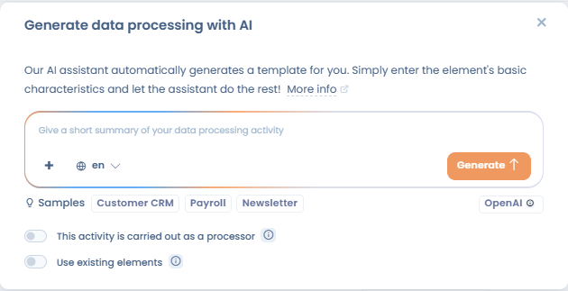
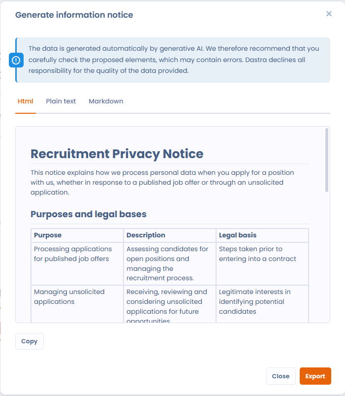
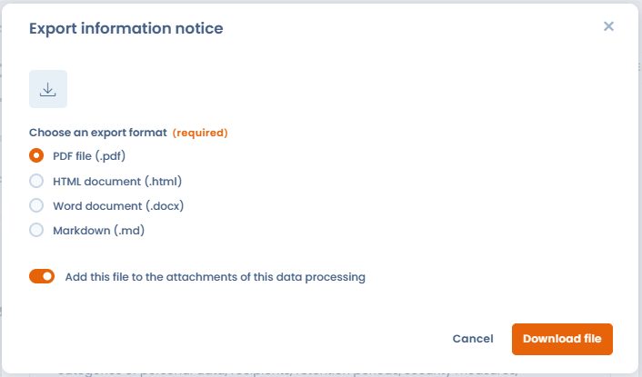
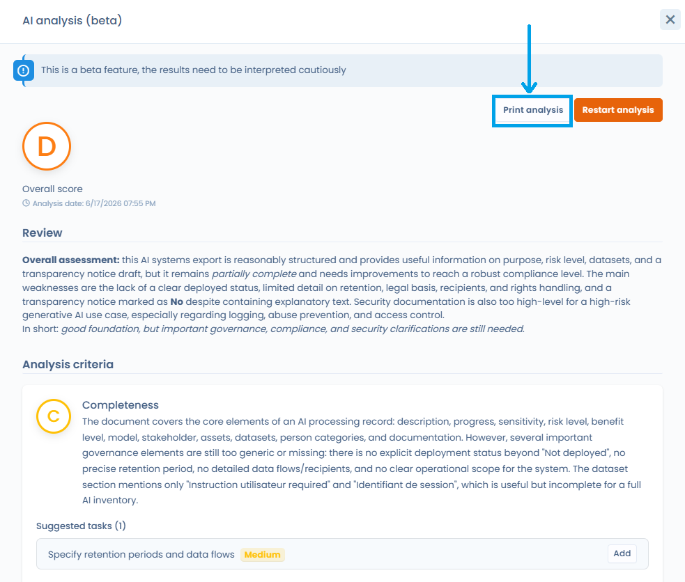

# Cas d'usage


**Avertissement sur la qualité du contenu généré** : tout contenu généré par l'assistant est une proposition uniquement. Il doit être relu et mis à jour par une personne qualifiée avant tout usage. Dastra ne s'engage pas sur la qualité des informations proposées.


Toutes les fonctionnalités de génération utilisent la même fenêtre : décrivez l'élément à générer (ou partez de l'un des **Exemples** proposés), choisissez si besoin la langue de génération, puis cliquez sur **Générer**. La proposition s'affiche dans un écran de synthèse, à relire avant de cliquer sur **Valider**.

Dans les listes, le bouton de génération est une icône IA placée à gauche du bouton de création. Il est grisé si votre offre n'inclut pas la fonctionnalité. Chaque génération consomme des [crédits IA](how-it-works.md#credits-et-quotas-ia).

***

## Traitements de données

### Générer un traitement

Générez rapidement un traitement de données au format attendu par Dastra à partir d'une description courte. L'assistant vous proposera un nom, un ou plusieurs jeux de données avec leurs champs, une durée de conservation, des mesures de sécurité, des destinataires et une description.

1. Dans le registre des traitements, cliquez sur l'icône IA à gauche de **Créer un traitement de données**, ou cliquez sur **Créer un traitement de données** puis sélectionnez **Créer avec assistant IA**
2. Saisissez une description courte de votre traitement, ou cliquez sur l'un des **Exemples** proposés sous le champ de saisie pour pré-remplir la demande
3. Si besoin, choisissez la langue de génération et activez les options souhaitées :
   * **Activité en tant que sous-traitant** : génère la fiche pour le registre sous-traitant
   * **Utiliser des éléments existants** : fournit à l'assistant les libellés des mesures de sécurité, actifs et champs de données existants de votre espace de travail, afin qu'il les réutilise dans la fiche générée plutôt que de créer des doublons. Les référentiels concernés s'affichent sous l'option
4. Cliquez sur **Générer** et patientez quelques instants
5. Sur l'écran de synthèse, vérifiez la proposition et cliquez sur **Valider**

<figure><figcaption>
Génération d'un traitement avec l'assistant IA : exemples, langue de génération et réutilisation des éléments existants
</figcaption></figure>

### Générer une notice d'information

1. Rendez-vous dans la page de modification d'un traitement
2. Dans la section **11. Documentation**, cliquez sur **Générer une notice d'information**
3. Choisissez le format souhaité (vous pouvez personnaliser les instructions en sélectionnant **Personnalisée**) et la **Langue de la notice** ; la langue de l'interface est proposée par défaut
4. Cliquez sur **Générer** : l'aperçu permet de copier le texte de chaque onglet, ou de cliquer sur **Exporter** pour obtenir un fichier PDF, Word, HTML ou Markdown
5. Dans la fenêtre **Exporter la notice d'information**, l'option **Ajouter ce fichier aux pièces jointes du traitement**, activée par défaut, ajoute le fichier exporté aux pièces jointes du traitement ; chaque export crée une nouvelle pièce jointe

<figure><figcaption>
Exporter la notice d'information générée par l'IA
</figcaption></figure>

<figure><figcaption>
Ajouter la notice exportée aux pièces jointes du traitement
</figcaption></figure>

### Générer l'évaluation des critères d'AIPD

L'onglet d'analyse d'un traitement évalue les 9 critères de l'AIPD du CEPD à partir des informations du traitement.

1. Ouvrez un traitement, puis son onglet d'analyse
2. Dans la section **Évaluation des 9 critères de l'AIPD (CEPD)**, cliquez sur **Générer l'évaluation**
3. Cliquez sur **Générer** dans la fenêtre qui s'ouvre, puis relisez le résultat

### Générer une analyse de conformité d'un traitement

L'assistant peut analyser un traitement existant et produire une évaluation de sa conformité au regard des exigences documentaires RGPD.


**Fonctionnalité en bêta** : les résultats peuvent être moins constants qu'une fonctionnalité stable et doivent être traités avec une vigilance accrue. Cette analyse est une aide à la décision, non un avis juridique.


Une fois l'analyse générée, cliquez sur **Imprimer l'analyse** pour exporter le résultat au format PDF ou l'envoyer directement à l'impression. Ce document peut servir de pièce jointe dans votre dossier de conformité.

### Analyser un contrat, un acteur, une application ou une réponse de questionnaire

La même analyse est disponible sur les contrats, les acteurs, les applications et les réponses de questionnaire. Ouvrez la fiche, puis cliquez sur le bouton **Analyse IA**. La fenêtre affiche la note globale de A à F, les critères analysés avec leur justification et les tâches suggérées. **Historique des analyses** permet de comparer avec une analyse précédente, et **Imprimer l'analyse** exporte le résultat.

### Proposer des tags

Dans un champ **Tags** encore vide, un bouton d'assistant IA propose des tags à partir du nom et de la description de l'objet. Cliquez dessus : les tags proposés remplissent le champ. Pour la gestion des tags, consultez la page [Gestion des tags](../tags.md).

***

## Référentiels

### Générer un actif

Générez rapidement un actif (logiciel, outil, etc.) au format attendu par Dastra. L'assistant vous proposera un nom, des liens vers la politique de confidentialité de l'acteur et créera un acteur en tant qu'éditeur.

1. Dans la liste des actifs, cliquez sur l'icône IA à gauche de **Créer un actif**, ou cliquez sur **Créer un actif** puis sélectionnez **Créer avec assistant IA**
2. Saisissez une description ou une URL de la politique de confidentialité
3. Cliquez sur **Générer**, puis vérifiez et complétez les informations proposées avant de cliquer sur **Valider**

### Générer un acteur

1. Dans la liste des acteurs, cliquez sur l'icône IA **Générer un acteur avec l'IA**
2. Donnez un bref résumé de l'acteur. L'assistant effectue une recherche sur le Web
3. Cliquez sur **Générer**, relisez la proposition, puis cliquez sur **Valider**

### Générer un jeu de données

1. Allez sur la page des **Jeux de données**
2. Cliquez sur l'icône IA **Générer un ensemble de données avec l'IA**, ou sur **Créer jeu de données** puis **Créer avec assistant IA**
3. Saisissez une description courte de votre jeu de données
4. Cliquez sur **Générer** et patientez quelques instants
5. Sur l'écran de synthèse, appliquez vos corrections et cliquez sur **Valider**

### Générer une mesure de sécurité

Dans la liste des mesures, cliquez sur l'icône IA **Générer une mesure avec l'IA**, décrivez la mesure, cliquez sur **Générer**, puis sur **Valider**. Cette fonctionnalité fait partie des options risques de votre offre.

***

## Questionnaires (PIA, analyse de risque…)

### Générer une réponse assistée par IA

1. Allez dans la rubrique **Questionnaires** et sélectionnez le modèle souhaité (ex. : PIA de la CNIL)
2. Cliquez sur **Planifier un questionnaire**
3. Sélectionnez **Réponse assistée par IA**
4. Renseignez le traitement qui servira de source, ou saisissez des instructions personnalisées
5. Une fois la réponse générée, apportez vos corrections directement dans le questionnaire


Lorsqu'une analyse IA a été réalisée sur une réponse de questionnaire ou une PIA, un bouton **Imprimer l'analyse** apparaît dans l'en-tête du panneau d'analyse dès qu'un résultat est disponible. Le document structuré reprend la note globale (A à F), l'appréciation générale, les critères évalués avec leur note et leur justification, ainsi que les tâches suggérées classées par priorité, sans recourir à des captures d'écran.


### Générer un modèle de questionnaire

1. Allez dans la rubrique **Questionnaires** et cliquez sur créer un modèle de questionnaire
2. Sélectionnez **Créer à partir de l'IA**
3. Donnez une description du questionnaire (300 mots) et un type
4. Ajoutez le nombre de sections et de questions
5. Cliquez sur **Générer**

### Traduire un questionnaire avec l'IA

Dans le constructeur d'un modèle de questionnaire enregistré, cliquez sur **Traduire le questionnaire** : l'IA traduit toutes les sections et toutes les questions du modèle dans une autre langue. Choisissez la langue cible et le mode d'enregistrement du résultat.

***

## Demandes d'exercice de droits

### Générer une réponse à une demande

Générez des réponses dans plusieurs langues, avec des options de personnalisation (longueur, ton formel ou informel, etc.).

1. Ouvrez une demande d'exercice de droits en cours de traitement
2. Remplissez les informations jusqu'à l'étape **Communication / Transmission**
3. Cliquez sur **Générer avec IA** : l'assistant génère une réponse à partir des informations suivantes :
   * Nom et prénom du demandeur
   * Message de la demande
   * Langue à utiliser
   * Nom de l'espace de travail
   * Finalités du traitement concerné
   * Nom de l'opérateur de la demande
   * Date de la demande et nombre de jours restants
   * État et identifiant de la demande
4. Éditez le texte proposé ou utilisez les options de reformulation (raccourcir, allonger, changer le ton)
5. Cliquez sur **Valider ce message**, ajoutez les pièces jointes éventuelles, puis cliquez sur **Envoyer**


Une limitation du nombre d'appels par minute est en place pour cette fonctionnalité.



**Règlement IA, article 50** : lorsqu'une réponse est générée par l'assistant IA, l'obligation stricte de l'art. 50(1) (informer la personne qu'elle interagit avec un système d'IA) ne s'applique **pas**, car il n'y a pas d'interaction directe entre le système d'IA et la personne concernée : c'est un utilisateur humain qui relit, valide et envoie la réponse. Il reste toutefois recommandé d'informer la personne concernée à titre de bonne pratique RGPD (art. 5(1)(a) loyauté). Consultez la [FAQ](faq.md) pour l'analyse complète.


***

## Violations de données

### Générer un post-mortem

À partir d'une fiche de violation existante, l'assistant génère un document de post-mortem structuré incluant une description de l'incident, les données affectées et les mesures prises.

Dans l'onglet post-mortem de la fiche de violation, marquez le post-mortem comme terminé, puis cliquez sur **Générer avec IA**.

***

## Contrats

### Extraire les métadonnées d'un contrat

Importez un document contractuel (PDF, image ou URL) et laissez l'assistant en extraire automatiquement les métadonnées : parties, objet, durée, clauses clés, etc.

Dans le module **Contrats**, cliquez sur le bouton de création, puis sur **Importer votre document**.

***

## Documents et rapports personnalisés

### Générer un document personnalisé

Saisissez vos propres instructions et fournissez éventuellement un contenu source. L'assistant génère un document structuré selon vos spécifications. Dans le module **Contrats**, cliquez sur le bouton de création, puis sur **Générer un document**.

### Générer un rapport personnalisé

Depuis le module **Rapports personnalisés**, cliquez sur l'icône IA **Générer un rapport personnalisé avec l'IA** et décrivez le rapport souhaité en langage naturel. L'assistant produit une première version que vous pouvez affiner.

***

## Systèmes d'IA

### Générer un système d'IA

1. Dans le registre des systèmes d'IA, cliquez sur l'icône IA **Créer avec assistant IA** à gauche du bouton de création
2. Saisissez un court résumé de votre système d'IA (nom, modèle d'IA, etc.)
3. Cliquez sur **Générer**, relisez la proposition, puis cliquez sur **Valider**

La même démarche existe pour les modèles d'IA : décrivez le modèle (nom, éditeur, etc.).

### Générer une notice d'information pour un système d'IA

Depuis la fiche d'un système d'IA, cliquez sur **Générer une notice** pour produire automatiquement le document d'information destiné aux utilisateurs ou aux personnes concernées.

### Générer une analyse de risque d'un système d'IA

L'assistant analyse les champs renseignés dans la fiche du système d'IA et produit une évaluation des risques associés.


**Fonctionnalité en bêta** : à traiter avec une vigilance accrue et à valider par un expert avant toute décision.


Une fois l'analyse générée, cliquez sur **Imprimer l'analyse** pour exporter le résultat au format PDF. Ce document peut être joint à votre dossier de conformité AI Act.

<figure><figcaption>
Le bouton « Imprimer l'analyse » permet d'exporter le résultat de l'analyse au format PDF
</figcaption></figure>

***

## Référentiels et contrôles

### Suggérer des contrôles, des exigences et des tests

Depuis un framework du module Conformité, l'assistant suggère des contrôles et des tests à partir du contexte de l'objet concerné (nom, description, framework associé).

* **Contrôles** : sur la page d'une exigence, cliquez sur **Associer des contrôles**, puis sur **Créer ou associer avec IA**. Les résultats se répartissent entre **Contrôles existants** de votre bibliothèque et **Nouveau contrôles** à créer. Les tests des nouveaux contrôles sont générés avec eux.
* **Tests** : depuis un contrôle, cliquez sur **Sélectionner ou générer des tests par IA**. Les résultats se répartissent entre **Tests existants** et **Nouveaux tests**.
* **Exigences** : dans la fenêtre de création d'une exigence, une icône IA à côté du champ de référence propose une référence.

### Analyser une preuve de test

Dans le tableau des preuves d'un test, cliquez sur **Analyser** dans la colonne IA. L'assistant compare la preuve à la procédure du test et indique sa **Confiance de l'analyse** et ses **Détails**. Les nouvelles preuves sont analysées automatiquement tant que l'**Analyse IA automatique des preuves** est activée, ce qui est le cas par défaut : vous la désactivez par espace de travail dans **Réglages espace de travail** > **Conformité**.
