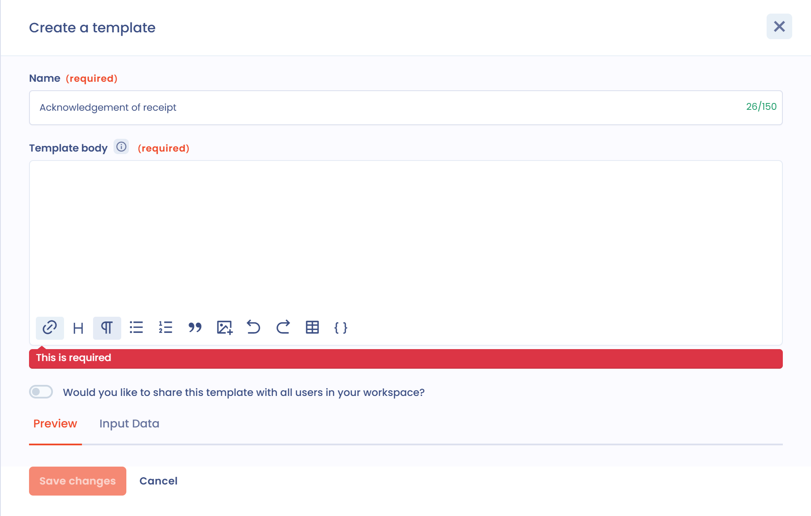

# Modèles e-mail

## Généralités

Les modèles de messages sont disponibles dans les demandes d'exercice de droits, les tâches, les invitations aux questionnaires, les invitations à compléter un traitement ou une violation, et les règles de workflow qui envoient un message. Une fois enregistrés, ils permettent de communiquer rapidement avec les parties prenantes. Les données de l'objet concerné peuvent être insérées dans le texte, avec des conditions et des boucles pour récupérer plus d'informations.

Cette page explique comment écrire un modèle. Pour les types de modèles, le partage, l'import et l'export, consultez la page [Modèles de messages](../settings/message-templates.md).

## Utilisation

Pour utiliser un modèle, cliquez sur **Sélectionner un modèle** à côté de la zone de rédaction du message.

<figure><figcaption><p>Le bouton Sélectionner un modèle dans une demande d'exercice de droits</p></figcaption></figure>

Le panneau **Sélection du modèle** s'ouvre. Recherchez un modèle dans la liste, parcourez les modèles **Partagé** ou **Privé** de chaque type, ou choisissez un autre espace de travail auquel vous avez accès. Cliquez sur **Sélectionner** en face du modèle voulu.

<figure><figcaption><p>Le panneau de sélection d'un modèle</p></figcaption></figure>

Si aucun modèle ne convient, cliquez sur **Créer modèle**. La fenêtre de création comprend :

* le **Nom** du modèle, qui permet de le retrouver ;
* le **Corps du modèle**, la zone de saisie ;
* l'option de partage avec tous les utilisateurs de l'espace de travail ;
* l'onglet **Aperçu**, qui affiche le rendu du message en temps réel ;
* l'onglet **Input Data**, qui affiche les données de l'objet concerné par le modèle.

Les onglets **Aperçu** et **Input Data** n'apparaissent que si vous créez le modèle depuis l'endroit où vous rédigez le message, et pas depuis les réglages.

<figure><figcaption><p>La fenêtre de création d'un modèle</p></figcaption></figure>

## Personnalisez le modèle

Dans le corps du modèle, vous pouvez appliquer des styles, insérer des images ou des tableaux. Le résultat s'affiche dans l'onglet **Aperçu**.

Pour insérer une donnée de l'objet, cliquez sur l'icône accolades de la barre d'outils (**Insérer des champs dynamiques**) et choisissez un champ dans la liste. La valeur du champ est insérée à l'emplacement du curseur.

<figure><figcaption><p>L'insertion d'un champ dynamique</p></figcaption></figure>

## Les champs dynamiques

Les champs entourés de doubles accolades sont des variables : elles sont remplacées par les valeurs de l'objet correspondant (ici une demande d'exercice de droits).

### Utiliser un champ de l'Input Data

L'onglet **Input Data** liste les propriétés de l'objet lié. Pour afficher par exemple le message de la demande :

1. Repérez le champ dans l'onglet **Input Data**.
2. Saisissez son nom dans le corps du modèle avec la syntaxe `{{message}}`.
3. Vérifiez le résultat dans l'onglet **Aperçu**.

Vous pouvez aller plus loin avec des boucles, des conditions et des formats de date.

### Les conditions

Un bloc conditionnel ne s'affiche que dans certaines conditions. Il commence par une balise `if` et se termine par une balise `endif`. Par exemple :

```liquid

  Vous avez une pièce jointe

```

Le bloc ne s'affiche que si la demande contient une pièce jointe.

### Les boucles

Les boucles fonctionnent de la même manière, avec une variable propre à la boucle :

```liquid

  {{ purpose }}

```

Dans cet exemple, la boucle parcourt la liste `purposes` et affiche chaque élément dans la variable `purpose`.

### Format des dates

Les dates de l'Input Data ne sont pas présentables en l'état. Appliquez-leur un format :

```liquid
{{ dateCreation | date: "%d-%m-%Y à %H:%M" }}
```

Ce modèle donne par exemple 15-03-2023 à 15:40.

### Un exemple plus complet

Le corps de texte ci-dessous utilise tous les éléments précédents :

```liquid
Bonjour,

Nous avons bien reçu votre demande d'exercice de droit le {{ dateCreation | date: "%d-%m-%Y à %H:%M" }} concernant {{ givenName }} {{ familyName }}.

La demande porte sur les finalités suivantes :

* {{ purpose }}



Nous avons bien reçu les pièces suivantes :

* {{ attachment.fileName }}



Nous vous tiendrons informé de la suite du traitement de votre demande.

Cordialement,
{{ operator.displayName }}
```

Pour la demande en cours de traitement, le message est transformé de la manière suivante :

<figure><figcaption><p>Le rendu d'un modèle complet</p></figcaption></figure>

## Aller plus loin

Les modèles utilisent la syntaxe Liquid. Consultez la [documentation de Liquid](https://shopify.github.io/liquid/) pour la liste des balises et des filtres.
