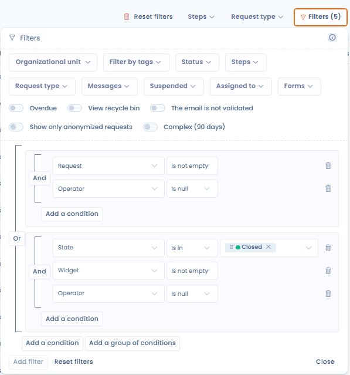

# Filtres avancés



## Utilisation

Les filtres avancés permettent de filtrer vos données sur presque tous les champs de vos entités.

1. Allez dans un module de Dastra, par exemple celui des demandes d'exercice de droits.
2. Cliquez sur le bouton **Filtres** en haut à droite du tableau de données.
3. Dans la fenêtre qui s'affiche, appliquez l'un des filtres standards les plus utilisés : le tableau se met à jour automatiquement.

<figure><figcaption><p>Les filtres standards d'une liste de demandes d'exercice de droits</p></figcaption></figure>


Les filtres se cumulent.

_Par exemple : si vous filtrez sur les tags « complexe » et « en attente » et sur l'unité organisationnelle « Contoso », le tableau affiche les lignes qui portent les deux tags **et** qui sont dans l'unité organisationnelle « Contoso »._


4. Si aucun filtre standard ne convient, cliquez sur **Ajouter un filtre** pour construire la combinaison de conditions adaptée à votre besoin.

Chaque modification s'applique tout de suite. Le bouton **Effacer les filtres** remet le tableau dans son état initial.

Dastra conserve les filtres que vous sélectionnez : si vous changez de page ou rafraîchissez votre navigateur, ils sont maintenus. Ils sont propres à votre navigateur, à la liste et à votre espace de travail, et sont stockés dans le **LocalStorage** de votre navigateur.

## Personnaliser les colonnes

Le bouton **Personnaliser les colonnes**, dans la dernière cellule de l'en-tête de chaque liste, permet de choisir les colonnes affichées (**Colonnes visibles** et **Colonnes cachées**), y compris les champs personnalisés, et de définir leur ordre. Cliquez sur **Appliquer** pour valider, ou sur **Réinitialiser** pour revenir à la sélection d'origine.

Vous pouvez aussi réordonner les colonnes directement depuis l'en-tête de la liste : au survol d'un en-tête, une poignée de glisser-déposer apparaît à gauche du nom de la colonne. Faites glisser la colonne jusqu'à l'emplacement souhaité : le nouvel ordre s'applique immédiatement. Certaines colonnes fixes ne peuvent pas être déplacées.

Le survol d'un en-tête de colonne affiche l'explication complémentaire de la colonne, lorsqu'elle existe. Votre sélection de colonnes est enregistrée sur votre compte.

## Vues personnalisées

Une **vue personnalisée** enregistre l'état courant de vos filtres et votre sélection de colonnes sous un nom. Le sélecteur de vues se trouve en haut à gauche de chaque liste : il affiche **Vue par défaut**, ou le nom de la vue active suivi d'un astérisque lorsque vous l'avez modifiée sans l'enregistrer.

Pour créer une vue :

1. Appliquez les filtres et la sélection de colonnes souhaités.
2. Ouvrez le sélecteur de vues et cliquez sur **Enregistrer la vue personnalisée**.
3. Saisissez le **Nom de votre vue personnalisée** et confirmez.

<figure><figcaption><p>Le sélecteur de vues personnalisées</p></figcaption></figure>

Le sélecteur regroupe **Vue par défaut**, qui réinitialise filtres et colonnes, vos vues sous **Mes vues personnalisées** et celles de vos collègues sous **Vues partagées**. Survolez une vue pour la modifier (crayon) ou la supprimer (corbeille). Quand la vue active est modifiée, l'entrée **Mettre à jour** la remplace par les filtres et les colonnes courants.

Pour **partager une vue** avec les autres utilisateurs de votre espace de travail, activez l'option **Partager cette vue personnalisée avec les autres utilisateurs** lors de l'enregistrement. Elle n'est proposée qu'aux utilisateurs qui disposent du droit d'accès avancé, qui sont aussi les seuls à pouvoir modifier ou supprimer une vue partagée.

<figure><figcaption><p>L'enregistrement d'une vue personnalisée, avec l'option de partage</p></figcaption></figure>

Les vues personnalisées sont disponibles dans la plupart des listes : demandes d'exercice de droits, registre des traitements, actifs, contrats, systèmes d'IA, violations de données, etc.

## Groupes de conditions

Les filtres avancés permettent de combiner des conditions avec les opérateurs **Et** et **Ou** au sein d'un même filtre.

### Principe

Par défaut, toutes les conditions d'un filtre sont reliées par **Et** : une ligne doit satisfaire _toutes_ les conditions. Dès qu'un groupe contient au moins deux éléments (conditions ou groupes), un bouton **Et** apparaît en bordure : cliquez dessus pour le changer en **Ou**, et inversement. Chaque groupe a son propre opérateur, le filtre dans son ensemble aussi.

Exemple :

```
Groupe 1 : statut = "En cours" ET priorité = "Haute"
OU
Groupe 2 : statut = "En retard"
```

Ce filtre affiche toutes les demandes en cours et prioritaires, et aussi toutes celles en retard, quelle que soit leur priorité.

### Créer un groupe de conditions

1. Ouvrez la fenêtre des filtres et cliquez sur **Ajouter un filtre**.
2. Cliquez sur **Ajouter une condition**, puis choisissez le champ, l'opérateur de comparaison et la valeur.
3. Cliquez sur **Ajouter un groupe de conditions** pour créer un bloc indépendant, puis ajoutez ses conditions.
4. Cliquez sur le bouton **Et** ou **Ou** pour choisir comment les conditions d'un groupe, ou les groupes entre eux, sont combinés.
5. Supprimez une condition ou un groupe avec l'icône corbeille.

<figure><figcaption><p>Deux groupes de conditions reliés par Ou, avec les boutons Ajouter une condition et Ajouter un groupe de conditions</p></figcaption></figure>


Un groupe ne peut pas contenir d'autre groupe, et un filtre compte au maximum 10 conditions. Les filtres et les vues personnalisées créés avant les groupes restent utilisables.


## Problèmes connus

### Les données ne s'affichent plus

Si un filtre vous fait perdre l'affichage de vos données, videz les données de votre navigateur (cookies, LocalStorage, etc.). Cela réinitialise les filtres et la vue active de votre espace de travail. Vous pouvez aussi cliquer sur **Effacer les filtres**, puis choisir **Vue par défaut**.

### Des colonnes sont absentes des filtres avancés

Pour des raisons techniques, certaines colonnes ne peuvent pas être filtrées. Dans ce cas, exportez les données brutes et construisez votre rapport dans un outil comme Excel.

Si un filtre est essentiel à votre activité, faites une demande de nouvelle fonctionnalité [via la communauté Dastra ou le système de demandes](../../getting-started/support/request.md).
