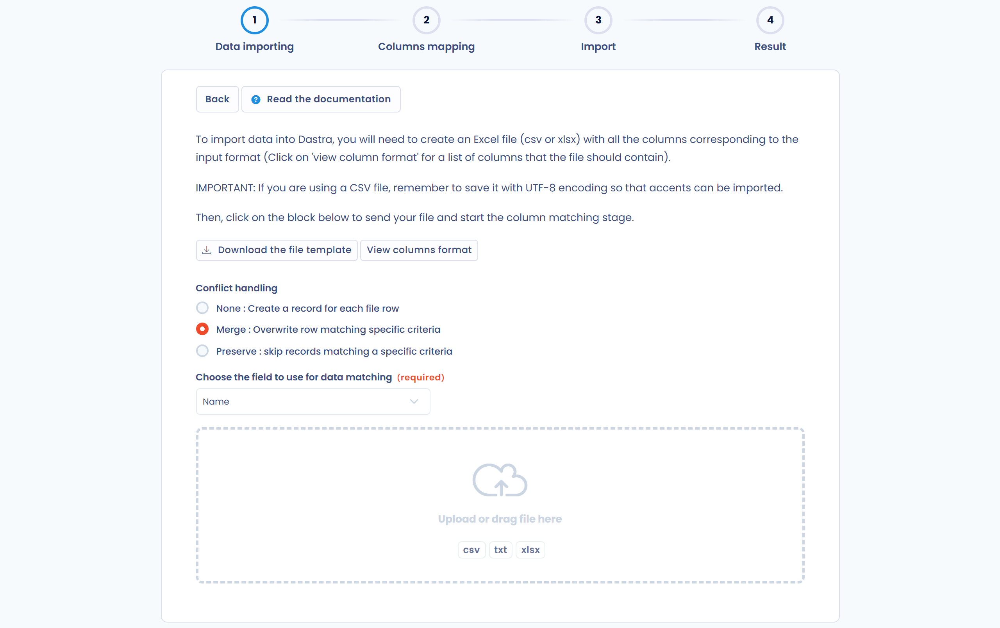

# Importer vos données (Excel, Csv)



## L'import de données dans Dastra

Dastra importe vos propres données depuis un fichier au format tableur. Dans chaque liste concernée, l'import se lance depuis la flèche du bouton de création, puis **Importer**.

<figure><figcaption>
L'entrée Importer du menu du bouton de création
</figcaption></figure>

Les objets suivants peuvent être importés :

| Objet | Où importer | Remarque |
| --- | --- | --- |
| Traitements | Inventaire > Traitements de données > Registre des traitements | Fichier plat (CSV), classeur Excel complexe (bêta) ou JSON |
| Actifs | Inventaire > Référentiels > Actifs | Excel ou CSV, ou JSON |
| Acteurs | Inventaire > Référentiels > Acteurs | |
| Jeux de données | Inventaire > Référentiels > Jeux de données | |
| Champs de données | Inventaire > Référentiels > Glossaire de données | |
| Mesures de sécurité | Inventaire > Référentiels > Mesures | |
| Catégories de personnes concernées | Inventaire > Référentiels > Cat. personnes concernées | |
| Systèmes d'IA et modèles d'IA | Inventaire > Systèmes d'IA | |
| Demandes d'exercice de droits | Opérations > Demandes > Registre des demandes | |
| Violations de données | Opérations > Incidents > Registre des incidents | |
| Tâches | Opérations > Planification > Tâches | Les projets s'importent en JSON depuis **Projets** |
| Contrats et politiques | Opérations > Contrats et politiques > Registre des contrats et politiques | |
| Types de risque, menaces, sources, points de contrôle et événements | Gouvernance > Gestion des risques | |
| Modèles de questionnaires | Gouvernance > Questionnaires > Modèles de questionnaires > **Créer modèle** > **Envoyer un fichier** | Fichier Excel ou fichier JSON |
| Réponses aux questionnaires | Liste des réponses d'un modèle > **Planifier questionnaire** > **Importer des réponses** | |
| Frameworks, contrôles, tests, menaces et risques de la bibliothèque | Gouvernance > Conformité > Bibliothèque | Voir [Import et modèles Dastra](../compliance/library/frameworks/import.md) pour les frameworks |
| Tags | Réglages espace de travail > Processus > Tags | |
| Modèles de messages | Réglages espace de travail > Modèles | |
| Unités organisationnelles | Réglages espace de travail > Gestion des accès > Unités organisationnelles | Fichier CSV |

Dans chaque import, le processus est le même. Il s'effectue en 4 étapes :

1. [Préparation du fichier de données](import.md#1.-preparation-du-fichier-de-donnees)
2. [Téléchargement du fichier](import.md#2.-charger-le-fichier)
3. [Vérification des données avant import](import.md#3.-verifiez-vos-donnees)
4. [Import des données](import.md#4.-importez-les-donnees)

### 1. Préparation du fichier de données

Dastra supporte les formats de données suivants :

* **Excel** (.xlsx)
* **Fichiers plats** (.csv, .txt) avec séparateur ; et encodage UTF-8 (l'encodage est important pour conserver les accents)
* **JSON**, pour le registre complet, les actifs, les projets, les modèles de questionnaires et les frameworks de conformité

Certaines listes demandent de choisir le format avant d'ouvrir l'assistant d'import. Pour le registre des traitements, **Fichier plat** ouvre l'assistant décrit ci-dessous.

#### Téléchargement du modèle de fichier

Dans l'assistant d'import, cliquez sur **Télécharger le modèle de fichier**. Le modèle est **un fichier CSV** que vous pouvez éditer avec Excel, LibreOffice ou Google Sheets. Il contient toutes les colonnes de l'import avec une ligne de données d'exemple, à remplacer par vos données.

#### Renseignement du modèle de fichier

Remplissez le fichier téléchargé avec vos données. Pour chaque import, le bouton **Voir le format des colonnes** affiche les colonnes attendues, leurs règles et leurs valeurs possibles.

<figure><figcaption>
Le format des colonnes attendu par l'import
</figcaption></figure>

Les valeurs possibles sont données en anglais : il s'agit d'un import technique en base de données. Elles correspondent aux listes déroulantes de l'application.

Par exemple, dans l'import du registre :

* la colonne `State` correspond au statut du traitement : `Draft` pour **Brouillon** et `Active` pour **Publié**. Si la cellule est vide, le traitement est créé avec le statut **Publié** ;
* la colonne `ProcessingState` correspond au champ **État du traitement** de l'étape **Général** : `Study` pour **À étudier**, `BeingDeployed` pour **En cours de déploiement**, `InProduction` pour **En production** et `Stopped` pour **Arrêté**.

Une valeur qui ne correspond à aucun choix possible ne bloque pas l'import : elle est remplacée par la valeur par défaut de la colonne. Vérifiez vos valeurs avant d'envoyer le fichier.

### Jeux de données : import des champs associés

L'export des jeux de données contient une colonne **Champs de données personnelles** qui liste les champs de données associés. Chaque champ s'écrit `libellé#classification de sensibilité#catégorie de données personnelles`, et les champs sont séparés par `|`. Le même format s'utilise à l'import.

À l'import, pour chaque **nouveau** jeu de données :

* un champ dont le libellé existe déjà dans l'espace de travail est associé tel quel : la classification et la catégorie du fichier ne le modifient pas ;
* un champ dont le libellé n'existe pas est créé automatiquement.


Les champs associés ne sont lus que pour les jeux de données créés par l'import. En mode **Fusion**, les champs d'un jeu de données existant ne sont pas modifiés.


Pour importer des jeux de données, ouvrez **Inventaire** > **Référentiels** > **Jeux de données**, cliquez sur la flèche du bouton **Créer jeu de données**, puis sur **Importer**.

### 2. Charger le fichier

Dans l'assistant d'import, certains objets demandent d'abord une unité organisationnelle : tous les éléments importés y sont rattachés. C'est le cas des traitements, des demandes, des violations, des tâches, des contrats et des systèmes d'IA.

<figure><figcaption>
L'étape Envoi du fichier, avec la gestion des conflits
</figcaption></figure>

#### Gestion des conflits

Pour les objets qui ont une clé de correspondance (par exemple le libellé ou la référence), le groupe **Gestion des conflits** décide de ce qui se passe quand une ligne du fichier correspond à un enregistrement existant. Les trois modes sont :

* **Aucun : créer un enregistrement pour chaque ligne de fichier** (mode par défaut) : chaque ligne crée un nouvel enregistrement, y compris si un enregistrement identique existe déjà ;
* **Fusion : Ecraser les données des lignes qui matchent (dangereux !)** : les lignes qui correspondent à un enregistrement existant le mettent à jour, les autres lignes créent de nouveaux enregistrements ;
* **Préservation : ne pas modifier les données qui remplissent une condition** : les lignes qui correspondent à un enregistrement existant sont ignorées et celui-ci reste intact, les autres lignes créent de nouveaux enregistrements.

Avec **Fusion** ou **Préservation**, choisissez le **champ à utiliser pour la correspondance des données**. Une ligne correspond à un enregistrement lorsque la valeur de ce champ est strictement identique (majuscules et minuscules comprises) dans le fichier et dans l'espace de travail.


Le mode **Fusion** remplace les valeurs enregistrées par celles du fichier. Une cellule vide ne modifie pas la valeur existante, sauf dans les colonnes à choix imposé (par exemple le type ou le statut d'un actif) qui reprennent alors leur valeur par défaut : renseignez-les toujours. Vérifiez votre fichier avant de lancer l'import, car l'opération ne s'annule pas.


Les objets sans clé de correspondance, comme les tags, les modèles de messages, les demandes ou les types de risque, n'affichent pas ce groupe. Pour les violations de données, le groupe est affiché mais chaque ligne crée toujours un enregistrement. Les imports de la bibliothèque de conformité ignorent les lignes dont la référence existe déjà, quel que soit le mode.


Pour les **actifs**, le mode **Fusion** met aussi à jour les **champs personnalisés**, quel que soit leur type. Comme pour les colonnes natives, une cellule vide laisse la valeur enregistrée inchangée, et une liste à réponses multiples remplace intégralement la liste existante. En cas de valeur refusée, l'import s'interrompt sans rien modifier et indique la ligne en cause.


#### Envoi du fichier

Cliquez dans la zone **Envoyer/déplacer des fichiers ici** pour choisir votre fichier, ou déposez-le directement dans cette zone. Dastra lit les premières lignes pour préparer la correspondance des colonnes.

### 3. Vérifiez vos données

L'étape **Correspondances** associe les colonnes de votre fichier aux colonnes attendues par l'import. Dastra les associe d'office quand l'en-tête est identique au nom ou au libellé de la colonne. Les onglets **Toutes les colonnes**, **Sans correspondance** et **Correspondance (fichier importé)** filtrent la liste, et la colonne **Données du fichier** montre un échantillon de vos données.

<figure><figcaption>
L'étape Correspondances
</figcaption></figure>

Le bouton **Continuer** reste inactif tant qu'une colonne obligatoire n'a pas de correspondance.

### 4. Importez les données

Cliquez sur **Continuer** pour lancer l'import. L'écran **Résultat** indique le nombre de lignes importées, d'objets créés, d'objets mis à jour et d'objets ignorés. Cliquez sur **Afficher** pour ouvrir la liste.

<figure><figcaption>
Le résultat de l'import
</figcaption></figure>

Si une ligne ne passe pas la validation (un champ obligatoire vide ou une valeur trop longue, par exemple), l'import entier est interrompu et rien n'est enregistré. Le message indique le numéro de la ligne en cause, l'en-tête du fichier comptant pour la ligne 1. Corrigez le fichier, puis relancez l'import.

Vérifiez ensuite que les données ont bien été importées dans l'outil.
