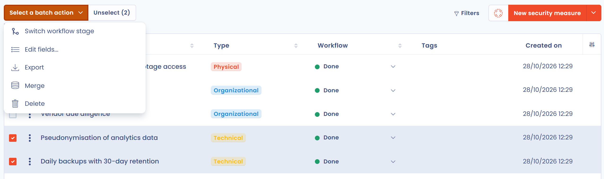
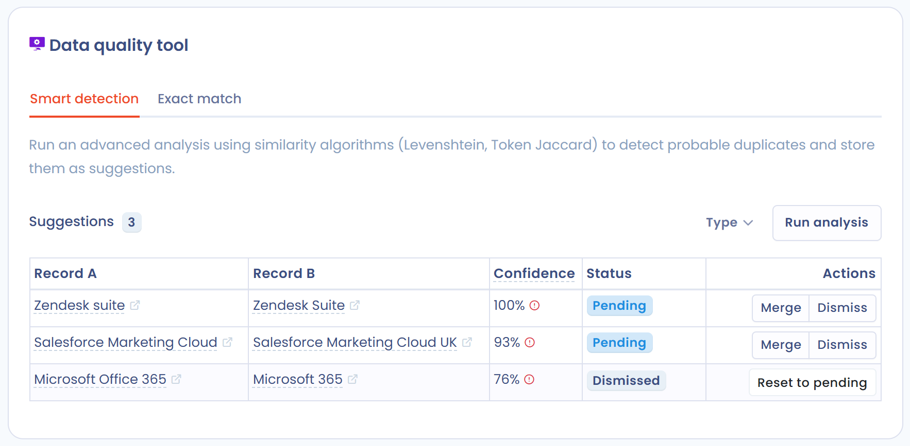

# Fusion d'éléments

## À quoi sert l'outil de fusion

La fonctionnalité de **fusion d'éléments** de Dastra regroupe plusieurs éléments identiques ou proches en un seul, sans que vous ayez à rattacher à la main chacune des entités associées (traitements, responsables, registres, etc.). Elle garde votre référentiel cohérent et limite les manipulations manuelles.

## Sur quels éléments utiliser l'outil de fusion

L'outil de fusion est disponible sur :

* les traitements
* les actifs
* les acteurs
* les jeux de données
* les champs de données (glossaire de données)
* les mesures de sécurité
* les catégories de personnes concernées
* les tâches
* les contrôles de conformité (contrôles appliqués et contrôles de référence)
* les tests de conformité (tests opérationnels et tests de référence)
* les scénarios de risque et les menaces de la bibliothèque de conformité


La fusion des contrôles, des tests, des scénarios de risque et des menaces s'effectue depuis la bibliothèque ou le projet du module Conformité. Pour le détail de cette opération, consultez les pages [Contrôles](../compliance/library/controls.md), [Tests](../compliance/library/tests.md), [Risques](../compliance/library/risks.md) et [Menaces](../compliance/library/threats.md).


## Fusionner des éléments

1. Dans la liste, sélectionnez les éléments à fusionner. Le nombre d'éléments sélectionnés doit rester inférieur à 30.
2. Cliquez sur **Choisir une action groupée**, puis sur **Fusionner**.

<figure><figcaption>
Deux éléments sélectionnés et l'action groupée Fusionner
</figcaption></figure>

3. Dans la fenêtre **Outil de fusion**, choisissez l'élément à conserver en le sélectionnant dans l'en-tête de sa colonne : il devient la **Version de référence**. Les autres colonnes portent le badge **Conserver sélection** : ces éléments sont supprimés une fois la fusion validée, et seuls les champs que vous y sélectionnez sont reportés sur la version de référence.
4. Pour chaque champ qui diffère, sélectionnez la valeur à conserver.
5. Cliquez sur **Fusionner**.

<figure><figcaption>
La fenêtre Outil de fusion
</figcaption></figure>

Vous pouvez aussi partir d'un seul élément : dans son menu d'actions, cliquez sur **Fusionner**, sélectionnez les objets avec lesquels fusionner les données, puis cliquez sur **Suivant**.

Pour choisir plus vite les valeurs à conserver :

* chaque champ dont la valeur diffère d'un élément à l'autre porte la mention **Différent**, et un compteur indique le nombre de lignes concernées ;
* le tableau n'affiche que les lignes qui diffèrent ; activez **Voir tous les champs** pour afficher l'ensemble des champs comparables. Les champs identiques masqués conservent la valeur de la version de référence ;
* le bouton **Sélectionner tout**, sous l'en-tête d'une colonne, retient ses valeurs sur toutes les lignes qui diffèrent ; **Annuler la sélection** revient en arrière. Une valeur vide ne remplace jamais une valeur renseignée.


Les entités associées aux éléments supprimés (traitements, analyses, tâches, etc.) sont automatiquement rattachées à la version de référence, sans perte ni déconnexion dans votre registre. La section **Objets liés conservés** de la fenêtre en donne le décompte.


Lors de la mise à jour d'un objet depuis les réponses d'un questionnaire, la même fenêtre s'ouvre avec une colonne **Réponses au questionnaire**. L'objet existant reste toujours la version de référence : il conserve son identifiant, son historique et ses rattachements.

## Outil de qualité de données

L'**outil de qualité de données** analyse votre référentiel pour repérer les éléments probablement en doublon, sans sélection préalable. Il propose ensuite de les fusionner avec l'outil de fusion.

### Où le trouver

L'outil est disponible sur les listes des traitements, des acteurs, des actifs, des champs de données, des jeux de données et des mesures de sécurité. Il n'est pas proposé pour les catégories de personnes concernées, qui restent fusionnables depuis la liste.

Dans la liste, cliquez sur la flèche du bouton de création en haut à droite (par exemple **Créer un traitement de données**), puis sur **Outil de qualité de données**. Cette action nécessite le droit d'écriture sur le module.

### Détection intelligente

L'onglet **Détection intelligente** lance une analyse par similarité (distance de Levenshtein et indice de Jaccard) et enregistre les doublons probables sous forme de suggestions. L'analyse démarre d'elle-même à la première ouverture ; cliquez sur **Lancer l'analyse** pour la relancer.

<figure><figcaption>
Les suggestions de doublons de l'onglet Détection intelligente
</figcaption></figure>

Chaque suggestion associe deux enregistrements (**Enregistrement A** et **Enregistrement B**). L'algorithme compare surtout le libellé, puis, selon le type d'élément, la description, l'adresse, l'e-mail, le numéro de téléphone ou la définition. Il en déduit un **score de confiance**, de 0 % à 100 %, que vous pouvez lire avant toute fusion. Une icône rouge **UO différente** signale deux enregistrements rattachés à des unités organisationnelles différentes.

Pour chaque suggestion :

* **Fusionner** ouvre l'outil de fusion avec les deux enregistrements ;
* **Ignorer** écarte la suggestion : son statut passe à **Ignoré** et l'analyse ne la reproposera pas ;
* **Remettre en attente** replace une suggestion ignorée parmi les suggestions **En attente**.

La liste peut être filtrée par statut (**Tous les statuts**, **En attente**, **Ignoré**). L'outil ne supprime jamais un doublon de lui-même : seuls les éléments non retenus lors d'une fusion sont supprimés.

### Correspondance exacte

L'onglet **Correspondance exacte** regroupe les enregistrements qui ont la même valeur dans la colonne de votre choix. Sélectionnez la colonne, puis cliquez sur **Fusionner** en face d'un groupe pour ouvrir l'outil de fusion.
