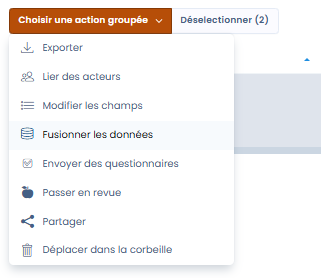

# Fusion d'éléments

## À quoi sert l'outil de fusion

La fonctionnalité de **fusion d’éléments** de Dastra a été conçue pour simplifier la gestion des doublons et des éléments similaires dans vos données de conformité. Elle vous permet de **regrouper plusieurs éléments identiques ou proches** en un seul, sans avoir à effectuer manuellement le **rattachement complexe à l’ensemble des entités associées** (traitements, responsables, registres...).

Cette fonctionnalité vise à **assurer la cohérence de votre référentiel** tout en **limitant les manipulations manuelles**, vous faisant gagner en temps et en fiabilité.

## Sur quels éléments peuvent être utilisés l'outil de fusion

L'outil de fusion peut être utilisé sur :

* Les traitements
* Les actifs
* Les acteurs
* Les jeux de données
* Les glossaires de données
* Les mesures
* Les catégories de personnes concernées
* Les tâches
* Les contrôles de conformité (contrôles appliqués et contrôles de référence)
* Les tests de conformité (tests opérationnels et tests de référence)


La fusion des contrôles et des tests de conformité s'effectue depuis la bibliothèque ou le projet du module Conformité, via les actions groupées. Vous pouvez sélectionner jusqu'à 30 éléments à fusionner. Pour le détail de cette opération, consultez les pages [Contrôles](../compliance/library/controls.md) et [Tests](../compliance/library/tests.md).


## Comment fusionner les éléments ?

1. Dans la liste, sélectionnez les éléments à fusionner.

<figure><figcaption></figcaption></figure>

2. Cliquez sur **Choisir une action groupée**, puis sur **Fusionner les données**.

3. Dans la fenêtre **Outil de fusion**, cochez dans l'en-tête de sa colonne l'élément à conserver : il devient la **Version de référence**. Les autres colonnes portent le badge **Conserver sélection** : ces éléments sont supprimés une fois la fusion validée, et seuls les champs que vous y sélectionnez sont reportés sur la version de référence.
4. Pour chaque champ qui diffère, sélectionnez la valeur à conserver.
5. Cliquez sur **Fusionner**.

<figure><figcaption>
La fenêtre Outil de fusion
</figcaption></figure>

Pour faciliter le choix des valeurs :

* chaque champ dont la valeur diffère d'un élément à l'autre porte la mention **Différent**, et un compteur indique le nombre de lignes concernées ;
* le tableau n'affiche que les lignes qui diffèrent ; activez **Voir tous les champs** pour afficher l'ensemble des champs comparables. Les champs identiques masqués conservent la valeur de la version de référence ;
* le bouton **Sélectionner tout**, sous l'en-tête d'une colonne, retient ses valeurs sur toutes les lignes qui diffèrent ; **Annuler la sélection** revient en arrière. Une valeur vide ne remplace jamais une valeur renseignée, et le nombre de lignes mises à jour est indiqué.


Les entités (traitements, analyses, etc.) associées aux éléments supprimés sont automatiquement rattachées à la version de référence, évitant toute perte ou déconnexion dans votre registre. La section **Objets liés conservés** de la fenêtre en donne le décompte.


Lors de la mise à jour d'un objet depuis les réponses d'un questionnaire, la même fenêtre s'ouvre avec une colonne **Réponses au questionnaire**. L'objet existant reste toujours la version de référence : il conserve son identifiant, son historique et ses rattachements.

## Outil qualité des données — détection automatique des doublons

Dastra dispose d’un **outil de qualité des données** qui analyse automatiquement votre référentiel pour détecter les éléments potentiellement en doublon, sans nécessiter de sélection manuelle préalable.

### Comment fonctionne la détection automatique

L’algorithme utilise un **scoring expliqué** : pour chaque paire de doublons potentiels, il analyse plusieurs dimensions (nom, éditeur, unité organisationnelle, URL, catégorie) et attribue un **score de confiance**. Ce score vous permet de valider en connaissance de cause avant toute opération de fusion ou de suppression.

### Modules couverts

L’outil qualité des données est disponible pour :

* les actifs
* les mesures
* les acteurs
* les jeux de données
* les glossaires de données
* les traitements
* les catégories de personnes concernées

### Comment accéder à l’outil

Dans chacun de ces modules, cliquez sur le **bouton de menu principal** (⋮ ou "Actions") puis sélectionnez **"Outil qualité des données"**. Tous les doublons détectés sont présentés avec leur score de confiance. Vous pouvez ensuite choisir de **fusionner** ou de **supprimer** chaque doublon identifié.
