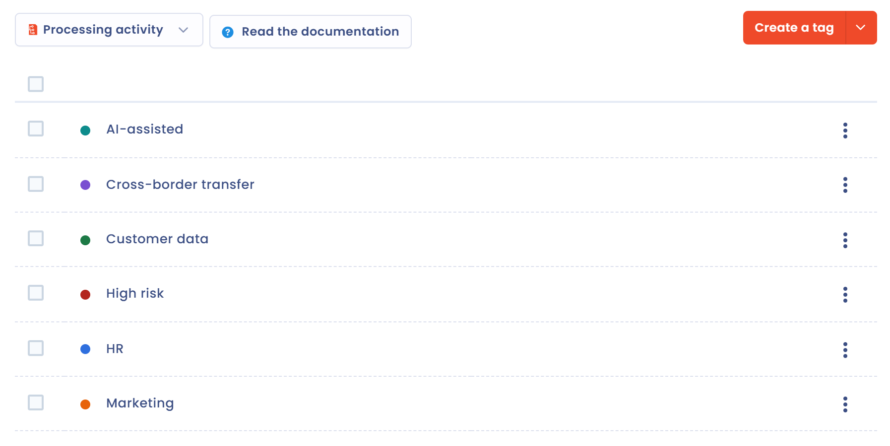

# Gestion des tags

## À quoi servent les tags

Les tags servent à classer les informations selon votre propre méthodologie. Ils permettent de repérer des traitements ou d'autres éléments de Dastra pour les faire ressortir.

Vous pouvez par exemple poser un tag « prioritaire », « à vérifier » ou « traitement sensible » pour retrouver les éléments concernés. La liste de tags n'est pas limitée et vous pouvez en poser plusieurs sur un même traitement. Un clic sur un tag filtre les éléments qui le portent.

Un tag est propre à un type d'objet : les tags des traitements, des demandes, des violations, des tâches, des acteurs, des mesures, des actifs, des risques, des jeux de données, des modèles de questionnaires, des systèmes d'IA, des modèles d'IA, des contrats, des contrôles et des scénarios de risque sont gérés séparément. Chaque tag a une couleur.

## Créer des tags

Dans un champ **Tags**, commencez à taper le nom d'un tag. S'il existe, sélectionnez-le. S'il n'existe pas, appuyez sur la touche **Entrée** : Dastra crée le tag et l'ajoute à la sélection. Seuls les utilisateurs qui disposent de la permission d'écriture avancée peuvent créer un tag de cette façon.

<figure><figcaption>
La saisie d'un tag dans un formulaire
</figcaption></figure>

Quand le champ est vide, un bouton d'assistant IA peut vous proposer des tags à partir du nom et de la description de l'objet. Voir [Cas d'usage](ai-assistant/use-cases.md).

## Administrer les tags de l'espace de travail

1. Dans la barre latérale, cliquez sur **Réglages espace de travail**.
2. Dans la section **Processus**, cliquez sur **Tags**.
3. Choisissez le type d'objet dont vous voulez gérer les tags.

<figure><figcaption>
La liste des tags d'un type d'objet
</figcaption></figure>

Depuis cette page, vous pouvez :

* cliquer sur **Créer un tag**, saisir son **Label** et choisir sa **Couleur** ;
* cliquer sur la flèche du bouton pour **Créer à partir de modèles**, **Importer** des tags depuis un fichier (voir [Importer vos données](import.md)) ou **Exporter** la liste en CSV, XLSX, JSON ou Markdown ;
* ouvrir le menu d'un tag pour **Modifier le tag**, **Supprimer** le tag ou cliquer sur **Objets liés**, qui ouvre la liste des éléments portant ce tag ;
* sélectionner plusieurs tags, puis **Choisir une action groupée** > **Supprimer**.

Depuis un champ **Tags**, le lien **Gestion des tags** en bas de la liste ouvre cette même liste, limitée au type d'objet du formulaire.

La section **Processus** n'apparaît que pour les utilisateurs qui disposent de la permission d'écriture avancée.
