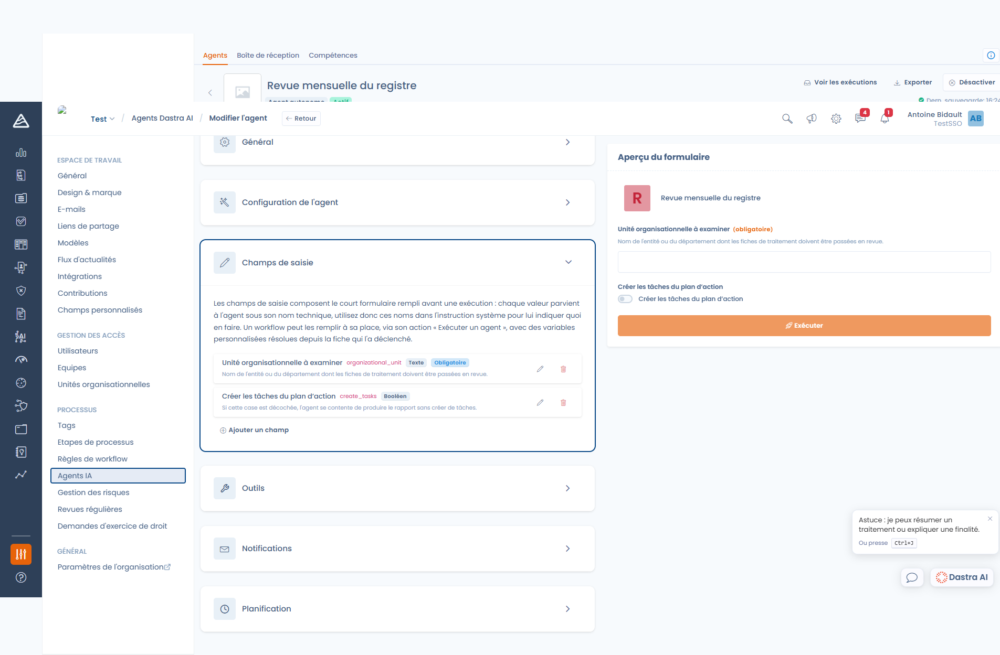
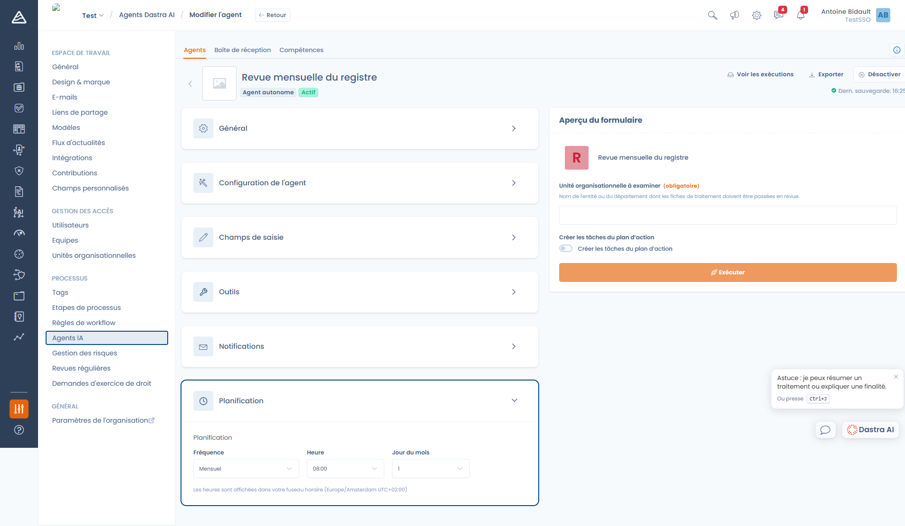

# Créer un agent autonome

Un agent autonome exécute une tâche de bout en bout, sans personne devant l'écran : passer en revue un périmètre du registre, préparer un plan d'action, produire une synthèse mensuelle.

Rendez-vous dans **Réglages espace de travail > Agents IA**, cliquez sur **Créer un agent**, puis sur **Agent autonome**.


**Un agent autonome ne peut pas vous poser de question.** Les outils qui demandent une interaction — poser une question, naviguer dans l'interface, demander une confirmation — lui sont retirés. Son instruction doit donc couvrir tous les cas, y compris ce qu'il doit faire quand une information manque.


***

### Configuration de l'agent

L'**instruction système** (10 000 caractères maximum) décrit la mission complète. Contrairement à un agent conversationnel, où vous définissez surtout une personnalité, il s'agit ici d'une procédure.

Une instruction système efficace est numérotée, explicite sur les limites, et précise le format du résultat attendu :

```
Tu réalises la revue mensuelle du registre des traitements.

Étapes à suivre :
1. Liste les fiches de traitement de l'unité organisationnelle indiquée
   dans le champ de saisie.
2. Pour chaque fiche, vérifie que la finalité, la base légale, la durée
   de conservation et les mesures de sécurité sont renseignées.
3. Regroupe les manques constatés par fiche.
4. Crée un plan d'action contenant une tâche par fiche incomplète, en
   précisant les champs à compléter.

Ne modifie aucune fiche de traitement : limite-toi à la création des
tâches du plan d'action.

Termine par un résumé en français indiquant le nombre de fiches examinées,
le nombre de fiches incomplètes et les tâches créées.
```

***

### Champs de saisie

Les champs de saisie composent le court formulaire rempli avant une exécution. Chaque valeur parvient à l'agent **sous son nom technique** : utilisez donc ces noms dans l'instruction système pour lui indiquer quoi en faire.

<figure><figcaption><p>Les champs de saisie et leur aperçu, à droite</p></figcaption></figure>

Chaque champ se définit par :

| Paramètre | Rôle |
| --- | --- |
| **Libellé** | Ce que voit la personne qui lance l'exécution |
| **Nom** | Le nom technique sous lequel la valeur parvient à l'agent |
| **Type** | Texte, Nombre, Booléen ou Liste de choix |
| **Obligatoire** | Empêche de lancer l'exécution tant que le champ est vide |
| **Défaut** | Valeur pré-remplie |
| **Description** | Aide affichée sous le champ |

Un agent sans aucun champ de saisie s'exécute sans rien demander.


Le **Nom** est pré-rempli automatiquement à partir du libellé. Si vous le modifiez, vérifiez la valeur finale : c'est elle que vous devez citer dans l'instruction système.


L'**aperçu du formulaire**, à droite de l'éditeur, montre exactement ce que verront vos utilisateurs — et sert aussi à lancer une exécution de test.

***

### Outils

Le fonctionnement est identique à celui d'un [agent conversationnel](agent-conversationnel.md#outils) : par défaut tous les outils sont disponibles, et vous pouvez restreindre la liste.

L'enjeu est cependant plus important ici, puisque personne ne relit l'agent pendant qu'il travaille. Accordez-lui les outils de lecture dont il a besoin, et **uniquement les outils de modification que sa mission exige**.

### Notifications

Les utilisateurs notifiés reçoivent une notification Dastra lorsque l'agent **termine** son exécution, et une autre lorsqu'elle **échoue**. Une exécution qui se termine en demandant une revue humaine est considérée comme terminée.

***

### Planification

<figure><figcaption><p>La planification d'un agent autonome</p></figcaption></figure>

Choisissez une **fréquence** — Pas de planification, Quotidien, Hebdomadaire ou Mensuel — puis l'heure, et selon le cas le jour de la semaine ou le jour du mois.


**Les heures sont affichées dans votre fuseau horaire**, comme l'indique la mention sous le formulaire. Dastra les enregistre en UTC : c'est pourquoi la vignette de l'agent dans la liste peut afficher une heure différente de celle que vous avez saisie.

Le déclencheur passe **une fois par heure, à l'heure pile**. Une planification ne peut donc pas viser une minute précise.


Seuls les agents **actifs**, non archivés et de type autonome sont pris en compte par la planification.

***

### Les trois façons de déclencher une exécution

#### 1. Manuellement

Remplissez le formulaire dans l'aperçu, puis cliquez sur **Exécuter**. L'exécution est mise en file d'attente : vous êtes redirigé vers la boîte de réception, où vous la voyez passer de **En cours** à son statut final.

#### 2. Selon le planning

L'agent part tout seul à la fréquence configurée. Les valeurs par défaut de ses champs de saisie sont alors utilisées.

#### 3. Depuis une règle de workflow

Dans **Réglages espace de travail > Règles de workflow**, l'action **Exécuter un agent IA** permet de déclencher un agent à partir d'un événement sur une fiche — un changement d'étape, une création, une échéance.

Vous y choisissez l'agent, un message, et les valeurs de ses champs de saisie. Ces valeurs acceptent des **variables personnalisées** résolues depuis la fiche qui a déclenché la règle : l'agent reçoit donc un contexte différent à chaque exécution.

***

### Limites d'une exécution

| Limite | Comportement |
| --- | --- |
| **30 itérations d'outils** par tour | Au-delà, l'agent doit conclure : l'exécution se termine en *Exécution incomplète* |
| **Taille du contexte** | Les échanges d'outils les plus anciens sont résumés ; en cas de dépassement, l'exécution se termine en *Limite de contexte atteinte* |
| **10 000 caractères** en entrée | Un message plus long est refusé |
| **Quota de crédits** | Une exécution est refusée si le quota mensuel est atteint |

Ces statuts, et les autres, sont détaillés dans [Suivre les exécutions](boite-de-reception.md).

***


[boite-de-reception.md](boite-de-reception.md)

