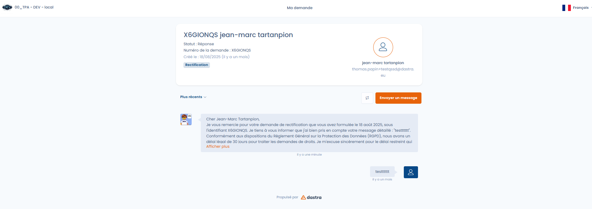

# Espace demandeur

Chaque personne à l’origine d’une demande accède à un **espace dédié**, sécurisé par un code unique transmis par email.

Depuis cet espace, le demandeur peut :

* Suivre l’avancement de sa demande.
* Consulter les messages envoyés par l’organisation.
* Répondre et échanger directement avec le responsable.
* Télécharger ou déposer des documents justificatifs.

<figure><figcaption>
L'espace d'échange avec le demandeur
</figcaption></figure>

Cet espace permet d’assurer la traçabilité, le suivi et la transparence des échanges, tout en évitant les envois non sécurisés par email classique.


**Données de santé** : Dastra n'est pas certifié HDS (Hébergeur de Données de Santé). En revanche, notre hébergeur, Microsoft Azure, l'est. Si des documents transmis via l'interface (par le demandeur ou par votre organisation) contiennent des données de santé, assurez-vous que cet usage est compatible avec vos propres obligations en la matière.

