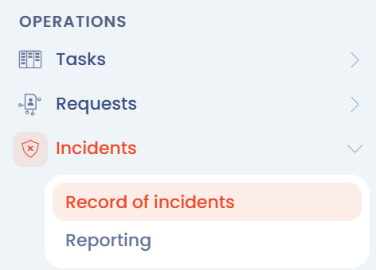
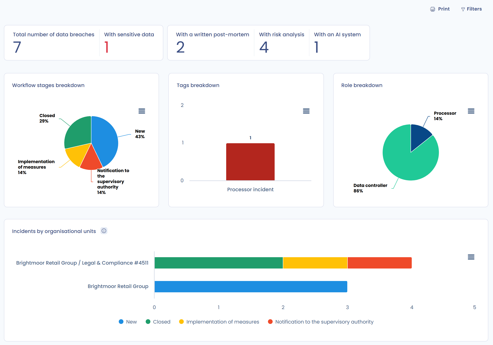

# Incidents et violations de données

Le module **Incidents** de Dastra sert à documenter les incidents de sécurité qui touchent des données personnelles, à suivre les notifications à l'autorité de contrôle et aux personnes concernées, et à garder une trace de chaque incident. Il s'adresse au délégué à la protection des données (DPO), aux équipes sécurité et aux juristes.

Pour savoir ce qu'est une violation de données et quelles sont vos obligations, lisez la page [Violations de données](../../gdpr/concepts/breaches.md).

## Pourquoi tenir un registre des violations

L'article 33, paragraphe 5, du RGPD impose à chaque organisme de documenter toutes les violations de données personnelles : les faits, leurs effets et les mesures prises. Cette obligation vaut même lorsque la violation n'est pas notifiée à l'autorité de contrôle.

Le registre sert aussi à respecter les délais de notification et à repérer les mesures de prévention à mettre en place. Pour en savoir plus, consultez la [page dédiée du site Dastra](https://www.dastra.eu/fr/product-features/data-breach).

## Ouvrir le registre des incidents

Dans le menu de gauche, ouvrez **Opérations** > **Incidents** > **Registre des incidents**.

<figure><figcaption>
Le module Incidents dans le menu de gauche
</figcaption></figure>

Le module n'apparaît que si la fonctionnalité est activée pour votre organisation et si votre rôle donne accès aux incidents.

## Lire le registre

Le registre liste les incidents de l'espace de travail, un par ligne.

<figure><figcaption>
Le registre des incidents
</figcaption></figure>

### Barre d'indicateurs

Au-dessus du tableau, une barre d'indicateurs compte les incidents :

* **Total**, **En cours** (statut Actif) et **Fermées** ;
* **Sans analyse de risque** et **Avec données sensibles** ;
* **Incluant un système d'IA**, si le module des systèmes d'IA est activé.

Cliquez sur un indicateur pour filtrer le tableau sur les incidents concernés.

### Colonnes et filtres

Vous choisissez les colonnes du tableau. La colonne **Délai de notification à l'autorité contrôle** indique, pour chaque incident dont la notification est obligatoire, le nombre d'heures restantes (badge vert) ou de retard (badge rouge), puis **Vous avez prévenu l'autorité de contrôle** une fois la notification enregistrée. Lorsque la notification n'est pas nécessaire, la cellule affiche **Notif. autorité pas nécessaire**.

Les filtres couvrent notamment l'unité organisationnelle, les tags, les **Types d'incidents**, les **Statuts** (Nouveau, Actif, Fermé), le **Type** (sous-traitant ou responsable de traitement), les **Etapes** du workflow et la **Personne en charge de l'incident**. Cochez **Avec notification** pour ne garder que les incidents notifiés, ou **Liées à un système d'IA** pour ceux qui impliquent un système d'IA. Pour les filtres avancés et les vues personnalisées, lisez [Filtres avancés](../general/filters.md).

### Actions sur les incidents

* Cliquez sur une ligne pour ouvrir l'incident.
* Le menu à droite d'une ligne propose **Modifier**, **Modifier les champs** et **Déplacer dans la corbeille**.
* Cochez plusieurs lignes pour agir sur la sélection : **Basculer l'étape de processus**, **Modifier les champs**, **Exporter**, **Partager** ou **Déplacer dans la corbeille**.
* Le bouton **Ajouter un incident** crée un incident. Sa flèche ouvre un menu avec **Importer**, **Exporter**, **Partager** et **Lire la documentation**.

### Corbeille

**Déplacer dans la corbeille** retire l'incident du registre sans l'effacer. Cochez **Voir la corbeille** pour afficher les incidents qui s'y trouvent, puis choisissez **Restaurer** pour les remettre dans le registre ou **Supprimer** pour les effacer.


**Supprimer** efface l'incident de façon définitive. L'article 33, paragraphe 5, impose pourtant de pouvoir justifier chaque violation : ne supprimez pas la trace d'une violation que vous devez documenter.


## Consulter les statistiques

Ouvrez **Opérations** > **Incidents** > **Statistiques** pour avoir une vue d'ensemble du registre. Le bouton **Imprimer** produit une version imprimable de la page.

<figure><figcaption>
La page Statistiques des incidents
</figcaption></figure>

La page affiche :

* des indicateurs : **Nombre total d'incidents**, **Avec post-mortem rédigé**, **Avec analyse de risque**, **Sans analyse de risque**, **Avec données sensibles** et **Incluant un système d'IA** ;
* les graphiques **Répartition par étape de workflow**, **Répartition par tags**, **Répartition par rôle** et **Incidents par unités organisationnelles**.

## Aller plus loin


[Documenter une nouvelle violation de données](document-breach.md)



[Incidents en tant que sous-traitant](as-processor.md)



[Exportez vos violations de données](export.md)

