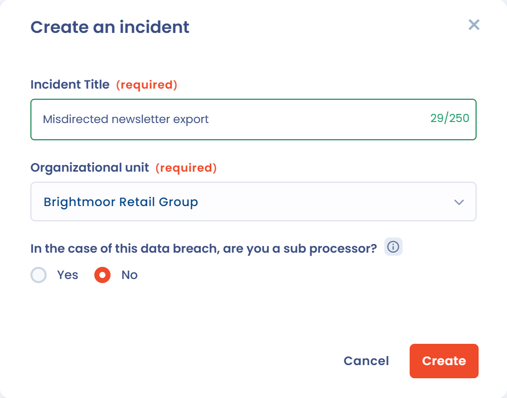
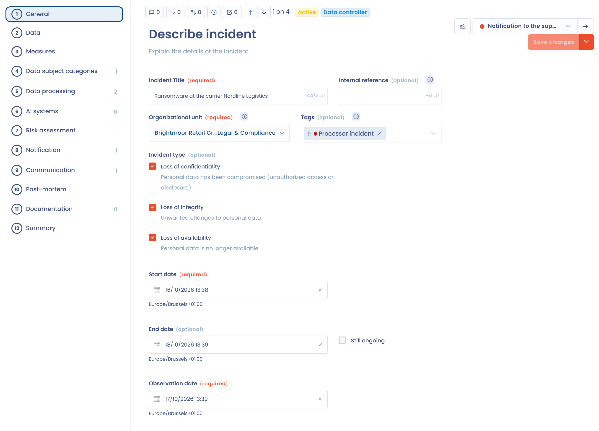
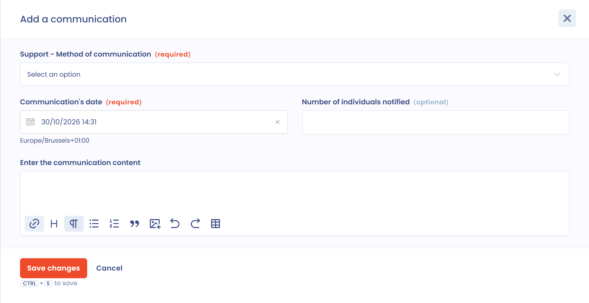
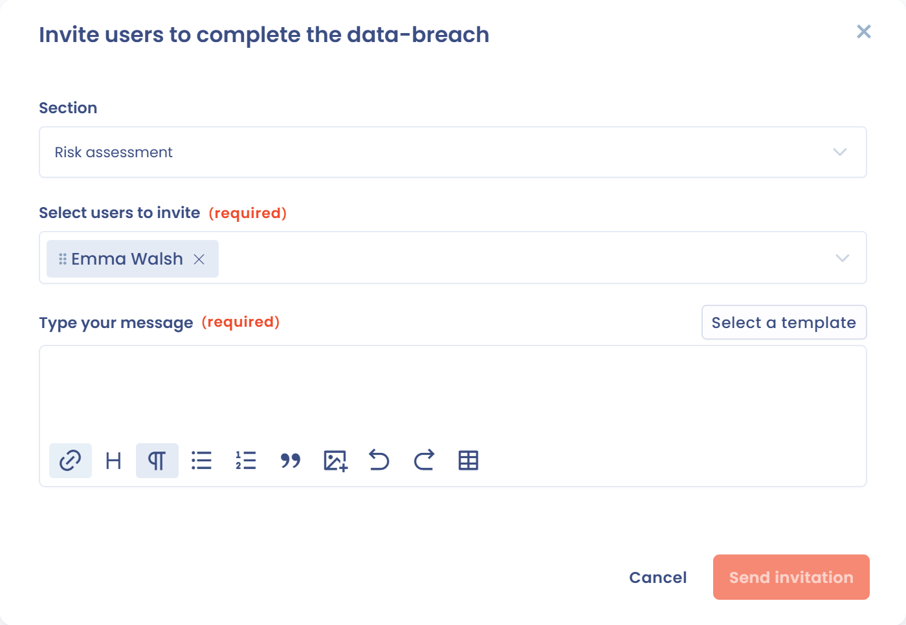

# Documenter une nouvelle violation de données

Cette page explique comment créer un incident dans Dastra et comment remplir chaque étape de son formulaire. Si votre organisation intervient en tant que sous-traitant, lisez aussi [Incidents en tant que sous-traitant](as-processor.md).

## Créer un incident

Un incident se crée de trois façons :

* manuellement, avec le bouton **Ajouter un incident** ;
* par import d'un fichier Excel, CSV ou texte : dans le registre, ouvrez la flèche du bouton **Ajouter un incident**, choisissez **Importer** et suivez l'assistant décrit dans [Importer vos données (Excel, Csv)](../general/import.md) ;
* par e-mail : une adresse de collecte transforme chaque e-mail reçu, avec ses pièces jointes, en incident. Lisez [Adresses emails de collecte](../settings/mailboxes.md).

### Créer un incident manuellement

1. Ouvrez **Opérations** > **Incidents** > **Registre des incidents**, puis cliquez sur **Ajouter un incident**.
2. Saisissez l'**Intitulé de l'incident** et choisissez l'**Unité organisationnelle**. Les deux champs sont obligatoires.
3. Répondez à la question **Dans le cadre de cet incident, êtes-vous sous-traitant ?**. La réponse par défaut est **Non**.
4. Cliquez sur **Créer**. Le formulaire de l'incident s'ouvre sur la première étape.

<figure><figcaption>
La fenêtre de création d'un incident
</figcaption></figure>

Répondez **Oui** uniquement si votre organisation traite les données touchées pour le compte d'un responsable de traitement. Le formulaire est alors adapté, comme l'explique [Incidents en tant que sous-traitant](as-processor.md).



## Parcourir le formulaire

Les étapes du formulaire sont listées à gauche. Un compteur indique le nombre d'éléments renseignés pour les étapes qui en comptent. Parcourez-les dans l'ordre avec **Suivant** et **Retour**, ou passez directement à l'étape de votre choix.

<figure><figcaption>
Le formulaire d'un incident, ici sur l'étape Général
</figcaption></figure>

* Cliquez sur **Enregistrer** pour conserver vos modifications, ou ouvrez la flèche du bouton et choisissez **Enregistrer et quitter**.
* En haut du formulaire, des onglets donnent accès aux discussions, aux tâches liées, aux relations avec d'autres objets, à l'historique et aux audits.
* Le sélecteur d'étape de processus fait avancer l'incident dans votre workflow. Lisez [Etapes de processus](../settings/workflow-stages.md) pour les configurer.
* Le menu du bouton **Enregistrer** donne aussi accès à **Exporter**, **Partager**, **Règle de workflow**, **Champs personnalisés**, **Dupliquer** et **Déplacer dans la corbeille**.

L'étape **Notification** n'apparaît pas pour un incident traité en tant que sous-traitant, et l'étape **Systèmes d'IA** n'apparaît que si le module des systèmes d'IA est activé.

## Étape Général

Décrivez l'incident et ses circonstances :

* **Intitulé de l'incident**, **Référence interne**, **Unité organisationnelle** et **Tags** ;
* **Type d'incident** : **Perte de confidentialité**, **Perte d'intégrité** ou **Perte de disponibilité**. Vous pouvez en cocher plusieurs ;
* **Date et heure de début de l'incident**, **Date et heure de fin de l'incident** et la case **Incident toujours en cours** ;
* **Date et heure de constatation de l'incident** ;
* **Personne en charge de l'incident** ;
* **Description générale de l'incident** et **Lieu de l'incident** ;
* **Cause principale de l'incident** (Inconnue, Acte interne intentionnel, Acte interne accidentel, Acte externe intentionnel, Acte externe accidentel ou Autre), une raison secondaire facultative et des observations complémentaires ;
* **Des sous-traitants sont-ils impliqués ?** Si vous répondez **Oui**, indiquez les sous-traitants impliqués dans l'incident parmi les acteurs de votre espace de travail.


La date de constatation est le point de départ du délai de notification. Renseignez la date et l'heure auxquelles vous avez eu connaissance de la violation, pas celles de son début.


## Étape Données

Indiquez les données personnelles touchées :

* **Jeux de données concernés par l'incident** : sélectionnez les jeux de données de votre espace de travail ;
* **Volume de données** : choisissez une valeur dans une liste (**Sélecteur**) ou saisissez un nombre (**Entrer une valeur**). Il s'agit du nombre approximatif d'enregistrements touchés ;
* **Supports des données concernées par l'incident** ;
* **Des données sensibles sont-elles impliquées ?** Cette réponse alimente l'indicateur **Avec données sensibles** du registre.

## Étape Mesures

Décrivez les mesures de sécurité en deux temps :

* **Mesures préalables à l'incident** : sélectionnez des mesures de sécurité existantes et complétez par un texte ;
* **Mesures prises pour remédier à la violation ou pour en atténuer les conséquences négatives**, avec la même présentation.

Ces informations correspondent à ce que l'article 33, paragraphe 3, demande de décrire dans la notification à l'autorité de contrôle.

## Étape Personnes concernées

Cliquez sur **Ajouter une catégorie de personnes concernées** pour chaque catégorie touchée. Dans la fenêtre, choisissez la catégorie, saisissez le **Volume approximatif de personnes concernées** et ajoutez un commentaire si nécessaire. Vous pouvez modifier ou supprimer chaque ligne ensuite.

## Étape Traitements

Sous **Indiquez les traitements liés à l'incident**, sélectionnez les traitements du registre concernés, puis complétez dans **Observations complémentaires** si besoin. Ces liens sont aussi ceux que Dastra utilise pour retrouver les responsables de traitement d'un incident traité en tant que sous-traitant.

## Étape Systèmes d'IA

Lorsqu'une violation implique un système d'IA, qu'il en soit la cause, le vecteur ou qu'il traite les données touchées, sélectionnez-le sous **Indiquez les systèmes d'IA liés à l'incident**. Vous pouvez en lier plusieurs, parmi les systèmes d'IA de votre espace de travail.

<figure><figcaption>
L'étape Systèmes d'IA
</figcaption></figure>

Avec ce lien, vous pouvez :

* afficher la colonne **Systèmes d'IA** dans le registre et filtrer les incidents avec **Systèmes d'IA** ou **Liées à un système d'IA** ;
* suivre la part des incidents impliquant un système d'IA grâce à l'indicateur **Incluant un système d'IA** du registre et de la page **Statistiques** ;
* faire tenir compte de ces systèmes par le post-mortem généré avec l'IA.

## Étape Analyse de risque

L'analyse de risque détermine si vous devez notifier l'autorité de contrôle et informer les personnes concernées.

<figure><figcaption>
L'étape Analyse de risque, avec le niveau de risque calculé
</figcaption></figure>

Répondez d'abord à **Une analyse du risque a-t-elle déjà été effectuée ?**.

* Avec **Non**, évaluez l'incident avec Dastra. Choisissez un score de 1 (négligeable) à 4 (maximal) pour **Identification des personnes concernées**, qui mesure la facilité à identifier les personnes à partir des données, et pour **Impacts sur les personnes concernées**, qui mesure la gravité des conséquences pour elles. Dastra additionne les deux scores et affiche le **Niveau de risque**.
* Avec **Oui**, vous avez déjà mené votre propre analyse. Choisissez le niveau dans **Conclusion de l'analyse du risque : niveau de risque estimé**, puis cliquez sur **Envoyer mon analyse** pour joindre le document à l'étape Documentation.

| Total des deux scores | Niveau de risque | Conséquence affichée par Dastra |
| --- | --- | --- |
| 2 et 3 | Risque négligeable | La notification à l'autorité de contrôle et la communication aux personnes ne sont pas nécessaires |
| 4 et 5 | Risque réel | Notification à l'autorité de contrôle obligatoire |
| 6 à 8 | Risque élevé | Notification à l'autorité de contrôle et communication aux personnes concernées obligatoires |

Pour le cadre juridique de cette évaluation (articles 33 et 34 du RGPD), lisez [Violations de données](../../gdpr/concepts/breaches.md).



## Étape Notification

L'étape **Notification** suit la notification à l'autorité de contrôle. Le RGPD demande de notifier la violation dans les meilleurs délais et, si possible, 72 heures au plus tard après en avoir pris connaissance (article 33).

<figure><figcaption>
L'étape Notification et son compte à rebours
</figcaption></figure>

Dès que l'analyse de risque conclut à un risque réel ou élevé, un encadré compte les 72 heures à partir de la date de constatation. Il indique le nombre d'heures restantes, puis « délai de 72 heures dépassé » en cas de retard, puis « Vous avez prévenu l'autorité de contrôle » une fois la notification enregistrée. Pour un risque négligeable, l'encadré précise que vous n'êtes pas tenu de notifier l'autorité.

Pour enregistrer une notification :

1. Cliquez sur **Ajouter une notification**.
2. Cliquez sur le lien « Rendez-vous sur le site de l'autorité compétente » pour déclarer la violation sur le site de l'autorité. Dastra n'envoie pas la notification : il en garde la trace.
3. Renseignez la **Date et heure de la notification**, le **Numéro de la notification (fourni par l'autorité de contrôle)** et les **Observations complémentaires**.
4. Validez la fenêtre, puis enregistrez le formulaire.

L'autorité proposée est celle de l'unité organisationnelle de l'incident. Si aucune n'est définie, la fenêtre affiche « Aucune autorité de contrôle n'a été définie pour votre entité » et un lien vers les paramètres des unités organisationnelles. Lisez [Ajouter une autorité chef de file](../../getting-started/setup/lead-authority.md).

## Étape Communication

Cette étape suit l'information des personnes concernées. L'article 34 du RGPD l'impose lorsque la violation présente un risque élevé pour leurs droits et libertés.

Un encadré rappelle ce que l'analyse de risque implique. Répondez ensuite à **Avez-vous adressé une communication aux personnes concernées ?** par **Non applicable**, **Oui** ou **Non**.

* Avec **Oui**, cliquez sur **Ajouter une communication** et renseignez le **Support de la communication** (e-mail, lettre, appel téléphonique, bannière sur le site web, campagne de communication ou autre moyen), la **Date et heure de la communication**, le **Nombre de personnes informées** et le contenu envoyé.
* Avec **Non**, indiquez **Pour quelles raisons n'avez-vous pas communiqué aux personnes concernées** : « Le risque élevé n'est plus susceptible de se matérialiser » ou « Les données ont été rendues incompréhensibles ». Expliquez votre choix dans **Justification de l'absence de communication**.

<figure><figcaption>
La fenêtre Ajouter une communication
</figcaption></figure>

## Étape Post-mortem

Le post-mortem est une revue détaillée de l'incident après sa résolution. Il est recommandé, sans être obligatoire. Répondez à **Souhaitez-vous rédiger un post-mortem ?**. Avec **Oui**, indiquez la **Date de rédaction**, puis choisissez l'une des trois méthodes :

* saisir la **Référence, emplacement ou url du document** s'il existe déjà ailleurs ;
* cliquer sur **Ajouter un post-mortem en pièce jointe** ;
* rédiger le texte dans l'éditeur, avec **Utiliser le modèle** pour partir d'un plan type, ou **Générer avec IA**.

<figure><figcaption>
L'étape Post-mortem
</figcaption></figure>

**Générer avec IA** rédige un brouillon à partir des informations de l'incident : contexte (y compris les traitements et les systèmes d'IA liés), chronologie, impacts, mesures et analyse de risque, communications, leçons apprises et pistes d'amélioration. Relisez et corrigez le texte avant de l'enregistrer. **Enregistrer en tant que pdf** exporte le post-mortem rédigé.

## Étape Documentation

Rassemblez ici tout ce qui documente l'incident : un texte libre avec liens et images, et les fichiers joints, comme le post-mortem ou le compte rendu de notification.

## Étape Récapitulatif

L'étape **Récapitulatif** rassemble en lecture seule toutes les informations de l'incident. Utilisez **Tout replier** et **Tout déployer** pour parcourir les sections, et **Imprimer** pour en obtenir une version papier.

## Inviter des collègues à compléter l'incident

Plusieurs personnes interviennent souvent sur un incident. Cliquez sur le bouton des utilisateurs, en haut à droite du formulaire, à côté du sélecteur d'étape de processus. Dans la fenêtre, choisissez la **Section** à compléter, **Sélectionnez les utilisateurs à inviter**, saisissez votre message (vous pouvez partir d'un modèle avec **Sélectionner un modèle**), puis cliquez sur **Envoyer une invitation**.

<figure><figcaption>
La fenêtre d'invitation à compléter un incident
</figcaption></figure>

## Partager un incident

**Partager**, dans le menu du bouton **Enregistrer** ou dans le menu du bouton **Ajouter un incident** du registre, ouvre la fenêtre de création d'un lien de partage. Pour le fonctionnement général des liens de partage, lisez [Partager le registre](../ropa/share.md).
