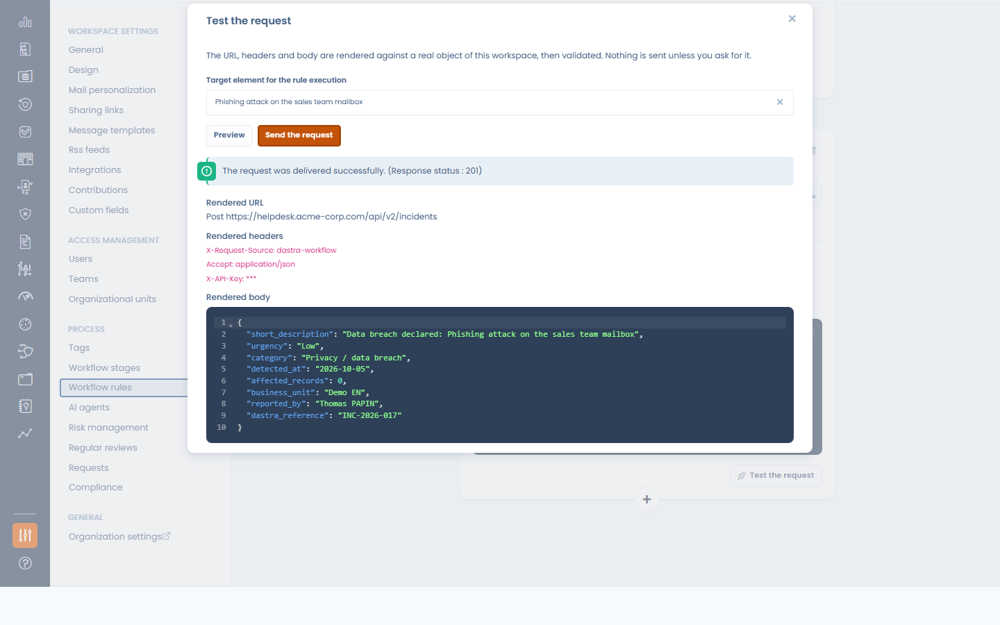
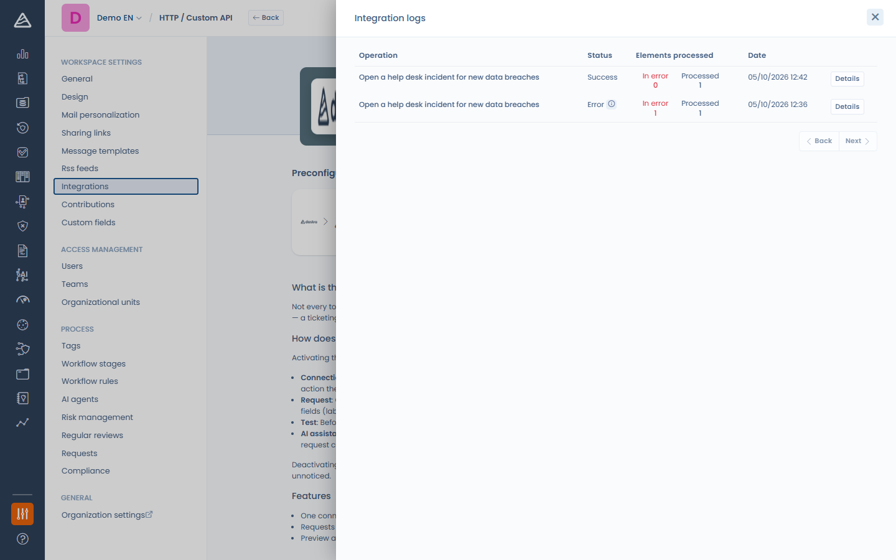

# HTTP / Custom API

### Que fait l'intégration ?

L'intégration HTTP / Custom API permet à vos **règles de workflow d'appeler n'importe quelle plateforme exposant une API HTTP** — outil de ticketing, ITSM, service interne, hub d'automatisation — au déclenchement d'une règle. Vous composez la requête vous-même : la méthode, l'URL, les en-têtes et un corps JSON ou XML construit à partir des données de l'enregistrement. C'est l'intégration à utiliser lorsqu'aucun connecteur natif n'existe pour votre outil.

<!-- 📸 Capture : le designer de règles de workflow avec une action « Envoyer une requête HTTP » — méthode et URL en haut, onglet Corps ouvert sur un template JSON Liquid -->

<figure><figcaption>
L'action de workflow « Envoyer une requête HTTP »
</figcaption></figure>

### Prérequis

* Un point d'accès de la plateforme cible acceptant une requête HTTP (GET, POST, PUT, PATCH ou DELETE), et ses identifiants : une clé ou un jeton d'API, un nom d'utilisateur et un mot de passe, ou un client OAuth 2.0 (identifiant client, secret et URL de jeton).
* La permission **Intégrations** sur le workspace, pour activer l'intégration, gérer les connexions et ajouter ou modifier des actions de requête HTTP. Les concepteurs de workflow qui ne l'ont pas peuvent toujours modifier le reste d'une règle qui en contient une, ou retirer l'action — mais ni l'ajouter ni la modifier.
* Une cible joignable depuis internet : Dastra bloque les requêtes vers des adresses réseau privées ou internes.

### Installation

1. Dans Dastra, ouvrez **Réglages espace de travail** > **Intégrations** et sélectionnez **HTTP / Custom API**.
2. Activez le cas d'usage : aucun identifiant à saisir à cette étape — l'interrupteur active simplement l'action pour le workspace.
3. Cliquez sur **Gérer les connexions** et ajoutez une connexion par plateforme cible. Une connexion porte une façon de s'authentifier :
   * **Clé d'API / jeton** — la clé, l'en-tête qui la transporte (`Authorization` par défaut) et un préfixe de valeur optionnel (`Bearer ` par défaut lorsque l'en-tête est `Authorization`). Pour un en-tête du type `X-API-Key`, laissez le préfixe vide.
   * **Basic (identifiants)** — un nom d'utilisateur et un mot de passe.
   * **OAuth 2.0 (client credentials)** — une URL de jeton, un identifiant client et un secret client (plus des scopes optionnels) : Dastra demande lui-même les jetons d'accès et les renouvelle avant leur expiration.

   L'**URL de base** optionnelle ne sert qu'au test de connexion : Dastra y envoie un GET avec les identifiants et attend une réponse en succès.

<!-- 📸 Capture : la page de l'intégration HTTP / Custom API — cas d'usage activé, bouton « Gérer les connexions » -->

<figure><figcaption>
L'intégration est un simple interrupteur d'activation ; les identifiants vivent sur les connexions
</figcaption></figure>

<!-- 📸 Capture : la modale « Ajouter une connexion » avec la méthode clé d'API / jeton (clé, nom d'en-tête, préfixe, URL de base) -->

<figure><figcaption>
Ajout d'une connexion par clé d'API
</figcaption></figure>


Les identifiants vivent sur la connexion, jamais dans la règle de workflow. Plusieurs règles peuvent partager une même connexion, et un workspace peut contenir autant de connexions que de plateformes cibles. Le gestionnaire de connexions indique combien de règles utilisent chacune d'elles.


### Envoyer une requête depuis une règle de workflow

Une fois l'intégration active, le designer de règles de workflow propose l'action **Envoyer une requête HTTP** :

* **Méthode** et **URL** — l'URL doit être absolue (`https://…`). Son hôte est fixe ; le chemin et la chaîne de requête peuvent contenir des variables.
* Onglet **Authentification** — choisissez la connexion à utiliser, ou **Sans authentification** pour un point d'accès public. Une connexion peut être créée depuis cet onglet.
* Onglet **En-têtes** — jusqu'à 20 en-têtes personnalisés. Les valeurs acceptent des variables. L'en-tête d'authentification de la connexion l'emporte toujours sur un en-tête du même nom.
* Onglet **Corps** (POST, PUT et PATCH) — choisissez le format (**JSON**, **XML** ou **Sans corps**) et rédigez le corps sous forme de template.

Tapez `{{` dans l'URL, dans une valeur d'en-tête ou dans le corps pour insérer les champs de l'enregistrement (libellé, responsable, dates, champs personnalisés…). Ils sont rendus au déclenchement de la règle. Le corps rendu doit être un JSON ou un XML bien formé, sinon rien n'est envoyé et l'exécution de la règle est journalisée en erreur.

#### Tester la requête

**Tester la requête** rend l'URL, les en-têtes et le corps avec un enregistrement réel de votre workspace, puis les valide — l'en-tête d'authentification est affiché avec son secret masqué. **Aperçu** n'envoie rien ; **Envoyer la requête** effectue l'appel réel et affiche le statut de réponse de la cible et, en cas d'échec, le début de son message d'erreur.

<!-- 📸 Capture : la modale de test après « Envoyer la requête » — résultat de l'envoi, URL rendue, en-tête masqué, corps rendu -->

<figure><figcaption>
Test de la requête sur un enregistrement réel
</figcaption></figure>

#### Générer la requête avec l'IA

Avec l'assistant IA de Dastra, le bouton à côté du champ URL (**Générer avec l'IA**) rédige toute la requête : décrivez ce qu'elle doit faire et collez le payload attendu par la cible — ou un extrait de la documentation de son API. Seuls les noms et types des champs de l'enregistrement sont partagés avec l'assistant, jamais vos données ni vos identifiants, et le brouillon ne porte jamais d'authentification : elle reste sur la connexion. Relisez le brouillon, puis utilisez le bouton de test.

<!-- 📸 Capture : la modale « Générer la requête avec l'IA » — champs instruction et payload collé -->

<figure><figcaption>
Rédaction de la requête à partir d'une instruction et du payload attendu
</figcaption></figure>

### Journaux

Chaque envoi effectué par une règle est tracé dans les journaux d'intégration du cas d'usage (**Voir les journaux** dans le menu du cas d'usage) : la règle, la méthode, l'hôte cible et le statut de réponse — jamais l'URL complète, les en-têtes ni le corps. Les journaux d'exécution de la règle conservent le message d'erreur détaillé, et une règle qui échoue de façon répétée sur le même enregistrement cesse de réessayer après trois tentatives.

<!-- 📸 Capture : le panneau des journaux d'intégration avec des envois HTTP (lignes en succès et en erreur) -->

<figure><figcaption>
Journaux d'intégration des envois HTTP
</figcaption></figure>

### Désactivation et désinstallation

Désactiver le cas d'usage, le désinstaller ou supprimer une connexion **désactive automatiquement les règles de workflow qui en dépendent** (elles ne sont pas supprimées), pour que rien ne continue d'échouer sans que personne ne le voie. Réactivez les règles une fois la dépendance rétablie.


Les requêtes expirent après 15 secondes. Une réponse 2xx est un succès ; tout autre statut est journalisé en échec avec le début de la réponse de la cible. Les requêtes vers des adresses privées ou internes sont toujours bloquées.

