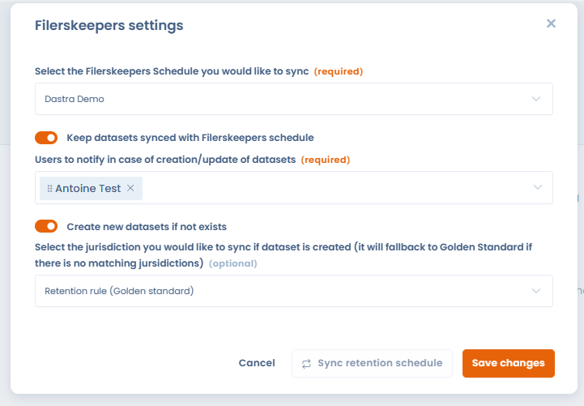
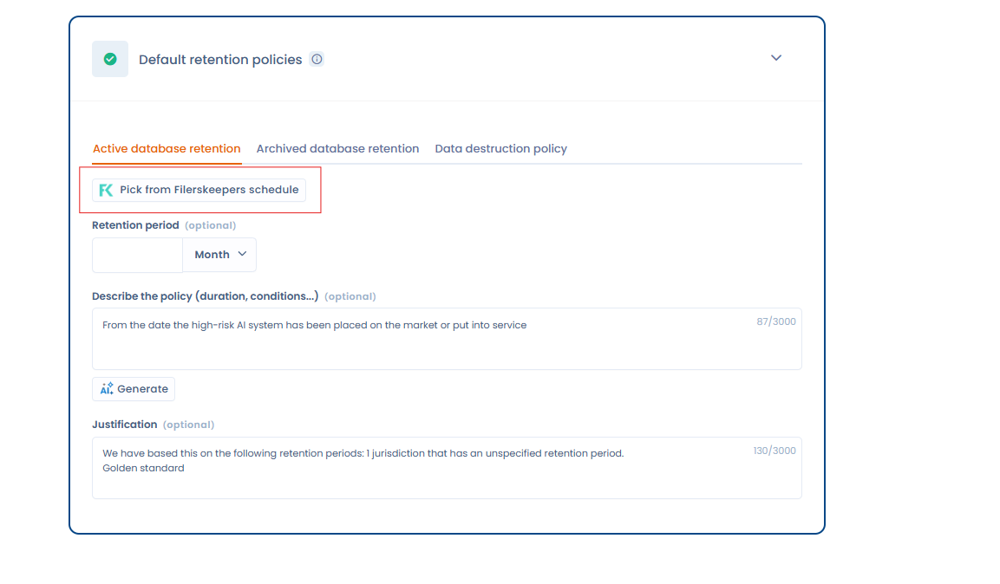
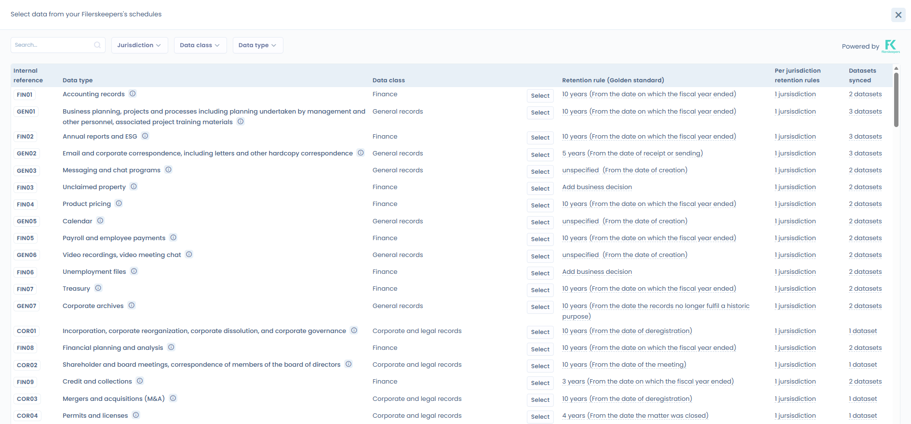
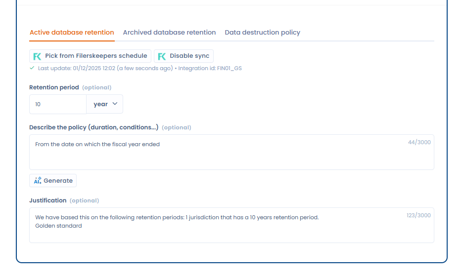

# Filerskeepers

### Qu'est ce que c'est Filerskeepers ?

[Filerskeepers](https://www.filerskeepers.co/) est un service qui fournit des **tableaux de conservation des données** (retention schedules) prêts à l’emploi, couvrant les obligations légales du monde entier.\
Il aide les entreprises à **déterminer combien de temps conserver ou supprimer chaque type de donnée** pour rester conformes aux réglementations.

### Prérequis

* Avoir une licence payante Dastra
* Avoir un compte Filerskeepers, si vous n'en avez pas, et si vous êtes déjà client Dastra, vous pouvez en [discuter avec notre équipe commerciale](https://meetings-eu1.hubspot.com/yann-forveille/rendez-vous-avec-un-expert?message=Filerskeepers+Integration) qui vous proposera des tarifs avantageux
* Avoir mis en place un référentiel de durées de conservation (Schedule) dans le logiciel Filerskeepers. L'intégration aura besoin de ce référentiel pour accéder aux données du catalogue.


L'utilisation du connecteur est soumise aux conditions d'utilisation de Filerskeepers. Les données fournies par Filerskeepers sont réservées à l'usage interne de votre organisation : elles ne peuvent être ni copiées, ni exportées, ni partagées, ni utilisées à des fins commerciales. Les identifiants Filerskeepers ne peuvent être liés qu'à une seule organisation Dastra. Si le service prend fin, vous devez supprimer toutes les données Filerskeepers. Dastra n'est pas responsable du contenu ni des mises à jour provenant de Filerskeepers.


### Installation

L'installation suit le parcours commun des intégrations (voir [Connexions, cas d'usage et mapping des champs](connections.md)) :

1. Ouvrez **Réglages espace de travail** > **Intégrations** et sélectionnez **Filerskeepers**.
2. Sur le cas d'usage des jeux de données, cliquez sur **Ajouter l'intégration**.
3. Dans l'étape **Connexion**, choisissez **Ajouter une connexion**. Saisissez l'**Email** et le **Password** d'un compte administrateur Filerskeepers, puis cliquez sur **Connecter**. Dastra utilise ces identifiants pour obtenir un jeton d'accès à l'API Filerskeepers.

<figure><figcaption>
Connexion à Filerskeepers
</figcaption></figure>

4. Dans l'étape **Configuration**, sélectionnez le Schedule à synchroniser avec Dastra. Cette étape est obligatoire pour finaliser l'installation.

<figure><figcaption></figcaption></figure>

### Configuration

Rouvrez la configuration depuis le menu du cas d'usage, entrée **Configuration**.

* Le plan de durée de rétention (Schedule) à synchroniser, obligatoire : le référentiel Filerskeepers à synchroniser avec Dastra.
* L'interrupteur de synchronisation des durées de conservation : activé, il met à jour une fois par jour les jeux de données synchronisés avec Filerskeepers.
* **Utilisateurs à avertir en cas de création/mise à jour de jeux de données** (obligatoire quand la synchronisation est activée, 10 au maximum) : ces utilisateurs reçoivent un e-mail qui liste les jeux de données créés ou mis à jour.
* L'interrupteur de création des jeux de données : activé, il crée un jeu de données pour chaque type de données déclaré dans votre compte Filerskeepers.
* Le sélecteur de juridiction, facultatif, qui s'affiche quand la création des jeux de données est activée : il choisit la juridiction synchronisée pour les jeux de données créés. Sans juridiction correspondante, Dastra utilise la durée de conservation de référence (Golden standard).


Si vous activez la création des jeux de données, un grand nombre de jeux de données sont créés automatiquement dans votre espace de travail.


#### Lancer une synchronisation

Pour synchroniser sans attendre la synchronisation quotidienne, ouvrez le menu du cas d'usage et cliquez sur **Lancer la synchronisation**. Une synchronisation lancée à la main crée les jeux de données manquants, même si l'option de création est désactivée.

**Afficher les journaux**, dans le même menu, liste les exécutions passées et leur résultat.

### Sélection de la politique de durée de conservation

Le connecteur Filerskeepers a plusieurs modes de fonctionnement :

* Affichage du sélecteur de durée de conservation depuis votre référentiel de durées de conservation. Appelées "Schedule" dans le logiciel

Désormais, quand vous vous rendez dans un jeu de données, dans la section "politiques de conservation", un bouton de sélection de la politique de conservation s'affichera

<figure><figcaption></figcaption></figure>

En cliquant sur ce bouton, vous allez pouvoir directement sélectionner un jeu de données depuis votre référentiel Filerskeepers. **Cette durée de conservation sera automatiquement synchronisée** avec Dastra, si vous avez activé cette option dans la configuration du connection.

<figure><figcaption></figcaption></figure>

Sélectionnez un jeu de données, en cliquant sur le bouton **Sélectionner**

Une fois que vous avez sélectionné la durée de conservation, la fenêtre se fermera, et les informations suivantes s'afficheront : 

<figure><figcaption></figcaption></figure>


Seul les durées conservation en base active seront synchronisées


### Comment sont synchronisées les données entre Dastra et Filerskeepers ?

Un certain nombre de champs issues de Filerskeepers seront automatiquement mappés sur votre durée de conservation :

* **La durée de conservation** (from)
* **La description de la règle de conservation**
* **La justification légale, le lien et la juridiction concernée** seront concaténées dans le champ justification
