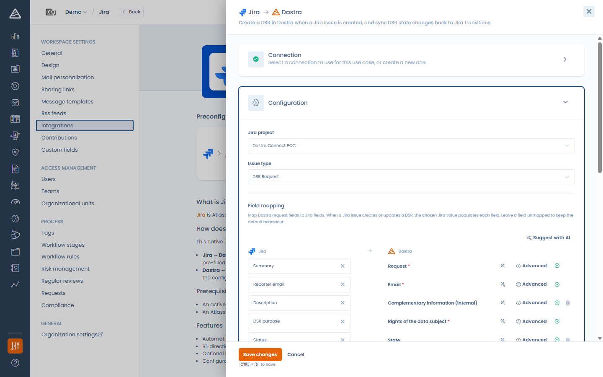
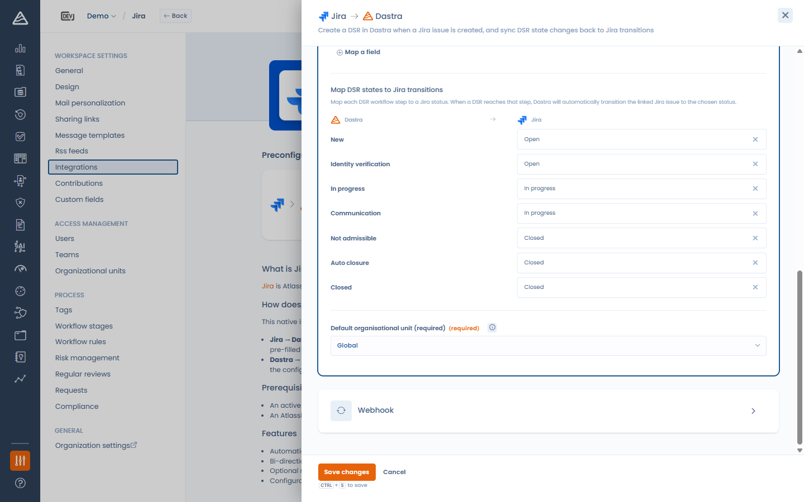

# Jira

### Que fait l'intégration ?

L'intégration Jira propose **deux cas d'usage**. Ils partagent la même connexion Jira, et chacun a sa propre configuration : projet Jira, type de ticket, mapping des champs, association des étapes aux statuts et webhook.

| Cas d'usage | Ce qu'il fait |
| --- | --- |
| **Demandes d'exercice de droits** | Un ticket Jira crée ou met à jour une demande d'exercice de droits (DSR) dans Dastra. Quand la demande atteint une étape de workflow, le ticket lié passe au statut Jira associé à cette étape. |
| **Tâches** | Vous envoyez une tâche Dastra vers Jira, où elle devient un ticket. La tâche et le ticket restent ensuite liés : le statut, l'assigné et les champs mappés remontent depuis Jira, et les changements d'étape faits dans Dastra font passer le ticket au statut Jira correspondant. |

Vous pouvez installer un seul cas d'usage ou les deux.

### Prérequis

* Une instance Jira Cloud (ex. `https://votre-entreprise.atlassian.net`) et un projet pour chaque cas d'usage.
* Selon la méthode d'authentification :
  * **Basic** — l'adresse e-mail d'un compte Jira et un [jeton d'API](https://id.atlassian.com/manage-profile/security/api-tokens) pour ce compte.
  * **OAuth** — aucun jeton à créer : vous vous connectez avec votre compte Atlassian et autorisez Dastra.
* Chaque cas d'usage n'est affiché qu'aux utilisateurs qui disposent du module et du droit correspondants :

| Cas d'usage | Module | Droit |
| --- | --- | --- |
| Demandes d'exercice de droits | Exercices des droits | Écriture sur les demandes |
| Tâches | Planification | Écriture sur les tâches |


La méthode OAuth apparaît dans la liste **Méthode d'authentification** lorsqu'elle est disponible sur votre environnement Dastra. À défaut, utilisez un jeton d'API.


### Installation

1. Ouvrez **Réglages espace de travail** > **Intégrations** et sélectionnez **Jira**.
2. Sur le cas d'usage voulu, cliquez sur **Ajouter l'intégration**.
3. Ajoutez une connexion, ou sélectionnez la connexion Jira déjà utilisée par l'autre cas d'usage :
   * **Basic** : saisissez l'**URL de l'instance**, l'**E-mail** et le **Jeton d'API**, puis cliquez sur **Connecter**.
   * **OAuth** : saisissez l'**URL de l'instance**, puis cliquez sur **Enregistrer et se connecter** — vous êtes redirigé vers Atlassian pour autoriser Dastra.

<!-- 📸 Capture : la modale de connexion Jira montrant le sélecteur Méthode d'authentification avec Basic et OAuth -->

<figure><figcaption>
Connexion de Dastra à Jira
</figcaption></figure>


Si les deux cas d'usage visent la même instance Jira, donnez à chacun **son propre projet ou type de ticket**. Chaque cas d'usage ne lit que les tickets de son projet et de son type de ticket : deux cas d'usage sur le même projet et le même type se disputeraient les mêmes tickets.


## Cas d'usage Demandes d'exercice de droits

### Configuration

* **Projet Jira** — le projet à synchroniser.
* **Type de ticket** — le type de ticket qui représente une demande d'exercice de droits.
* **Mapping des champs** — associez les champs d'une demande Dastra aux champs Jira. Lorsqu'un ticket Jira crée ou met à jour une demande, la valeur Jira choisie remplit chaque champ. Les sources incluent les champs Jira standard (résumé, e-mail du rapporteur, description, statut) **et vos champs personnalisés Jira**.
* **Associer les états DSR aux transitions Jira** — associez chaque étape du workflow DSR à un statut Jira. Quand une demande atteint cette étape, Dastra effectue la transition du ticket lié. Laissez une étape sur **Aucune transition** pour l'ignorer.
* **Unité organisationnelle par défaut** (obligatoire) — l'unité affectée aux demandes créées par l'intégration.

<!-- 📸 Capture : le panneau de configuration Jira avec le projet, le type de ticket et le mapping des champs -->

<figure><figcaption>
Configuration du cas d'usage Demandes d'exercice de droits
</figcaption></figure>


Le champ **Email** de la demande doit être mappé (ou recevoir une valeur par défaut) : il identifie la personne concernée. La configuration ne peut pas être enregistrée sans lui.


#### Champs à liste de valeurs fermée

Certains champs Dastra n'acceptent qu'une liste fixe de valeurs, comme les **Types de droits**. Lorsque vous en mappez un sur un champ Jira, la ligne affiche **Mapping requis** tant que vous n'avez pas indiqué à Dastra comment convertir les valeurs Jira. Ouvrez le panneau **Avancé** de la ligne, puis :

* associez chaque valeur Jira à une valeur Dastra, et/ou
* renseignez une **valeur par défaut**, utilisée quand la valeur Jira n'a pas de correspondance.

La configuration ne peut pas être enregistrée tant qu'une ligne est incomplète. Les champs Jira à valeurs fermées (statuts, listes de choix) proposent leurs valeurs possibles dans ce même panneau **Avancé**. Voir [Connexions et mapping des champs](connections.md) pour le détail de l'éditeur de mapping.

<!-- 📸 Capture : le panneau Avancé de la ligne « Types de droits », avec deux valeurs Jira associées à des types de droits et une valeur par défaut -->

<figure><figcaption>
Conversion des valeurs Jira en types de droits dans le panneau Avancé
</figcaption></figure>

#### Étapes de workflow et statuts Jira

<!-- 📸 Capture : la section « Associer les états DSR aux transitions Jira » avec quelques étapes associées à des statuts Jira -->

<figure><figcaption>
Association des étapes de workflow DSR aux statuts Jira
</figcaption></figure>

Quand une demande atteint une étape associée, Dastra cherche une transition Jira qui mène du statut courant du ticket au statut associé :

* le ticket est déjà dans ce statut : rien n'est fait ;
* le workflow Jira ne propose pas cette transition : le ticket reste inchangé et le journal de l'intégration affiche une entrée **Sync error** qui indique le statut courant et le statut visé. Adaptez le workflow Jira ou l'association des étapes.

## Cas d'usage Tâches

### Configuration

* **Projet Jira** et **Type de ticket** — l'emplacement des tickets créés à partir des tâches. Ils peuvent différer de ceux du cas d'usage Demandes d'exercice de droits.
* **Mapping des champs** — pour chaque champ de la tâche, choisissez le champ du ticket Jira qui l'alimente. À chaque mise à jour dans Jira d'un ticket lié à une tâche, les valeurs mappées sont recopiées dans la tâche. Les champs non mappés ne sont jamais modifiés.
  * Les sources sont les champs Jira standard (résumé, description, statut, e-mail de l'assigné, priorité, échéance) et vos champs personnalisés Jira.
  * Les cibles sont les champs de la tâche, **champs personnalisés des tâches inclus**.
  * L'étape de workflow et l'assigné ne sont pas proposés comme cibles : ils suivent l'association des étapes aux statuts et la règle d'assignation décrite plus bas.
* **La priorité fonctionne dans les deux sens.** Le dictionnaire de valeurs défini dans le panneau **Avancé** de la ligne **Priorité** convertit les priorités Jira en priorités Dastra, et sert aussi à choisir la priorité Jira lors de l'envoi d'une tâche vers Jira. Sans entrée dans le dictionnaire, la priorité Dastra est envoyée sous son nom (Low, Medium, High), qui correspond au schéma de priorités par défaut de Jira.
* **Associer les étapes des tâches aux statuts Jira** — associez chaque étape du workflow des tâches à un statut Jira. Lorsqu'une tâche atteint cette étape, Dastra fait passer le ticket lié au statut choisi ; lorsque le ticket change de statut dans Jira, la tâche passe à l'étape associée. Seules les étapes associées sont synchronisées, dans un sens comme dans l'autre.

Aucune unité organisationnelle par défaut n'est demandée : ce cas d'usage ne crée aucun objet dans Dastra.

<!-- 📸 Capture : la configuration du cas d'usage Tâches avec le projet, le type de ticket, le mapping des champs (ligne Priorité) et la section « Associer les étapes des tâches aux statuts Jira » -->

<figure><figcaption>
Configuration du cas d'usage Tâches
</figcaption></figure>

### Envoyer une tâche vers Jira

Depuis une tâche, ouvrez le menu d'actions et cliquez sur **Envoyer vers Jira**, puis confirmez.

<!-- 📸 Capture : le menu d'actions de la fiche d'une tâche avec « Envoyer vers Jira » -->

<figure><figcaption>
Envoi d'une tâche vers Jira depuis son menu d'actions
</figcaption></figure>

Dastra crée un ticket dans le projet et le type de ticket configurés, avec :

* le **libellé** de la tâche comme résumé, sa **description** en texte brut et sa **date d'échéance** ;
* la **priorité** Jira choisie comme expliqué plus haut ;
* un **lien retour** vers la tâche dans Dastra, visible sur le ticket Jira ;
* le **statut** Jira associé à l'étape courante de la tâche, lorsque cette étape est associée.

La tâche affiche alors le bandeau **Cet élément est synchronisé avec Jira**, avec la clé du ticket et la date de dernière mise à jour, et l'action **Envoyer vers Jira** disparaît.

<!-- 📸 Capture : la fiche d'une tâche avec le bandeau « synchronisé avec Jira » et la clé du ticket -->

<figure><figcaption>
Une tâche liée à son ticket Jira
</figcaption></figure>

Bon à savoir :

* L'action est disponible sur toute tâche de l'espace de travail, quel que soit l'objet auquel elle se rattache (traitement, risque, audit, demande…), pour les utilisateurs qui ont le droit d'écriture sur les tâches, lorsque le cas d'usage Tâches est installé, configuré et actif.
* Elle n'est pas proposée sur une tâche archivée ni sur une tâche déjà liée à un système externe.
* L'envoi est manuel, tâche par tâche : créer ou modifier une tâche ne crée jamais de ticket Jira.
* Envoyer deux fois la même tâche (par exemple depuis deux onglets) ne crée jamais de second ticket : Dastra indique que la tâche est déjà liée à son ticket.
* Si le lien retour ou le statut initial ne peut pas être posé, le ticket est tout de même créé et lié à la tâche.

### Ce qui reste synchronisé

| Changement | Sens | Effet |
| --- | --- | --- |
| La tâche passe à une étape associée | Dastra → Jira | Le ticket passe au statut Jira associé. |
| Le ticket change de statut dans Jira | Jira → Dastra | La tâche passe à l'étape associée. Son état (ouverte, en cours, terminée) et ses dates d'activation et de clôture sont mis à jour comme pour un changement fait dans Dastra ; atteindre l'étape finale clôture aussi les sous-tâches. |
| L'assigné change dans Jira | Jira → Dastra | La tâche est assignée à l'utilisateur actif de votre organisation dont l'adresse e-mail est celle de l'assigné Jira. Le nouvel assigné est notifié. |
| Un champ mappé change dans Jira | Jira → Dastra | La valeur est recopiée dans la tâche, convertie avec le dictionnaire de valeurs de la ligne s'il y en a un. |

Les changements venus de Jira apparaissent dans l'historique de la tâche et déclenchent les notifications et les règles de workflow, comme un changement fait dans Dastra. Un changement venu de Jira ne repart jamais vers Jira.

Lorsqu'un changement d'étape ne peut pas être reporté dans Jira, faute de transition vers le statut associé dans le workflow Jira, le ticket reste inchangé et le journal de l'intégration affiche une entrée **Sync error** qui indique le statut courant et le statut visé.

Limites de cette version :

* Seuls les tickets créés depuis une tâche Dastra sont synchronisés. Les autres tickets du projet sont ignorés, et aucune tâche n'est créée depuis Jira.
* Une fois le ticket créé, seuls les changements d'étape vont de Dastra vers Jira. Les modifications ultérieures du libellé, de la description, de l'échéance ou de la priorité dans Dastra ne sont pas envoyées vers Jira.
* Lorsque l'adresse e-mail de l'assigné Jira est masquée par les paramètres de confidentialité Atlassian, ou ne correspond à aucun utilisateur actif de votre organisation, l'assigné de la tâche reste inchangé et le journal de l'intégration indique le motif. L'adresse e-mail n'est jamais écrite dans le journal.
* Retirer l'assigné dans Jira ne désassigne pas la tâche.
* Les commentaires et les pièces jointes ne sont pas synchronisés.

### Colonnes de la liste des tâches

Le choix des colonnes de la liste des tâches propose **Source d'intégration**, **Id d'intégration externe** et **Date de dernière synchro intégration externe**. Elles sont masquées par défaut.

## Webhook (Jira → Dastra)

Chaque cas d'usage a **sa propre URL de webhook** : c'est par elle que les changements Jira arrivent dans Dastra. Enregistrez d'abord la configuration — l'URL devient disponible une fois le cas d'usage configuré. Ensuite, dans l'étape **Webhook**, deux options :

* **Enregistrement manuel** — copiez l'**URL du webhook** et, dans Jira, accédez à **Paramètres du projet > Automation** (ou **Webhooks**) et ajoutez un webhook pointant vers cette URL. Pour les demandes d'exercice de droits, utilisez les événements *ticket créé* et *ticket mis à jour* ; pour les tâches, *ticket mis à jour* suffit.
* **Enregistrement automatique** — cliquez sur **Enregistrer le webhook dans Jira** et Dastra l'enregistre pour vous via l'API Jira, filtré sur le projet et le type de ticket du cas d'usage. Cela nécessite la permission globale **Administrer Jira** sur le compte configuré. Un nouvel enregistrement remplace le webhook précédent. Vous pouvez le retirer avec **Supprimer le webhook**.

<!-- 📸 Capture : l'étape Webhook avec l'URL copiable et le bouton « Enregistrer le webhook dans Jira » -->

<figure><figcaption>
Enregistrement du webhook Jira
</figcaption></figure>


Les webhooks enregistrés avant l'arrivée du cas d'usage Tâches continuent de fonctionner : leur URL vise toujours le cas d'usage Demandes d'exercice de droits.


## Journal de l'intégration

Cliquez sur **Afficher les journaux** sur un cas d'usage pour voir ce que la synchronisation a fait avec Jira. Une entrée en **Sync error** indique ce qui n'a pas été fait et pourquoi : par exemple un workflow Jira qui n'autorise pas le changement de statut attendu, ou un assigné introuvable.

## Désactivation et désinstallation

* **Désactiver** un cas d'usage arrête sa synchronisation ; l'autre cas d'usage continue de fonctionner. Pour les tâches, l'action **Envoyer vers Jira** n'est plus proposée. La synchronisation reprend pour les changements faits après la réactivation.
* **Désinstaller** un cas d'usage efface sa configuration et retire le webhook enregistré dans Jira pour ce cas d'usage, lorsqu'il avait été enregistré automatiquement. Les demandes et les tickets Jira déjà créés sont conservés, et les tâches gardent la clé de leur ticket Jira.
