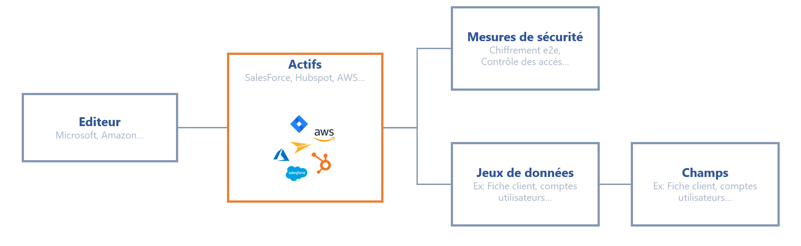
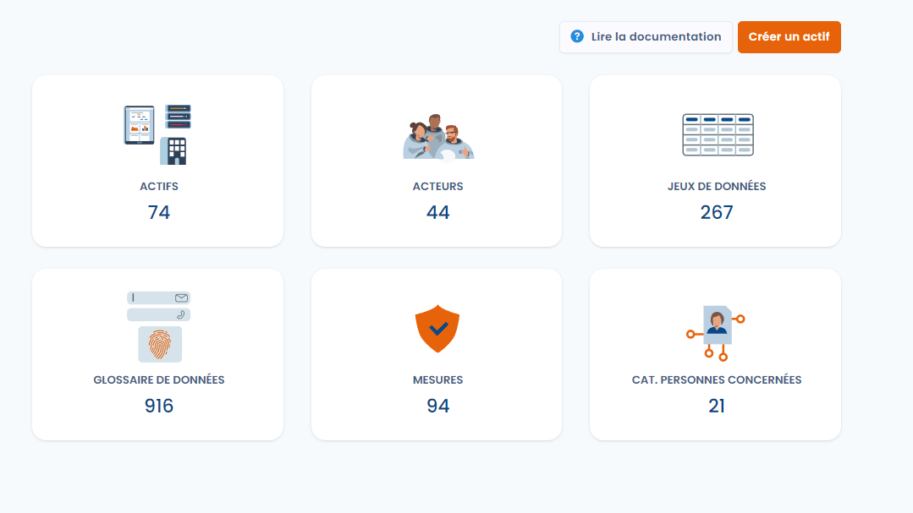

# Cartographie des données



## Tout commence par une cartographie des données 

Avant de constituer vos traitements, cartographiez le plus précisément possible les données de l'organisation. Dans l'application, ce module s'appelle **Référentiels**. Le schéma ci-dessous présente la structure de la cartographie que vous pouvez mettre en place.

<figure><figcaption>
Schéma de la cartographie de données
</figcaption></figure>

Pour inventorier l'ensemble des données personnelles de votre système d'information, suivez cette procédure :

1. **Recensez les actifs** : logiciels, fichiers, plugins, serveurs, machines, etc.
2. **Identifiez l'éditeur de l'actif, le cas échéant** : saisissez les informations de la société qui produit cet actif. Elle pourra être listée parmi les sous-traitants lors de la constitution du registre.
3. **Inventoriez les données** : listez le ou les jeux de données associés (vous pouvez vous référer au DPA signé avec le sous-traitant). Pour en savoir plus, consultez [Données et conservation](../ropa/activity/datasets.md).
4. **Listez les mesures de sécurité** mises en place.

Cette cartographie facilite la constitution des traitements, puisque vous partez de la réalité de vos données.

Si vous ne souhaitez pas faire cet inventaire, ou si les logiciels que vous utilisez sont standards, créez votre référentiel d'actifs à partir de la bibliothèque de modèles prédéfinis, qui contient les actifs courants du marché (Salesforce, Jira, etc.).

Pour suivre un flux de l'éditeur jusqu'au traitement, voir [Cartographier un flux de données](../../examples/data-mapping.md).

## Accéder à la cartographie

1. [Accédez à votre espace de travail](../../getting-started/setup/workspace.md#accedez-a-un-espace-de-travail).
2. Dans le menu latéral, sous **Inventaire**, cliquez sur **Référentiels**.
3. La **Vue d'ensemble** s'affiche : une carte par référentiel, avec le nombre d'éléments qu'il contient.

<figure><figcaption>
La vue d'ensemble des référentiels
</figcaption></figure>

Cliquez ensuite sur le référentiel auquel vous souhaitez accéder. Pour le chemin d'accès, les fonctions de liste communes à tous les référentiels et la cartographie, consultez [Référentiels](repositories/README.md).

## Les référentiels de la cartographie

Chaque référentiel a sa propre page :

* [Actifs](repositories/assets.md) : les logiciels, serveurs et autres supports de vos données.
* [Acteurs](repositories/stakeholders.md) : les sous-traitants, éditeurs et autres entreprises et personnes avec lesquels vous travaillez, et leurs sous-traitants ultérieurs.
* [Jeux de données](repositories/datasets.md) : les groupes de champs de données, avec leurs règles de conservation.
* [Glossaire de données](repositories/data-glossary.md) : les champs de données, avec leur catégorie et leur niveau de sensibilité.
* [Mesures de sécurité](repositories/security-measures.md) : les mesures techniques et organisationnelles qui protègent les données.
* [Catégories de personnes concernées](repositories/subject-categories.md) : les groupes de personnes dont vous traitez les données.

Pour documenter un lien que la plateforme ne déduit pas, par exemple un actif lié à un acteur, consultez [Relations génériques](relationships.md). Pour réutiliser ces référentiels dans votre registre, consultez [Registre des traitements](../ropa/README.md).

## Établissez votre liste de mesures de sécurité

Les mesures de sécurité disposent de leur propre référentiel (voir [Mesures de sécurité](repositories/security-measures.md)) : saisissez-les une fois, puis rattachez-les aux actifs dans la section **Mesures de sécurité associées** de la fiche de l'actif. Ces informations figurent souvent dans le DPA signé avec l'éditeur. Préférez des libellés courts (Antivirus, Pare-feu applicatif, Contrôles d'accès) : une mesure peut ainsi être réutilisée d'un actif à l'autre.



## Gérez vos sous-traitants

Un sous-traitant est un [acteur](repositories/stakeholders.md) de votre cartographie. Renseignez-le comme **Editeur** de l'actif : il pourra ensuite être référencé comme sous-traitant lorsque cet actif est mentionné dans un traitement. Sur la fiche de l'acteur, vous pouvez aussi enregistrer ses sous-traitants ultérieurs, pour cartographier toute la chaîne de sous-traitance.


