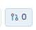
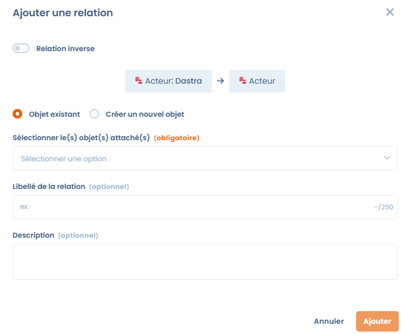
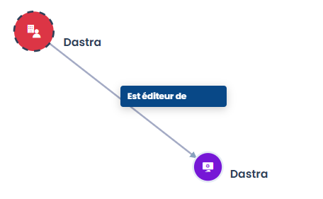

# Relations génériques

## Définition d'une relation générique

Une **relation générique** est un lien simple et étiqueté entre deux éléments dans Dastra. Elle sert à documenter des connexions entre objets qui ne sont pas inférées automatiquement par la plateforme, par exemple lier un actif à un acteur, ou une violation de données à un risque.

Une relation se caractérise par :

* un **objet source** et un **objet cible**,
* un **libellé de la relation** (optionnel, par exemple « Responsable » ou « Géré par »),
* une **description** (optionnelle, pour apporter du contexte),
* une **direction**, qui peut être inversée si nécessaire.


Un élément peut être lié à plusieurs autres éléments de types différents.


## Où créer une relation générique

Vous créez une relation depuis la fiche d'un :

* **actif**,
* **acteur**,
* **jeu de données**,
* **mesure de sécurité**,
* **violation de données**.

L'objet cible peut être de l'un de ces types, ou un **risque** si le module de gestion des risques est activé et que vous y avez accès. Un risque ne porte donc pas lui-même de relation générique.

Les relations apparaissent dans la page **Cartographie** du module **Référentiels**, où elles relient les nœuds du graphe. Voir [Référentiels](repositories/README.md).

Pour relier des traitements entre eux, consultez [Créer des relations entre les traitements](../ropa/relationships.md).

## Ajouter une relation générique

1. Ouvrez un élément, par exemple un actif.
2. Dans la barre d'outils, cliquez sur **Eléments liés**. Le bouton affiche le nombre de liens existants.

<figure><figcaption></figcaption></figure>

3. Cliquez sur **Ajouter une relation**, puis sélectionnez le type d'objet à lier : acteur, mesure de sécurité, violation de données, actif, jeu de données ou risque.
4. Dans la fenêtre qui s'ouvre :
   * Activez **Relation inverse** si la direction doit être inversée.
   * Choisissez **Objet existant** pour lier un élément déjà présent dans Dastra, ou **Créer un nouvel objet** pour en créer un à la volée.
   * Avec **Objet existant**, sélectionnez les objets cibles dans **Sélectionner le(s) objet(s) attaché(s)**. Avec **Créer un nouvel objet**, saisissez son nom dans **Nom du nouvel objet**.
   * Renseignez si vous le souhaitez le **Libellé de la relation** et la **Description**.
5. Cliquez sur **Ajouter** pour enregistrer la relation.

<figure><figcaption></figcaption></figure>

## Visualiser les relations

Une fois créées, les relations apparaissent :

* dans le panneau **Eléments liés** de chaque élément, qui affiche tous ses liens directs ;
* dans les graphes **Cartographie des flux entre les actifs** et **Cartographie des acteurs** de la page **Cartographie**, où elles sont représentées sous forme de réseau.

<figure><figcaption>
Exemple de visualisation graphique d'une relation générique dans la cartographie
</figcaption></figure>

## Pour aller plus loin


[.](README.md)

