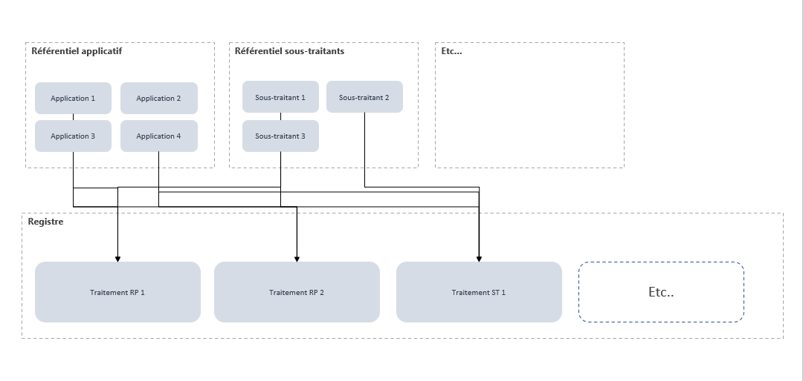

# Référentiels

Pour réduire les erreurs de saisie, Dastra vous permet d'administrer un ou plusieurs référentiels de manière autonome, indépendamment du registre. Le schéma ci-dessous illustre la réutilisabilité de ces référentiels dans le registre des traitements.

## Accéder aux référentiels

Dans le menu latéral, sous **Inventaire**, cliquez sur **Référentiels**. Le menu déroulant propose :

* **Vue d'ensemble** : le nombre d'éléments de chaque référentiel.
* **Cartographie** : la représentation graphique de vos actifs et de vos acteurs.
* **Actifs**, **Acteurs**, **Jeux de données**, **Glossaire de données**, **Mesures** et **Cat. personnes concernées** : les six référentiels.

## Liste des référentiels proposés par Dastra

* **Actifs** : les actifs regroupent les éléments utiles au pilotage des données (supports des données, locaux, éléments matériels ou immatériels). Voir [Actifs](assets.md).
* **Acteurs** : les acteurs sont différenciés des utilisateurs, car ils n'ont pas besoin de se connecter à la plateforme.
* **Jeux de données** : les jeux de données sont des groupes de données formant des ensembles cohérents, avec leurs règles de conservation.
* **Glossaire de données** : les données sont les informations. Elles constituent le niveau le plus atomique dans Dastra.
* **Mesures** : les mesures de sécurité sont les dispositions techniques ou organisationnelles mises en place pour protéger les données.
* **Cat. personnes concernées** : les catégories de personnes concernées regroupent des catégories d'individus.

## Fonctions communes aux listes

Les listes des six référentiels partagent plusieurs fonctions :

* **Créer à partir de modèles** ajoute un élément depuis la bibliothèque de modèles.
* **Importer** ajoute des éléments depuis un fichier. Voir [Importer vos données (Excel, Csv)](../../general/import.md).
* **Exporter** exporte la liste.
* **Outil de qualité de données** détecte les doublons, et **Fusionner** les regroupe. L'outil de qualité de données n'existe pas pour les catégories de personnes concernées. Voir [Fusion d'éléments](../../general/merge.md).

## Vue d'ensemble et cartographie

La **Vue d'ensemble** affiche une carte par référentiel avec son nombre d'éléments. Cliquez sur une carte pour ouvrir la liste correspondante. Le bouton **Créer un actif** crée un actif depuis cette page.

La page **Cartographie** propose quatre représentations, à choisir dans la liste déroulante en haut à gauche :

* **Cartographie des flux entre les actifs** : un graphe des actifs, de leurs éditeurs, de leurs jeux de données et de leurs étiquettes. Les [relations génériques](../relationships.md) y apparaissent comme des liens.
* **Cartographie des acteurs** : un graphe des acteurs, de leurs actifs et de leurs sous-traitants ultérieurs, que vous pouvez filtrer par **Référencé en tant que**.
* **Diagramme de répartition des données par actif** : un diagramme de Sankey, que vous pouvez filtrer par type de répartition (champs de données, traitements, propriétaires, pays, catégories de données).
* **Arbre hierarchique des actifs**.

Les boutons **Imprimer** et **Rafraîchir** sont disponibles en haut de la page.

## Particularités de chaque référentiel

### Acteurs

Un acteur peut être rattaché à une unité organisationnelle, ce qui limite sa visibilité aux utilisateurs de cette unité. Le bouton **Créer acteur** propose de partir d'un modèle (**A partir d'un modèle**) ou de zéro (**A partir de zéro**).

Sur la fiche, la section **Sous-traitants ultérieurs** permet d'enregistrer les sous-traitants de l'organisation, souvent cités dans le DPA, et de cartographier toute la chaîne de sous-traitance.

Dans la liste, le filtre **Référencé en tant que** retrouve les acteurs selon l'usage que vous en faites : éditeur de logiciel (éditeur d'au moins un actif), fournisseur de modèle d'IA (éditeur d'au moins un modèle d'IA), ou destinataire dans un traitement (sous-traitant, responsable conjoint, organisme public, etc.).

### Jeux de données

Un jeu de données regroupe des champs de données, sensibles ou non, et les règles de conservation liées à leur cycle de vie : un bulletin de paie papier ou les fiches clients d'un CRM, par exemple. Renseignez notamment l'**Origine de la collecte**, la **Base active** et l'**Archivage intermédiaire**, puis ajoutez les données dans **Détails des données**.

Le filtre **Voir orphelin (sans actif)** liste les jeux de données qui ne sont rattachés à aucun actif. Vous pouvez les rattacher depuis le champ **Actif lié**.

### Glossaire de données

Chaque donnée porte un **Niveau de sensibilité** :

* **Standard**, par exemple le nom, le prénom ou le numéro de téléphone.
* **Données hautement personnelles**, par exemple les données financières, la localisation ou les communications.
* **Données sensibles**, par exemple l'origine raciale, les opinions politiques, la religion, la santé ou l'orientation sexuelle.

Le niveau **Données sensibles** fait apparaître le champ **Base légale de collecte**. La colonne **Jeux de données**, masquée par défaut, se filtre avec **Est vide** ou **N'est pas vide** : utilisez-la pour retrouver les données qui n'appartiennent à aucun jeu de données.

### Mesures

Une mesure porte un nom, un **Type** et, si vous le souhaitez, l'adresse de sa documentation, par exemple sur le site de la CNIL. Le filtre **Voir les orphelins** liste les mesures qui ne sont rattachées ni à un actif ni à un traitement.

### Catégories de personnes concernées

Une catégorie porte un libellé et une option **Personnes vulnérables concernées**, à cocher si la catégorie regroupe des personnes en situation de déséquilibre, comme des mineurs, des salariés ou des personnes âgées.

## Générer un référentiel de données avec Dastra



## Filtrer les référentiels


