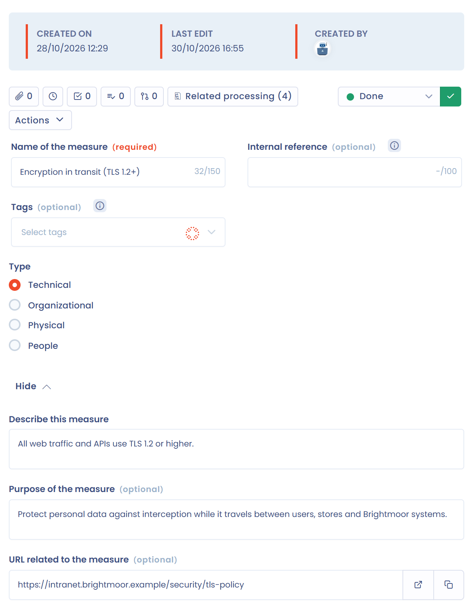

# Mesures de sécurité

Les mesures de sécurité sont les dispositions techniques ou organisationnelles mises en place pour protéger les données : antivirus, pare-feu applicatif, contrôle des accès, politique de bureau propre, etc. Dans le menu, le référentiel s'appelle **Mesures**.

Saisissez chaque mesure une seule fois, avec un nom court, pour la réutiliser d'un actif ou d'un traitement à l'autre. Cette information figure souvent dans le DPA signé avec un éditeur.

## Ajouter une mesure de sécurité

Ouvrez **Inventaire** > **Référentiels** > **Mesures**. Cliquez sur **Créer une mesure**, puis choisissez :

* **Créer à partir de zéro**, pour partir d'une fiche vide ;
* **Utiliser un modèle**, pour copier une mesure de la bibliothèque ou d'un autre espace de travail ;
* **Générer avec l'IA**, pour décrire la mesure et laisser l'assistant la rédiger (cette option dépend des fonctionnalités activées pour votre organisation).

La flèche à côté de **Créer une mesure** propose aussi **Créer à partir de modèles**, **Importer** et **Outil de qualité de données**. Voir [Importer vos données (Excel, Csv)](../../general/import.md).

<figure><figcaption>
La fiche d'une mesure de sécurité
</figcaption></figure>

## Renseigner la fiche de la mesure

| Champ | Contenu |
| --- | --- |
| **Nom de la mesure** | Le nom de la mesure, obligatoire. |
| **Référence interne** | Votre référence. |
| **Type** | **Technique**, **Organisationnelle**, **Physique** ou **Liée aux personnes**. |
| **Décrire la mesure** | Une description libre. |
| **Décrire le risque potentiel lié à la mesure** | Le risque potentiel auquel la mesure répond. |
| **Url de la documentation de la mesure (ex: sur le site de la CNIL)** | L'adresse de sa documentation. |

Vous pouvez ajouter des [tags](../../general/tags.md), et les [champs personnalisés](../../general/custom-fields.md) définis pour les mesures s'ajoutent à la fiche.

La barre d'outils de la fiche donne accès aux documents joints, aux questionnaires et aux tâches liés à la mesure, selon vos droits et les fonctionnalités activées. Elle contient aussi :

* **Eléments liés** : les [relations génériques](../relationships.md) de la mesure ;
* **Traitements** : les traitements qui utilisent la mesure, avec le bouton **Lier à un traitement** pour en ajouter ;
* **Historique d'activités** ;
* l'étape de processus de la mesure, lorsque des étapes sont définies.

Le menu d'actions de la fiche propose **Dupliquer**, **Fusionner** et **Supprimer**.

## Retrouver des mesures dans la liste

Les filtres sont **Filtrer par tags** et **Types**. Activez **Voir les orphelins** pour lister les mesures qui ne sont rattachées ni à un actif ni à un traitement.

Depuis une sélection, vous pouvez **Basculer l'étape de processus**, **Modifier les champs**, **Fusionner**, **Exporter** et **Supprimer**. Voir [Fusion d'éléments](../../general/merge.md).

## Où les mesures de sécurité sont utilisées

* Dans un actif, la section **Mesures de sécurité associées** liste les mesures de l'actif. Voir [Actifs](assets.md).
* Dans un traitement, vous sélectionnez les mesures qui protègent le traitement et indiquez leur état de déploiement. Voir [Mesures de sécurité](../../ropa/activity/security.md).


Supprimer une mesure efface définitivement ses références dans tous les traitements et pièces jointes.

