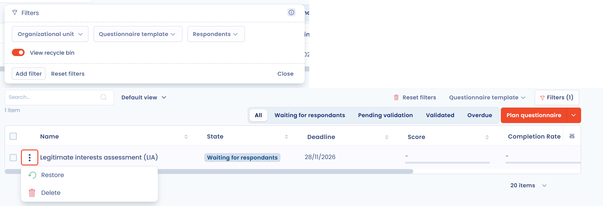
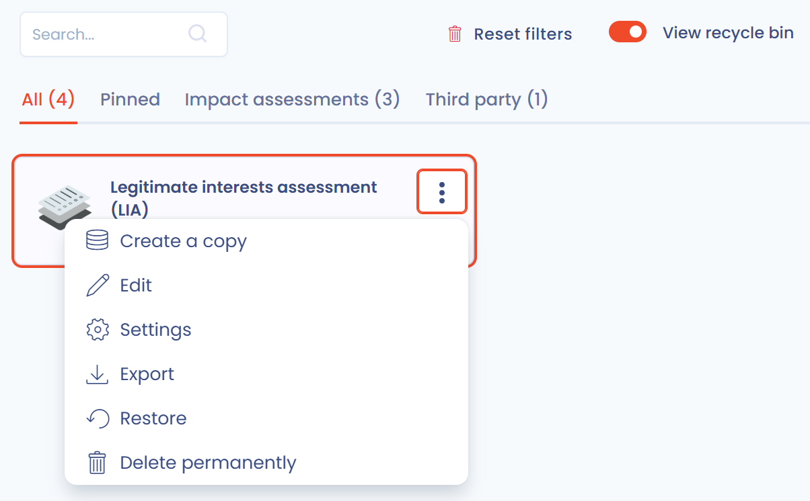

# Supprimer un questionnaire ou un modèle

Dans Dastra, un questionnaire ou un modèle de questionnaire passe d'abord par la corbeille avant sa suppression définitive. Cette étape protège contre les suppressions accidentelles : tant que l'élément est dans la corbeille, vous pouvez le restaurer.

## Supprimer un questionnaire

### Déplacer dans la corbeille

1. Dans une liste de questionnaires (**Tous les questionnaires**, **Mes réponses aux questionnaires** ou le tableau de bord d'un modèle), cliquez sur les trois points de la ligne concernée.
2. Cliquez sur **Déplacer dans la corbeille** et confirmez.

Vous pouvez aussi ouvrir le questionnaire et choisir **Déplacer dans la corbeille** dans le menu à côté de son bouton principal. Pour traiter plusieurs questionnaires à la fois, sélectionnez les lignes et utilisez l'action groupée correspondante.

<figure><figcaption>
L'action Déplacer dans la corbeille dans le menu d'un questionnaire
</figcaption></figure>

### Restaurer ou supprimer définitivement

1. Cliquez sur **Filtres** au-dessus de la liste, puis activez **Voir la corbeille**.
2. Dans le menu du questionnaire, cliquez sur **Restaurer** pour le remettre dans vos listes, ou sur **Supprimer** pour le supprimer définitivement.

<figure><figcaption>
La corbeille des questionnaires : Restaurer ou Supprimer
</figcaption></figure>


La suppression définitive d'un questionnaire est irréversible.


## Supprimer un modèle

Les modèles de questionnaires disposent eux aussi d'une corbeille.

1. Dans **Modèles de questionnaires**, cliquez sur les trois points du modèle.
2. Cliquez sur **Déplacer dans la corbeille** et confirmez.

<figure><figcaption>
Le menu d'un modèle de questionnaire
</figcaption></figure>

Pour restaurer un modèle ou le supprimer définitivement, activez **Voir la corbeille** en haut de la liste des modèles. Dans le menu du modèle, cliquez ensuite sur **Restaurer** ou sur **Supprimer définitivement**.

<figure><figcaption>
La corbeille des modèles de questionnaires
</figcaption></figure>


Le nombre de modèles dépend de votre abonnement, et la corbeille des modèles compte dans ce quota : un modèle déplacé dans la corbeille occupe toujours un emplacement tant qu'il n'est pas supprimé définitivement. Si vous souhaitez conserver une copie d'un modèle avant de le supprimer, exportez-le au format JSON depuis son menu : vous pourrez le réimporter plus tard.

