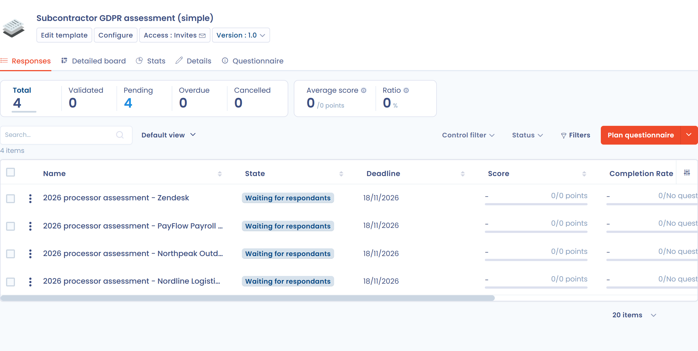
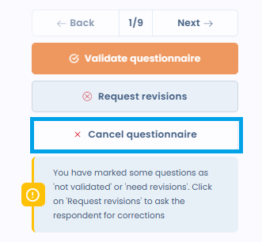

# Piloter les questionnaires

## Tableau de bord des réponses

Depuis **Modèles de questionnaires**, cliquez sur un modèle pour accéder à son tableau de bord de réponses. Il propose cinq vues :

* **Réponses** : liste de toutes les réponses avec leur statut (en attente de réponses, démarré, en attente de validation, validé, annulé, délai dépassé), leur score et l'objet lié ;
* **Matrice** : comparaison côte à côte de toutes les réponses par catégorie et score, utile pour comparer plusieurs entités ou traitements ;
* **Statistiques** : statistiques agrégées sur l'ensemble des réponses du modèle ;
* **Détails** : configuration et métadonnées du modèle ;
* **Questionnaire** : le contenu du modèle, que vous pouvez imprimer ou exporter.

Pour suivre les réponses de tous les modèles à la fois, ouvrez **Tous les questionnaires**.

<figure><figcaption>
Le tableau de bord des réponses d'un modèle
</figcaption></figure>

<figure><figcaption>
Les statuts des réponses, dont « Annulé » (badge rouge)
</figcaption></figure>

## Reporting d'une réponse individuelle

En ouvrant une réponse, vous accédez à une vue de reporting détaillée :

* **Statut** : progression de « En attente de réponses » à « Démarré », « En attente de validation » puis « Validé » ;
* **Score** : score total sur le maximum de points ;
* **Complété** : nombre de questions répondues sur le total ;
* **Temps de réponse** : durée de complétion du questionnaire ;
* **Points d'attention** : réponses automatiquement marquées comme nécessitant une attention, selon la configuration du modèle ;
* **Analyse des résultats** : blocs d'analyse générés automatiquement (niveau de conformité, évaluation des risques, etc.) ;
* **Score par catégories** : visualisé sous forme de radar ou de graphique en barres.

Les réponses aux questions à choix sont présentées sous une forme condensée :

* seules les options sélectionnées par le répondant sont affichées ;
* le lien **Afficher toutes les options**, sous chaque question, fait apparaître les options non sélectionnées de cette question ; le lien **Masquer les options** revient à l'affichage condensé ;
* une question sans réponse est signalée par un tiret (-), sans liste d'options.

<figure><figcaption>
Seules les options sélectionnées sont affichées ; les autres options restent accessibles question par question
</figcaption></figure>

## Actions sur une réponse

Le menu à côté du bouton principal de la réponse regroupe les actions suivantes, selon le statut de la réponse et vos droits :

* **Renouveler ce questionnaire** : voir [Planifier un questionnaire](schedule.md) ;
* **Exporter questionnaire** : voir [Exporter un rapport](export.md) ;
* **Envoyer des invitations** : relance les répondants tant que la réponse est en attente de réponses ou démarrée ;
* **Annuler le questionnaire** ;
* **Partager le rapport** : partage le rapport par lien, uniquement lorsque la réponse est validée ;
* **Modifier le modèle** ;
* **Règle de workflow** ;
* **Déplacer dans la corbeille** : voir [Supprimer un questionnaire ou un modèle](delete.md).

### Règles de workflow

Les réponses aux questionnaires peuvent déclencher des règles de workflow. L'action **Règle de workflow** du menu de la réponse affiche les règles qui s'appliquent aux réponses, avec leur état et leur historique, et permet d'en créer une avec **Créer une règle de workflow**. Dans le concepteur de règles, choisissez l'entité **Soumission de questionnaire**. Pour le fonctionnement des règles, consultez la page [Règles de workflows](../settings/workflow-rules.md).

## Analyse IA (bêta)

Depuis la vue de reporting d'une réponse, déclenchez une **analyse IA** pour obtenir :

* un score global de conformité ou de risque ;
* un résumé écrit des principaux constats ;
* une analyse par critères (complétude, base légale, mesures de sécurité, etc.) ;
* des tâches suggérées pour combler les lacunes identifiées.


L'analyse IA est une fonctionnalité bêta. Les résultats doivent être interprétés avec prudence et revus par un professionnel qualifié.


## Valider une réponse

Une fois la réponse examinée, cliquez sur **Revoir et valider le questionnaire** pour la faire passer au statut **Validé**. Cette action est réservée aux approbateurs de la réponse. L'approbation, la demande de révision et la validation finale sont décrites dans [Valider un questionnaire](validate.md).

## Annuler un questionnaire

Un approbateur peut annuler un questionnaire sans repasser par la liste des questionnaires. L'action **Annuler le questionnaire** est proposée :

* à l'étape de validation d'une réponse en attente de validation, à côté de **Valider le questionnaire** et de **Demander révision** ;
* dans le menu de la réponse, à tout statut tant que la réponse n'est pas déjà annulée ni dans la corbeille.

<figure><figcaption>
L'action « Annuler le questionnaire » est proposée à l'étape de validation
</figcaption></figure>

L'annulation demande une confirmation et accepte un commentaire facultatif. Le motif saisi est conservé dans l'historique et reste visible par le répondant.

Une réponse annulée prend le statut « Annulé », affiché sous forme de badge rouge dans la liste, les filtres, le reporting et les exports. Elle n'est plus modifiable par le répondant et n'est pas compilée dans les résultats.

Pour reprendre un questionnaire annulé, ouvrez-le et cliquez sur **Réactiver le questionnaire**. Dastra vous renvoie vers l'écran des invitations pour relancer les répondants.

## Fusionner les réponses avec l'objet attaché

Les questionnaires dont le modèle est de type création (collecte de projet de traitement, de violation de données, d'actif, de contrat, de système d'IA ou d'acteur) permettent de **fusionner les réponses collectées avec un objet de Dastra**. Cette action crée l'objet, ou met à jour l'objet lié, à partir des informations saisies dans le formulaire, sans nouvelle saisie manuelle.

Le bouton n'apparaît que lorsque la réponse est validée, et il est actif pour les approbateurs de la réponse. Il s'intitule **Fusionner les données** suivi du type d'objet, par exemple **Fusionner les données (Traitement de données)**, lorsque la réponse est déjà liée à un objet. Dans le cas contraire, il s'intitule **Création d'objet (Traitement de données)**.

Ouvrez la réponse validée et cliquez sur ce bouton : une fenêtre de confirmation liste les champs qui seront mis à jour dans l'objet cible.

<figure><figcaption>
Le bouton de fusion permet de répercuter les réponses dans l'objet Dastra lié
</figcaption></figure>

<figure><figcaption>
Confirmation de la fusion et création du traitement depuis les réponses collectées
</figcaption></figure>

Cette fonctionnalité est particulièrement utile pour la collecte externe via un Trust Center, où des tiers (fournisseurs, sous-traitants) renseignent des informations qui doivent ensuite apparaître dans vos registres internes. Voir [Collecter des projets de traitements, d'incidents, d'actifs ou de contrats](../trust-center/creation-questionnaires.md).

## Traduire un modèle de questionnaire avec l'IA

L'IA peut traduire toutes les sections et questions d'un modèle dans une autre langue. La procédure est décrite dans [Traduire un questionnaire avec l'IA](translate.md).

## Générer un plan d'actions

Lorsqu'une réponse est validée, un approbateur peut cliquer sur **Générer un plan d'action** depuis la vue de reporting pour créer automatiquement des tâches à partir des réponses fournies. Les tâches sont suggérées selon la configuration du modèle et ajoutées au module de gestion des tâches de Dastra.
