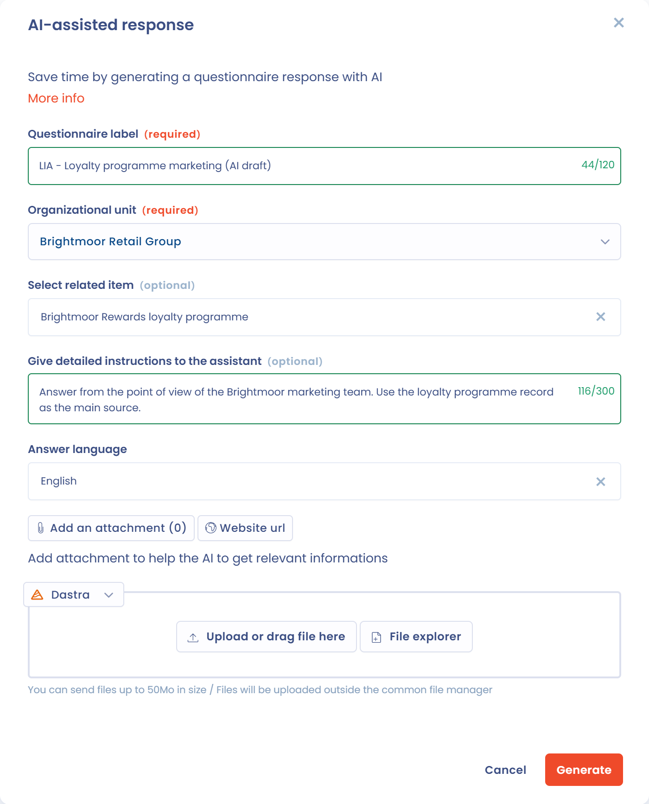

# Planifier un questionnaire

Planifier un questionnaire consiste à envoyer un modèle à ses répondants, ou à y répondre vous-même. Cette page présente les quatre modes de création, les paramètres de la planification et le lien avec les autres objets de Dastra.

## Lancer une planification



Une fois le modèle de questionnaire créé et personnalisé, cliquez sur **Planifier questionnaire**. Le bouton est disponible dans la liste **Modèles de questionnaires**, en haut de la page d'un modèle et, pour les questionnaires de type PIA, TIA ou LIA, depuis le traitement concerné (voir [AIPD / PIA](types/dpia.md)).

La fenêtre **Planifier un questionnaire** propose quatre modes de création.

<figure><figcaption>
Les quatre modes de création d'un questionnaire
</figcaption></figure>

### Création rapide

**Création rapide** : répondez vous-même, sans étape de configuration. Dastra crée immédiatement le questionnaire, dont vous êtes le répondant et l'approbateur, sans étape d'approbation ni e-mail d'invitation, puis ouvre le formulaire de réponse. Ce mode convient aux auto-évaluations internes.

### Inviter des répondants

**Inviter des répondants** : réalisez une campagne auprès d'utilisateurs, d'acteurs et d'équipes. Ce mode ouvre le formulaire de planification décrit dans la section suivante. Les répondants, internes comme externes, reçoivent un e-mail contenant un lien vers un espace en ligne où ils renseignent leurs réponses. Vous pouvez relancer les personnes qui n'ont pas répondu avec l'action **Envoyer des invitations** du menu de la réponse.

### Créer lien d'invitation

**Créer lien d'invitation** : partagez le lien vers votre questionnaire. Dans la fenêtre qui s'ouvre :

1. Choisissez l'**unité organisationnelle** et, si le modèle est lié à un objet, l'objet concerné.
2. Cliquez sur **Copier lien** et partagez-le.

Ce mode active de lui-même le partage par lien du modèle : vous n'avez aucun interrupteur à activer. N'importe quelle personne disposant du lien devient répondante du questionnaire. Un questionnaire est généré à chaque accès, et le lien reste disponible jusqu'à sa désactivation : désactivez l'option pour rendre inaccessibles les liens déjà envoyés. Lorsque l'adresse e-mail saisie par le répondant correspond à un compte Dastra, elle est reprise automatiquement à l'étape de connexion, et le répondant est orienté directement vers le fournisseur d'identité de son organisation si le SSO est en place.

Pour retrouver le lien ou le désactiver plus tard, ouvrez la page du modèle et cliquez sur le bouton **Accès** situé sous son titre. La fenêtre **Paramètres du lien d'invitation** s'ouvre : elle contient l'interrupteur **Activer la possibilité de répondre au questionnaire par lien**. Le même accès existe dans le menu à côté de **Planifier questionnaire**. Un modèle utilisé dans un Trust Center ne permet pas de désactiver le lien tant qu'il n'a pas été retiré de ce Trust Center.

<figure><figcaption>
Les paramètres du lien d'invitation d'un modèle
</figcaption></figure>

### Réponse assistée par IA

**Réponse assistée par IA** : gagnez du temps en générant une réponse au questionnaire avec l'IA. Ce mode est un mode de création, et non une action dans un questionnaire déjà ouvert. Il est grisé lorsque la fonctionnalité d'IA pour les questionnaires n'est pas activée pour votre organisation.

Dans la fenêtre **Réponse assistée par IA** :

1. Saisissez le **Libellé du questionnaire** et choisissez l'**unité organisationnelle**.
2. Si le modèle est lié à un objet, sélectionnez l'élément contextuel associé : ses informations sont transmises à l'IA.
3. Dans **Donnez des instructions détaillées à l'assistant**, ajoutez si besoin des consignes (300 caractères au maximum).
4. Choisissez la **Langue des réponses**. Les réponses sont rédigées dans cette langue, indépendamment de la langue de l'interface, et Dastra la mémorise d'une génération à la suivante.
5. Joignez jusqu'à trois documents avec **Ajouter un document** (PDF, Word, Markdown, HTML, JSON, CSV ou texte : notes de projet, politique de sécurité, DPA, analyse existante, etc.), ou indiquez l'adresse d'un site web avec **Url de site Web**.
6. Cliquez sur **Générer**.

Dastra crée le questionnaire, dont vous êtes le répondant et l'approbateur, y inscrit les réponses proposées par l'IA et l'ouvre. Relisez chaque réponse, ajustez-la, puis finalisez le questionnaire comme n'importe quelle réponse. Ce mode est particulièrement utile pour les questionnaires longs, comme les PIA, TIA ou LIA, lorsque vous disposez déjà d'une documentation.

Un indicateur **Utilisation** s'affiche dès que votre quota de crédits IA atteint 80 %. La génération est bloquée lorsque le quota est dépassé.


L'utilisation de la réponse assistée par IA consomme des crédits IA. Consultez la page [Assistant IA](../general/ai-assistant/README.md) pour connaître votre quota et les modalités de consommation.


<figure><figcaption>
Générer la réponse à un questionnaire avec l'IA
</figcaption></figure>

## Paramètres de la planification

Le mode **Inviter des répondants** ouvre un formulaire organisé en quatre sections.

<figure><figcaption>
La section Généralités du formulaire de planification
</figcaption></figure>

### Généralités

* **Libellé du questionnaire** et **Unité organisationnelle** sont obligatoires.
* **Objet lié à la réponse** apparaît lorsque le modèle est lié à un type d'objet (voir la section « Lier le questionnaire à d'autres objets dans Dastra » ci-dessous).
* **Préremplir le questionnaire** reprend dans les réponses les champs de l'objet lié. Pour un modèle de type PIA, l'option s'appelle **Remplir automatiquement le PIA à partir du traitement**.
* **Désactiver l'étape d'approbation** publie la réponse dès que les répondants l'ont finalisée (voir [Valider un questionnaire](validate.md)).

### Répondants

Choisissez d'abord le mode de réponse :

* **Questionnaire individuel** : chaque répondant répond à son propre questionnaire. Si vous ajoutez plusieurs répondants, Dastra génère un questionnaire distinct pour chacun d'eux. Ce mode convient pour collecter des informations comparables auprès de plusieurs personnes ou entités (évaluation de fournisseurs, évaluation par département) et pour produire un reporting consolidé.
* **Questionnaire collaboratif** : les répondants travaillent ensemble sur un même questionnaire. Ce mode convient aux questionnaires longs ou multi-domaines qui mobilisent plusieurs équipes (par exemple un PIA qui demande les contributions des équipes juridique, informatique et métier).

Cliquez ensuite sur **Ajouter répondants** :

* **Ajouter utilisateurs** et **Ajouter une équipe** pour les utilisateurs de Dastra ;
* **Ajouter des emails** pour des répondants externes ;
* **Ajouter emails à partir des acteurs** pour reprendre l'e-mail de contact d'acteurs de votre espace de travail ;
* **S'ajouter en tant que répondant** ;
* **Importer fichier .csv d'emails**, avec les colonnes `email` et `displayName` (format UTF-8, séparateur point-virgule).

Un questionnaire accepte 50 répondants au maximum. Chaque répondant peut être requis ou non : la réponse passe en attente de validation lorsque tous les répondants requis ont finalisé leur réponse.

<figure><figcaption>
La section Répondants du formulaire de planification
</figcaption></figure>

### Invitations

* **Échéance** : date et heure limites de réponse. Elles sont proposées à partir du **Délai de réponse par défaut** du modèle.
* **Envoyer des invitations par e-mail** : désactivez l'option si vous préférez transmettre vous-même les liens d'accès. Sinon, rédigez le **Message d'invitation**, ou reprenez un modèle de message avec **Sélectionner un modèle**.
* **Planifier l'envoi de la notification** : choisissez une **Date d'envoi de l'email**, dans les 70 heures qui suivent.

Un répondant externe peut devoir valider son identité avec un code à 6 chiffres envoyé par e-mail avant d'accéder au questionnaire. La [FAQ](faq.md) précise dans quels cas.

<figure><figcaption>
La section Invitations du formulaire de planification
</figcaption></figure>

### Approbateurs

Les approbateurs contrôlent les réponses et valident le questionnaire. Choisissez au moins un **Approbateur requis** et, si besoin, activez **Ajouter des approbateurs optionnels**. Le processus complet est décrit dans [Valider un questionnaire](validate.md).

## Importer des réponses

Pour reprendre des réponses déjà collectées, ouvrez la page du modèle, cliquez sur la flèche à côté de **Planifier questionnaire**, puis sur **Importer des réponses**. Téléchargez le fichier modèle xlsx, remplissez-le en respectant le format demandé pour chaque question, puis importez-le (xlsx ou csv).

## Questionnaires récurrents et renouvellement

Dans la configuration du modèle, répondez **Oui** à **Ce questionnaire doit-il être effectué de manière récurrente ?** et indiquez les **Jours entre chaque réponse**. Une réponse validée affiche alors la date à laquelle elle doit être renouvelée, et le badge **A renouveler** signale dans les listes les réponses à renouveler.

Pour renouveler une réponse, ouvrez-la et choisissez **Renouveler ce questionnaire** dans son menu. Vous pouvez choisir la version du modèle, puis indiquer si le questionnaire renouvelé reprend les réponses du précédent. Si vous répondez **Non**, vous repartez d'un questionnaire vierge et les anciennes réponses sont archivées.

## Lier le questionnaire à d'autres objets dans Dastra

Vous pouvez rattacher le questionnaire à un autre module de Dastra. Dans la configuration du modèle, après lui avoir donné un nom et une description, choisissez un type d'objet dans **Objet associé**. Les objets possibles sont les acteurs, les actifs, les traitements de données, les violations de données, les demandes, les mesures de sécurité, les jeux de données, les évaluations de risque, les systèmes d'IA et les contrats.

<figure><figcaption>
Le champ Objet lié à la réponse lors de la planification
</figcaption></figure>

Lorsque le modèle existe déjà, vous pouvez encore lui associer un objet : ouvrez le menu du modèle (les trois points), cliquez sur **Configuration**, puis renseignez **Objet associé**.

Lorsque vous planifiez ensuite le questionnaire, le champ **Objet lié à la réponse** apparaît. Son sélecteur vous permet de choisir l'objet précis auquel lier la réponse.


Vous ne pouvez lier un questionnaire qu'à un seul objet dans Dastra.


## Accès direct à l'AIPD depuis un traitement

Pour les questionnaires de type PIA, vous pouvez lancer l'analyse d'impact depuis la fiche d'un traitement. Dans l'étape **Analyse d'impact** du traitement, le bouton **Créer un PIA** ouvre le questionnaire correspondant sans quitter le contexte du traitement.

## Générer un plan d'actions à partir d'un questionnaire



## Valider un questionnaire


