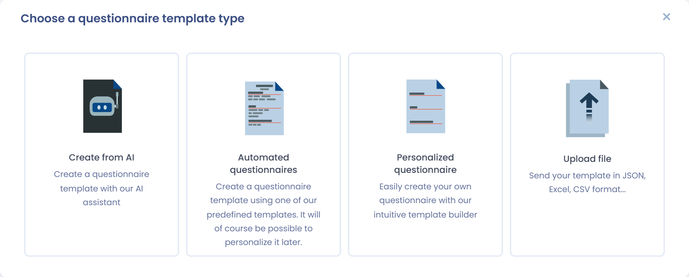
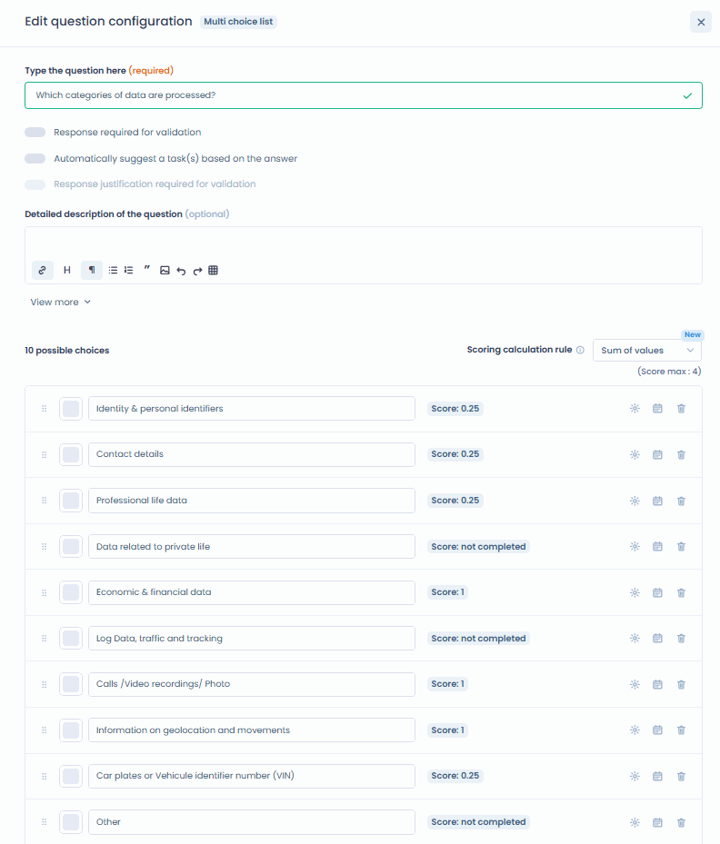
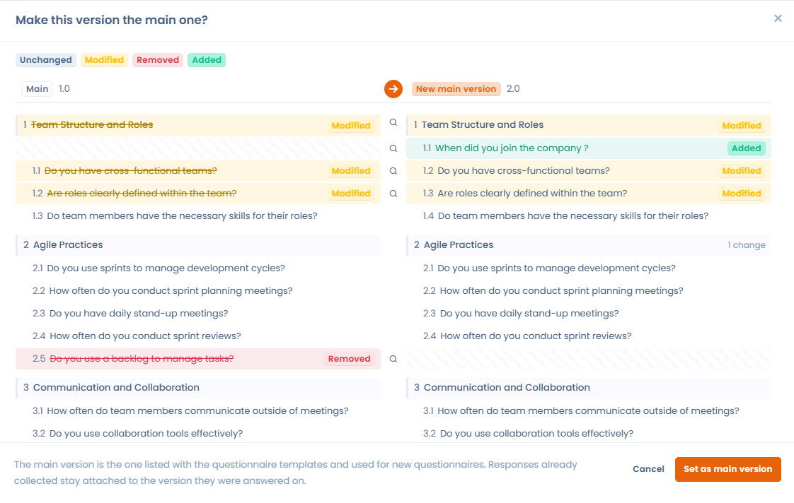

# Créer un modèle de questionnaire

Un modèle de questionnaire décrit les sections, les questions et les règles de calcul d'un questionnaire. Vous le créez une fois, puis vous le planifiez autant de fois que nécessaire. Pour accéder aux modèles, ouvrez **Questionnaires** > **Modèles de questionnaires**.

## Créer ou modifier un modèle de questionnaire



Pour créer un modèle, cliquez sur **Créer modèle** en haut de la liste **Modèles de questionnaires**. Le bouton est grisé lorsque vous avez atteint le nombre de modèles de votre abonnement.

<figure><figcaption><p>La liste des modèles de questionnaires</p></figcaption></figure>

La fenêtre **Choisir le type de questionnaire** propose quatre options :

* **A partir d'un modèle** : choisissez un modèle prédéfini dans la bibliothèque de Dastra. Voir [Les modèles de questionnaires automatisés](#les-modeles-de-questionnaires-automatises).
* **A partir de zéro** : construisez votre propre modèle. Voir [Les modèles de questionnaires personnalisés](#les-modeles-de-questionnaires-personnalises).
* **Créer à partir de l'IA** : l'assistant IA génère le modèle à partir de votre description. Vous pouvez joindre des documents avec le bouton **+** (grille d'audit Word, questionnaire de sécurité en PDF, etc.) : l'assistant transpose le questionnaire fourni en sections, questions, types de questions et propositions de réponse. Précisez le type de questionnaire (**Standard**, **Conformité cyber** ou **Formation**), puis, dans **Plus d'options**, les sections souhaitées, le nombre de questions (de 1 à 50) et, pour un questionnaire de formation, le niveau de difficulté. Vous prévisualisez le résultat avant de créer le modèle. L'option est grisée lorsque la fonctionnalité d'IA pour les questionnaires n'est pas activée pour votre organisation.
* **Envoyer un fichier** : importez un modèle existant avec **Fichier JSON** (un modèle exporté depuis Dastra) ou **Fichier Excel** (un questionnaire au format Excel ou CSV).

<figure><figcaption><p>Les quatre options de création d'un modèle</p></figcaption></figure>

<figure><figcaption><p>Créer un modèle de questionnaire avec l'IA à partir d'un document</p></figcaption></figure>


Contrairement aux questionnaires automatisés, les questionnaires personnalisés sont entièrement personnalisables. En fonction des réponses sélectionnées par les répondants, vous pouvez générer automatiquement un plan d'actions ou cartographier les risques associés au modèle.


## Les modèles de questionnaires automatisés

Dastra propose de nombreux modèles de questionnaires automatisés qui documentent la conformité et pilotent les processus. Ils incluent notamment des AIPD/PIA, des TIA, des LIA et des questionnaires sous-traitants.

Dans la fenêtre de sélection, filtrez la bibliothèque avec les filtres **Source de données de la bibliothèque**, **Langue**, **Tags** et **Types**, ou recherchez un modèle par son nom. Cliquez sur l'icône en forme d'œil d'un modèle pour en consulter le détail. Cliquez sur le modèle pour l'installer : Dastra en crée une copie dans votre espace de travail et ouvre sa page.

<figure><figcaption><p>La bibliothèque de modèles de questionnaires</p></figcaption></figure>

Depuis la page du modèle, vous pouvez :

* **modifier le modèle** avec **Modifier le modèle** ;
* planifier un questionnaire avec **Planifier questionnaire**.


Certains types de questionnaires (AIPD, TIA, LIA) peuvent également être lancés directement depuis un traitement, par exemple depuis les étapes **Analyse d'impact**, **Destinataires** ou **Finalités**. Consultez les pages dédiées ci-dessous pour plus de détails.


## Les modèles de questionnaires personnalisés

Pour créer votre propre modèle, cliquez sur **A partir de zéro**. Le panneau **Création d'un modèle de questionnaire** s'ouvre : renseignez-le (voir la section suivante), puis construisez les sections et les questions dans l'éditeur de modèle. Cliquez sur **Enregistrer** pour conserver vos modifications, ou sur **Enregistrer et quitter** pour fermer l'éditeur.

<figure><figcaption><p>L'éditeur de modèle de questionnaire</p></figcaption></figure>

### Configurer le modèle

Le panneau de configuration s'ouvre à la création d'un modèle. Il s'intitule **Configuration du modèle** lorsque vous le rouvrez ensuite. Pour y revenir plus tard, ouvrez le menu du modèle dans la liste et cliquez sur **Configuration**, ou, dans l'éditeur, cliquez sur **Configurer**.

<figure><figcaption><p>Le panneau de configuration d'un modèle</p></figcaption></figure>

| Champ | Rôle |
| --- | --- |
| **Nom**, **Description**, logo | L'identité du modèle dans les listes et la bibliothèque. |
| **Objet associé** | Le type d'objet auquel chaque réponse est liée (voir [Éléments évalués](#elements-evalues)). |
| **Responsables du questionnaire** | Les approbateurs sélectionnés par défaut à la planification. Ils peuvent toujours être modifiés. |
| **Type de questionnaire** | Le comportement du questionnaire dans l'application (voir [Les types de modèles](#les-types-de-modeles)). |
| **Tags** | Des étiquettes pour filtrer les modèles. |
| **Délai de réponse par défaut** | Le nombre de jours proposé comme échéance à la planification. Il est de 30 jours par défaut. |
| **Afficher les résultats (scores) et autoriser l'export aux répondants** | Les répondants voient les blocs d'analyse et les scores, et peuvent exporter leurs réponses. |
| **Ce questionnaire doit-il être effectué de manière récurrente ?** | Si vous répondez **Oui**, indiquez les **Jours entre chaque réponse**. Voir [Planifier un questionnaire](../schedule.md). |

### Éléments évalués

Vous pouvez lier des questionnaires à des éléments dans Dastra. En choisissant le type d'élément évalué dans **Objet associé**, vous forcez toutes les réponses basées sur ce modèle à être liées à un objet du type choisi. Par exemple, ce modèle de questionnaire sera toujours lié à un traitement.

Les types d'objets possibles sont les acteurs, les actifs, les traitements de données, les violations de données, les demandes, les mesures de sécurité, les jeux de données, les évaluations de risque, les systèmes d'IA et les contrats.

Vous pouvez aussi choisir de ne pas lier un questionnaire à un objet particulier. La réponse est alors toujours liée à une unité organisationnelle, ce qui convient par exemple à des questionnaires de conformité globaux.

### Les types de modèles

Le champ **Type de questionnaire** classe le modèle et change son comportement dans l'application. Dastra propose 19 types, regroupés ainsi dans la liste :

| Groupe | Types |
| --- | --- |
| Analyses d'impact | Analyse d'impact (PIA), Analyse d'impact du transfert (TIA), Analyse de base légale du traitement (LIA), Base légale consentement, Analyse d'impact d'un système d'IA |
| Conformité | Conformité cyber, Conformité privacy, Conformité RSE |
| Sous-traitants/Tiers | Audit sous-traitant, Création d'acteur |
| E-Learning | Formation |
| Privacy by design | Collecte de projet de traitement |
| Gestion d'incidents | Création de violations de données |
| Asset management | Création d'actif |
| Contracts | Création de contrat |
| AI | Création d'un système d'IA, Analyse de risque d'un système d'IA, Evaluation des rôles et responsabilité |
| Autres | Standard |

Certains types activent un comportement particulier :

* **Standard** : un questionnaire classique avec un reporting classique ;
* **Conformité cyber** : un questionnaire de conformité à une réglementation spécifique, avec un score de conformité ;
* **Analyse d'impact (PIA)** : ce modèle affiche une matrice des risques (avec la configuration requise) et peut être appelé à l'étape **Analyse d'impact** d'un traitement. Voir [Créer ou modifier un modèle de PIA](pia.md) ;
* **Audit sous-traitant** : ce modèle est appelé à l'étape des destinataires sous-traitants d'un traitement ;
* **Analyse d'impact du transfert (TIA)** : questionnaire d'analyse des risques liés à un transfert de données hors UE ;
* **Analyse de base légale du traitement (LIA)** : questionnaire sur la base légale des intérêts légitimes, pour s'assurer que ces intérêts n'outrepassent pas les droits et libertés des personnes ;
* **Formation** : questionnaire pour réaliser des quiz de formation. Il permet de désigner la bonne réponse parmi les réponses proposées et d'afficher les bonnes réponses en fin de questionnaire ;
* les types de **création** (collecte de projet de traitement, de violation de données, d'actif, de contrat, de système d'IA ou d'acteur) : une fois la réponse validée, ses données servent à créer ou à mettre à jour l'objet correspondant (voir [Piloter les questionnaires](../monitor.md)). Ces modèles alimentent aussi la collecte depuis un Trust Center (voir [Collecter des projets de traitements, d'incidents, d'actifs ou de contrats](../../trust-center/creation-questionnaires.md)).

### Règle de calcul du score des questions à choix multiples

Pour une question à choix multiples dont les réponses portent un score, le champ **Règle de calcul du score** détermine le score retenu :

* **Somme des valeurs** (par défaut) : additionne les scores de toutes les réponses sélectionnées ;
* **Valeur maximale** : retient uniquement le score le plus élevé parmi les réponses sélectionnées. Par exemple, dans une AIPD, le niveau de risque d'une question « Catégories de données » reflète alors la catégorie la plus sensible, et non le cumul des catégories cochées.

Le **Score maximum** de la question s'affiche sous le sélecteur. La règle s'applique au score global, au score en pourcentage et au score par catégories, et elle est enregistrée avec le modèle.

<figure><figcaption><p>Règle de calcul du score d'une question à choix multiples</p></figcaption></figure>

## Charger un modèle de questionnaire que vous possédez

Vous pouvez importer l'un de vos modèles de questionnaires au format JSON. À la création du modèle, cliquez sur **Envoyer un fichier**, puis sur **Fichier JSON**, et déposez le fichier. Pour obtenir ce fichier, exportez un modèle depuis son menu avec **Exporter**.

## Questions à sélection dynamique

Parmi les types de questions disponibles dans l'éditeur de modèle, deux types permettent de connecter une question directement aux données de votre espace de travail Dastra : **Sélection dynamique simple** et **Sélection dynamique multiple**.

Ces types de questions affichent au répondant une liste d'objets issus de Dastra : actifs, traitements, parties prenantes, mesures de sécurité, jeux de données, champs de données, systèmes d'IA, contrats, etc. Le répondant sélectionne un ou plusieurs éléments de sa bibliothèque comme réponse à la question.


Pour que la liste s'affiche correctement, le répondant doit disposer des **droits de lecture** sur les objets correspondants dans Dastra. Un répondant externe sans compte Dastra ou sans les permissions appropriées ne pourra pas voir la liste.


## Renseigner des champs personnalisés depuis un questionnaire

Vous pouvez utiliser un questionnaire pour renseigner automatiquement des champs personnalisés dans les registres Dastra. Configurez la variable de la question avec le préfixe `custom_`, suivi du nom technique du champ.



### Configurez la question du modèle

Dans **Questionnaires**, ouvrez le modèle concerné et ajoutez la question qui doit renseigner le champ personnalisé. Choisissez un type de question compatible avec le type du champ. &#x20;

Ouvrez les propriétés de la question, puis activez "**Souhaitez-vous personnaliser le nom de la variable ?"**. Dans **Nom de la variable**, saisissez `custom_` suivi du nom technique du champ.

Pour un champ dont le nom technique est `business_owner`, utilisez :

```
custom_business_owner
```

Enregistrez ensuite les modifications du modèle.



### Syntaxe des variables

Le nom de variable doit respecter le format `custom_nom_de_la_variable`. Reprenez le nom technique du champ à l’identique après le préfixe.


Le champ personnalisé n’a pas besoin d’apparaître dans **Sélectionnez une variable à mapper**. Saisissez directement le nom complet de la variable.



Le préfixe `custom_` est obligatoire. Pour le champ `business_owner`, utilisez `custom_business_owner`, et non `business_owner`.


### Résoudre un problème de mapping

Si la valeur n’apparaît pas dans le registre, vérifiez les points suivants :

* Le champ existe dans le module concerné.
* La variable commence par `custom_` et reprend exactement le slug du champ.
* Le type de question est compatible avec le type du champ.
* Les modifications du modèle sont enregistrées.

## Gestion des versions du modèle

Lorsque vous modifiez un modèle déjà utilisé dans des questionnaires existants, Dastra vous propose deux options :

* **Écraser la version actuelle** : les modifications remplacent le modèle en place, sans historique de version. Les réponses existantes sont conservées, mais celles portant sur des questions supprimées ou restructurées peuvent ne plus être affichées ni comptabilisées. Avant la validation, un comparatif entre la version enregistrée et vos modifications s'affiche, et vous pouvez encore annuler.
* **Créer une nouvelle version** : une nouvelle version du modèle est créée. Vous pouvez la laisser en **brouillon** le temps de la préparer, puis la promouvoir en **version principale** lorsqu'elle est prête. Les questionnaires existants continuent d'utiliser l'ancienne version principale jusqu'à ce que vous changiez explicitement de version.

Pour naviguer entre les versions, utilisez le sélecteur de version disponible dans l'interface du modèle. La version marquée comme principale est celle qui sera utilisée pour toutes les nouvelles planifications.

L'action **Comparez les versions** présente deux versions côte à côte. Chaque section et chaque question porte un statut : **Inchangé**, **Modifié**, **Supprimé**, **Ajouté** ou **Déplacé** ; un élément seulement déplacé n'est pas signalé comme supprimé puis ajouté. Un rappel de l'impact sur les réponses déjà collectées accompagne la comparaison.

<figure><figcaption><p>Comparer deux versions d'un modèle de questionnaire</p></figcaption></figure>


Le nombre de modèles disponibles dépend de votre souscription. Ce quota est partagé entre tous les espaces de travail de votre organisation. La corbeille des modèles compte dans ce quota : pensez à vider régulièrement les modèles inutilisés pour libérer des emplacements.


## Historique, export et contribution

Dans l'éditeur, le menu à côté du bouton **Enregistrer** donne accès à plusieurs actions :

* **Créer une version** ;
* **Planifier questionnaire** ;
* **Configurer** ;
* **Historique d'activités** : consulter et restaurer les modifications précédentes du modèle ;
* **Exporter** : télécharger le modèle (JSON, Excel, CSV, PDF, Word, HTML ou Markdown) ;
* **Contribuer** : publier le modèle pour tous les utilisateurs de Dastra, pour les utilisateurs autorisés à contribuer.

Pour supprimer un modèle, consultez [Supprimer un questionnaire ou un modèle](../delete.md).

## Les blocs d'analyse

Les blocs d'analyse affichent un texte personnalisé en fonction du score du questionnaire ou des réponses apportées.



## Pour aller plus loin


[Planifier un questionnaire](../schedule.md)



[Exporter un rapport](../export.md)



[AIPD / PIA](../types/dpia.md)



[Analyse d'impact sur les transferts (TIA)](../types/tia.md)



[Test d'équilibre des intérêts légitimes (LIA)](../types/lia.md)



[Créer ou modifier un modèle de PIA](pia.md)

