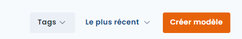
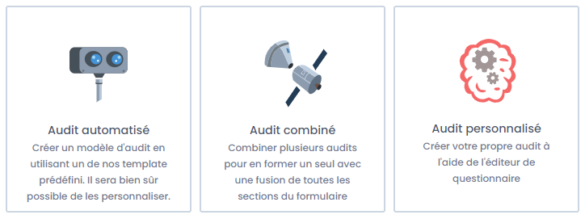
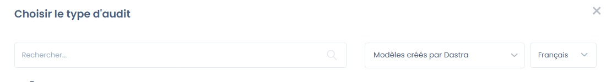
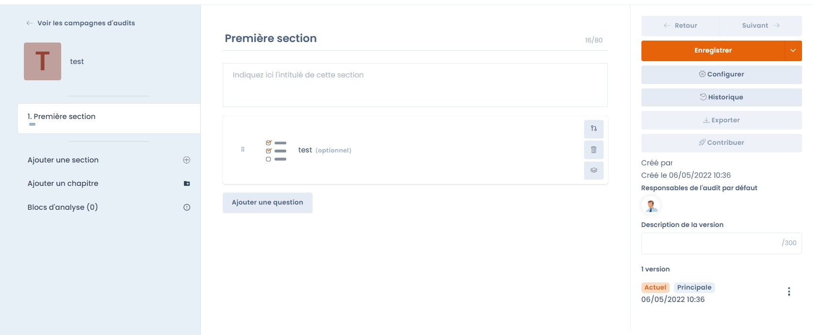
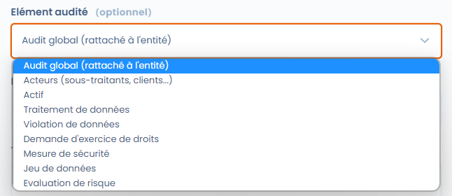
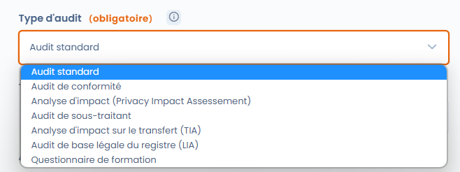

# Créer un modèle de questionnaire

## Introduction

La création ou la modification d'un modèle de questionnaire dans Dastra est un jeu d'enfant. Pour ce faire, accédez à la fonctionnalité "Questionnaires".

## Créer ou modifier un modèle de questionnaire



Pour créer un modèle de questionnaire, cliquez sur le bouton "Créer un modèle" dans l'onglet "Questionnaires". Ensuite vous pouvez sélectionner un des types de modèles disponibles dans Dastra : questionnaire automatisé, personnalisé ou importé depuis un fichier.

<figure><figcaption></figcaption></figure>

Vous arrivez sur l'interface de sélection des types de modèles :



* En cliquant sur l'onglet "**Questionnaire automatisé**", vous choisirez un modèle de questionnaire prédéfini existant en piochant dans la bibliothèque de Dastra.
* En cliquant sur "**Questionnaire personnalisé**", vous pouvez construire votre propre modèle de questionnaire.
* En cliquant sur "**Créer à partir de l'IA**", l'assistant IA génère le modèle à partir de votre description. Vous pouvez joindre des documents avec le bouton **+** (grille d'audit Word, questionnaire de sécurité en PDF, etc.) : l'assistant transpose le questionnaire fourni en sections, questions, types de questions et propositions de réponse. Le type de questionnaire, la langue de génération et les options avancées s'appliquent comme pour toute génération, et vous prévisualisez le résultat avant de créer le modèle.

<figure><figcaption><p>Créer un modèle de questionnaire avec l'IA à partir d'un document</p></figcaption></figure>


Contrairement aux questionnaires automatisés, les questionnaires personnalisés sont entièrement personnalisables. En fonction des réponses sélectionnées par les répondants, vous serez en mesure de générer automatiquement un plan d'actions ou de cartographier les risques associés au modèle.


## Les modèles de questionnaires automatisés

Dastra propose de nombreux modèles de questionnaires automatisés permettant de documenter la conformité et de piloter les processus. Ces modèles incluent notamment des AIPD/PIA, des TIA, des LIA, des questionnaires sous-traitants, et bien d'autres.



Une fois le modèle sélectionné, vous accédez à l'écran de planification où vous pouvez :

* soit **modifier le modèle** en cliquant sur le bouton "Modifier le modèle"
* soit planifier un questionnaire en cliquant sur le bouton "Planifier un questionnaire"


Certains types de questionnaires (AIPD, TIA, LIA) peuvent également être lancés directement depuis un traitement — par exemple depuis les onglets "Analyse d'impact", "Destinataires" ou "Finalités". Consultez les pages dédiées ci-dessous pour plus de détails.


## Les modèles de questionnaires personnalisés

Dans Dastra, il vous est possible de créer votre propre modèle de questionnaire personnalisé. Pour cela, cliquez sur l'option "Questionnaire personnalisé". Vous accéderez ainsi à l'interface d'édition de modèle de questionnaire.

Construisez le modèle de questionnaire que vous souhaitez et cliquez sur "Enregistrer et continuer".



### Règle de calcul du score des questions à choix multiples

Pour une question à choix multiples dont les réponses portent un score, le champ **Règle de calcul du score** détermine le score retenu :

* **Somme des valeurs** (par défaut) : additionne les scores de toutes les réponses sélectionnées ;
* **Valeur maximale** : retient uniquement le score le plus élevé parmi les réponses sélectionnées. Par exemple, dans une AIPD, le niveau de risque d'une question « Catégories de données » reflète alors la catégorie la plus sensible, et non le cumul des catégories cochées.

Le **Score maximum** de la question s'affiche sous le sélecteur. La règle s'applique au score global, au score en pourcentage et au score par catégories, et elle est enregistrée avec le modèle.

<figure><figcaption><p>Règle de calcul du score d'une question à choix multiples</p></figcaption></figure>

### Éléments évalués

Vous pouvez lier des questionnaires à des éléments dans Dastra. En choisissant le type d'élément évalué, vous forcez toutes les réponses basées sur ce modèle à être liées à un objet du type choisi. Par exemple, vous pouvez choisir que ce modèle de questionnaire sera toujours lié à un traitement.

<figure><figcaption></figcaption></figure>

Vous pouvez choisir de ne pas lier un questionnaire à un objet particulier. Dans ce cas, la réponse sera toujours liée à une unité organisationnelle. Cela peut être le cas pour des questionnaires de conformité globaux par exemple.

### Les types de modèles

Lors de la création d'un modèle personnalisé, vous devrez choisir un type de modèle.

<figure><figcaption></figcaption></figure>

Ces types permettent une certaine personnalisation des modèles de questionnaires.

* **Questionnaire standard** : il s'agit d'un questionnaire classique
* **Questionnaire de conformité** : à l'heure actuelle, il s'agit d'un questionnaire classique
* **Analyse d'impact** : ce modèle permet d'afficher une matrice des risques (avec la configuration requise) et d'être appelé lors de l'étape AIPD d'un traitement
* **Questionnaire de sous-traitant** : ce modèle est appelé lors de l'étape destinataires sous-traitants d'un traitement
* **Analyse d'impact sur le transfert (TIA)** : questionnaire permettant l'analyse des risques relatifs à un transfert de données hors UE
* **Analyse de la base légale (LIA)** : questionnaire de la base légale des intérêts légitimes pour s'assurer que les intérêts n'outrepassent pas les droits et libertés des personnes
* **Questionnaire de formation** : questionnaire permettant de réaliser des quiz de formation. Ce type de questionnaire permet de sélectionner une bonne réponse parmi les réponses et d'afficher les bonnes réponses en fin de questionnaire.

## Charger un modèle de questionnaire que vous possédez

Il est enfin possible d'importer un de vos modèles de questionnaires, au format json. Pour cela, à la création du questionnaire, sélectionnez l'option "Charger un modèle".

## Questions à sélection dynamique

Parmi les types de questions disponibles dans l'éditeur de modèle, deux types permettent de connecter une question directement aux données de votre espace de travail Dastra : **"Sélection dynamique simple"** et **"Sélection dynamique multiple"**.

Ces types de questions affichent au répondant une liste d'objets issus de Dastra : actifs, traitements, parties prenantes, mesures de sécurité, jeux de données, champs de données, systèmes d'IA, contrats, etc. Le répondant sélectionne un ou plusieurs éléments de sa bibliothèque comme réponse à la question.


Pour que la liste s'affiche correctement, le répondant doit disposer des **droits de lecture** sur les objets correspondants dans Dastra. Un répondant externe sans compte Dastra ou sans les permissions appropriées ne pourra pas voir la liste.


## Renseigner des champs personnalisés depuis un questionnaire

Vous pouvez utiliser un questionnaire pour renseigner automatiquement des champs personnalisés dans les registres Dastra. Configurez la variable de la question avec le préfixe `custom_`, suivi du nom technique du champ.



### Configurez la question du modèle

Dans **Questionnaires**, ouvrez le modèle concerné et ajoutez la question qui doit renseigner le champ personnalisé. Choisissez un type de question compatible avec le type du champ. &#x20;

Ouvrez les propriétés de la question, puis activez "**Souhaitez-vous personnaliser le nom de la variable ?"**. Dans **Nom de la variable**, saisissez `custom_` suivi du nom technique du champ.

Pour un champ dont le nom technique est `business_owner`, utilisez :

```
custom_business_owner
```

Enregistrez ensuite les modifications du modèle.



### Syntaxe des variables

Le nom de variable doit respecter le format `custom_nom_de_la_variable`. Reprenez le nom technique du champ à l’identique après le préfixe.


Le champ personnalisé n’a pas besoin d’apparaître dans **Sélectionnez une variable à mapper**. Saisissez directement le nom complet de la variable.



Le préfixe `custom_` est obligatoire. Pour le champ `business_owner`, utilisez `custom_business_owner`, et non `business_owner`.


### Résoudre un problème de mapping

Si la valeur n’apparaît pas dans le registre, vérifiez les points suivants :

* Le champ existe dans le module concerné.
* La variable commence par `custom_` et reprend exactement le slug du champ.
* Le type de question est compatible avec le type du champ.
* Les modifications du modèle sont enregistrées.

## Gestion des versions du modèle

Lorsque vous modifiez un modèle déjà utilisé dans des questionnaires existants, Dastra vous propose deux options :

* **Écraser la version actuelle** : les modifications remplacent le modèle en place, sans historique de version. Les réponses existantes sont conservées, mais celles portant sur des questions supprimées ou restructurées peuvent ne plus être affichées ni comptabilisées. Avant la validation, un comparatif entre la version enregistrée et vos modifications s'affiche, et vous pouvez encore annuler.
* **Créer une nouvelle version** : une nouvelle version du modèle est créée. Vous pouvez la laisser en **brouillon** le temps de la préparer, puis la promouvoir en **version principale** lorsqu'elle est prête. Les questionnaires existants continuent d'utiliser l'ancienne version principale jusqu'à ce que vous changiez explicitement de version.

Pour naviguer entre les versions, utilisez le sélecteur de version disponible dans l'interface du modèle. La version marquée comme principale est celle qui sera utilisée pour toutes les nouvelles planifications.

L'action **Comparez les versions** présente deux versions côte à côte. Chaque section et chaque question porte un statut : **Inchangé**, **Modifié**, **Supprimé**, **Ajouté** ou **Déplacé** ; un élément simplement déplacé n'est pas signalé comme supprimé puis ajouté. Un rappel de l'impact sur les réponses déjà collectées accompagne la comparaison.

<figure><figcaption><p>Comparer deux versions d'un modèle de questionnaire</p></figcaption></figure>


Le nombre de modèles disponibles dépend de votre souscription. Ce quota est partagé entre tous les espaces de travail de votre organisation. La corbeille des modèles compte dans ce quota — pensez à vider régulièrement les modèles inutilisés pour libérer des emplacements.


## Les blocs d'analyse



## Pour aller plus loin


[planifier-un-audit.md](../schedule.md)



[rapport-daudit.md](../export.md)



[pia-aipd.md](../types/dpia.md)



[tia.md](../types/tia.md)



[lia.md](../types/lia.md)

