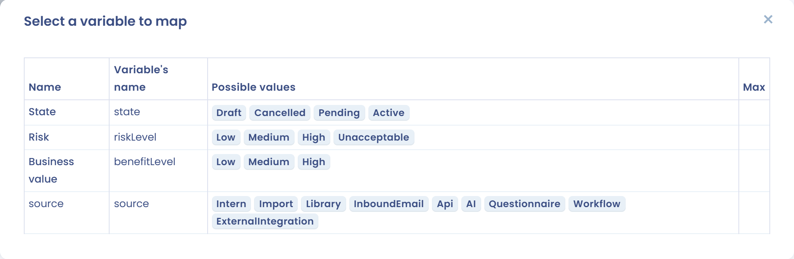

# Alimenter une fiche avec les réponses

Un questionnaire d'un type de création peut transformer ses réponses en fiche Dastra : un traitement, un actif, un système d'IA, etc. Quand la réponse est liée à une fiche existante, les réponses peuvent être fusionnées dans cette fiche. Chaque question est reliée à un champ de la fiche par son **nom de variable**.

Cette page s'adresse aux personnes qui construisent les modèles. Les répondants ne voient rien de ce mapping.

Pour un cas complet avec un système d'IA, voir [Des réponses de questionnaire dans une fiche](../../../examples/questionnaire-to-record.md).

## Quels objets peuvent être alimentés

Seuls les types de création du champ **Type de questionnaire** portent un modèle de données. Les autres types, comme la PIA, l'évaluation de fournisseur ou le questionnaire standard, n'en ont pas.

| Type de questionnaire | Fiche |
| --- | --- |
| Collecte de projet de traitement | Traitement |
| Création de violations de données | Violation de données |
| Création d'actif | Actif |
| Création de contrat | Contrat |
| Création d'un système d'IA | Système d'IA |
| Création d'acteur | Acteur |

Les modèles intégrés de ces types sont prêts à l'emploi (voir [Créer un modèle de questionnaire](README.md)). Vous pouvez aussi construire votre propre modèle et choisir l'un de ces types.

## Validation du modèle et liste des variables

Le modèle d'un type est la description des champs de la fiche : leur nom, leur nature (texte, date, liste de valeurs fixes, liste d'éléments) et leur longueur maximale. La liste des variables lit ce modèle.

Pour relier une question :

1. Ouvrez le modèle, puis la question.
2. Cochez **Souhaitez-vous personnaliser le nom de la variable (pour les utilisateurs avancés uniquement) ?**.
3. Dans **Nom de la variable**, saisissez le nom du champ, ou cliquez sur **Sélectionnez une variable à mapper**.
4. Dans la liste, cliquez sur le champ. La fenêtre affiche **Nom**, **Nom de la variable**, **Valeurs possibles** et **Max** pour chaque champ. Une mention **Obligatoire** signale les champs dont la fiche ne peut pas se passer.

Choisir un champ renseigne le nom de la variable et la longueur maximale. Pour un champ à liste de valeurs fixes, par exemple le niveau de risque d'un système d'IA, cela crée aussi les réponses de la question, une par valeur, et le nom de variable de chaque réponse est la valeur attendue par Dastra. Ne modifiez pas ces noms de variable.

Un nom de variable contient des lettres, des chiffres, des tirets et des tirets bas, et il est unique dans le modèle.


Une question dont le nom de variable ne correspond à aucun champ de la fiche est ignorée à la création de la fiche. Seul le modèle du type décide des noms valides : saisissez les noms exactement comme la liste les affiche, avec la même casse.


<figure><figcaption>
Les variables proposées pour un système d'IA
</figcaption></figure>

## Types de questions et champs

La liste ne propose que les champs qui conviennent au type de la question.

| Type de question | Champs proposés | Ce que reçoit la fiche |
| --- | --- | --- |
| Texte court, Texte long, Editeur de texte | Champs texte | Le texte saisi |
| Date, Date & heure | Champs date | La date. Une date invalide reste vide |
| Liste de cases à cocher (une seule réponse possible), Sélecteur simple | Champs à liste de valeurs fixes | Le nom de variable de la réponse choisie, ou son libellé s'il n'en a pas |
| Liste de cases à cocher (plusieurs réponses possibles), Sélecteur multiple | Tous les champs, sauf `id` | La liste des noms de variable des réponses choisies |
| Liste personnalisée | Champs liste | Un élément par ligne. Les noms de variable des sous-questions sont les propriétés d'un élément |
| Nombre, Règle, Case à cocher simple, Pays, Sélecteur de tags | Tous les champs, sauf `id` | La valeur saisie. Pour le sélecteur de tags, la liste des tags |

Pour les types sans filtre, vous choisissez vous-même le champ : prenez un champ de même nature que la réponse.

Le type **Pièces jointes** n'est relié à aucun champ. Les documents envoyés avec les réponses peuvent être transférés vers la GED à la création de la fiche (voir plus bas).

## Questions natives

Une question native est une question d'un modèle de création intégré, liée à un champ de la fiche. Son type, son nom de variable, ses limites et ses réponses sont verrouillés : seuls les administrateurs de Dastra peuvent les modifier, pour que le mapping reste correct. Ajoutez vos propres questions à côté des questions natives pour alimenter d'autres champs.

## Alimenter un champ personnalisé

Un champ personnalisé est alimenté par un nom de variable composé de `custom_` suivi du nom technique du champ.

1. Dans la barre latérale, cliquez sur **Réglages espace de travail**, puis sur **Champs personnalisés**, et choisissez le module de la fiche.
2. Cliquez sur le champ. Le nom technique est le **Nom de la variable (slug)**, par exemple `business_owner`. Il n'est plus modifiable après la création.
3. Dans la question, réglez le nom de la variable sur `custom_business_owner`.

Les champs personnalisés ne figurent pas dans la liste **Sélectionnez une variable à mapper** : saisissez le nom complet. Voir [Champs personnalisés](../../general/custom-fields.md) pour les options d'un champ.

Choisissez un type de question qui correspond au type du champ :

| Type du champ personnalisé | Type de question |
| --- | --- |
| Texte, Zone de texte, Texte formatté | Texte court, Texte long, Editeur de texte |
| Nombre (entier), Nombre (décimal) | Nombre |
| Date, Date et heure | Date, Date & heure |
| Radio, Sélecteur simple | Liste de cases à cocher (une seule réponse possible), Sélecteur simple |
| Case à cocher, Sélecteur multiple | Liste de cases à cocher (plusieurs réponses possibles), Sélecteur multiple |
| Booléen | Case à cocher simple |

Deux règles s'appliquent à la création de la fiche :

* un nom technique qui ne correspond à aucun champ personnalisé de l'espace de travail pour ce type de fiche est ignoré sans erreur : la réponse n'est pas enregistrée. Vérifiez l'orthographe et le préfixe `custom_` ;
* une valeur que le champ n'accepte pas interrompt la création avec un message qui nomme le champ, par exemple quand le champ est obligatoire et la réponse vide, ou quand une liste compte trop peu ou trop d'éléments.

## Créer ou fusionner la fiche

Le bouton apparaît dans la réponse du questionnaire quand :

* la réponse est publiée, c'est-à-dire validée et non archivée ;
* le modèle est d'un type de création.

Il n'est actif que pour le propriétaire de la réponse.

* Sans fiche liée, le bouton est **Création d'objet**, suivi du type de fiche. Il ouvre un aperçu de la fiche construite à partir des réponses. Choisissez l'**Unité organisationnelle** (non demandée pour les actifs et les acteurs), conservez ou décochez l'option de transfert des fichiers vers la GED, puis cliquez sur **Créer**. La fiche est créée et liée à la réponse.
* Avec une fiche liée, le bouton est **Fusionner les données**. Liez la fiche lors de la planification du questionnaire, dans **Objet lié à la réponse** (voir [Planifier un questionnaire](../schedule.md)), après avoir réglé **Objet associé** du modèle sur le type de la fiche. L'aperçu s'ouvre de la même façon, et le bouton est **Créer et fusionner l'existant**.

Avec **Créer et fusionner l'existant**, Dastra construit une fiche temporaire à partir des réponses, dont le libellé est suivi de « (From Questionnaire) », et ouvre la fenêtre de fusion avec la fiche existante et la fiche temporaire. Vous choisissez, champ par champ, les valeurs à conserver. Les fichiers sont transférés une fois la fusion confirmée. Si vous quittez la fenêtre sans fusionner, la fiche temporaire est supprimée et rien ne change.

Rien n'est fusionné automatiquement : les réponses ne mettent jamais une fiche à jour d'elles-mêmes. La fusion est toujours une action d'une personne.

<figure><figcaption>
La demande de fusion d'une réponse
</figcaption></figure>

## Messages d'erreur

| Message ou symptôme | Cause | Solution |
| --- | --- | --- |
| This audit template type has no model validation configured | Le type du modèle n'est pas l'un des six types de création : il n'a donc pas de modèle. Le message apparaît quand vous cliquez sur **Sélectionnez une variable à mapper** | Changez le **Type de questionnaire** pour un type de création, ou saisissez les noms de variable à la main si le modèle ne fait que collecter des réponses |
| La liste **Sélectionnez une variable à mapper** est vide | Aucun champ de la fiche ne convient au type de la question, par exemple une question Date sur une fiche sans date | Changez le type de la question, ou choisissez un type sans filtre |
| Vous devez renseigner un nom de variable | Le nom de la variable est vide | Renseignez **Nom de la variable** |
| Le nom de la variable {slug} est présent dans une autre question | Deux questions utilisent le même nom de variable | Donnez à chaque question son propre nom |
| Le bouton **Création d'objet** ou **Fusionner les données** est absent | La réponse n'est pas publiée, est archivée, ou le modèle n'est pas d'un type de création | Validez la réponse, restaurez-la ou vérifiez le type |
| Le bouton est grisé | Vous n'êtes pas le propriétaire de la réponse | Demandez au propriétaire |
| Un champ est vide dans la nouvelle fiche | Le nom de variable ne correspond pas au champ, ou le champ personnalisé n'existe pas | Comparez-le avec la liste et avec le nom technique |
| La création s'arrête avec un message qui nomme un champ | La valeur n'est pas valide pour le champ | Corrigez la réponse, puis recommencez |
