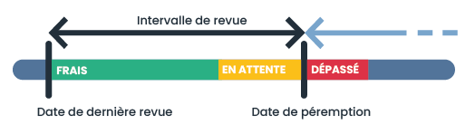
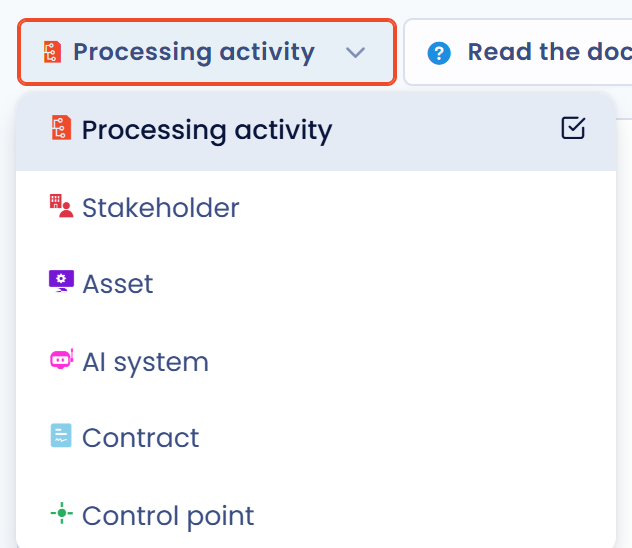
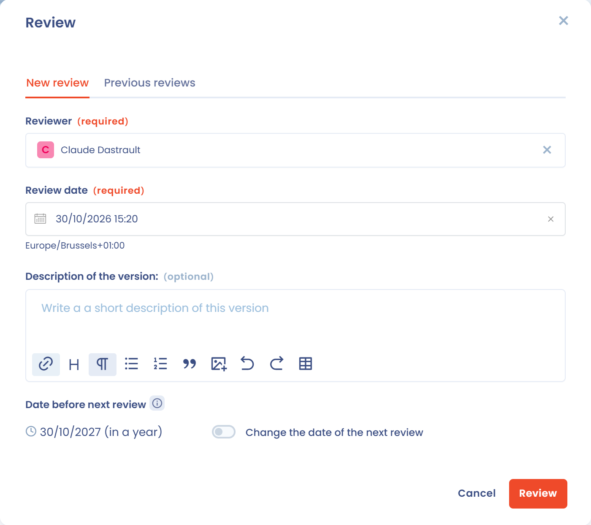

# Revue régulière (fraîcheur)

La fraîcheur indique à quand remonte le dernier passage en revue d'un élément. En activant la revue régulière pour un type d'élément, vous définissez un intervalle entre deux revues. Chaque revue fixe une date de prochaine revue, et la fraîcheur diminue à l'approche de cette date. Vous vous assurez ainsi que les informations saisies dans Dastra sont revues régulièrement.

La revue régulière est disponible pour les traitements de données, les acteurs, les actifs, les systèmes d'IA, les contrats et les points de contrôle de la gestion des risques, selon les modules de votre abonnement. Les spécificités des traitements sont détaillées dans [Fraîcheur des traitements](ropa/freshness.md).

<figure><figcaption>
Schéma de fonctionnement de l'indicateur de fraîcheur
</figcaption></figure>

## Activer la revue régulière

Seuls les utilisateurs qui disposent de la permission **Configuration avancée** peuvent modifier ce réglage.

1. Dans le menu de gauche, cliquez sur **Réglages espace de travail**, puis, sous **Processus**, sur **Revues régulières**. Vous pouvez aussi cliquer sur **Configurer revue régulière** dans le menu d'options de la liste d'un module : l'entrée indique si la revue est déjà activée pour ce type d'élément.
2. Dans le sélecteur en haut de la page, choisissez le type d'élément.
3. Activez **Activer la revue régulière de l'élément**.
4. Dans **Sélectionnez l'intervalle souhaité entre chaque revue**, saisissez l'intervalle en années, en mois ou en jours.
5. Cliquez sur **Enregistrer**.

<figure><figcaption>
Les réglages Revues régulières
</figcaption></figure>

<figure><figcaption>
Les types d'éléments disponibles
</figcaption></figure>

L'intervalle est le même pour tous les éléments d'un même type. Une fois enregistré, Dastra demande **Appliquer le nouvel intervalle ?** :

* **Appliquer à toutes les revues existantes** remplace toutes les dates de prochaine revue déjà renseignées par de nouvelles dates calculées avec le nouvel intervalle ;
* **Appliquer uniquement aux prochaines revues** conserve les dates existantes, et le nouvel intervalle s'applique à partir de la prochaine revue.

## Désactiver la revue régulière

Dans les mêmes réglages, choisissez le type d'élément, désactivez **Activer la revue régulière de l'élément** et cliquez sur **Enregistrer**.

## Afficher la fraîcheur

La fraîcheur ne s'affiche que pour les éléments **publiés** qui ont été revus au moins une fois.

Tous les éléments concernés disposent d'une colonne **Date de dernière revue**, que vous pouvez ajouter aux colonnes de la liste. Elle affiche l'état de fraîcheur de chaque élément.

<figure><figcaption>
La colonne Date de dernière revue
</figcaption></figure>

Sur la fiche d'un traitement ou d'un système d'IA, le panneau de droite affiche aussi la barre **Fraîcheur**, qui diminue à l'approche de la date de prochaine revue. À côté de l'état et de sa couleur, vous voyez le lien **Passer en revue** et le nombre de jours restants ou de retard.

<figure><figcaption>
L'indicateur de fraîcheur d'une fiche de traitement
</figcaption></figure>

### Les états de fraîcheur

| État | Règle d'affichage |
| --- | --- |
| **Frais** (vert) | L'élément a été revu récemment et ne demande pas d'attention immédiate. Cet état s'affiche tant que la date du jour n'est pas dans les derniers 10 % de l'intervalle. |
| **Bientôt périmé** (orange) | L'élément doit être vérifié. Cet état s'affiche pendant les derniers 10 % de l'intervalle qui suit la dernière revue. |
| **Périmé** (rouge) | La date de prochaine revue est dépassée : l'élément n'est plus conforme à la politique de revue. |


**Exemple :** vous avez défini un intervalle de 1 an. Un élément revu le 1er janvier 2026 s'affiche **Frais** jusqu'à fin novembre 2026, puis **Bientôt périmé** jusqu'au 1er janvier 2027. Au-delà, il s'affiche **Périmé** tant qu'il n'est pas revu.


## Passer en revue un élément

Vous pouvez passer un élément en revue à tout moment, sans attendre la date de prochaine revue. Dans une liste, cliquez sur la cellule de la colonne **Date de dernière revue** de l'élément. Sur la fiche d'un traitement ou d'un système d'IA, cliquez sur **Passer en revue**.

<figure><figcaption>
La fenêtre Passer en revue
</figcaption></figure>

Dans l'onglet **Nouvelle revue**, renseignez :

* **Responsable de la revue** : l'utilisateur qui a réalisé la revue ;
* **Date de revue** ;
* **Description de la version** (facultatif) : ce qui a été vérifié ou modifié ;
* **Date avant la prochaine revue** : calculée à partir de l'intervalle défini dans les réglages. Pour fixer une date propre à cet élément, activez **Changer la date de prochaine revue** et choisissez une date (au plus tôt le lendemain).

Cliquez sur **Passer en revue** pour enregistrer : un nouveau cycle de fraîcheur démarre à la date de revue.

L'onglet **Anciennes revues** liste les revues passées de l'élément. Il propose aussi le bouton **Supprimer toutes les revues**, qui efface l'historique. Après confirmation, l'élément est considéré comme n'ayant jamais été revu, ses dates de revue sont effacées et l'indicateur de fraîcheur disparaît. Cette action est irréversible.

## Suivre les revues sur le tableau de bord

La tuile **Traitements de données** du [tableau de bord](dashboard.md) affiche l'indicateur **Revue nécessaire** : le nombre de traitements à revoir au regard de l'intervalle défini, et le nombre de traitements frais.

## Notifications

Lorsqu'un élément passe à l'état périmé, son créateur et les utilisateurs qui lui sont associés (par exemple les propriétaires d'un traitement) sont notifiés par e-mail : l'élément n'a pas été revu depuis longtemps et il est temps de le rafraîchir.
