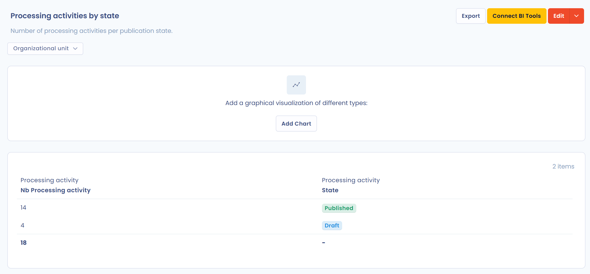

# Rapports personnalisés

Les rapports personnalisés extraient les informations utiles des données de Dastra, sous la forme que vous choisissez : tableau, graphique ou export.

## Démarrage rapide

1. Dans le menu de gauche, sous **Ressources**, cliquez sur **Rapports personnalisés**.
2. Les rapports sont organisés par catégories. Avant de créer votre premier rapport, vous devez **créer une première catégorie**.
3. Cliquez sur **Créer un rapport** pour construire un rapport vierge, ou ouvrez la flèche du bouton et choisissez **Créer à partir de modèles**.

Si l'analyse par IA est incluse dans votre abonnement, le bouton d'IA à côté de **Créer un rapport** (**Générer un rapport personnalisé avec l'IA**) génère un rapport à partir d'une courte description, par exemple « Nombre de traitements par étape de workflow avec un graphique ».

## Glossaire

* **Métrique** : une valeur mesurable que l'on regroupe (agrège) sur plusieurs éléments. _Exemple : le nombre de traitements, la durée moyenne de traitement d'une tâche, etc._
* **Dimension** : à l'inverse de la métrique, la dimension n'agrège pas les données. C'est une propriété (une colonne) d'un élément. _Exemple : le nom du traitement, son statut, sa référence, etc._

## Construction du rapport

Un rapport se construit en quatre temps :

1. **Sélection des données** : choisissez les tables que vous voulez interroger, puis les métriques et dimensions pertinentes.
2. **Filtres** : affinez vos résultats avec des critères pour ne garder que les données utiles à votre analyse.
3. **Graphique** : affichez le rapport sous forme de graphique ou de tableau.
4. **Export et partage** : exportez le rapport en PDF, Word, HTML, Excel, CSV, JSON ou Markdown, partagez-le ou branchez-le sur un outil de BI comme Power BI.

### Sélection des tables

Choisissez d'abord la table racine dans la liste **Sélectionnez la table racine** : c'est la table principale du rapport, par exemple les traitements. Cliquez ensuite sur **Ajouter table** pour ajouter des tables liées à la table racine (les étapes du traitement, la finalité, les tags, etc.). Vous pouvez interroger jusqu'à 7 tables dans chaque rapport, table racine comprise.

<figure><figcaption>
La sélection de la table racine et des tables liées
</figcaption></figure>

Cliquez sur **Suivant** quand vous avez choisi les tables.


Vous pouvez revenir à la sélection des tables depuis la construction du rapport, avec le bouton **Modifier** de la carte **Tables sélectionnées**, pour ajouter d'autres tables. Les tables déjà utilisées par le rapport sont verrouillées.


### Construction à partir des métriques et dimensions

Construisez votre rapport en faisant glisser les métriques et dimensions voulues, ou en les sélectionnant, depuis le panneau de gauche vers la zone **Déposez des métriques et dimensions ici**. Un message vous prévient lorsque vous avez atteint le nombre maximum de métriques et dimensions pour un rapport.

<figure><figcaption>
L'éditeur de métriques et dimensions
</figcaption></figure>

La carte **Filtres** limite les données, et **Trier par** définit l'ordre des lignes (cochez **Tri ascendant** pour un tri croissant). **Rafraîchir les données** met à jour l'aperçu.

Cliquez sur **Enregistrer et continuer** pour ouvrir le rapport, ou sur **Enregistrer** pour rester dans l'éditeur.


Les données sont automatiquement agrégées par dimension pour calculer les métriques sélectionnées.


Exemple : si vous sélectionnez la métrique **Nb Traitements de données** et la dimension **Statut**, vous obtenez un rapport regroupé sous cette forme :

| Statut    | Nb Traitements de données |
| --------- | ------------------------- |
| Brouillon | 12                        |
| Actif     | 560                       |

### Lien vers la fiche de l'objet

Pour les tables d'objets dotés d'une fiche (traitements, exercices des droits, violations de données, actifs, acteurs, audits, mesures de sécurité, contrats, systèmes d'IA et tâches), la dimension **Lien vers la ressource (url)** ajoute à chaque ligne un lien cliquable **Détails**. Ce lien ouvre la fiche de l'objet dans le bon module, dans un nouvel onglet, pour l'espace de travail courant. La colonne est également incluse dans les exports, sous forme d'URL.

<figure><figcaption>
Ajout de la dimension Lien vers la ressource (url) au rapport
</figcaption></figure>

<figure><figcaption>
Chaque ligne affiche un lien Détails qui ouvre la fiche de l'objet
</figcaption></figure>

## Afficher le rapport et ajouter un graphique

Une fois le rapport enregistré, vous arrivez sur sa page. Le tableau de données s'affiche avec un filtre par unité organisationnelle, **Effacer les filtres** et la description du rapport, que vous pouvez modifier directement.

<figure><figcaption>
La page d'un rapport personnalisé
</figcaption></figure>

Pour ajouter un graphique, cliquez sur **Ajouter graphique**, puis réglez les options :

* **Type de graphique** : **Diagramme en colonnes**, **Diagramme en barres**, **Diagramme circulaire** ou **Zone de chaleur** ;
* **Métrique affichée** : la valeur mesurée par le graphique ;
* **Dimension n°1** et **Dimension n°2** : les axes du graphique ;
* **Disposition des données** : **Par défaut**, **Répartition dans la colonne** (valeurs empilées) ou **Répartition par pourcentage** (empilées à 100 %) ;
* **Trier par** et **Tri ascendant** : l'ordre d'affichage.

L'aperçu se met à jour au fil de vos choix. Pour modifier ou supprimer le graphique plus tard, utilisez **Modifier graphique** ou **Supprimer graphique** au-dessus du graphique.

<figure><figcaption>
La fenêtre Ajouter graphique
</figcaption></figure>

## Imprimer, exporter et partager

Depuis la page d'un rapport :

* **Exporter** télécharge le rapport au format CSV, Excel, JSON, PDF, Word, HTML ou Markdown ;
* le menu du bouton **Modifier** propose **Imprimer**, **Exporter**, **Partager** (réservé aux utilisateurs qui disposent de la permission **Configuration avancée**) et **Déplacer dans la corbeille** ;
* **Connecter outils BI** branche le rapport sur un outil d'analyse de données : voir [Intégration dans les outils d'analyse de données (BI)](bi-tools.md).

## Corbeille

Un rapport ou une catégorie supprimé passe d'abord par la corbeille : vous pouvez le restaurer tant qu'il n'a pas été supprimé définitivement.

* **Placer un élément dans la corbeille** : dans le menu d'actions d'un rapport, cliquez sur **Déplacer dans la corbeille** puis confirmez. Le menu d'actions d'une catégorie, dans le panneau de gauche, propose la même action : la catégorie et tous ses rapports sont placés dans la corbeille.
* **Consulter la corbeille** : activez l'option **Voir la corbeille** au-dessus de la liste des rapports, ou depuis le menu du panneau des catégories.
* **Restaurer** : depuis la corbeille, **Restaurer** remet l'élément dans la liste active. Restaurer une catégorie restaure aussi les rapports placés dans la corbeille avec elle ; restaurer un rapport dont la catégorie est dans la corbeille restaure aussi cette catégorie.
* **Supprimer définitivement** : depuis la corbeille, **Supprimer** efface l'élément après confirmation. La suppression d'une catégorie supprime aussi tous ses rapports. Cette action est irréversible.


Les actions de la corbeille nécessitent le droit de modification des rapports personnalisés.

