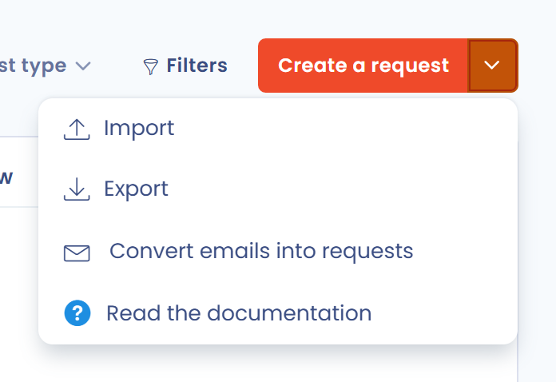
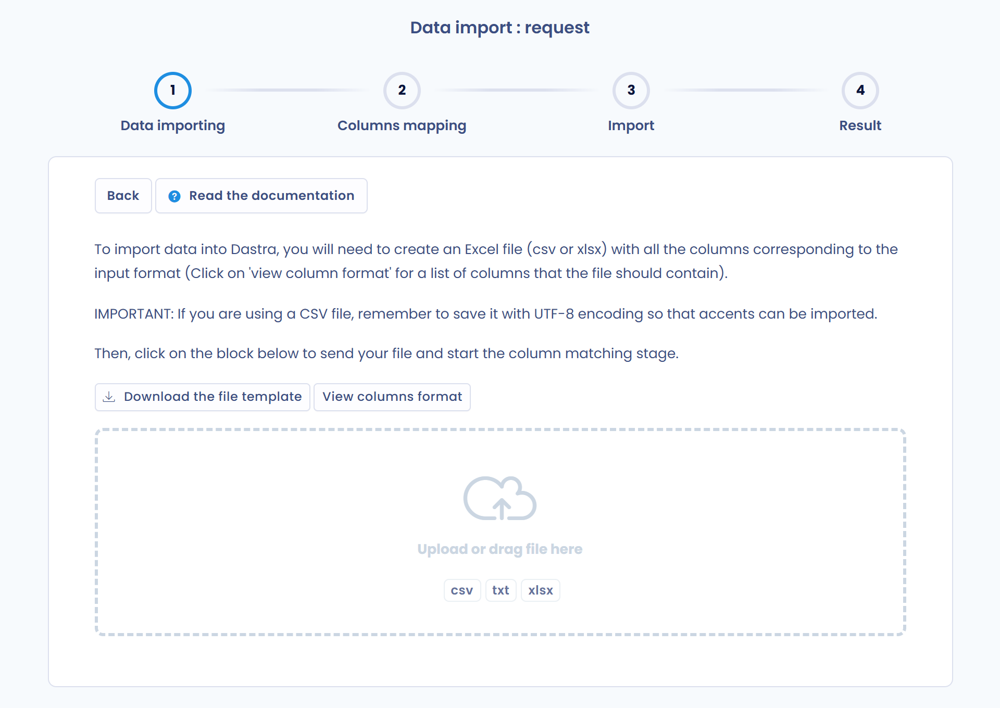

# Exercices des droits

Avec le RGPD, les citoyens européens peuvent demander à une entreprise ou à une organisation qui traite des données personnelles les concernant d'exercer leurs droits. Celle-ci a l'obligation de faciliter l'exercice de ces droits.


[droits-des-personnes.md](../../gdpr/concepts/rights.md)


Pour cela, l'entreprise ou l'organisation doit mettre en place des procédures pour répondre aux demandes d'exercice des droits et en apporter la preuve. Cela passe notamment par des étapes à suivre et une documentation conservée dans un registre.

## Le processus de gestion d'une demande d'exercice de droit

La gestion d'une demande d'exercice de droit se résume en 4 grandes étapes :

<figure><figcaption></figcaption></figure>

Pour plus de détails sur la gestion des demandes d'exercice de droits, voir la page suivante :


[gestion-des-demandes-dexercices-de-droits.md](manage.md)


## Le registre des demandes d'exercice de droits

Dastra centralise dans un registre toutes les demandes passées, présentes et à venir. Pour l'ouvrir, cliquez sur **Demandes** dans la barre latérale, puis sur **Registre des demandes**.

<figure><figcaption>
Le registre des demandes
</figcaption></figure>

Le menu **Demandes** donne accès à cinq pages :

* **Registre des demandes** : la liste de toutes les demandes, avec leurs filtres et leurs colonnes.
* **Statistiques** : les indicateurs de suivi (voir [Statistiques des demandes](process.md#statistiques-des-demandes)).
* **Messages** : les échanges avec les demandeurs (voir [Messages des demandeurs](process.md#messages-des-demandeurs)).
* **Formulaires de collecte** : les widgets qui collectent les demandes sur votre site. Cette page est réservée aux utilisateurs autorisés à gérer les formulaires de collecte.
* **Exécution des demandes** : l'interface des propriétaires d'actifs (voir [Interface de traitement des demandes](advanced/asset-owners.md)).

## Renseigner une nouvelle demande d'exercice de droits

Il existe 5 manières de renseigner une nouvelle demande dans Dastra :

1. [Saisir directement la demande dans l'outil](manage.md#creation-dune-demande-manuellement).
2. [Importer des demandes depuis un fichier Excel, CSV ou texte](manage.md#import--export-des-demandes).
3. [Recevoir les demandes par une adresse e-mail de collecte](manage.md#creation-dune-demande-via-une-adresse-e-mail-de-collecte).
4. [Mettre en place un formulaire de collecte (widget)](widget.md) sur votre site.
5. [Créer les demandes par l'API REST](api.md).

### Création manuelle d'une demande d'exercice de droits

Cliquez sur **Créer une demande**. Dans la fenêtre qui s'ouvre, renseignez le titre, le ou les types de demande, la date, la langue du demandeur, l'adresse e-mail (facultative) et l'unité organisationnelle, puis cliquez sur **Créer**. Dastra ouvre la demande : vous pouvez alors la détailler et la traiter.

<figure><figcaption>
La fenêtre de création d'une demande
</figcaption></figure>

### Import et export du registre des demandes

L'ensemble du registre des demandes est importable et exportable. Pour importer des demandes, cliquez sur la flèche à côté du bouton **Créer une demande**, puis sur **Importer**.

<figure><figcaption></figcaption></figure>

Dans l'écran d'import, cliquez sur **Télécharger le modèle de fichier** pour connaître le format attendu (**Voir le format des colonnes** liste les colonnes), puis déposez votre fichier (csv, txt ou xlsx) dans la zone d'envoi. Suivez les étapes de l'assistant (envoi du fichier, correspondances des colonnes, import et résultat) pour importer les demandes dans Dastra. Une fois importées, les demandes sont directement disponibles dans le registre.

<figure><figcaption></figcaption></figure>

### Mise en place d'un widget de demande d'exercice de droits

Les demandes d'exercice de droits peuvent également provenir d'un widget spécifique, paramétrable depuis la plateforme Dastra.

Consultez [notre guide sur la mise en place du widget d'exercice de droits](widget.md).


[implementez-un-widget-dexercice-des-droits.md](widget.md)

