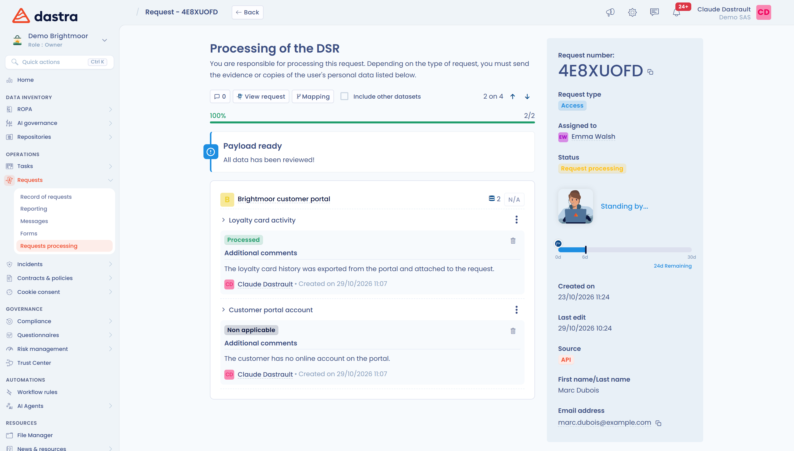

# Interface de traitement des demandes (propriétaires d’actifs)

Lorsqu’un utilisateur est défini comme **propriétaire d’un actif** lié à un jeu de données concerné par une demande, il dispose d’une interface dédiée pour traiter cette demande. Il n’a pas accès à la liste des demandes, mais il doit disposer du droit d’accès au référentiel.

Pour y accéder, ouvrez le menu **Demandes**, puis **Exécution des demandes**. La page **Actifs à traiter** liste les actifs dont l'utilisateur est responsable, et la page **Demandes en attente d'exécution** liste les demandes à traiter, avec des filtres par type et par actif.

Fonctionnalités disponibles :

* Visualiser la liste des demandes à traiter.
* Accéder aux jeux de données concernés par la demande.
* Fournir les preuves, copier ou supprimer les données demandées.
* Valider le traitement d'un jeu de données ou le déclarer **Non applicable**, avec un commentaire.

<figure><figcaption>
Les actifs à traiter
</figcaption></figure>

<figure><figcaption>
Les demandes en attente d'exécution
</figcaption></figure>

Ouvrez une demande pour voir ses jeux de données, regroupés par actif. La page propose **Afficher la demande**, **Cartographie** et **Inclure autres jeux de données**. Cliquez sur **Examiner** pour détailler un jeu de données, puis sur **Valider** une fois la preuve fournie ou les données copiées ou supprimées. Cliquez sur **Non applicable** si le jeu de données n'est pas concerné : le bouton **N/A** d'un actif applique ce statut à tous ses jeux de données. Lorsque tous les jeux de données sont traités, Dastra affiche le bandeau **Livraison prête**.

<figure><figcaption>
Exemple de demande traitée
</figcaption></figure>
