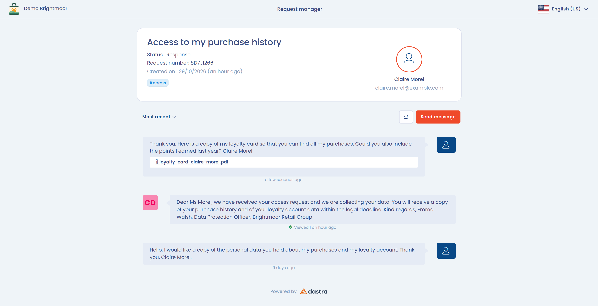
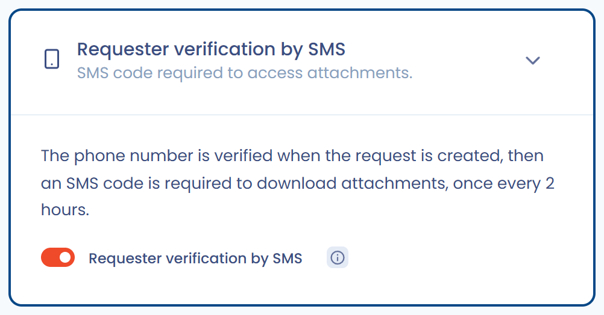
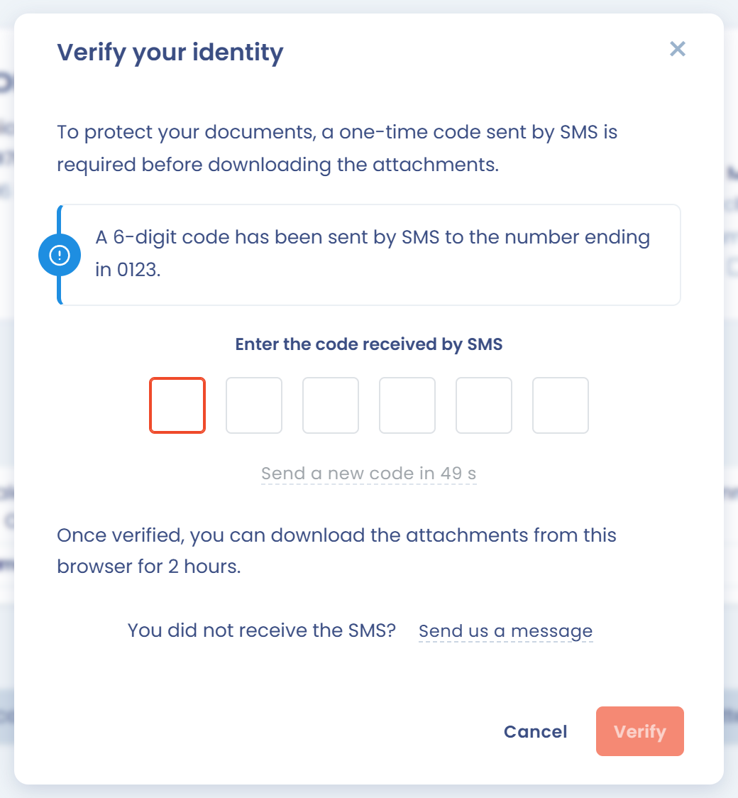

# Espace demandeur

Chaque personne à l’origine d’une demande accède à un **espace dédié**, sécurisé par un code à 6 chiffres à usage unique, envoyé par e-mail.

Depuis cet espace, le demandeur peut :

* Suivre l’avancement de sa demande.
* Consulter les messages envoyés par l’organisation.
* Répondre et échanger directement avec le responsable de la demande.
* Télécharger ou déposer des documents justificatifs.

<figure><figcaption>
L'espace d'échange avec le demandeur
</figcaption></figure>

Cet espace assure la traçabilité, le suivi et la transparence des échanges, et évite les envois non sécurisés par e-mail classique. Après la clôture de la demande, le demandeur conserve l'accès à son espace pendant une durée limitée : voir les [questions fréquentes](../faq.md).

Pour retrouver le lien d'accès à l'espace d'une demande, ouvrez le menu **Actions** de la demande et cliquez sur **Copier le lien d'accès au portail demandeur**.


**Données de santé** : Dastra n'est pas certifié HDS (Hébergeur de Données de Santé). En revanche, notre hébergeur, Microsoft Azure, l'est. Si des documents transmis via l'interface (par le demandeur ou par votre organisation) contiennent des données de santé, assurez-vous que cet usage est compatible avec vos propres obligations en la matière.


***

## Vérifier le demandeur par SMS

La vérification du demandeur par SMS ajoute un second facteur, indépendant de l'e-mail. Le demandeur prouve qu'il possède un numéro de téléphone, puis saisit un code reçu par SMS avant de télécharger les pièces jointes de la demande. Le SMS prouve la possession d'un numéro : il ne remplace pas la vérification de l'identité du demandeur (voir [Vérification de l'identité](../process.md#verification-de-lidentite)).

Cette fonctionnalité est une option de votre offre. Sans elle, le réglage affiche **Option non incluse dans votre abonnement**.

### L'activer

1. Dans les réglages de l'espace de travail, sous **Processus**, ouvrez **Demandes d'exercice de droit**.
2. Ouvrez la section **Vérification du demandeur par SMS** et activez l'option. Vous devez avoir le droit de gérer les réglages avancés.
3. Ouvrez chaque formulaire de collecte, rendez-vous dans sa section **Configuration** et cochez **Activer la validation du téléphone**. Ce commutateur n'apparaît que lorsque l'option est activée dans l'espace de travail, et il est activé par défaut dans chaque formulaire.

<figure><figcaption>
L'option dans les réglages de l'espace de travail
</figcaption></figure>

Lorsqu'un formulaire vérifie le numéro, son champ téléphone est toujours affiché et obligatoire, pour tous les types de demande. Dans la personnalisation des champs, il apparaît verrouillé, avec une infobulle qui en donne la raison.

### Ce que voit le demandeur

À la création, le demandeur valide son adresse e-mail. La page de confirmation lui demande ensuite de vérifier son numéro de téléphone : Dastra envoie par SMS un code à 6 chiffres au numéro saisi, et le demandeur le saisit. La demande est enregistrée dès que l'adresse e-mail est validée, même si le numéro n'est pas encore vérifié. La vérification du téléphone reste possible pendant 24 heures après l'envoi. Si votre formulaire redirige vers votre propre page (**Lien de redirection dans le cas d'un succès**), la page de confirmation n'est pas affichée et cette étape est ignorée.

Lorsque le demandeur télécharge une pièce jointe depuis son espace, une icône de cadenas indique qu'un code est requis. La fenêtre **Vérifiez votre identité** demande un code envoyé par SMS au numéro de la demande, dont seuls les quatre derniers chiffres sont affichés. Une fois le code valide, le demandeur peut télécharger les pièces jointes depuis le même navigateur pendant 2 heures, puis un nouveau code est nécessaire. Modifier le numéro de téléphone de la demande met fin à cette session.

<figure><figcaption>
La fenêtre qui demande le code SMS avant un téléchargement
</figcaption></figure>

Une demande sans pièce jointe ne déclenche aucun SMS au-delà de la vérification initiale.

Si le demandeur n'a pas reçu le SMS, il clique sur **Envoyer un nouveau code**, ou sur **Envoyez-nous un message** pour écrire à l'organisation.

### Limites

| Règle | Valeur |
| --- | --- |
| Validité d'un code | 10 minutes, et un code ne sert qu'une fois |
| Délai avant un nouveau code | 60 secondes |
| Codes envoyés par demande | 5 par heure |
| Codes incorrects avant le blocage | 4, puis la vérification est bloquée pendant 30 minutes |
| Session de téléchargement après un code valide | 2 heures |

### Côté organisation

Dans la section **Informations d'identité** d'une demande, le champ **Téléphone** affiche **Vérifié le** suivi de la date, **Non vérifié**, ou l'alerte **Pièces jointes non protégées par SMS : aucun numéro de téléphone renseigné**. Sans numéro de téléphone, aucun code n'est demandé et les pièces jointes se téléchargent sans SMS.

Un numéro saisi ou modifié par un utilisateur n'est jamais considéré comme vérifié. Quand vous le modifiez, Dastra vous demande de confirmer dans la fenêtre **Modifier le numéro de téléphone ?** : ne changez le numéro que si vous êtes certain que la demande vient du demandeur. La vérification est alors réinitialisée, le code en attente et la session de téléchargement sont abandonnés, et les prochains codes partent vers le nouveau numéro.

L'historique de la demande retrace chaque étape : code envoyé, numéro vérifié, téléchargement validé, vérification bloquée et numéro modifié. Voir [Modifier et traiter les demandes](../process.md#suivi-global).
