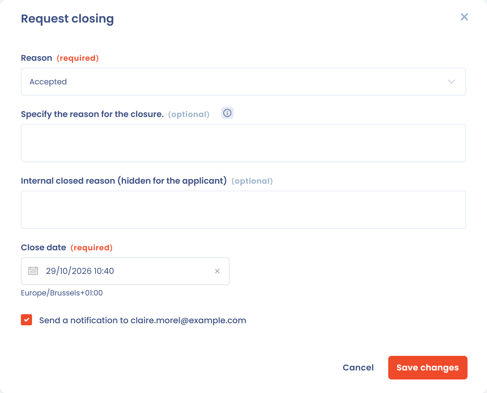

# Questions fréquentes

## Les demandeurs reçoivent-ils une notification par e-mail lors de la clôture d'une demande ?

Par défaut, aucun e-mail n'est envoyé. La notification de clôture est envoyée au demandeur uniquement si vous cochez la case **Envoyer une notification de clôture de la demande à** (suivie de l'adresse e-mail du demandeur) dans la fenêtre de clôture. La case n'apparaît que si la demande contient une adresse e-mail, et elle est grisée lorsque le demandeur a déjà été notifié.

<figure><figcaption>
La case de notification dans la fenêtre de clôture
</figcaption></figure>


Cochez cette option lorsque vous souhaitez informer la personne concernée de la résolution de sa demande. C'est une bonne pratique pour démontrer le respect du délai de réponse imposé par le RGPD.


***

## Pendant combien de temps le demandeur a-t-il accès à l'espace sécurisé après la clôture ?

Une fois la demande clôturée, le demandeur conserve l'accès à son espace sécurisé (historique des échanges, documents transmis) pendant **60 jours**. Pendant cette période, il peut encore envoyer un message au gestionnaire de la demande depuis l'interface de conversation.

Au-delà de 60 jours, l'accès est révoqué automatiquement.

## Comment fonctionne la vérification de l'adresse e-mail du demandeur ?

Lorsqu'une demande est déposée depuis le formulaire public, le demandeur reçoit un e-mail de confirmation contenant un **lien de validation** et un **code à 6 chiffres**. La demande n'est prise en compte qu'une fois l'adresse validée.

* Le lien et le code sont valables **24 heures**. Cette durée n'est pas paramétrable.
* Après plusieurs saisies de code incorrectes (4), les nouvelles tentatives sont **bloquées pendant 30 minutes**.
* Si le délai est dépassé, le demandeur doit déposer une nouvelle demande.

## Pourquoi un demandeur ne peut-il pas déposer une nouvelle demande ?

Un même demandeur (même adresse e-mail) ne peut pas déposer une deuxième demande **du même type** dans le même espace de travail tant que la précédente, déposée il y a moins de 24 heures, n'est pas clôturée.

## Quelle est la longueur maximale d'un message dans une demande ?

Les messages échangés avec le demandeur, le message du formulaire public et les motifs de clôture sont limités à **3 000 caractères**. Un message peut contenir jusqu'à **20 pièces jointes**.

***

## La page de collecte des demandes pose-t-elle des cookies ? Faut-il une bannière de consentement ?

Non. La page widget Dastra (URL de type `https://api.dastra.eu/v1/client/data-subject-request/page?id=…`) ne pose **qu'un seul cookie** : `acaAffinity`.

Il s'agit d'un cookie de **load balancing** (Azure Application Gateway), dont la seule fonction est de maintenir la stabilité de la session serveur en routant les requêtes vers le même nœud backend. Il est de durée **session**, sécurisé (`Secure`, `HttpOnly`) et entre dans l'**exemption de consentement** prévue à l'article 5§3 de la directive ePrivacy, confirmée par les lignes directrices de la CNIL (cookies strictement nécessaires au fonctionnement du service).

Aucune bannière de consentement n'est requise sur cette page.


Audit réalisé le 27 avril 2026 : 0 cookie analytique, 0 cookie publicitaire, 0 tracker tiers détecté. Les ressources tierces chargées (Bootstrap via cdnjs.cloudflare.com, police Poppins via fonts.bunny.net, SDK via cdn.dastra.eu) ne posent aucun cookie.


***

## Le cookie `acaAffinity` doit-il figurer dans notre registre des cookies ?

Oui, par souci d'exhaustivité documentaire, même s'il est exempté de consentement. Voici l'entrée recommandée :

| Champ               | Valeur                                          |
| ------------------- | ----------------------------------------------- |
| Nom                 | `acaAffinity`                                   |
| Domaine             | `api.dastra.eu`                                 |
| Catégorie           | Technique / Strictement nécessaire              |
| Finalité            | Load balancing : stabilité de session serveur   |
| Durée               | Session (supprimé à la fermeture du navigateur) |
| Émetteur            | Dastra (sous-traitant)                          |
| Base légale         | Exemption ePrivacy : strictement nécessaire     |
| Consentement requis | Non                                             |
