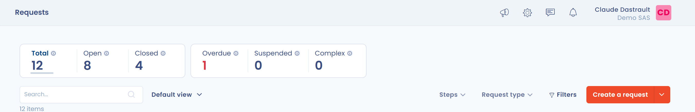
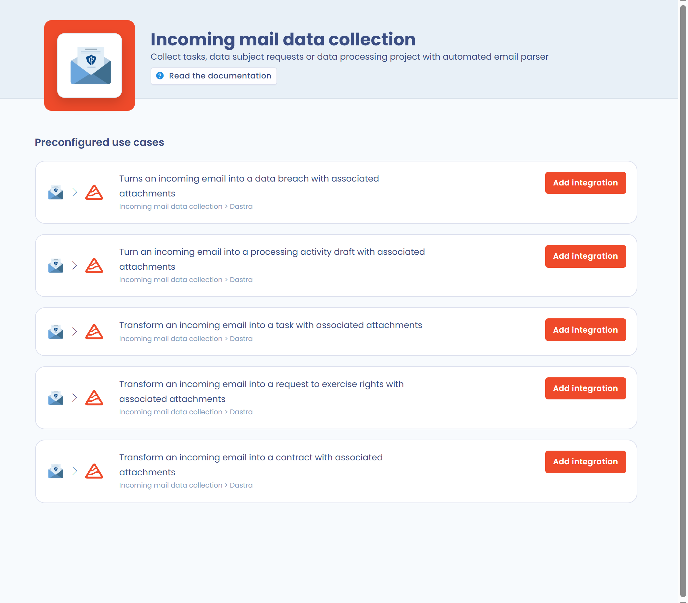

# Gestion des demandes d'exercices de droits



## Création d'une demande de droit

Une demande de droit peut être créée de 5 manières dans Dastra :

1. Manuellement, depuis le registre des demandes.
2. Par import d'un fichier (voir [Import et export des demandes](manage.md#import--export-des-demandes)).
3. Automatiquement, via une adresse e-mail de collecte.
4. Automatiquement, via un formulaire de collecte de demandes.
5. Automatiquement, via l'API REST.

### Création d'une demande manuellement



Pour créer une demande manuellement depuis le registre, cliquez sur **Demandes** dans la barre latérale, puis sur **Registre des demandes** et sur le bouton **Créer une demande**.

<figure><figcaption>
Le registre des demandes
</figcaption></figure>


Vous pouvez également créer des demandes automatiquement (voir ci-dessous).


### Création d'une demande via une adresse e-mail de collecte



Pour créer une ou plusieurs demandes à partir d'une adresse e-mail de collecte, activez d'abord l'intégration **Adresse mail de collecte** (voir [la page de l'intégration](../settings/mailboxes.md)).

Pour cela, ouvrez **Réglages espace de travail**, puis la section **Intégrations** et cliquez sur la carte **Adresse mail de collecte**.

<figure><figcaption>
L'intégration « Adresse mail de collecte » dans Dastra
</figcaption></figure>


Si cette intégration n'est pas encore installée, installez-la. Depuis le registre des demandes, l'entrée **Transformer emails en demandes de droits** du menu du bouton **Créer une demande** y mène directement.


Dans la liste **Cas d'usage préconfigurés**, cliquez ensuite sur **Ajouter l'intégration** sur la ligne **Transforme un mail entrant en une demande avec les pièces jointes associées**. Une adresse e-mail est générée automatiquement.

<figure><figcaption></figcaption></figure>

Chaque e-mail envoyé à cette adresse devient alors une demande dans Dastra, avec ses pièces jointes.

### Création d'une demande via un formulaire de collecte

Pour créer des demandes automatiquement à partir d'un formulaire de collecte (widget), voir la page « Implémenter un widget d'exercice des droits » :


[implementez-un-widget-dexercice-des-droits.md](widget.md)


### Création d'une demande via l'API

Les demandes peuvent aussi être créées depuis un autre outil grâce à l'API REST de Dastra. Voir la page « Intégration de l'API » :


[api.md](api.md)


## Import / Export des demandes



Cliquez sur la flèche à côté du bouton **Créer une demande**, puis sur **Importer**.

Suivez ensuite le guide d'[import de données dans Dastra](../general/import.md).

Pour exporter, cliquez sur **Exporter** dans le même menu.
