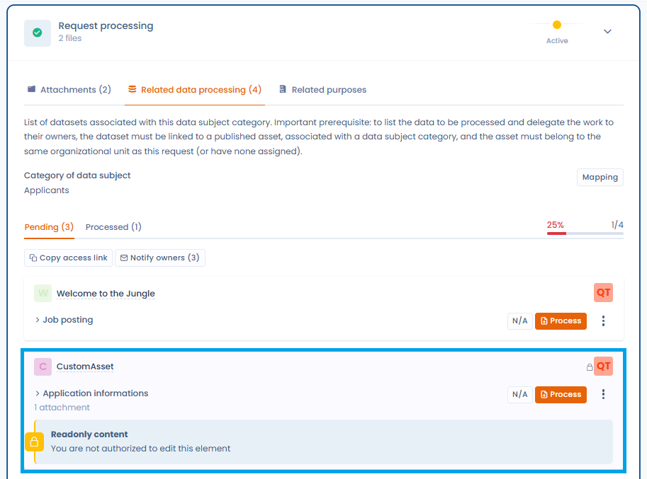
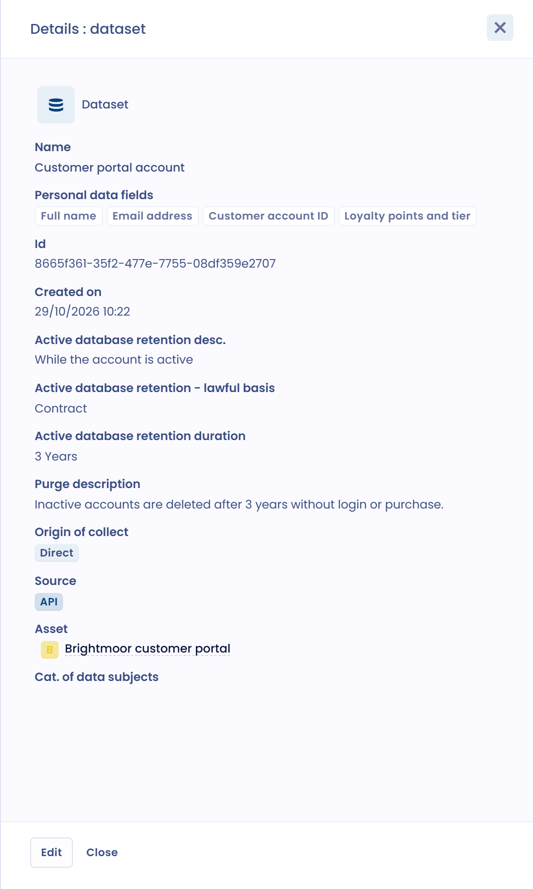
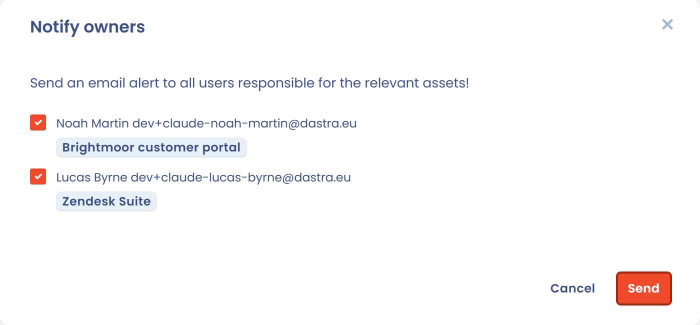

# Édition et traitement des demandes

Dastra couvre l’ensemble du cycle de vie d’une demande d’exercice de droits (DSAR).\
Depuis l’interface, vous pouvez :

* **Qualifier la demande** : type de droit concerné, unité organisationnelle, gestion des délais.
* **Vérifier l’identité** du demandeur en complétant ou adaptant les informations collectées.
* **Traiter les données associées** en consultant les jeux de données liés, en téléversant des preuves et en notifiant les responsables.
* **Répondre directement** au demandeur, avec l'aide de l'assistant IA si vous le souhaitez, avec une traçabilité complète des échanges.
* **Clôturer la demande** en indiquant le motif de clôture.

Chaque étape est documentée et historisée, ce qui vous aide à démontrer votre conformité et à répondre clairement aux personnes concernées.

***

## Qualification de la demande

Lorsqu’une demande est enregistrée, elle apparaît dans le registre des demandes.\
Dans la section **Qualification de la demande**, vous pouvez :

1. Définir le ou les **types de demande** concernés.
2. Assigner la demande à un opérateur et à une **unité organisationnelle**.
3. Gérer les **délais de traitement**.

<figure><figcaption>
La section Qualification de la demande
</figcaption></figure>

La section contient aussi la langue préférée du demandeur, les **Tags**, le **Message de la demande**, les **Informations complémentaires sur la demande** et la **Référence de la demande**.

### Types de demande

Dastra propose 17 types de demande :

* Information
* Accès
* Rectification
* Effacement
* Limitation
* Opposition
* Portabilité
* Sort des données après le décès
* Absence d'une décision automatisée
* Accès aux documents administratifs
* Demande au DPO
* Demande d'un tiers
* Plainte relative à la protection des données
* Ne pas vendre/partager mes données
* Limiter l'utilisation des informations personnelles sensibles
* Retrait du consentement
* Autre

Une demande peut porter sur plusieurs types.

### Délais de traitement

Le délai légal est calculé à partir de la date de la demande :

* 30 jours par défaut.
* 20 jours lorsque le type **Accès aux documents administratifs** est sélectionné.
* 90 jours lorsque vous activez **Demande complexe (90 jours)**. Cette option prime sur les deux autres délais, et la prolongation doit être justifiée.

La **Date d'expiration** peut aussi être fixée en un clic : les boutons **+8j**, **+30j** et **+90j** ajoutent respectivement 8, 30 ou 90 jours à la date de la demande.

Si vous suspendez la demande (voir [Suspension d'une demande](process.md#suspension-dune-demande)), la **Date d'expiration prévisionnelle** repousse l'échéance de la durée de la suspension.

***

## Vérification de l’identité

Vous vérifiez dans Dastra l’identité de la personne à l’origine de la demande.\
Vous pouvez compléter ou modifier les informations collectées via le formulaire initial :

* Adresse e-mail, prénom, nom.
* Données complémentaires : pays, adresse postale, téléphone, identifiant utilisateur, etc.
* Catégorie de personnes concernées (par exemple abonnés à la newsletter, clients, salariés).

<figure><figcaption>
La section Informations d'identité
</figcaption></figure>

Lorsque la demande vient d'un formulaire de collecte, les champs renseignés par le demandeur (le message et l'adresse e-mail) sont verrouillés : ils ne peuvent pas être modifiés.

Si d'autres demandes ont la même adresse e-mail, le panneau latéral affiche le lien **n demandes avec e-mail identique**. Il aide à repérer les doublons.

***

## Exécution de la demande

La section **Exécution de la demande** regroupe toutes les actions liées au traitement. Elle comporte trois onglets : **Pièces jointes**, **Données liées** et **Finalités associées**.

### Pièces jointes

Vous pouvez téléverser des fichiers de preuve ou des exports contenant les données du demandeur.\
Ces fichiers pourront ensuite être joints lors de la réponse. Chaque fichier propose des boutons pour l'aperçu, le caviardage (selon votre offre), le téléchargement et la suppression, et **Téléchargez tout (.zip)** récupère l'ensemble des fichiers. La taille d'un fichier peut atteindre 100 Mo.

<figure><figcaption>
Ajout de fichiers à la demande
</figcaption></figure>

Pour masquer les informations de tiers dans un document avant de le transmettre, voir [Caviardage des documents](redaction.md).


**Données de santé** : Dastra n'est pas certifié HDS (Hébergeur de Données de Santé). En revanche, notre hébergeur, Microsoft Azure, l'est. Tenez-en compte avant de transmettre, via l'interface, des documents contenant des données de santé.


### Traitements de données liés

Dastra identifie automatiquement les jeux de données associés à la **catégorie de personnes concernées**.\
Chaque jeu de données doit être traité individuellement.

* Statuts disponibles : **En attente** / **Terminé**. Un jeu de données peut aussi être marqué **Non applicable**.
* Affichage de l’avancement global (progression en pourcentage).

L'onglet **Données liées** affiche l'ensemble des jeux de données pertinents selon un **modèle cumulatif** : ceux rattachés à l'unité organisationnelle assignée à la demande, ceux de **toutes ses unités parentes** (jusqu'à la racine de la hiérarchie) et ceux de **toutes ses unités descendantes**. Cette vue garantit qu'aucun jeu de données hérité n'est oublié lors du traitement.

<figure><figcaption>
Les jeux de données hérités des unités parentes et descendantes sont affichés selon un modèle cumulatif
</figcaption></figure>


Une demande ne peut pas être déclarée traitée à 100 % tant que des jeux de données hérités n'ont pas été traités ou explicitement marqués comme **Non applicable**.


Si l'opérateur en charge de la demande ne dispose pas des droits d'accès à certains jeux de données affichés, une **indication visuelle** l'invite à contacter les responsables concernés.

#### Détails d’un jeu de données

Cliquez sur le bouton **Cartographie** pour visualiser les liens entre la catégorie de personnes concernées, les jeux de données et les actifs.

<figure><figcaption>
Visualisez le lien entre la catégorie de personnes et le responsable à contacter
</figcaption></figure>

En cliquant sur **Examiner**, vous accédez aux informations détaillées :

* Champs de données personnelles concernés (par exemple nom complet, adresse e-mail).
* Base légale et durée de conservation.
* Modalités de suppression après la période de conservation.

<figure><figcaption>
Accès rapide au détail de l'actif
</figcaption></figure>

#### Marquer un jeu de données comme traité

Pour chaque jeu de données :

1. Consultez les informations.
2. Justifiez le traitement effectué (par exemple suppression, rectification) dans le champ **Justification**, obligatoire. **Générer** rédige le texte avec l'IA.
3. Ajoutez, si nécessaire, des fichiers de preuve.
4. Cliquez sur **Valider**.

Si le jeu de données ne concerne pas la demande, cliquez sur **Non applicable**. Le statut est mis à jour et le commentaire est conservé.

<figure><figcaption>
Interface de traitement de la demande spécifique à l'actif
</figcaption></figure>

#### Collaboration et notifications

Vous pouvez notifier automatiquement les responsables des actifs concernés.\
Cliquez sur **Notifier les responsables** : dans la fenêtre, sélectionnez les personnes à avertir par e-mail, puis cliquez sur **Envoyer**.

<figure><figcaption>
Notifiez rapidement les propriétaires des actifs
</figcaption></figure>

### Finalités associées

L'onglet **Finalités associées** liste, dans un tableau, les finalités de traitement liées à la catégorie de personnes concernées (**Finalité**), avec leur **Base légale** et les traitements de données liés. Les finalités ne s'affichent que si elles appartiennent à la même unité organisationnelle que la demande.

<figure><figcaption>
Les finalités associées à la catégorie de personnes concernées
</figcaption></figure>

***

## Réponse à la demande

Une fois le traitement terminé, vous pouvez répondre directement au demandeur dans la section **Réponse à la demande**.

* Cliquez sur **Générer avec IA** : l'**assistant IA** propose un message conforme et personnalisable dans la fenêtre **Assistant IA de discussion**.
* Ajustez le message avec les suggestions proposées : plus formel, moins formel, plus court, plus long, avec des emojis, approuver la demande, valider l'identité. Vous pouvez aussi saisir votre propre consigne avec **Utiliser une instruction personnalisée**.
* Cliquez sur **Utiliser ce message**, puis envoyez-le directement depuis Dastra.

<figure><figcaption>
Échangez des messages avec le demandeur, en utilisant l'IA si vous le souhaitez
</figcaption></figure>

***

## Clôturer une demande

Pour clôturer une demande, cliquez sur **Clôturer la demande** dans le menu **Actions** ou en bas de la page. Dans la fenêtre qui s'ouvre :

1. Dans la liste **Motif de clôture pour le demandeur**, choisissez le motif de clôture. Ce champ est obligatoire.
2. Dans **Précisez le motif de clôture (visible par le demandeur)**, ajoutez une explication que le demandeur verra dans son espace. Ce champ est facultatif.
3. Dans **Motif de clôture interne (invisible pour le demandeur)**, ajoutez si besoin une note réservée à votre équipe.
4. Vérifiez la **Date de clôture**.
5. Pour avertir le demandeur par e-mail, cochez **Envoyer une notification de clôture de la demande à** suivi de son adresse. La case n'apparaît que si la demande a une adresse e-mail, et elle n'est pas cochée par défaut.
6. Cliquez sur **Enregistrer**.

<figure><figcaption>
La fenêtre de clôture d'une demande
</figcaption></figure>

Si la demande est suspendue, la clôturer lève automatiquement la suspension. Une demande clôturée peut être rouverte avec le bouton **Rouvrir**.

***

## Actions supplémentaires sur une demande

En plus des étapes principales (qualification, vérification, traitement et réponse), Dastra propose un menu **Actions** qui permet d’effectuer des opérations avancées sur une demande.

<figure><figcaption>
Accédez rapidement aux nombreuses actions supplémentaires disponibles
</figcaption></figure>

Les actions disponibles incluent notamment :

* **Champs personnalisés** : ajouter ou modifier des champs spécifiques pour enrichir la demande.
* **Copier le lien d'accès au portail demandeur** : partager un lien direct avec la personne concernée.
* **Envoyer un mail** : envoyer un message lié à la demande directement depuis la plateforme.
* **Exporter** : exporter les informations de la demande.
* **Règles de workflow** : appliquer ou déclencher une règle d’automatisation.
* **Suspendre la demande** : mettre en pause le délai légal de traitement (voir ci-dessous).
* **Clôturer la demande** : marquer manuellement la demande comme terminée.
* **Réinitialiser le jeton d'accès** : recréer un lien sécurisé pour le demandeur.
* **Anonymiser** : effacer les données identifiantes liées à la demande. L'action devient disponible une fois la demande clôturée.
* **Purger fichiers** : supprimer les pièces jointes transmises. Le menu en indique le nombre, par exemple **Purger fichiers (1)**. Leur nom et leurs dates sont conservés. Cette action n'apparaît qu'une fois la demande clôturée.
* **Déplacer dans la corbeille** : placer la demande dans la corbeille. Les règles de purge s'appliquent ensuite (voir [Règles de purge des demandes](advanced/purge.md)).

### Suspension d’une demande

Dans certains cas, il est nécessaire de **suspendre temporairement** une demande (par exemple en attente d’une vérification d’identité).\
La suspension interrompt le délai légal et celui-ci ne reprend qu’une fois la suspension levée.

<figure><figcaption>
Suspendez une demande dans l'attente d'une réponse du demandeur, par exemple
</figcaption></figure>

* **Date de la suspension** : obligatoire.
* **Justification de la suspension** : champ libre pour documenter la raison (par exemple en attente de pièces justificatives).

Cliquez ensuite sur **Enregistrer**.

Une fois la demande suspendue, l’interface affiche clairement l’état et propose le bouton **Lever la suspension**.

<figure><figcaption></figcaption></figure>

Le compteur de jours restants est automatiquement recalculé, en prenant en compte la période de suspension.

***

## Messages des demandeurs

La page **Messages** du menu **Demandes** rassemble, demande par demande, les messages échangés avec les demandeurs. Chaque groupe affiche le titre de la demande et le nom du demandeur. Vous pouvez filtrer la liste par opérateur (**Assignée à**), par expéditeur, par type de message (**Messages de demandeurs**, **Messages de l'opérateur** ou **Tous les messages**) et par période.

<figure><figcaption>
La boîte de réception des messages des demandeurs
</figcaption></figure>

Un message de demandeur qui n'a pas encore été lu est signalé par une icône d'enveloppe. Une coche **Consultée** apparaît une fois qu'il a été lu. Pour ouvrir la conversation, cliquez sur **Afficher** : dans la demande, le bouton **Marquer comme lu** marque comme lus les nouveaux messages.

## Statistiques des demandes

La page **Statistiques** du menu **Demandes** présente l'activité du module sur la période choisie (30, 90, 180 ou 365 jours, ou une période personnalisée). Elle indique notamment :

* le nombre de demandes créées, clôturées, clôturées en retard et complexes ;
* le temps moyen de clôture ;
* l'évolution des demandes ouvertes et fermées ;
* la répartition des demandes par type, par étape, par opérateur et par raison de fermeture.

Vous pouvez filtrer par unité organisationnelle et par étape, inclure la corbeille, utiliser **Filtres** (par exemple pour choisir un formulaire de collecte ou exclure les demandes anonymisées) et imprimer la page avec **Imprimer**.

<figure><figcaption>
Les statistiques des demandes
</figcaption></figure>

***

## Suivi global

Chaque demande conserve l’historique complet :

* Messages échangés.
* Pièces jointes ajoutées.
* Statut et avancement du traitement.

Vous garantissez ainsi la traçabilité et la conformité en cas de contrôle.
