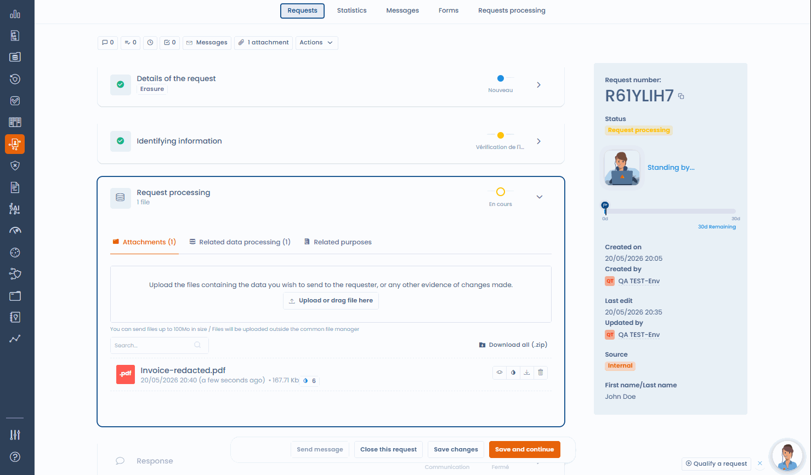

# Caviardage des documents

Lors du traitement d'une demande d'exercice de droits, vous devez souvent transmettre des documents au demandeur : copie d'identité, contrat, historique de compte, dossier client. Ces documents contiennent presque toujours des informations confidentielles qui ne doivent pas être communiquées : données relatives à des tiers, données contractuelles internes, références nominatives.

Dastra intègre un outil de caviardage dans la demande. L'interface l'appelle **Occultation de fichier**.

***

## Comment accéder à l'occultation

L'outil s'ouvre depuis les pièces jointes de la demande. Il accepte les fichiers PDF, PNG et JPEG, et dépend de votre offre : le bouton n'apparaît pas si l'occultation n'y est pas incluse.

1. Dans le menu **Demandes**, ouvrez **Registre des demandes**, puis la demande à traiter.
2. Dans la section **Exécution de la demande**, ouvrez l'onglet **Pièces jointes**. Importez le document si nécessaire.
3. Sur la ligne du fichier, cliquez sur l'icône **Occultation des données**. Vous pouvez aussi ouvrir l'aperçu du fichier, puis cliquer sur **Occultation des données**.

L'éditeur **Occultation de fichier** s'ouvre sur le document.

<figure><figcaption>
Les pièces jointes de la demande, avec l'icône d'occultation sur chaque fichier compatible
</figcaption></figure>

***

## Occulter manuellement

Tracez à la souris les zones à masquer sur chaque page. L'éditeur affiche le nombre d'occultations posées et propose ces actions :

* **Retirer l'occultation** supprime une zone.
* **Annuler la dernière occultation** revient en arrière d'une zone.
* **Effacer les occultations de la page** et **Effacer toutes les occultations** repartent d'une page blanche.
* Les boutons de zoom et de changement de page facilitent la lecture des documents longs.

<figure><figcaption>
Tracez les zones à occulter directement sur le document
</figcaption></figure>

<figure><figcaption>
L'éditeur Occultation de fichier
</figcaption></figure>

***

## Occulter avec l'IA

Dans l'éditeur, cliquez sur **Caviarder auto.** pour ouvrir la fenêtre **Occultation automatique par IA**. L'IA analyse le document, repère les données personnelles de tiers (noms, adresses, coordonnées, numéros d'identification) et place des zones d'occultation. Aucune donnée n'est conservée au-delà de la session.

La fenêtre propose trois options :

* **Exclure les informations de la personne concernée de l'occultation** : cochée par défaut, pour que les données du demandeur restent lisibles.
* **Instruction personnalisée** : une consigne complémentaire, par exemple occulter aussi tous les noms d'entreprise.
* **Expressions supplémentaires à occulter** : jusqu'à 20 expressions à masquer partout où elles apparaissent. Saisissez une expression, puis appuyez sur Entrée.

Cliquez ensuite sur **Caviarder auto.**. Les zones proposées s'ajoutent à l'éditeur : supprimez celles qui sont détectées à tort et ajoutez celles que l'IA a manquées. Le bouton **Caviarder auto.** n'apparaît que si l'occultation par IA est incluse dans votre offre.

<figure><figcaption>
Les options de l'occultation automatique par IA
</figcaption></figure>

<figure><figcaption>
L'IA analyse le document et place les zones d'occultation à valider
</figcaption></figure>


Le résultat de l'IA est une proposition de départ, pas une décision finale. Une personne qualifiée doit revoir et valider chaque zone avant la transmission.


***

## Enregistrer le fichier occulté

Une fois la revue terminée, cliquez sur **Enregistrer le fichier occulté**. Le bouton reste inactif tant qu'aucune zone n'est posée. Le commutateur **Supprimer le fichier original**, activé par défaut, détermine ce que devient l'original :

* Activé : le fichier occulté remplace définitivement l'original, qui est supprimé.
* Désactivé : le fichier occulté est ajouté comme nouvelle pièce jointe, nommée avec le suffixe `-redacted`, et l'original est conservé.

Dastra vous demande de confirmer avant d'enregistrer. Les pages sont aplaties en images : le texte masqué n'existe plus dans le fichier produit et il est impossible de l'extraire. Un fichier occulté porte l'indicateur **Données caviardées**, avec le nombre de zones occultées.


Un simple rectangle opaque posé sur un PDF non aplati peut être contourné et ne constitue pas un caviardage conforme. L'aplatissement en image est la méthode recommandée par les autorités de protection des données.


***

## Bonnes pratiques

* Relisez le document occulté avant l'envoi pour vérifier qu'aucune information confidentielle n'est visible.
* Désactivez **Supprimer le fichier original** pour conserver l'original dans la demande, par exemple pour votre dossier de conformité, sauf si votre politique interne impose sa suppression.
* Pour les documents volumineux ou complexes (contrats de plusieurs pages, relevés de compte), combinez la détection par IA avec une relecture manuelle page par page.
