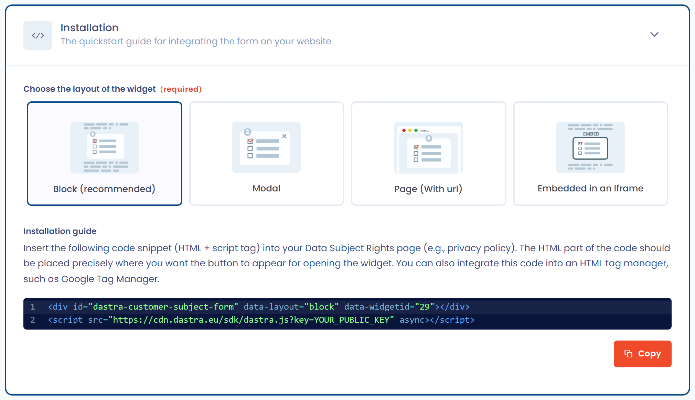
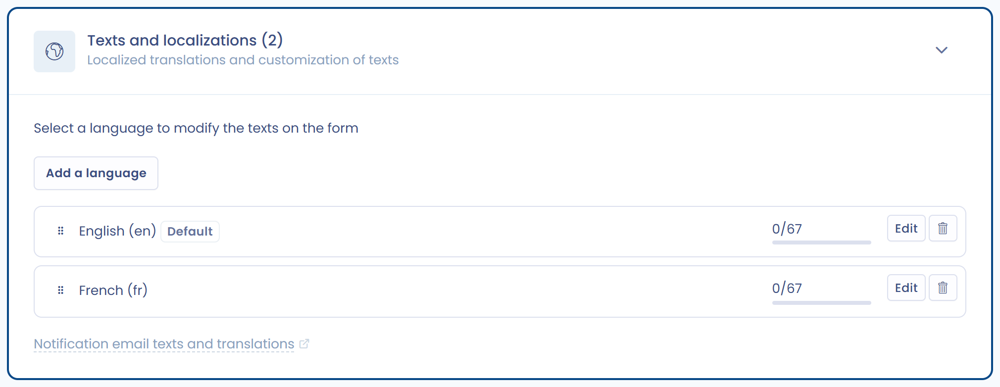

# Implémenter un widget d’exercice des droits

Le widget Dastra ajoute un formulaire d’exercice des droits directement sur votre site web. Dans l’application, il se gère depuis **Demandes** > **Formulaires de collecte** : cliquez sur **Créer un formulaire** pour en ajouter un.

Il est personnalisable sur cinq points :

* **Configuration générale** : types de droits proposés, redirections, politique de confidentialité.
* **Personnalisation visuelle** : couleurs, logo, image de fond, icônes, police, barre de progression.
* **Champs** : champs standards et champs personnalisés, obligatoires ou facultatifs.
* **Modes d’intégration** : insertion dans une page, fenêtre modale (popup), iframe ou page web dédiée.
* **Multilingue** : traduction et adaptation de tous les textes du widget.

***

## Workflow d’intégration

Voici le schéma général du fonctionnement d’un widget d’exercice de droits dans Dastra :

<figure><figcaption>
Le parcours d’une demande collectée par le widget
</figcaption></figure>

Ce diagramme illustre le processus :

1. La personne concernée soumet une demande via le widget.
2. La demande est transmise et enregistrée dans Dastra.
3. Vous êtes notifiés et pouvez la qualifier et la traiter dans la plateforme.
4. La personne concernée reçoit une réponse via le portail demandeur.

### Vidéo tutoriel

Cette vidéo montre comment mettre en place un widget de collecte de demandes de droits.


La vidéo n’est pas totalement à jour visuellement, mais elle reste utile pour comprendre les grandes étapes.




***

## Configuration générale

Ouvrez un formulaire de collecte, section **Configuration**. Vous y définissez :

* Le **nom** du widget et son **unité organisationnelle**.
* Les types de droits disponibles, avec la question **Pour quels types de droit ?** : **Types de droit par défaut**, **Certains types de droit** (vous choisissez alors les types dans **Choisir les types de demande autorisés**) ou **Aucun type de droit (formulaire simple)**, qui ne demande pas de type de droit à la personne.
* Les liens **Lien de redirection dans le cas d'un succès (après la phase d'identification)**, **Lien de redirection dans le cas d'une erreur (ex: expiration du lien de validation)** et **Lien vers la politique de confidentialité**. Ces trois liens sont facultatifs.

<figure><figcaption>
Configuration du widget
</figcaption></figure>

***

## Personnalisation de l’apparence

La section **Apparence & design** adapte le formulaire à votre charte graphique. L’aperçu se met à jour pendant vos modifications.

Options disponibles :

* **Logo**, et **Image de fond** (proposée avec la disposition d’en-tête **Image de fond** ou avec le mode page web dédiée).
* Couleurs : **Couleur primaire du formulaire**, **Couleur secondaire** (avec la disposition d’en-tête **Complet**), **Couleur des titres**, **Couleur du texte** et **Couleur atténuée**.
* **Disposition de l'en-tête** : **Complet**, **Plat**, **Image de fond** ou **Pas d'en-tête**.
* **Ombre du formulaire** : **Large**, **Standard** ou **Pas d'ombre**.
* **Apparence des icônes** : **Aucune icône** ou **Icônes standards**.
* **Afficher la barre de progression**.
* **Nom de la police de caractères** : le nom d’une police installée sur votre site.
* **CSS personnalisé**, pour les utilisateurs avertis.

<figure><figcaption>
Adaptez l'apparence du widget
</figcaption></figure>

***

## Personnalisation des champs

La section **Personnalisation du formulaire** liste les **Champs actifs** à gauche et les **Champs disponibles** à droite. Cliquez sur un champ disponible pour l’ajouter, glissez les champs actifs pour changer leur ordre et cliquez sur un champ actif pour le modifier.

* L’adresse e-mail est toujours présente. Par défaut, le formulaire demande aussi le prénom, le nom, la référence de la demande et le message.
* Vous pouvez ajouter des champs standards : téléphone, adresse, code postal, ville, pays, pièces jointes et catégorie de personne.
* Vous pouvez ajouter vos propres **champs personnalisés**, créés dans les champs personnalisés des demandes.
* Chaque champ dispose d’un interrupteur **Obligatoire**.
* Pour le champ **Catégorie de personnes**, cliquez sur **Configurez les catégories** pour choisir les catégories proposées à la personne.

<figure><figcaption>
Personnalisez les champs disponibles dans le widget
</figcaption></figure>

***

## Logique conditionnelle (skip logic)

Pour chaque champ, vous choisissez quand il s’affiche : **Afficher toujours**, **Afficher en fonction du type de demande** ou **Conditions d'affichage personnalisées**. Avec les conditions personnalisées, un champ apparaît uniquement si la réponse à une question précédente remplit une condition définie.

Les opérateurs proposés dépendent du type du champ, comme dans les règles de workflow :

* comparaisons (inférieur à, supérieur à et leurs variantes inclusives) pour les nombres et les dates ;
* « appartient à » et « n'appartient pas à » pour les listes déroulantes et les boutons radio ;
* « contient tous », « exclut tous », « est vide » et « n'est pas vide » pour les cases à cocher ;
* présence ou absence de valeur pour les champs facultatifs.

L'aperçu du formulaire applique ces règles. Elles sont interprétées dynamiquement côté répondant : le formulaire s'adapte en temps réel à mesure que les réponses sont saisies.

Vous pouvez ainsi :

* Afficher ou masquer des champs selon le type de droit exercé, la nature de la demande ou toute réponse antérieure
* Gérer plusieurs scénarios au sein d'un **widget unique**, sans créer et maintenir un formulaire distinct par variante
* Réduire la charge de maintenance lors des évolutions de contenu ou des exigences de conformité

***

## Installation du widget

La section **Installation** propose quatre modes d’intégration, à choisir avec **Type d'affichage du formulaire** :

* **Intégré dans la page** : un snippet HTML à placer à l’endroit où le formulaire doit apparaître.
* **Fenêtre modale (popup)** : un bouton ouvre le formulaire dans une fenêtre.
* **Page web dédiée (URL fournie)** : Dastra héberge une page dont vous partagez l’URL, par exemple dans votre politique de confidentialité.
* **Intégré dans une Iframe** : une iframe à placer dans votre page. L’option **Redimensionner l'iframe automatiquement** évite l’apparition d’une barre de défilement ; sinon, la hauteur est fixée à 1000 px.

Le code fourni est un snippet HTML et un script JavaScript à insérer sur votre site ou dans un gestionnaire de tags (par exemple Google Tag Manager). Pour les options avancées (langue, préremplissage des champs, plusieurs widgets dans une page), voir [Intégration technique](integration.md).

<figure><figcaption>
Guide d'installation
</figcaption></figure>

***

## Textes et traductions

Le widget est multilingue : dans la section **Textes et traductions**, ajoutez des langues avec **Ajouter la langue** et personnalisez les traductions.\
La première langue de la liste est la langue par défaut : Dastra l’utilise quand la langue du navigateur de la personne n’est pas disponible.

<figure><figcaption>
Personnalisation des textes du widget
</figcaption></figure>

Pour chaque langue, cliquez sur **Modifier** pour ouvrir les textes, regroupés en quatre sections (paramètres généraux, types de droit, formulaire de contact et champs personnalisés). Vous pouvez modifier :

* Nom de la page (en cas d’intégration en page dédiée).
* Messages avant les liens de politique de confidentialité.
* Textes de boutons ou d’instructions.
* Traduction des catégories de personnes et des champs personnalisés (libellé, description, texte indicatif et options).

<figure><figcaption>
Modifiez une partie des textes
</figcaption></figure>

***

## Résultat côté utilisateur

Le widget ainsi configuré permet aux personnes concernées de sélectionner le type de droit qu’elles souhaitent exercer et de soumettre leur demande.\
Le formulaire s’adapte à la configuration (langues, apparence, champs).

À la fin du formulaire, le demandeur reçoit un e-mail avec un lien de validation et un code à 6 chiffres, et saisit le code dans le formulaire : **Saisissez le code à 6 chiffres que vous venez de recevoir par e-mail**. La demande n'est prise en compte qu'une fois l'adresse validée. Consultez la [FAQ](faq.md).
