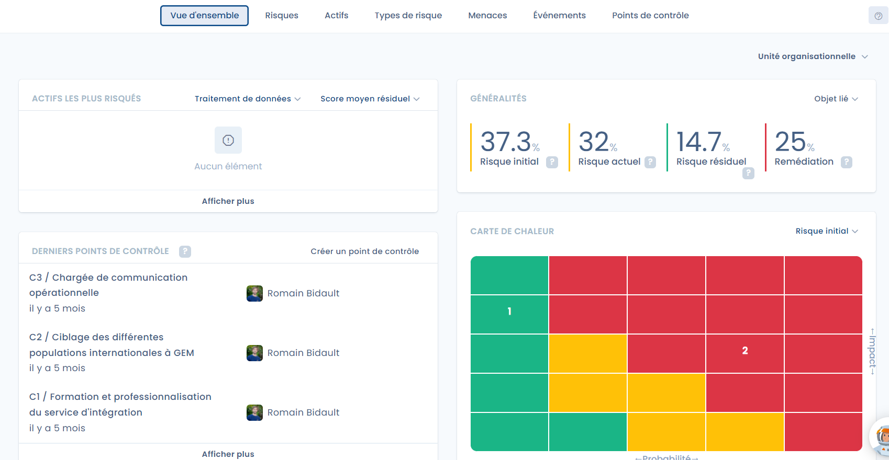
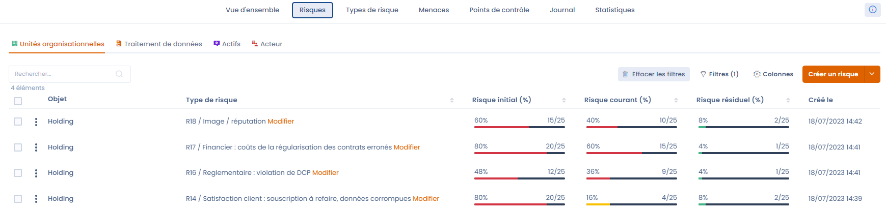

# Gestion des risques

Introduction

Vie privée, stratégiques, de non-conformité, opérationnels, financiers, sous-traitance... La gestion des risques est souvent complexe et peu efficiente. Supprimez la complexité et améliorez l’efficacité de vos plans de contrôle, d’audit et de conformité avec Dastra.

Obtenez une vision globale de vos risques pour alimenter vos plans de remédiation, étendre votre couverture et réduire votre exposition. Rationalisez vos opérations d’évaluation, de contrôle, de reporting et de suivi des tâches de remédiation. Assurez vous de la mise à jour, de la qualité et de la disponibilité des données risques.

## La gestion des risques dans Dastra en quelques mots

La fonctionnalité de gestion des risques de la solution Dastra permet d'identifier, évaluer, atténuer et piloter tous vos risques de manière visuelle & intégrée, et d'obtenir une vision globale de vos risques pour alimenter vos plans de remédiation, étendre votre couverture et réduire votre exposition.

Avec Dastra, vous pourrez :

* **Visualiser vos risques** par traitement, actif ou acteur ;
* **Rationaliser vos opérations** d’évaluation, de contrôle, de reporting et de suivi des tâches de remédiation ;
* Vous assurer de la **mise à jour,** de la **qualité** et de la **disponibilité** des données risques. 

## Associer un risque

Dans Dastra, un risque peut être associé à **un ou plusieurs objets**, parmi lesquels se trouve les éléments suivants :

* Unité organisationnelle
* Traitement de donnée à caractère personnel
* Acteur ou sous-traitant
* Actif

<figure><figcaption>
Exemple de visualisation consolidée des risques
</figcaption></figure>

## Aller plus loin


[definition-des-risques.md](../../gdpr/risks/definition.md)



[evaluation-dun-risque.md](../../gdpr/risks/assessment.md)



[risques.md](attach-to-processing.md)

