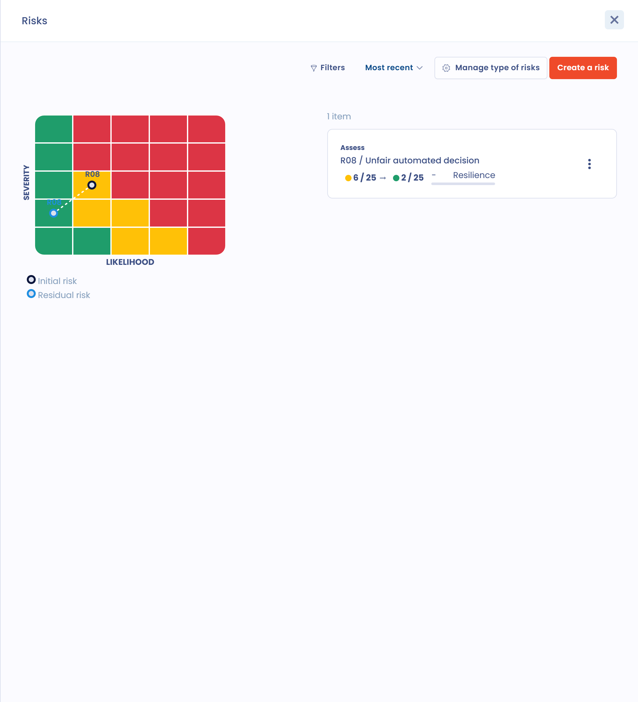
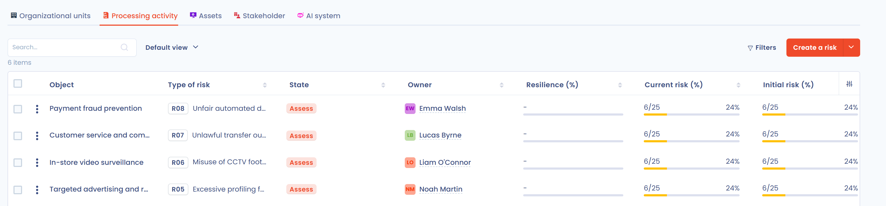

# Associer un risque à un traitement

## Ajouter un risque dans un traitement

1. Ouvrez le traitement concerné dans le registre des traitements.
2. Dans la barre de boutons sous le titre, cliquez sur **Risques**. Le bouton affiche le nombre de risques déjà associés au traitement.

<figure><figcaption>
Le bouton Risques d'un traitement
</figcaption></figure>

3. Dans le panneau qui s'ouvre, cliquez sur **Créer un risque**.

<figure><figcaption>
Le panneau Risques d'un traitement
</figcaption></figure>

Vous arrivez sur la page d'édition du risque, avec le traitement et son unité organisationnelle déjà renseignés. Commencez à renseigner les informations du risque que vous avez identifié, comme décrit dans [Identifier](process/identify.md).

Vous pouvez aussi rattacher un risque à un traitement depuis le module de gestion des risques : ouvrez **Gestion des risques** > **Risques**, choisissez l'onglet **Traitement de données** et cliquez sur **Créer un risque**.

## Visualiser les risques d'un traitement

Pour voir les risques de tous vos traitements, ouvrez **Gestion des risques** > **Risques** et choisissez l'onglet **Traitement de données**. Chaque ligne affiche le type de risque, le traitement concerné et les niveaux de risque initial, courant et résiduel.

<figure><figcaption>
Les risques associés aux traitements
</figcaption></figure>

## Évaluation du niveau de risque

Le niveau de risque est calculé selon la formule suivante :

`Niveau de risque = valeur de probabilité x valeur d'impact`

Dastra l'affiche en points sur le maximum de l'échelle (par exemple 16/25) et en pourcentage. Le pourcentage est calculé selon la formule suivante :

`(impact x probabilité) / score maximum de l'échelle de risques active`

Le score maximum de l'échelle est de 25 avec l'échelle par défaut à 5 niveaux (5 x 5), de 16 avec l'échelle à 4 niveaux et de 9 avec l'échelle à 3 niveaux. Voir [Configurer l'échelle de risques](process/assess.md#configurer-lechelle-de-risques).

Le tableau de bord de l'espace de travail contient un module **Gestion des risques**. Il présente les moyennes, en pourcentage, du risque initial, du risque actuel et du risque résiduel, la remédiation moyenne, le nombre de risques par étape (**Total**, **Identifiés**, **Sans réponse**) et la répartition des risques résiduels faibles, moyens et élevés. Chaque moyenne porte sur les pourcentages calculés ci-dessus.

## Aller plus loin


[Planification](../tasks/README.md)

