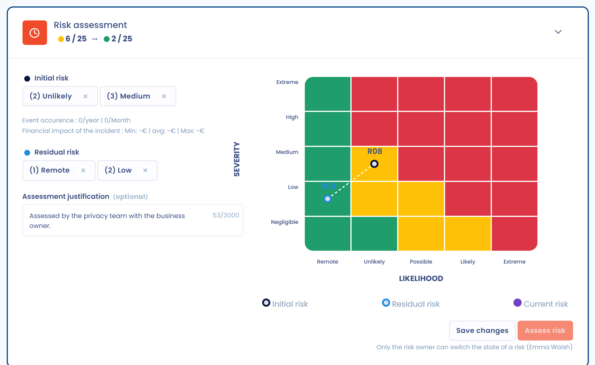
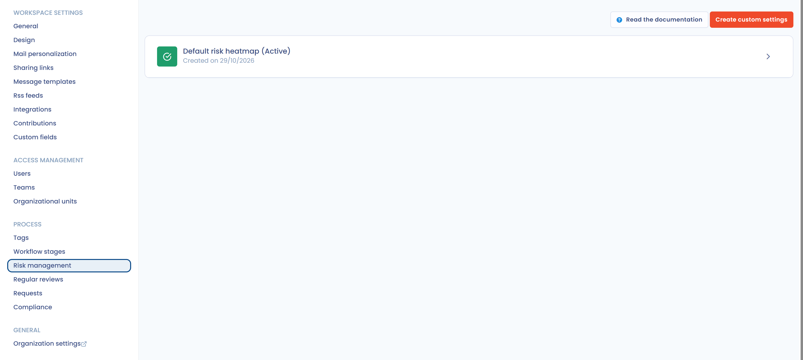

# 2. Évaluer

En fonction des éléments identifiés dans le type de risque et du contexte de l'objet, évaluez maintenant le risque. L'évaluation se fait en probabilité et en impact. L'application les libelle **Vraisemblance** et **Gravité**.

Dans la page du risque, ouvrez la section **Evaluation du risque**. Choisissez la vraisemblance et la gravité du risque initial, puis celles du risque résiduel. Si le type de risque contient une pré-évaluation, ces valeurs sont déjà renseignées. Le champ **Justification de l'évaluation** garde la trace de votre raisonnement.

<figure><figcaption>
La section Evaluation du risque et sa matrice
</figcaption></figure>

Cliquez sur **Valider l'évaluation** pour passer le risque à l'étape **Traitement**. Seul le propriétaire du risque peut le faire. Le bouton **Revenir à cette étape** ramène le risque à l'étape précédente.

## Détermination de l'échelle de risques 

Pour évaluer un risque, positionnez ces deux valeurs sur une échelle : l'échelle de risques. Elle est généralement basée sur 5 niveaux. En France, la méthode Ebios (portée notamment par la CNIL et l'ANSSI) prévoit une échelle sur 4 niveaux.

Pour chaque niveau, déterminez une condition d'application. L'échelle peut par exemple correspondre à un montant financier pour l'impact.

<figure><figcaption>
L'échelle de risques par défaut
</figcaption></figure>

### Configurer l'échelle de risques

L'échelle est personnalisable. Elle est définie par espace de travail, dans **Réglages espace de travail** > **Gestion des risques**, rubrique **Processus**. Cette entrée est visible avec le droit d'écriture sur les risques ; créer, enregistrer ou activer une échelle demande en plus le droit d'écriture sur les réglages avancés.

<figure><figcaption>
Les échelles de risques de l'espace de travail
</figcaption></figure>

L'échelle par défaut, **Echelle de risque par défaut** (5 niveaux), est en lecture seule. Pour en utiliser une autre :

1. Cliquez sur **Créer une échelle personnalisée**.
2. Donnez un nom à l'échelle et choisissez un **Modèle d'échelle de risque** : **5 niveaux - par défaut**, **4 niveaux - PIA de la CNIL** ou **3 niveaux - légère**.
3. Ouvrez l'échelle créée. Cliquez sur une graduation de vraisemblance ou de gravité pour modifier son libellé, sa description et sa valeur : par défaut, un montant en euros pour la gravité et un pourcentage pour la vraisemblance. Les boutons « plus » et « corbeille » ajoutent ou retirent un niveau, de 1 à 9 niveaux.
4. Modifiez au besoin les unités (**Unité de mesure de l'impact**, **Unité de mesure de la probabilité**) et la couleur de chaque case de la matrice.
5. Cliquez sur **Enregistrer**, puis sur **Enregistrer et activer cette grille** pour utiliser l'échelle.


Activer une autre échelle quand des risques existent déjà a un impact sérieux sur les statistiques de risque : l'application demande une confirmation avant d'activer la grille.


Le score d'un risque est le produit de sa gravité par sa vraisemblance. Le score maximum de l'échelle est le produit de ses deux niveaux les plus élevés : 25 avec l'échelle à 5 niveaux, 16 avec celle à 4 niveaux, 9 avec celle à 3 niveaux. Les pourcentages affichés dans Dastra expriment un score par rapport à ce maximum.

## Probabilité (vraisemblance) 

La probabilité correspond à l'évaluation de la fréquence d'occurrence d'un risque. C'est un score évalué de manière empirique (note sur 5 traditionnellement). Chaque niveau peut correspondre à une fréquence d'apparition du risque, donc de réalisation de la menace.

## Impact (gravité) 

L'impact correspond à l'évaluation de la conséquence d'un évènement redouté sur l'organisation. C'est la gravité de cette conséquence qui est estimée.

Selon le risque évalué, l'impact varie. Vous pouvez l'estimer de manière empirique, par exemple en chiffrant le coût d'une violation de données ou d'une indisponibilité des données après une attaque informatique.

### Appuyez-vous sur le journal des évènements

Le **Journal** garde la mémoire des évènements passés. Pour y ajouter un évènement, ouvrez **Gestion des risques** > **Journal** et cliquez sur **Créer un événement**. Renseignez son nom, la **Date de l'évènement**, son **Impact financier de l'incident** et, si possible, le type de risque concerné.

<figure><figcaption>
Le journal des évènements
</figcaption></figure>

Pour un risque dont le type est lié à des évènements, la section **Evaluation du risque** affiche leur fréquence par an et par mois, ainsi que leur impact financier minimum, moyen et maximum. Ces repères aident à choisir un niveau de vraisemblance et de gravité réaliste.


S'il s'agit de risques concernant les personnes (dans le cadre du RGPD par exemple), l'impact correspond au préjudice subi par les personnes concernées et à l'atteinte à leurs droits et libertés : discrimination, refus de contrat, désagrément.

Le tableau de la CNIL sur l'impact pour les personnes concernées, repris plus bas et commenté dans le [guide dastra.eu sur la gravité d'un risque](https://www.dastra.eu/fr/guide/rgpd-evaluer-la-gravite-dun-risque-pour-les-personnes-concernees/51878), peut aider à cette évaluation.


## Un modèle pour l'analyse d'impact sur la protection des données

L'évaluation reste toujours contextuelle. La méthodologie publiée par la CNIL pour mener un PIA propose toutefois une grille de lecture de l'échelle des risques. Voici le tableau proposé par la CNIL dans son guide PIA.

### Gravité

<table data-view="cards" data-full-width="true"><thead><tr><th>Niveaux</th><th>Descriptions génériques des impacts (directs et indirects)</th><th>Exemples d'impacts corporels</th><th>Exemples d'impacts matériels</th><th>Exemples d'impacts moraux</th></tr></thead><tbody><tr><td>1. Négligeable</td><td>Les personnes concernées ne seront pas impactées ou pourraient connaître quelques désagréments, qu'elles surmonteront sans difficulté.</td><td>Absence de prise en charge adaptée d'une personne non autonome (mineur, personne sous tutelle) ; maux de tête passagers.</td><td>Perte de temps pour réitérer des démarches ou pour attendre de les réaliser ; réception de courriers non sollicités (spams) ; réutilisation de données publiées sur des sites Internet à des fins de publicité ciblée (informations des réseaux sociaux réutilisées pour un publipostage papier) ; publicité ciblée pour des produits de consommation courants.</td><td>Simple contrariété par rapport à l'information reçue ou demandée ; peur de perdre le contrôle de ses données ; sentiment d'atteinte à la vie privée sans préjudice réel ni objectif (intrusion commerciale) ; perte de temps pour paramétrer ses données ; non-respect de la liberté d'aller et venir en ligne du fait du refus d'accès à un site commercial (alcool, du fait d'un âge erroné).</td></tr><tr><td>2. Limitée</td><td>Les personnes concernées pourraient connaître des désagréments significatifs, qu'elles pourront surmonter malgré quelques difficultés.</td><td>Affection physique mineure (maladie bénigne due au non-respect de contre-indications) ; absence de prise en charge causant un préjudice minime mais réel (handicap) ; diffamation donnant lieu à des représailles physiques ou psychologiques.</td><td>Paiements non prévus (amendes attribuées par erreur), frais supplémentaires (agios, frais de justice), défaut de paiement ; refus d'accès à des services administratifs ou commerciaux ; opportunités de confort perdues (annulation de loisirs, d'achats, de vacances, fermeture d'un compte en ligne) ; promotion professionnelle manquée ; compte bloqué pour des services en ligne (jeux, administration) ; réception de courriers ciblés non sollicités susceptibles de nuire à la réputation des personnes ; augmentation de coûts (hausse du prix d'une assurance) ; traitement de données erronées créant des dysfonctionnements de comptes (bancaire, client, sécurité sociale) ; publicité ciblée en ligne sur un aspect privé que la personne souhaitait garder confidentiel (grossesse, traitement pharmaceutique) ; profilage inexact ou abusif.</td><td>Refus de continuer à utiliser les systèmes d'information (lanceur d'alerte, réseaux sociaux) ; atteinte psychologique mineure mais objective (diffamation, réputation) ; difficultés relationnelles avec l'entourage personnel ou professionnel (image, réputation ternie, perte de reconnaissance) ; sentiment d'atteinte à la vie privée sans préjudice irrémédiable ; intimidation sur les réseaux sociaux.</td></tr><tr><td>3. Importante</td><td>Les personnes concernées pourraient connaître des conséquences significatives, qu'elles devraient pouvoir surmonter, mais avec des difficultés réelles et importantes.</td><td>Affection physique grave causant un préjudice à long terme (aggravation de l'état de santé suite à une mauvaise prise en charge ou au non-respect de contre-indications) ; altération de l'intégrité corporelle, par exemple à la suite d'une agression, d'un accident domestique ou du travail.</td><td>Détournements d'argent non indemnisés ; difficultés financières non temporaires (obligation de contracter un prêt) ; opportunités ciblées, uniques et non récurrentes perdues (prêt immobilier, refus d'études, de stages ou d'emploi, interdiction d'examen) ; interdiction bancaire ; dégradation de biens ; perte de logement ; perte d'emploi ; séparation ou divorce ; perte financière à la suite d'une escroquerie (hameçonnage) ; blocage à l'étranger ; perte de données clients.</td><td>Affection psychologique grave (dépression, développement d'une phobie) ; sentiment d'atteinte à la vie privée et de préjudice irrémédiable ; sentiment de vulnérabilité à la suite d'une assignation en justice ; sentiment d'atteinte aux droits fondamentaux (discrimination, liberté d'expression) ; victime de chantage ; cyberharcèlement et harcèlement moral.</td></tr><tr><td>4. Maximale</td><td>Les personnes concernées pourraient connaître des conséquences significatives, voire irrémédiables, qu'elles pourraient ne pas surmonter.</td><td>Affection physique de longue durée ou permanente (suite au non-respect d'une contre-indication) ; décès (meurtre, suicide, accident mortel) ; altération définitive de l'intégrité physique.</td><td>Mise en danger financière ; dettes importantes ; impossibilité de travailler ; impossibilité de se reloger ; perte de preuves dans le cadre d'un contentieux ; perte d'accès à une infrastructure vitale (eau, électricité).</td><td>Affection psychologique de longue durée ou permanente ; sanction pénale ; enlèvement ; perte de liens familiaux ; impossibilité d'ester en justice ; changement de statut administratif et/ou perte d'autonomie juridique (tutelle).</td></tr></tbody></table>

Sur cette échelle, prenez en compte les éléments contextuels suivants :

* le caractère identifiant des données ;
* la nature des sources de risques ;
* le nombre d'interconnexions, en particulier avec d'autres pays ;
* le nombre de destinataires, qui facilite la corrélation de données initialement séparées.

### Vraisemblance

Pour évaluer la probabilité, la CNIL propose l'échelle suivante :

| Niveaux | Description |
| --- | --- |
| Négligeable | Il ne semble pas possible que les sources de risques retenues puissent réaliser la menace en s'appuyant sur les caractéristiques des supports (par exemple, vol de supports papier stockés dans un local de l'organisme dont l'accès est contrôlé par badge et code d'accès). |
| Limitée | Il semble difficile pour les sources de risques retenues de réaliser la menace en s'appuyant sur les caractéristiques des supports (par exemple, vol de supports papier stockés dans un local de l'organisme dont l'accès est contrôlé par badge). |
| Importante | Il semble possible pour les sources de risques retenues de réaliser la menace en s'appuyant sur les caractéristiques des supports (par exemple, vol de supports papier stockés dans les bureaux d'un organisme dont l'accès est contrôlé par une personne à l'accueil). |
| Maximale | Il semble extrêmement facile pour les sources de risques retenues de réaliser la menace en s'appuyant sur les caractéristiques des supports (par exemple, vol de supports papier stockés dans le hall public de l'organisme). |

Sur cette échelle, prenez en compte les éléments contextuels suivants :

* un système ouvert sur Internet ou fermé ;
* des échanges de données avec d'autres pays, ou non ;
* des interconnexions avec d'autres systèmes, ou aucune ;
* l'hétérogénéité ou l'homogénéité du système ;
* la variabilité ou la stabilité du système ;
* l'image de l'organisation.
