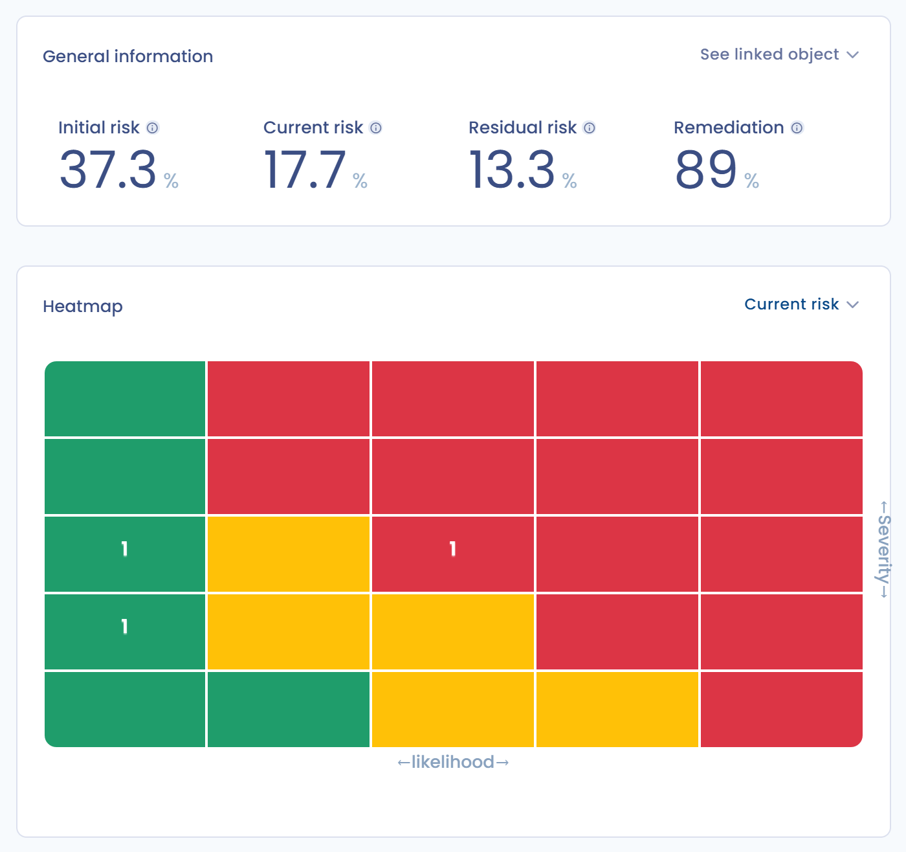

# 4. Surveiller

Une fois le risque traité, assurez son suivi dans le temps et repérez ses évolutions. Dans la page du risque, l'étape **Surveillance** porte le nom **Contrôles** quand l'option de traitement est **Réduction et contrôles** ; pour une autre option, elle porte le nom de cette option.

## Suivre les points de contrôle

Avec l'option **Réduction et contrôles**, la section affiche deux indicateurs : la **Remédiation** en pourcentage et le **Score** en points sur le maximum. Les points de contrôle sont regroupés selon leur objectif : ceux qui réduisent la gravité et ceux qui réduisent la vraisemblance, chacun avec son pourcentage.

<figure><figcaption>
Les points de contrôle d'un risque et sa remédiation
</figcaption></figure>

1. Cliquez sur **Attribuer des points de contrôle** pour choisir les points de contrôle du type de risque.
2. Sur le point de contrôle concerné, cliquez sur **Nouvel audit**.
3. Choisissez la réponse, indiquez la **Date de mise en oeuvre**, ajoutez au besoin une description et des **Fichiers de preuve de mise en oeuvre**.
4. Cliquez sur **Soumettre la réponse**.

Chaque réponse est conservée : le bouton **Historique d'activités** du point de contrôle les liste, et la plus récente est la réponse en cours. Si le point de contrôle est évalué de manière récurrente, Dastra vous notifie à l'échéance du nombre de jours choisi.

## Effet sur le risque courant

À chaque nouvelle réponse, Dastra recalcule le taux de remédiation, puis le risque courant : {Risque courant} = {Risque initial} - ({Risque initial} - {Risque résiduel}) \* {Taux de remédiation}. Plus la remédiation approche 100 %, plus le risque courant approche le risque résiduel. Le calcul est détaillé dans le [glossaire](../glossary.md).

## Suivre l'évolution dans le temps

La **Vue d'ensemble** du module et le tableau de bord de l'espace de travail suivent l'évolution des risques : risque initial, courant et résiduel moyens, remédiation moyenne, nombre de risques par étape. La carte de chaleur affiche le risque initial, résiduel ou courant. Les **Statistiques** détaillent les scores minimum, moyen et maximum par objet.

<figure><figcaption>
Le tableau de bord des risques suit l'évolution dans le temps
</figcaption></figure>

## Archiver un risque

Quand un risque a disparu, cliquez sur **Archiver**. Le risque passe à l'étape **Archivage** : il reste consultable mais n'est plus modifiable. Pour le remettre sous surveillance, cliquez sur **Annuler** dans la section d'archivage. Seul le propriétaire du risque peut archiver un risque ou annuler son archivage.
