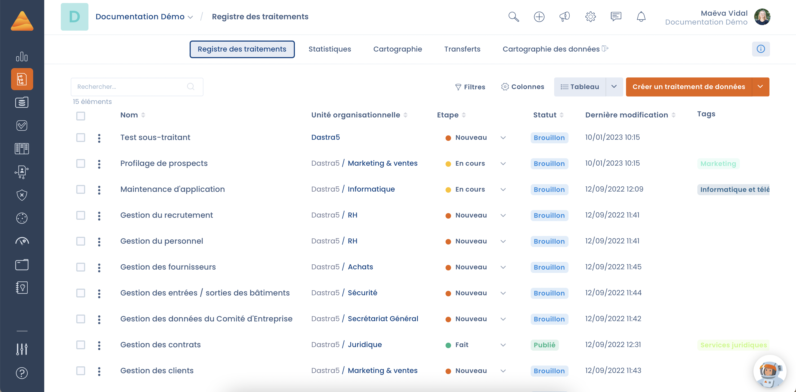

# Registre des traitements

## Introduction

Le registre de traitement vous permet de faire la cartographie de vos **traitements de données** et d'avoir une **vue d'ensemble** de ce que vous faites avec les données personnelles concernées. Disposer d'un registre complété est une **obligation** de l’article 30 du RGPD, mais au delà de l'aspect contraignant, c'est surtout un **outil pour mieux connaître ses données** et **maîtriser la chaîne de valeur** associée - depuis leur production jusqu'à l'usage qui en est fait.

Chez Dastra, nous pensons que notre rôle est de vous **faciliter le travail** de cartographie des traitements, pour vous permettre de vous concentrer sur votre métier. Pour cela, nous vous accompagnons à travers un registre **intelligent** et des **questionnaires** qui vous guident étape par étape dans la constitution de votre registre.

## Le registre Dastra en quelques mots

La fonctionnalité de registres des activités de traitements Dastra répond à tous les attendus de la règlementation. Les registres, à la fois Responsable de Traitement et Sous traitant, reposent sur des référentiels (acteurs, actifs, jeux de données, données, risques et mesures de sécurité) permettant de **cartographier vos traitements** et **gagner du temps** dans la gestion au quotidien.

Les traitements sont duplicables et des modèles de traitement sont disponibles dans une bibliothèque librement accessible à tous nos utilisateurs. Un workflow est intégré, une fonction de recherche est présente nativement et il est possible d’importer / exporter des fiches de traitements sous différents formats (PDF, Word, HTML, Excel, CSV, JSON, Markdown). Il est possible d'attacher des pièces jointes, des violations ou encore des risques à ces traitements.

<figure><figcaption></figcaption></figure>

## Registre "Responsable de traitement" versus "Sous-traitant"

L’article 30 du RGPD prévoit des obligations spécifiques pour le _registre du responsable de traitement_ et pour le _registre du sous-traitant_. Si votre organisme agit à la fois en tant que sous-traitant et responsable de traitement, votre registre doit donc clairement distinguer les deux catégories d’activités.

**En pratique, dans cette hypothèse, la CNIL vous recommande de tenir 2 registres :**

1. un pour les traitements de données personnelles dont vous êtes vous-même responsable,
2. un autre pour les traitements que vous opérez, en tant que sous-traitant, pour le compte de vos clients.


[le-registre-responsable-de-traitement.md](controller.md)



[le-registre-sous-traitant.md](processor.md)


## Les différentes méthodologies pour mettre en place le registre des traitements

Il existe deux méthodologies pour créer une fiche de traitement :

* **La conception en Top-Down (Descendante)** : on démarre le projet en établissant l'inventaire des traitements de données, et on collecte ensuite les informations propres à chaque traitement (les données, les sous-traitants...etc...).
* **La conception en Bottom-Up (Ascendante)** : on commence par faire l'inventaire des données (les logiciels, jeux de données et champs de données personnelles) et on créé les traitements à partir de celui-ci.

### Quelle méthodologie de mise en place de registre choisir ?

Il n'y a pas de bonne ou de mauvaise méthode, tout va dépendre du contexte de votre organisation, des compétences de l'équipe DPO, de l'accessibilité des opérationnels de la donnée...

Voici un tableau de comparaison des deux approches :

<table><thead><tr><th width="129">Méthodologie</th><th width="178">Cible</th><th>Bénéfices</th><th>Inconvénients</th></tr></thead><tbody><tr><td><strong>Top-Down (Descendante)</strong></td><td>Petites organisations ou collectivités Entreprise avec une faible culture de la donnée Equipe légale avec une faible affinité pour l'IT</td><td>Rapidité de mise en place Moins de travail Correspond bien aux attentes légales du RGPD </td><td>Peut engendrer des difficultés si l'équipe de mise en place du registre ne connaît pas les données de l'organisation Plus contraignant pour les opérationnels L'inventaire des données sera beaucoup moins valorisable car modelé pour des attentes légales uniquement Plus complexe à maintenir sur le long terme </td></tr><tr><td><strong>Bottom-Up (Ascendante)</strong></td><td>Grandes ou moyennes organisations Avec une forte culture de la donnée Equipe légale avec forte affinité IT</td><td>Faire l'inventaire des données sera moins abstrait que de créer directement des traitements. Le registre reflète la réalité de l'organisation La tenue du registre sera plus aisée sur le long terme Plus de membres de l'organisation sont impliqués Création de fiche de traitement est plus automatisé</td><td>Globalement plus difficile et long à mettre en place Projet nécessitant une bonne gouvernance</td></tr></tbody></table>

La bonne nouvelle, c'est que Dastra gère parfaitement les deux approches ! Vous pouvez soit créer une fiche en automatique [en prenant un modèle de traitement](templates.md). Si vous préférez l'approche , il est possible de [créer sa cartographie de données](../mapping/README.md) et créer un traitement directement à partir d'un actif (logiciel, base de données)

## Comment établir son registre de traitement ?

Voici un tutoriel vidéo vous permettant de créer le registre.

Si vous souhaitez apprendre à concevoir et gérer votre registre de traitement de données, commencez ici:




[gerer-votre-registre.md](establish.md)


Si vous souhaitez apprendre à concevoir et à gérer un de vos traitements de données, commencez ici:


[gerer-votre-traitement.md](declare.md)


Si vous souhaitez comprendre les différentes étapes du questionnaire, cliquez ici :


[remplir-le-questionnaire](activity/README.md)


Si vous souhaitez apprendre à partager le registre, cliquez ici :


[partager-le-registre.md](share.md)


##

## Comment effectuer des actions sur plusieurs traitements ?



## Pour aller plus loin

Retrouvez notre webinar dédié au registre des traitements.


Comment passer en mode run sur la gestion des registres de traitements



[registre-de-traitement.md](../../gdpr/concepts/ropa.md)



[risques.md](../risks/attach-to-processing.md)



[planifier](../tasks/README.md)

