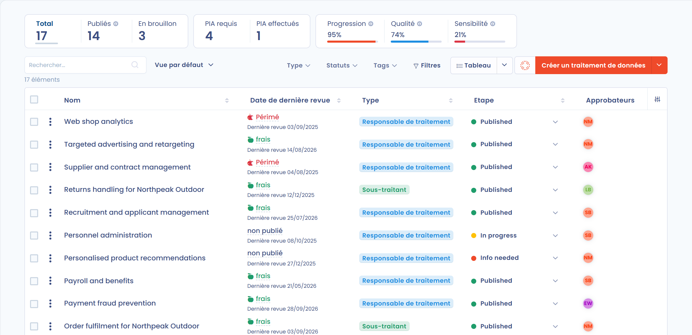

# Registre des traitements

## Introduction

Le registre des traitements vous permet de cartographier vos **traitements** et d'avoir une **vue d'ensemble** de ce que vous faites avec les données personnelles concernées. Tenir un registre complet est une **obligation** de l'article 30 du RGPD. Au-delà de l'obligation légale, c'est surtout **un outil pour mieux connaître vos données** et **maîtriser la chaîne de valeur associée**, depuis la production des données jusqu'à l'usage qui en est fait.

Dastra met à votre disposition un registre et des **questionnaires** qui vous guident étape par étape dans la cartographie de vos traitements.

## Le registre Dastra en quelques mots

Le registre des traitements de Dastra répond à toutes les exigences de la réglementation. Les deux registres, celui du responsable de traitement et celui du sous-traitant, reposent sur des référentiels (parties prenantes, actifs, jeux de données, données, risques et mesures de sécurité). Ces référentiels vous permettent de **cartographier vos traitements** et de **gagner du temps** dans la gestion au quotidien.

Les traitements peuvent être dupliqués, et des modèles de traitement sont disponibles dans une bibliothèque librement accessible à tous nos utilisateurs. Un workflow est intégré et une fonction de recherche est disponible nativement. Vous pouvez exporter les traitements sous différents formats (PDF, Word, HTML, Excel, CSV, JSON, Markdown) et les importer depuis des fichiers CSV, Excel ou JSON. Vous pouvez aussi rattacher des documents, des violations de données ou des risques à vos traitements.

<figure><figcaption>
Le registre des traitements : les tuiles d'indicateurs en haut, puis la liste des traitements
</figcaption></figure>

## Registre "Responsable de traitement" ou registre "Sous-traitant"

L'article 30 du RGPD prévoit des obligations spécifiques pour le _registre du responsable de traitement_ et pour le _registre du sous-traitant_. Si votre organisme agit à la fois en tant que sous-traitant et en tant que responsable de traitement, votre registre doit donc clairement distinguer les deux catégories d'activités.

**En pratique, dans cette hypothèse, la CNIL vous recommande de tenir 2 registres :**

1. un pour les traitements de données personnelles dont vous êtes vous-même responsable,
2. un autre pour les traitements que vous opérez, en tant que sous-traitant, pour le compte de vos clients.


[le-registre-responsable-de-traitement.md](controller.md)



[le-registre-sous-traitant.md](processor.md)


## Les différentes méthodologies pour mettre en place le registre des traitements

Il existe deux méthodologies pour constituer un registre des traitements :

* **La conception Top-Down (descendante)** : vous commencez par dresser l'inventaire des traitements, puis vous collectez les informations propres à chaque traitement (données, sous-traitants, etc.).
* **La conception Bottom-Up (ascendante)** : vous commencez par faire l'inventaire des données (logiciels, jeux de données et champs de données personnelles), puis vous créez les traitements à partir de cet inventaire.

### Choisir une méthodologie

Il n'y a pas de bonne ou de mauvaise méthode. Tout dépend du contexte de votre organisation, des compétences de l'équipe DPO, de la facilité à joindre les personnes qui exploitent les données, etc.

Voici un tableau qui compare les deux approches :

<table><thead><tr><th width="129">Méthodologie</th><th width="178">Cible</th><th>Bénéfices</th><th>Inconvénients</th></tr></thead><tbody><tr><td><strong>Top-Down</strong></td><td>Petites organisations ou collectivités Entreprises avec une faible culture de la donnée Équipe juridique peu familière de l'informatique</td><td>Rapide à mettre en place Moins de travail Correspond bien aux attentes légales du RGPD</td><td>Peut poser des difficultés si l'équipe qui met en place le registre ne connaît pas les données de l'organisation Plus contraignant pour les opérationnels L'inventaire des données a beaucoup moins de valeur, car il est modelé pour des besoins juridiques uniquement Plus complexe à maintenir sur le long terme</td></tr><tr><td><strong>Bottom-Up</strong></td><td>Grandes ou moyennes organisations Avec une forte culture de la donnée Équipe juridique familière de l'informatique</td><td>Faire l'inventaire des données est moins abstrait que de créer directement des traitements Le registre reflète la réalité de l'organisation Le registre est plus facile à maintenir sur le long terme Davantage de membres de l'organisation sont impliqués La création des traitements est plus automatisée</td><td>Globalement plus difficile et plus long à mettre en place Le projet nécessite une bonne gouvernance</td></tr></tbody></table>

Dastra prend en charge les deux approches. Pour une approche descendante, créez vos traitements [à partir de modèles](templates.md). Si vous préférez l'approche ascendante, vous pouvez d'abord [construire votre cartographie des données](../mapping/README.md), puis créer un traitement directement à partir d'un actif (logiciel, base de données).

## Établir votre registre



Pour apprendre à concevoir et à gérer votre registre des traitements, commencez ici :


[gerer-votre-registre.md](establish.md)


Pour apprendre à concevoir et à gérer un de vos traitements, commencez ici :


[gerer-votre-traitement.md](declare.md)


Pour comprendre les sections du questionnaire, consultez :


[remplir-le-questionnaire](activity/README.md)


Pour apprendre à partager le registre, consultez :


[partager-le-registre.md](share.md)


## Agir sur plusieurs traitements à la fois



Dans la vue **Tableau**, cochez les cases à gauche des traitements sur lesquels vous voulez agir. Le bouton **Choisir une action groupée** apparaît alors au-dessus de la liste. Selon vos permissions et les fonctionnalités activées dans votre espace de travail, il propose les actions suivantes :

* **Basculer l'étape de processus**
* **Exporter**
* **Lier des acteurs** : ajouter ou retirer des parties prenantes ou des destinataires sur tous les traitements sélectionnés
* **Modifier les champs** : modifier la valeur d'un ou de plusieurs champs sur tous les traitements sélectionnés
* **Fusionner** : voir [Fusion d'éléments](../general/merge.md)
* **Envoyer des questionnaires**
* **Passer en revue**
* **Partager**
* **Déplacer dans la corbeille**

## Suivre le registre avec les statistiques

Dans le menu de gauche, cliquez sur **Traitements de données**, puis sur **Statistiques** pour afficher les statistiques de votre registre.

<figure><figcaption>
La page Statistiques du registre
</figcaption></figure>

La page affiche :

* des tuiles d'indicateurs : le nombre de traitements et les indicateurs **Progression**, **Qualité** et **Sensibilité** ;
* les **Indicateurs moyens** et la **Répartition des indicateurs** ;
* le nombre de traitements par étape (**Étapes**), par **Bases légales**, par catégorie de personnes (**Catégories de personnes**), par sous-traitant et par unité organisationnelle ;
* la part des traitements avec transferts de données, les pays concernés (**Transferts de données**) et le statut du **PIA** ;
* l'évolution du nombre de traitements (**Nouveaux traitements**) et les **Activités**.

Utilisez le sélecteur d'unité organisationnelle, les filtres et les boutons **Tout**, **Responsable de traitement** et **Sous-traitant** pour restreindre les statistiques. Cliquez sur **Imprimer** pour imprimer la page.

## Analyses d'impact et demandes de Privacy by design

Deux autres entrées du menu **Traitements de données** donnent accès aux questionnaires liés à vos traitements. Elles s'affichent lorsque vous avez accès aux questionnaires.

* **Analyses d'impact** liste les questionnaires [PIA](../questionnaires/types/dpia.md), [LIA](../questionnaires/types/lia.md) et [TIA](../questionnaires/types/tia.md) de l'espace de travail. Cliquez sur **Planifier questionnaire** pour en créer un.
* **Privacy by design** liste les questionnaires de demande de création de traitement. Ils permettent de [collecter des projets de traitements](../trust-center/creation-questionnaires.md) depuis un Trust Center : une fois la réponse validée, ses données peuvent devenir un traitement.

## Pour aller plus loin




[registre-de-traitement.md](../../gdpr/concepts/ropa.md)



[risques.md](../risks/attach-to-processing.md)



[planifier](../tasks/README.md)

