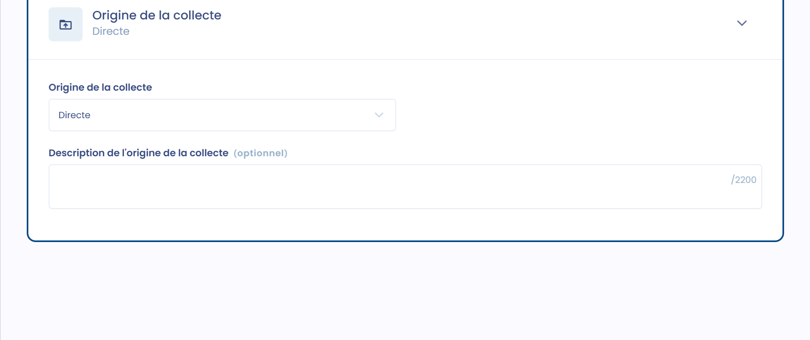
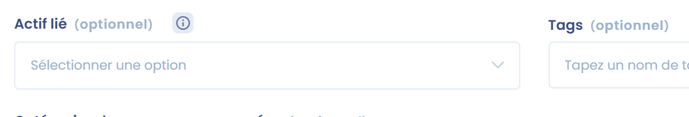
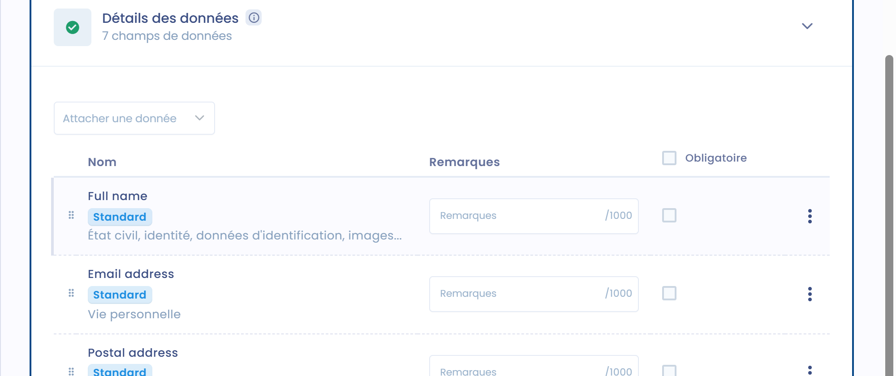
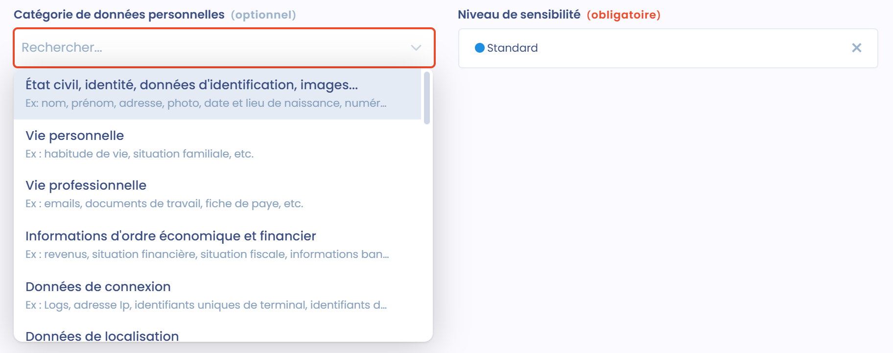
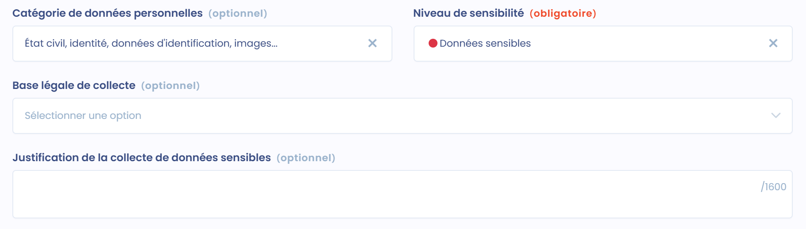
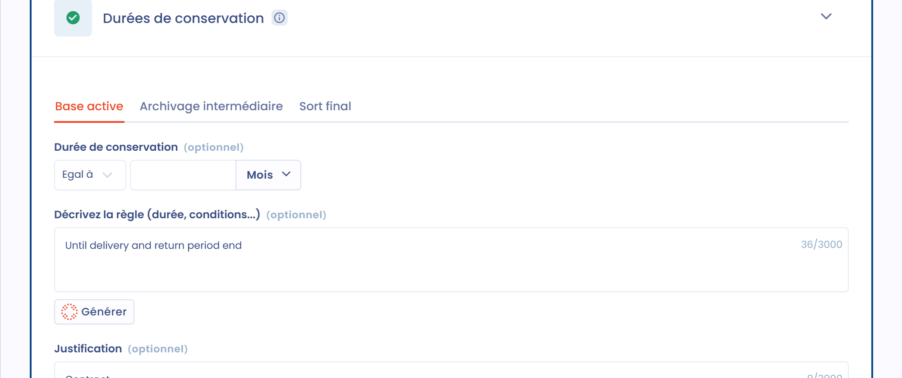
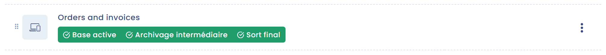
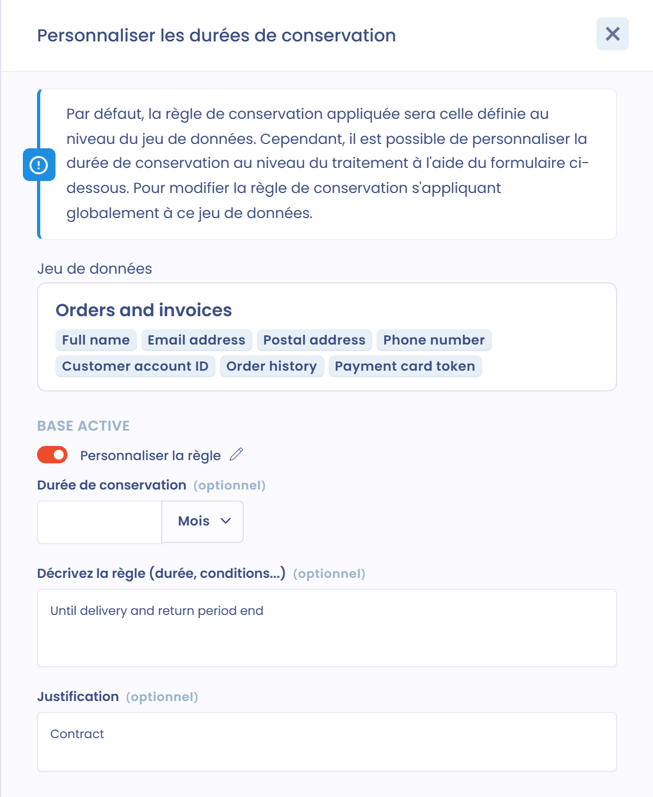

# Données et conservation



[**L'article 30 du RGPD**](https://www.cnil.fr/fr/reglement-europeen-protection-donnees/chapitre4) exige aussi que le registre liste les catégories de données traitées.

C'est dans cette section que vous définissez les catégories de données traitées. Elles peuvent être courantes ou sensibles. Certaines données présentent un risque plus important pour les personnes physiques, comme les données relatives à la santé, aux opinions politiques ou à l'appartenance syndicale. Les données relatives aux infractions ou aux condamnations sont aussi particulièrement protégées.

De même, le numéro d'identification national (comme le numéro de sécurité sociale) peut être assimilé à une donnée sensible.

La collecte de données sensibles est interdite par principe. Seules les exceptions prévues à l'[**article 9 du RGPD**](https://www.cnil.fr/fr/reglement-europeen-protection-donnees/chapitre2) la permettent.

## Jeux de données

Un jeu de données regroupe les données d'un élément précis, par exemple une table dans une base de données ou un formulaire de collecte papier.

### Plusieurs façons d'utiliser les jeux de données

Les jeux de données peuvent être utilisés de plusieurs façons :

* **Cas n°1** : en associant **un jeu de données à un actif unique**. Dans ce cas, le jeu de données correspond aux données de l'actif et n'est pas générique.
* **Cas n°2** : en associant **un jeu de données au traitement**. Ce jeu de données peut être spécifique au traitement et n'est pas réutilisé dans un autre traitement.
* **Cas n°3** : en associant **des jeux de données génériques au traitement**. Dans ce cas, le jeu de données peut être réutilisé dans plusieurs traitements.

Pour utiliser des jeux de données génériques, nous recommandons la procédure suivante :

* Ouvrez la section **Données** du traitement.
* Ouvrez la page des jeux de données de la cartographie dans un nouvel onglet.
* Sélectionnez le jeu de données dans le traitement.
* Si le jeu de données doit être modifié, créez-en un autre : allez dans l'autre onglet et dupliquez le jeu de données générique en retirant ou en ajoutant les champs souhaités.
* Pour plus de clarté, nous recommandons d'ajouter des tags à ces jeux de données, pour les distinguer dans le sélecteur de jeux de données. Par exemple : un tag « générique » et un tag pour la donnée ajoutée ou retirée.


Un jeu de données peut être lié à plusieurs traitements. Lorsque vous modifiez un jeu de données utilisé par plusieurs traitements, Dastra vous avertit que vos modifications s'appliquent à tous ces traitements. Si les champs de données diffèrent nettement pour un traitement, créez une copie du jeu de données et personnalisez la copie.


#### Utiliser des jeux de données sans champs

Vous pouvez aussi rester encore plus générique en ne précisant pas les champs de données du jeu de données, et en nommant le jeu de données d'après une catégorie de données (ce qui est également valable au sens du RGPD, par exemple).

Selon le traitement, vous pouvez adopter des approches différentes, en fonction de sa sensibilité au regard des droits et libertés des personnes concernées.

### Ajouter des jeux de données au traitement

Dans la section **Données**, vous avez deux possibilités :

* si vos jeux de données sont déjà documentés dans votre cartographie, cliquez sur **Lier jeux de données exist.** et sélectionnez les jeux de données à lier au traitement ;
* sinon, cliquez sur **Ajouter un jeu de données** pour ouvrir l'**Assistant à la création de jeu de données**. Créez le jeu de données avec l'assistant IA (**Créer avec assistant IA**), à partir d'un jeu de données existant (**Utiliser un modèle**), en sélectionnant ses champs de données (**Suivre le guide étape par étape**) ou à partir de rien (**Créer à partir de zéro**).

Chaque jeu de données du traitement affiche ses règles de conservation et les finalités qu'il sert. Activez **Afficher les champs** pour afficher aussi les champs de données de chaque jeu de données. Par défaut, un jeu de données est lié à toutes les finalités du traitement. Depuis le menu **...** du jeu de données, vous pouvez sélectionner une ou plusieurs finalités précises. Le même menu permet de **Modifier** le jeu de données, de le **Dupliquer**, d'afficher ses **Détails** ou de **Supprimer la liaison** avec le traitement.

Cliquez sur un jeu de données pour l'ouvrir et compléter les informations décrites ci-dessous.

### Associer la source des données au jeu de données

Dans chaque jeu de données, vous pouvez indiquer l'origine des données dans **Origine de la collecte** : **Directe**, **Indirecte** ou **Directe et indirecte**.

Le champ **Description de l'origine de la collecte** permet d'apporter les précisions nécessaires.

<figure><figcaption>
Source des données
</figcaption></figure>

### Associer un actif au jeu de données

Les jeux de données ont naturellement vocation à être liés à des [actifs](assets.md).

Vous pouvez lier un actif à votre jeu de données dans le champ **Actif lié**, dans le bloc **Informations générales** du jeu de données.

<figure><figcaption>
Sélecteur d'actif
</figcaption></figure>

Un jeu de données ne peut être lié qu'à un seul actif : les jeux de données d'un actif lui sont propres.

Par exemple, si vous considérez un logiciel de comptabilité comme un actif, plusieurs jeux de données pourraient lui être liés, comme « données de facturation » avec les données du module de suivi des factures, ou « données clients » avec les données des comptes clients.

### Associer des catégories de personnes concernées

Pour chaque jeu de données, vous pouvez lier une ou plusieurs catégories de personnes concernées dans **Catégories de personnes concernées**.

Cela vous aide à comprendre quelles données se rapportent à quelles personnes concernées. Cela simplifie aussi votre travail de cartographie.

<figure><figcaption>
Sélecteur de catégories de personnes concernées
</figcaption></figure>


Indiquer les personnes concernées est utile pour gérer les [demandes d'exercice des droits](../../requests/README.md) : vous identifiez rapidement les jeux de données concernés et retrouvez les données visées par la demande.


### Associer des champs de données

Chaque jeu de données a vocation à être complété par des champs de données. Ces champs sont les données elles-mêmes.

Dans le bloc **Détails des données**, cliquez sur **Attacher une donnée**. Les champs proposés dans le sélecteur sont ceux disponibles dans votre glossaire de données.

<figure><figcaption>
Sélecteur de champs de données
</figcaption></figure>

Si un champ n'existe pas encore, cliquez sur **Créer une donnée** pour le créer et l'ajouter au jeu de données.

Les champs peuvent être classés dans des catégories de données prédéfinies, comme **État civil, identité, données d'identification, images...**, **Vie personnelle**, **Vie professionnelle** ou **Informations d'ordre économique et financier**. Ces catégories reprennent celles préconisées par la CNIL.

<figure><figcaption>
Sélecteur de catégorie de données personnelles
</figcaption></figure>

C'est aussi au niveau du champ de données que vous indiquez le niveau de sensibilité de la donnée : **Standard**, **Données hautement personnelles** ou **Données sensibles**, par exemple une donnée de santé.

Pour les données sensibles, vous êtes invité à justifier la collecte de cette donnée, et en particulier son fondement juridique, dans **Base légale de collecte** et **Justification de la collecte de données sensibles**.

<figure><figcaption>
Donnée sensible
</figcaption></figure>


Les données sensibles sont prises en compte dans l'indicateur **Sensibilité** du traitement. Les jeux de données qui en contiennent portent le badge **Sensible** dans la section **Données**.


### Associer des règles de conservation au jeu de données

Dans chaque jeu de données, vous pouvez définir des règles de conservation par défaut dans le bloc **Durées de conservation**.

<figure><figcaption>
Durées de conservation
</figcaption></figure>

Ces durées de conservation sont des valeurs par défaut : elles peuvent être personnalisées au niveau de chaque traitement (voir ci-dessous).

Vous pouvez définir une conservation en base active, une conservation en archivage intermédiaire et un sort final :

* **Base active** : la base active est la base courante du traitement.
* **Archivage intermédiaire** : l'archivage intermédiaire est une forme de conservation plus restreinte.
* **Sort final** : décrivez les conditions de suppression des données ou de leur transmission pour archivage définitif.

Pour la base active et l'archivage intermédiaire, saisissez la **Durée de conservation**, puis remplissez **Décrivez la règle (durée, conditions...)** et ajoutez une **Justification**. Pour le sort final, remplissez la **Description de la règle appliquée pour le sort final** et sa **Justification**.

## Conservation des données

La conservation limitée des données est l'un des principes généraux de la protection des données personnelles, rappelé à l'[**article 5 1. e) du RGPD**](https://www.cnil.fr/fr/reglement-europeen-protection-donnees/chapitre2). Les données personnelles doivent être

> conservées sous une forme permettant l'identification des personnes concernées pendant une durée n'excédant pas celle nécessaire au regard des finalités pour lesquelles elles sont traitées.

Concrètement, lorsque vous mettez en oeuvre un traitement, vous devez prévoir ce que deviendront les données une fois la finalité atteinte. Les données devront alors être détruites de manière définitive, anonymisées, ou traitées pour une nouvelle finalité compatible.

La durée de conservation dépend de la finalité du traitement et de la nature des données. Les durées de conservation peuvent être définies selon les types de données. Par exemple, pour la gestion de la paie, les données relatives au bulletin de salaire sont conservées 1 mois en base active et 5 ans en archivage intermédiaire, tandis que les données relatives à l'ordre de virement pour paiement sont conservées en base active le temps nécessaire à l'émission du bulletin de paie, et 10 ans à compter de la clôture en archivage intermédiaire.

La durée peut être exprimée sous forme de valeur ou, si ce n'est pas possible, sous forme de critères utilisés pour définir la durée de conservation (jusqu'à la désinscription, par exemple). Il est recommandé, en particulier par la CNIL dans sa [**recommandation du 11 octobre 2005 sur l'archivage électronique dans le secteur privé**](https://www.legifrance.gouv.fr/affichCnil.do?id=CNILTEXT000017651957), de mettre en place des procédures pour gérer les durées de conservation au niveau de la catégorie de données et, en particulier, pour gérer la purge ou la destruction des données.

### Personnaliser les règles de conservation d'un jeu de données pour un traitement

Les champs de données d'un jeu de données générique ne peuvent pas varier d'un traitement à l'autre. La durée de conservation, elle, le peut. Vous pouvez personnaliser la durée de conservation d'un jeu de données pour un traitement donné : la durée de conservation par défaut du jeu de données ne s'applique alors plus à ce traitement.

Pour cela, le jeu de données doit être ajouté au traitement. Dans la section **Données**, cliquez sur l'un des boutons de conservation du jeu de données : **Base active**, **Archivage intermédiaire** ou **Sort final**. Un bouton vert signifie que la règle est définie. Un bouton **Base active** rouge signifie qu'elle manque.

<figure><figcaption>
Boutons de conservation d'un jeu de données, avec une règle personnalisée
</figcaption></figure>

Le panneau **Personnaliser les durées de conservation** s'ouvre. Il rappelle le jeu de données concerné. Activez **Personnaliser la règle**, puis saisissez la **Durée de conservation**, **Décrivez la règle (durée, conditions...)** et la **Justification** qui s'appliquent à ce traitement uniquement.

<figure><figcaption>
Personnalisation de la durée de conservation pour un traitement
</figcaption></figure>

Lorsqu'une durée de conservation est personnalisée au niveau du traitement, une icône de crayon apparaît sur le bouton concerné.

Pour modifier la règle de conservation qui s'applique au jeu de données dans tous les traitements, cliquez sur le jeu de données affiché en haut du panneau.

À terme, l'objectif peut être de limiter l'utilisation de jeux de données génériques et de s'orienter vers une cartographie plus précise, soit par les traitements (cas n°2), soit par les actifs (cas n°1).
