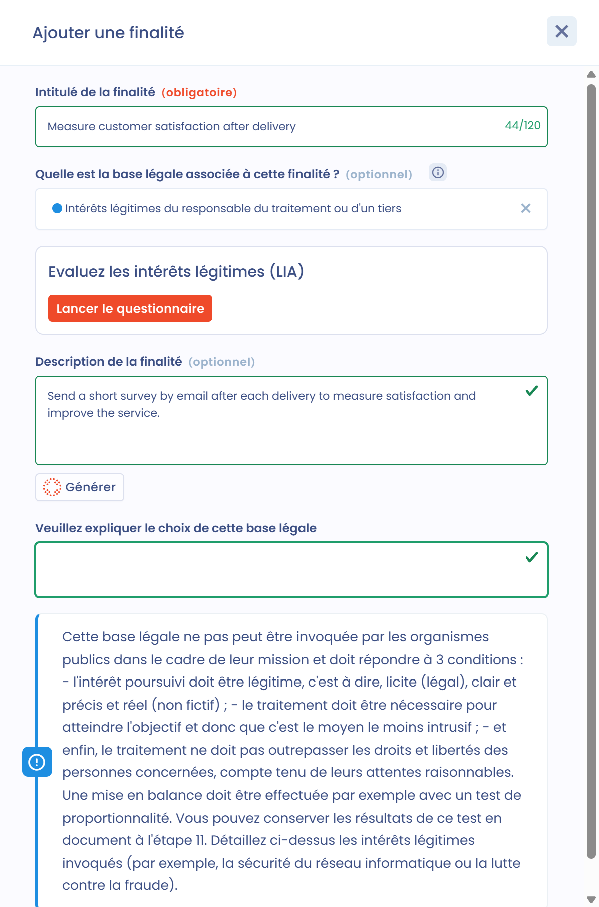
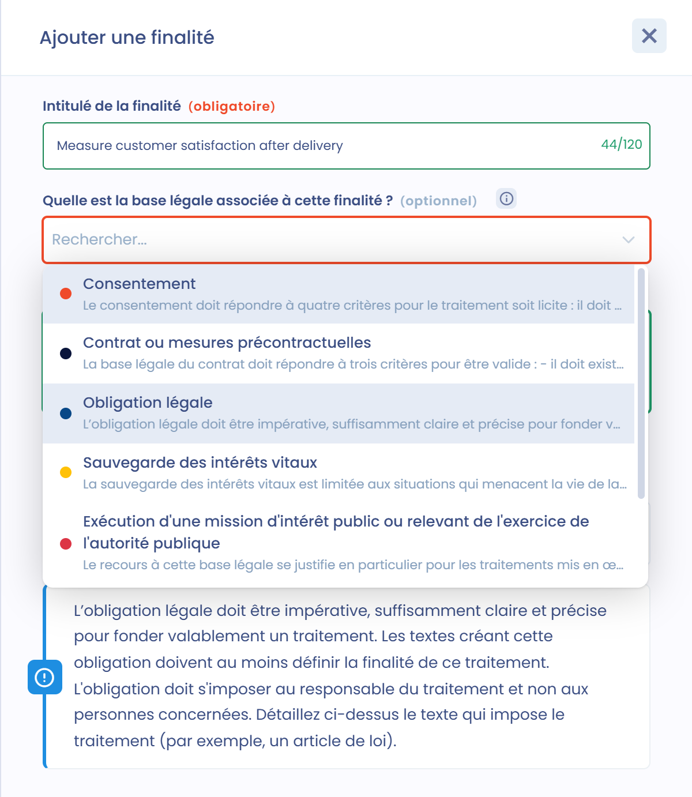

# Finalités



## Finalités d'un traitement

Une **finalité** est l'objectif poursuivi par la mise en place de votre fichier. Elle indique à quoi le traitement de données personnelles va servir, sa raison d'être. Cet objectif doit être clair et compréhensible.

La définition de la finalité est fondamentale, car elle est un prérequis pour les autres éléments qui encadrent le traitement, comme la durée de conservation des données, l'adéquation, la pertinence et la proportionnalité des données, ainsi que l'exactitude et la mise à jour des données.

[**L'article 5 1. b) du RGPD**](https://www.cnil.fr/fr/reglement-europeen-protection-donnees/chapitre2#Article5) prévoit que la finalité doit être déterminée, explicite et légitime.

**La finalité doit être déterminée :** la finalité doit être définie de manière suffisamment précise pour adapter les garanties nécessaires de protection des données et pour délimiter le périmètre du traitement. Le niveau de détail nécessaire dépend du contexte particulier de la collecte et des données concernées. Parfois, un langage simple suffit. Par exemple, un commerce familial de proximité n'aura pas besoin du même niveau de détail pour décrire la finalité de son fichier clients qu'une multinationale qui utilise des algorithmes complexes pour proposer des offres personnalisées et de la publicité ciblée. La finalité doit être déterminée avant la mise en oeuvre du traitement.

**La finalité doit être explicite** : la finalité ne doit pas être ambiguë et doit être exprimée clairement.

**La finalité doit être légitime** : la légitimité renvoie à la base légale sur laquelle repose le traitement, exigée par l'[_article 6 du RGPD_](https://www.cnil.fr/fr/reglement-europeen-protection-donnees/chapitre2).

Cette notion exige aussi que la finalité ne contrevienne pas à la loi de manière générale. Par exemple, la finalité ne sera pas légitime si elle conduit à une discrimination interdite par le code pénal. Le droit du travail, le droit de la consommation ou le droit des contrats, notamment, peuvent être pris en compte.

Le contexte du traitement doit aussi être pris en compte pour évaluer sa légitimité, en particulier les attentes raisonnables de la personne concernée.

Une activité de traitement peut avoir plusieurs finalités. Par exemple, l'activité « recrutement » pourra avoir deux finalités distinctes : l'analyse des candidatures et la gestion des entretiens, et la constitution d'une CV-thèque.

Pour chaque finalité, vous devez définir la [**base légale**](https://www.cnil.fr/fr/les-bases-legales) applicable. Il ne peut y avoir qu'une seule base légale par finalité. Le choix de cette base légale dépend du contexte du traitement.

## Ajouter une finalité dans Dastra

Les finalités s'ajoutent dans la section **Finalités**, la troisième section du traitement. Vous pouvez ajouter autant de finalités que nécessaire.

1. Dans la section **Finalités**, cliquez sur **Ajouter une finalité**. La fenêtre **Ajouter une finalité** s'ouvre.
2. Choisissez comment créer la finalité :
   * **Créer avec IA** : générez une liste de finalités avec l'IA. Sélectionnez les finalités à conserver, puis cliquez sur **Ajouter**.
   * **À partir d'une finalité** : partez d'une finalité existante. Vous pouvez filtrer les finalités par **Traitement de données** et par **Base légale**.
   * **À partir de zéro** : créez une nouvelle finalité.

Vous pouvez aussi ouvrir directement ces trois options depuis la flèche à côté du bouton **Ajouter une finalité**.

<figure><figcaption>
Les trois façons de créer une finalité
</figcaption></figure>

Lorsque vous créez une finalité à partir de zéro, remplissez les champs suivants, puis cliquez sur **Ajouter** :

* **Intitulé de la finalité** (obligatoire) : le nom de la finalité, limité à 120 caractères. Dastra propose des finalités existantes pendant la saisie.
* **Base légale** (facultatif) : la base légale de cette finalité (voir ci-dessous).
* **Description de la finalité** (facultatif) : décrivez la finalité. Le bouton IA **Générer** peut rédiger cette description pour vous.
* **Veuillez expliquer le choix de cette base légale** : affiché une fois une base légale sélectionnée, par exemple pour préciser les intérêts légitimes poursuivis ou la disposition légale qui impose le traitement.

<figure><figcaption>
Création d'une finalité à partir de zéro
</figcaption></figure>

Les finalités sont listées dans un tableau avec leur nom, leur description et leur base légale. Cliquez sur une finalité pour la modifier, ou utilisez le menu **...** pour **Modifier une finalité** ou la **Supprimer**.

## Bases légales

Il existe 6 bases légales possibles pour un traitement de données. Dans Dastra, la liste **Base légale** propose ces 6 bases légales, ainsi que **Autre**.

### Consentement

Le **consentement** doit répondre à quatre critères pour que le traitement soit licite. Il doit être :

* libre,
* spécifique,
* éclairé et
* univoque.

Il doit être aussi simple à retirer qu'à donner. Vous devez documenter la preuve que le consentement a été valablement recueilli. Pour cela, vous pouvez joindre au traitement la description du processus de recueil du consentement, dans la section **Documentation** (section 11).

### Contrat ou mesures précontractuelles

Le **contrat** (contrat ou mesures précontractuelles) doit répondre à trois critères pour être une base légale valable :

* il doit exister une relation contractuelle ou précontractuelle entre le responsable du traitement et la personne concernée ;
* le contrat doit être valide au regard du droit applicable et
* le traitement doit être objectivement nécessaire à l'exécution du contrat.

Le droit d'opposition ne peut pas s'exercer sur un traitement fondé sur cette base légale, alors que le droit à la portabilité le peut. Vous pouvez ajouter le contrat sur lequel vous fondez le traitement en pièce jointe dans la section **Documentation** (section 11).

### Obligation légale

L'**obligation légale** doit être :

* impérative,
* suffisamment claire et précise pour fonder valablement un traitement.

Les textes qui créent cette obligation doivent au moins définir la finalité du traitement.

L'obligation doit s'imposer au responsable du traitement et non aux personnes concernées. Vous devez préciser le texte qui impose le traitement (par exemple, un article de loi).

### Sauvegarde des intérêts vitaux

La **sauvegarde des intérêts vitaux** est limitée aux situations qui menacent la vie de la personne concernée ou d'une autre personne physique. L'application la plus évidente est celle d'une personne victime d'un accident qui, gravement blessée, est admise inconsciente à l'hôpital et n'est pas en état de consentir au traitement de ses données en vue de ses soins. Cette base doit être interprétée de manière stricte et utilisée seulement si le consentement ne peut pas être recherché.

### Mission d'intérêt public

L'**exécution d'une mission d'intérêt public ou relevant de l'exercice de l'autorité publique**. Le recours à cette base légale se justifie en particulier pour les traitements mis en oeuvre par les autorités publiques pour exécuter leurs missions.

Deux conditions sont nécessaires :

* le traitement doit permettre d'exercer, de manière pertinente et appropriée, la mission dont est investie l'autorité publique, et ne doit pas viser un autre objectif sans rapport ou trop éloigné des spécificités de la mission d'intérêt public en cause ;
* l'intérêt public doit être défini dans le droit et ne peut pas être présumé.

Vous devez préciser la mission d'intérêt public qui impose le traitement.

### Intérêts légitimes

Les **intérêts légitimes** du responsable du traitement ou d'un tiers.

Cette base légale ne peut pas être invoquée par les organismes publics dans l'exécution de leurs missions et doit répondre à 3 conditions :

* l'intérêt poursuivi doit être légitime, c'est-à-dire licite, clair et précis, et réel (non fictif) ;
* le traitement doit être nécessaire pour atteindre l'objectif, et donc être le moyen le moins intrusif ;
* enfin, le traitement ne doit pas porter une atteinte excessive aux droits et libertés des personnes concernées, compte tenu de leurs attentes raisonnables.

Une mise en balance doit être effectuée, par exemple avec un test de proportionnalité.

Vous pouvez conserver les résultats de ce test sous forme de document dans la section **Documentation** (section 11). Vous devez aussi préciser les intérêts légitimes invoqués (par exemple, la sécurité du réseau informatique ou la lutte contre la fraude).

### Autre

Seules les 6 bases légales ci-dessus peuvent fonder un traitement. Utilisez **Autre** uniquement si vous ne savez pas encore quelle base légale s'applique.

## Ajouter la base légale à une finalité

Dans chaque finalité, sélectionnez l'une des bases légales ci-dessus dans la liste **Base légale**. Une description de chaque option est affichée dans la liste.

<figure><figcaption>
Sélection de la base légale d'une finalité
</figcaption></figure>

Une fois la base légale sélectionnée, un rappel de ses conditions s'affiche et vous pouvez ajouter une description dans **Veuillez expliquer le choix de cette base légale**. Par exemple, pour préciser les intérêts légitimes ou la disposition légale concernée.


Si vous utilisez les [questionnaires](../../questionnaires/README.md), Dastra propose de créer une évaluation lorsqu'une finalité repose sur les **Intérêts légitimes du responsable du traitement ou d'un tiers** (**Evaluez les intérêts légitimes (LIA)**) ou sur le **Consentement** (**Evaluez la base légale de consentement**).

