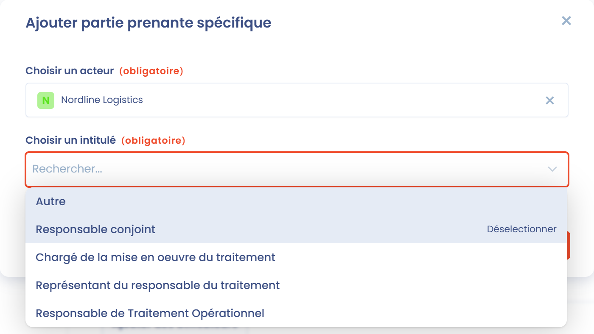
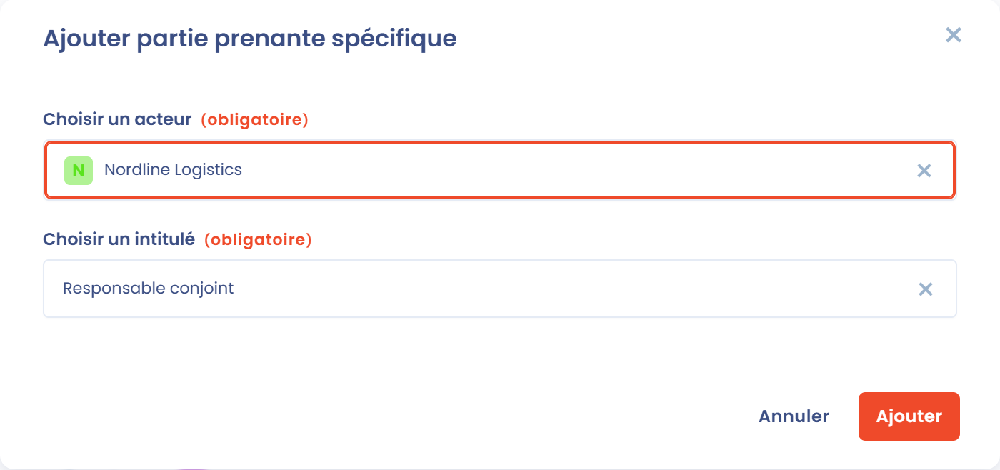

# Parties prenantes



La section **Parties prenantes** est la deuxième section d'un traitement. Elle regroupe deux listes :

* les **utilisateurs** : les personnes qui disposent d'un compte sur la plateforme Dastra et qui sont affectées au traitement ;
* les **parties prenantes** : les organismes, services ou personnes impliqués dans le traitement, comme le responsable de traitement, son délégué à la protection des données, les responsables conjoints ou le chargé de la mise en oeuvre du traitement.

## Ajouter des utilisateurs sur un traitement

Dastra vous permet d'attacher des utilisateurs à un traitement.

Il ne s'agit pas de parties prenantes mais d'utilisateurs (personnes physiques qui disposent d'un compte sur la plateforme Dastra).

1. Dans la section **Parties prenantes**, cliquez sur **Ajouter des utilisateurs**.
2. Dans **Propriétaires du traitement**, sélectionnez un ou plusieurs utilisateurs.
3. Dans **Assigner rôles**, choisissez le rôle de ces utilisateurs.
4. Cliquez sur **Ajouter**.

Les utilisateurs apparaissent dans le tableau avec leur **Fonction**, que vous pouvez modifier à tout moment depuis le tableau.

Les rôles ainsi définis vous aident à organiser la gestion et la mise en oeuvre de vos traitements dans Dastra :

* **Approbateur** : l'utilisateur dans Dastra chargé de valider que le traitement et les éléments associés, tels qu'ils sont décrits dans Dastra, répondent aux attentes de l'organisation. Il peut être différent du signataire du responsable du traitement. Par exemple, il peut s'agir d'un responsable de service, d'un DPO ou d'un relais DPO.
* **Réalisateur** : l'utilisateur qui met en oeuvre les actions nécessaires sur le traitement et le décrit. Il peut s'agir de la mise en place des mesures de sécurité des données, de la gestion des accès ou de toute autre tâche requise pour assurer la conformité du traitement. Il peut s'agir d'un chef de projet ou d'un responsable métier dédié.
* **Informé** : les utilisateurs qui doivent être tenus informés de l'avancement et de l'état du traitement, sans rôle actif dans sa validation ou sa mise en oeuvre. Il peut s'agir de membres de l'équipe de direction, de chefs de projet ou d'autres parties prenantes qui ont un intérêt dans le traitement.

Les utilisateurs affectés sont notifiés des actions réalisées sur le traitement et sont les destinataires par défaut des tâches et notifications associées.


Affecter un utilisateur ne restreint pas l'accès au traitement. Pour limiter l'accès, utilisez le système de rôles et de permissions.


## Identifier les principales parties prenantes du traitement

Vous pouvez indiquer les parties prenantes concernées par la mise en oeuvre du traitement. Il peut s'agir par exemple d'un service d'une entreprise (comme le service des ressources humaines), mais aussi d'une personne dédiée dans le cas d'un projet (un chef de projet, par exemple).

Vous indiquez aussi, le cas échéant, le représentant du responsable du traitement et le ou les responsables conjoints.

Les premières lignes du tableau des parties prenantes sont héritées de l'entité de l'unité organisationnelle sélectionnée dans la section **Général**. Elles sont signalées par une icône de cadenas :

* le **Responsable de traitement** (ou **Organisme (sous-traitant)** pour un traitement en tant que sous-traitant),
* son **Délégué à la protection des données**,
* son **Représentant**.

Pour les modifier, modifiez l'entité dans la gestion des unités organisationnelles.

## Ajouter une partie prenante spécifique

1. Dans la section **Parties prenantes**, cliquez sur **Ajouter partie prenante spécifique**.
2. Dans **Choisir un acteur**, recherchez la partie prenante dans l'annuaire, ou cliquez sur **Créer acteur** pour en ajouter une nouvelle.
3. Dans **Choisir un intitulé**, sélectionnez le rôle de cette partie prenante : **Responsable conjoint**, **Représentant du responsable du traitement**, **Chargé de la mise en oeuvre du traitement**, **Responsable de Traitement Opérationnel** ou **Autre**. Si vous choisissez **Autre**, saisissez le rôle dans **Intitulé du poste**.
4. Cliquez sur **Ajouter**.

<figure><figcaption>
Intitulés disponibles pour une partie prenante spécifique
</figcaption></figure>

## Ajouter un responsable conjoint (coresponsable de traitement)

Pour ajouter un responsable conjoint, ajoutez une nouvelle partie prenante et sélectionnez **Responsable conjoint** dans **Choisir un intitulé**.

<figure><figcaption>
Ajout d'un responsable conjoint au traitement
</figcaption></figure>

## Ajouter un chargé de la mise en oeuvre du traitement

Le chargé de la mise en oeuvre du traitement est le service responsable opérationnel du traitement. Il s'agit généralement du service qui utilise les données et met en oeuvre l'activité de traitement.

Il peut s'agir d'un service ou d'une personne physique.

Dans Dastra, ajoutez-le comme partie prenante avec l'intitulé **Chargé de la mise en oeuvre du traitement**.

## Ajouter un représentant du responsable du traitement

Le représentant du responsable du traitement est le représentant opérationnel du responsable du traitement (RT). Par exemple, il peut s'agir d'un membre du COMEX ou d'un conseiller municipal (le RT étant représenté par le maire).

Dans Dastra, ajoutez-le comme partie prenante avec l'intitulé **Représentant du responsable du traitement**.

## Ajouter un responsable de traitement opérationnel (RTO)

Le **responsable de traitement opérationnel (RTO)** est une notion utilisée en interne par certaines organisations pour désigner une personne ayant des responsabilités précises dans la **gestion opérationnelle des traitements de données personnelles**.

Dans Dastra, ajoutez-le comme partie prenante avec l'intitulé **Responsable de Traitement Opérationnel**.

**Rôle du RTO dans la gouvernance RGPD**\
Le **RTO** n'est pas une notion définie par le RGPD, mais certaines organisations l'utilisent en interne pour désigner une personne ayant des **responsabilités opérationnelles** précises dans la gestion des traitements de données.

#### **Mise en oeuvre des traitements de données**

* Le RTO est souvent un **relais opérationnel du responsable de traitement (RT)** au sein d'une direction métier (par exemple RH, Marketing, IT).
* Il est chargé d'exécuter les traitements au quotidien, conformément aux **instructions du responsable de traitement** et dans le respect des principes de protection des données.

#### **Application des mesures de conformité**

* Le RTO veille à ce que les traitements soient effectués en accord avec les **politiques internes de conformité** et les obligations de protection des données.
* Il applique les **mesures techniques et organisationnelles** définies par l'entreprise pour garantir la **sécurité et la confidentialité** des données personnelles.

#### **Collaboration avec le DPO et le responsable de traitement**

* Le RTO travaille en étroite collaboration avec le **délégué à la protection des données (DPO)** pour s'assurer que les traitements respectent les règles de protection des données.
* Il peut être un interlocuteur privilégié du **DPO**, en particulier pour le traitement des **demandes d'exercice des droits** (accès, rectification, effacement, etc.).

#### **Gestion des incidents et des violations de données**

* Le RTO peut être impliqué dans la **détection et la gestion des violations de données**, en appliquant les procédures internes pour **réagir rapidement et notifier** l'incident si nécessaire.
* Il assure le suivi des incidents et aide à la mise en place d'**actions correctives**.

#### **Documentation et tenue du registre des activités de traitement**

* Le RTO participe à la mise à jour du **registre des activités de traitement**, en documentant les traitements placés sous sa responsabilité et en s'assurant que les informations utiles remontent bien au **responsable de traitement ou au DPO**.

**Différence entre le responsable de traitement et le responsable de traitement opérationnel**

| **Critère**                | **Responsable de traitement (RT)**                                  | **Responsable de traitement opérationnel (RTO)** |
| -------------------------- | ------------------------------------------------------------------- | ------------------------------------------------ |
| **Rôle**                   | Définit les **finalités** et les **moyens** du traitement           | Met en oeuvre les traitements sur le terrain     |
| **Décisions**              | Décide **pourquoi et comment** les données sont traitées            | Applique les décisions et gère l'exécution       |
| **Responsabilité légale**  | Porte la **responsabilité juridique** en cas de non-conformité      | Agit sous l'**autorité du RT**                   |
| **Lien avec le DPO**       | Travaille avec le **DPO** pour définir les politiques               | Met en oeuvre les **recommandations du DPO**     |
